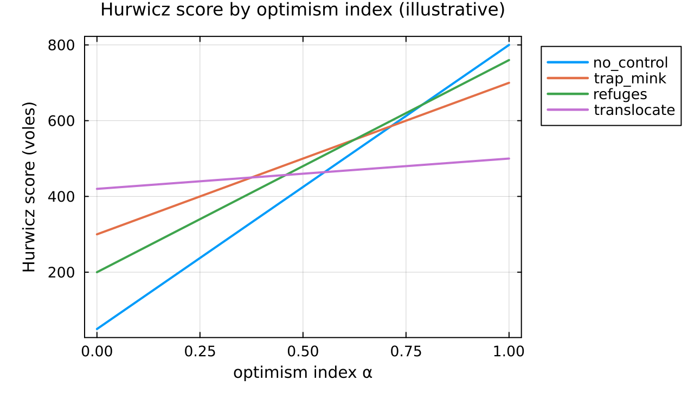

# Decision rules side by side
Simon Frost

- [Motivation](#motivation)
- [The problem](#the-problem)
- [The rules](#the-rules)
- [Why they disagree](#why-they-disagree)
- [Satisficing](#satisficing)
- [Rules that look at the tail](#rules-that-look-at-the-tail)
- [Ties](#ties)
- [What to take away](#what-to-take-away)
- [Next](#next)

## Motivation

Maximising the expected number of individuals is one way to choose. It
needs probabilities for the states, and it is indifferent to how bad the
worst case is. Other rules make other commitments: guard against the
worst state, hope for the best one, treat all states alike, or limit how
much one could come to regret the choice. When the rules agree, the
decision is easy to defend. When they disagree, the disagreement is
itself the result, and it should be reported.

This vignette applies seven rules to one table: expected utility,
maximin, maximax, Hurwicz, Laplace, minimax regret and satisficing.

## The problem

American mink are spreading along a river that holds a colony of water
voles. The manager can do nothing, trap mink, build reed-bed refuges
that give the voles cover, or move part of the colony to a mink-free
site. The outcome is the number of water voles alive in five years,
counting the animals at both sites when some are moved.

The state is how far the mink get: absent from this stretch, transient
visitors, or established.

**All numbers are illustrative**, not data and not estimates for any
real river.

``` julia
using DecisionAnalysis
include(joinpath("..", "_common.jl"))
using Plots

actions = [:no_control, :trap_mink, :refuges, :translocate]
states = [:absent, :transient, :established]
voles = [800 400  50     # no control: fine without mink, a collapse with them
         700 600 300     # trapping: disturbance when there are no mink, protection when there are
         760 480 200     # refuges: cheap in disturbance, partial protection
         500 450 420]    # translocation: losses in the move, then little exposure
payoff = PayoffTable(actions, states, voles)
payoff_markdown(payoff)
```

| action        | `absent` | `transient` | `established` |
|:--------------|---------:|------------:|--------------:|
| `no_control`  |      800 |         400 |            50 |
| `trap_mink`   |      700 |         600 |           300 |
| `refuges`     |      760 |         480 |           200 |
| `translocate` |      500 |         450 |           420 |

The belief is that mink are absent with probability 7/10, transient with
1/5 and established with 1/10 (illustrative). No control is business as
usual and is the baseline.

``` julia
problem = DecisionProblem(payoff, [7 // 10, 1 // 5, 1 // 10]; baseline=:no_control)
```

    DecisionProblem(4 feasible of 4 actions × 3 states, FiniteBelief)

## The rules

Each rule is an aggregator, which turns a row of the table into one
score, followed by a selector, which picks from the scores.
`decide(problem, rule)` returns the scores and the chosen actions.

| rule | score of an action | uses probabilities |
|:---|:---|:---|
| `MaxExpectedUtility()` | expected payoff | yes |
| `Maximin()` | worst payoff over states | no |
| `Maximax()` | best payoff over states | no |
| `DecisionRule(Hurwicz(α))` | α × best + (1 − α) × worst | no |
| `DecisionRule(Laplace())` | unweighted mean over states | no |
| `MinimaxRegret()` | largest regret over states (lower is better) | no |
| `Satisfice(threshold)` | expected payoff, accepted if at least the threshold | yes |

``` julia
rules = ["expected utility" => MaxExpectedUtility(),
         "maximin" => Maximin(),
         "maximax" => Maximax(),
         "Hurwicz, α = 1/2" => DecisionRule(Hurwicz(1 // 2); name=:Hurwicz),
         "Laplace" => DecisionRule(Laplace(); name=:Laplace),
         "minimax regret" => MinimaxRegret()]
results = [name => decide(problem, rule) for (name, rule) in rules]

md_table(vcat("action", first.(results)),
         [vcat(a, [r.scores[i] for (_, r) in results])
          for (i, a) in enumerate(feasible_actions(problem))])
```

| action | expected utility | maximin | maximax | Hurwicz, α = 1/2 | Laplace | minimax regret |
|:---|---:|---:|---:|---:|---:|---:|
| `no_control` | 645 | 50 | 800 | 425 | 416.67 | 370 |
| `trap_mink` | 640 | 300 | 700 | 500 | 533.33 | 120 |
| `refuges` | 648 | 200 | 760 | 480 | 480 | 220 |
| `translocate` | 482 | 420 | 500 | 460 | 456.67 | 300 |

The scores of minimax regret are losses, so the smallest wins. All other
columns are in voles and the largest wins.

``` julia
gain = Dict(zip(feasible_actions(problem), expected_gain_over_baseline(problem)))
md_table(["rule", "first choice", "is the baseline", "expected gain over no control"],
         [[name, first_choice(r), first_choice(r) == problem.baseline,
           gain[first_choice(r)]] for (name, r) in results])
```

| rule | first choice | is the baseline | expected gain over no control |
|:---|---:|---:|---:|
| expected utility | `refuges` | \- | 3 |
| maximin | `translocate` | \- | -163 |
| maximax | `no_control` | yes | 0 |
| Hurwicz, α = 1/2 | `trap_mink` | \- | -5 |
| Laplace | `trap_mink` | \- | -5 |
| minimax regret | `trap_mink` | \- | -5 |

Six rules recommend all four actions between them. The last column gives
the expected gain of each rule’s choice over no control, under the
stated probabilities.

## Why they disagree

**Expected utility** weighs each state by its probability. Mink are
probably absent, so the actions that do well without mink score highly,
and the three leading actions are within eight voles of each other.
Refuges lead by three.

**Maximin** looks only at the worst cell in each row. Translocation has
the best worst case, 420 voles, and is chosen although it has by far the
lowest expectation. It gives up 163 voles in expectation relative to no
control to be safe against established mink.

**Maximax** looks only at the best cell. No control has the best single
outcome, 800 voles when there are no mink.

**Laplace** averages the row as if the states were equally likely. That
gives established mink a weight of 1/3 where the belief gives 1/10,
which favours trapping.

**Minimax regret** asks how far each action can fall short of the best
action for the state that occurs. Trapping is never more than 120 voles
behind. The next vignette takes this rule apart.

**Hurwicz** mixes the best and worst cells with an optimism index α. It
moves from the maximin choice at α = 0 to the maximax choice at α = 1.

``` julia
alphas = 0:(1 // 20):1
scores = [aggregate(Hurwicz(α), problem)[i]
          for α in alphas, i in eachindex(feasible_actions(problem))]
plt = plot(Float64.(alphas), Float64.(scores);
           label=permutedims(String.(feasible_actions(problem))),
           xlabel="optimism index α", ylabel="Hurwicz score (voles)",
           title="Hurwicz score by optimism index (illustrative)")
png_figure(plt)
```



``` julia
md_table(["α", "Hurwicz choice"],
         [[exact(α), decide(problem, DecisionRule(Hurwicz(α))).chosen]
          for α in 0:(1 // 4):1])
```

| α   | Hurwicz choice |
|:----|---------------:|
| 0   |  `translocate` |
| 1/4 |  `translocate` |
| 1/2 |    `trap_mink` |
| 3/4 |      `refuges` |
| 1   |   `no_control` |

Every action is the Hurwicz choice for some α. A rule with a free
parameter that can justify any action needs its parameter fixed before
the table is seen.

## Satisficing

A satisficing rule accepts every action whose score reaches a threshold.
It returns a set, which may hold several actions or none.

``` julia
md_table(["requirement", "accepted actions"],
         [["expected voles at least 600",
           decide(problem, Satisfice(600)).chosen],
          ["expected voles at least 650",
           decide(problem, Satisfice(650)).chosen],
          ["at least 400 voles in every state",
           decide(problem, Satisfice(400; aggregator=WorstCase())).chosen],
          ["never more than 150 voles behind the best action",
           decide(problem,
                  Satisfice(150; aggregator=WorstCase(),
                            transform=RegretTransform())).chosen]])
```

| requirement | accepted actions |
|:---|---:|
| expected voles at least 600 | `no_control`, `trap_mink`, `refuges` |
| expected voles at least 650 | none |
| at least 400 voles in every state | `translocate` |
| never more than 150 voles behind the best action | `trap_mink` |

The second requirement accepts nothing: no action has an expected count
of 650. For that result `first_choice` returns `nothing`.

## Rules that look at the tail

Two more aggregators use the probabilities but concentrate on bad
outcomes. `CVaR(α)` is the expected payoff in the worst α share of the
probability, and `Quantile(α)` is the payoff exceeded with probability
about 1 − α.

``` julia
md_table(["action", "expectation", "CVaR at 1/5", "lower quantile at 1/5"],
         [[a, e, c, q]
          for (a, e, c, q) in zip(feasible_actions(problem),
                                  aggregate(Expectation(), problem),
                                  aggregate(CVaR(1 // 5), problem),
                                  aggregate(Quantile(1 // 5), problem))])
```

| action        | expectation | CVaR at 1/5 | lower quantile at 1/5 |
|:--------------|------------:|------------:|----------------------:|
| `no_control`  |         645 |         225 |                   400 |
| `trap_mink`   |         640 |         450 |                   600 |
| `refuges`     |         648 |         340 |                   480 |
| `translocate` |         482 |         435 |                   450 |

``` julia
first_choice(decide(problem, DecisionRule(CVaR(1 // 5))))
```

    :trap_mink

## Ties

When scores tie, every tied action is returned, in table order, and
`first_choice` is the first of them. Nothing is random. A small
artificial table shows it: the first two actions have the same expected
payoff.

``` julia
tied = DecisionProblem(PayoffTable([:a, :b, :c], [:s1, :s2], [4 0; 0 4; 1 1]),
                       [1 // 2, 1 // 2])
r = decide(tied, MaxExpectedUtility())
r.chosen, first_choice(r)
```

    ([:a, :b], :a)

## What to take away

- `decide(problem, rule)` applies any rule; the named rules are
  `MaxExpectedUtility`, `Maximin`, `Maximax`, `MinimaxRegret` and
  `Satisfice`, and any aggregator makes a rule through `DecisionRule`.
- On this table expected utility chooses refuges, maximin translocation,
  maximax no control, and Laplace and minimax regret trapping. The
  decision is contested, and a report that gave one rule’s answer alone
  would hide that.
- Expected utility needs probabilities. The state-wise rules ignore
  them, which is a strength when probabilities are not credible and a
  weakness when they are.
- Maximin can give up a large expected gain for protection in one state.
  Here it recommends an action with an expected loss of 163 voles
  relative to no control.
- A rule’s choice is only as fixed as its parameters: the Hurwicz index
  and a satisficing threshold must be set in advance.
- Ties are returned in full and broken by table order.

## Next

[Regret](03_regret.md) looks more closely at the regret
table, expected and maximum regret, the link to the value of perfect
information, and a weakness of minimax regret.
