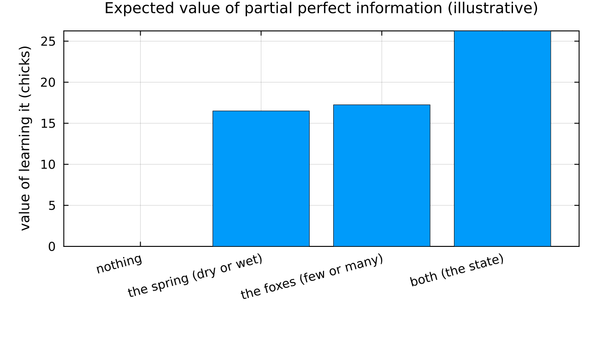

# Partial information: which uncertainty matters
Simon Frost

- [Motivation](#motivation)
- [The problem](#the-problem)
- [Partitions](#partitions)
- [Reading the result](#reading-the-result)
- [A partition need not be a
  component](#a-partition-need-not-be-a-component)
- [EVPPI is the EVSI of a test that reveals the
  cell](#evppi-is-the-evsi-of-a-test-that-reveals-the-cell)
- [What to take away](#what-to-take-away)
- [Next](#next)

## Motivation

The state of the world usually has several components, and research can
resolve one of them without touching the others. The expected value of
partial perfect information (EVPPI) is the value of learning one
component exactly. It ranks uncertainties by what resolving them would
do for the decision, which is not the same as ranking them by how
uncertain they are.

In `DecisionAnalysis.jl`, what is learned is described by a partition of
the states: the manager is told which cell of the partition the state
lies in, and nothing more.

## The problem

Lapwings breed on a wet grassland reserve. Two things are uncertain
about the coming season: whether foxes will be few or many, and whether
the spring will be dry or wet. The manager can leave the site as it is,
put up a predator fence around the main breeding field, or raise the
water level with a sluice. The outcome is the number of chicks fledged.

**All numbers are illustrative**, not data and not estimates for any
real reserve.

The state is a pair (foxes, spring), so there are four states. The
belief over the pairs is built from a joint distribution with
`FiniteKernels.jl`, the package that supplies finite state spaces; a
`FiniteBelief` accepts such a state directly and labels the joint states
by joining the component labels.

``` julia
using DecisionAnalysis
using FiniteKernels: FiniteSpace, tensor_space, state
include(joinpath("..", "_common.jl"))

foxes = FiniteSpace(:foxes, [:few_foxes, :many_foxes])
spring = FiniteSpace(:spring, [:dry, :wet])
joint = state(tensor_space(foxes, spring),
              [3//10 3//10      # few foxes:  dry, wet
               1//4  3//20])    # many foxes: dry, wet
belief = FiniteBelief(joint)
md_table(["state", "probability"],
         [[s, exact(p)] for (s, p) in zip(state_labels(belief), probabilities(belief))])
```

| state            | probability |
|:-----------------|------------:|
| `few_foxes_dry`  |        3/10 |
| `many_foxes_dry` |         1/4 |
| `few_foxes_wet`  |        3/10 |
| `many_foxes_wet` |        3/20 |

Foxes and rainfall are not independent in this belief: a dry spring is a
little more likely when foxes are many.

``` julia
actions = [:no_management, :predator_fence, :raise_water]
chicks = [ 60  20 140  50     # no management
           50  55 120 130     # fence: disturbance when building, protection from foxes
          120  40 110  40]    # raised water: good in a dry spring, floods nests in a wet one
payoff = PayoffTable(actions, state_labels(belief), chicks)
problem = DecisionProblem(payoff, belief; baseline=:no_management)
payoff_markdown(payoff)
```

| action | `few_foxes_dry` | `many_foxes_dry` | `few_foxes_wet` | `many_foxes_wet` |
|:---|---:|---:|---:|---:|
| `no_management` | 60 | 20 | 140 | 50 |
| `predator_fence` | 50 | 55 | 120 | 130 |
| `raise_water` | 120 | 40 | 110 | 40 |

``` julia
result = decide(problem, MaxExpectedUtility())
md_table(["action", "expected chicks", "expected gain over no management", "chosen"],
         [[a, e, g, a in result.chosen]
          for (a, e, g) in zip(actions, aggregate(Expectation(), problem),
                               expected_gain_over_baseline(problem))])
```

| action           | expected chicks | expected gain over no management | chosen |
|:-----------------|----------------:|---------------------------------:|-------:|
| `no_management`  |            72.5 |                                0 |     \- |
| `predator_fence` |           84.25 |                            11.75 |     \- |
| `raise_water`    |              85 |                             12.5 |    yes |

Raising the water is ahead of the fence by three quarters of a chick.
The choice is finely balanced, which is the situation in which
information is most valuable.

## Partitions

A partition has one entry per state. States with equal entries are in
the same cell. Learning the fox component means learning which of two
cells holds the state.

``` julia
by_foxes = [:few, :many, :few, :many]
by_spring = [:dry, :dry, :wet, :wet]
md_table(["state", "cell when foxes are learned", "cell when the spring is learned"],
         [[s, f, w] for (s, f, w) in zip(state_labels(belief), by_foxes, by_spring)])
```

| state | cell when foxes are learned | cell when the spring is learned |
|:---|---:|---:|
| `few_foxes_dry` | `few` | `dry` |
| `many_foxes_dry` | `many` | `dry` |
| `few_foxes_wet` | `few` | `wet` |
| `many_foxes_wet` | `many` | `wet` |

``` julia
nothing_learned = fill(:all, 4)
everything = state_labels(belief)
values = ["nothing" => evppi(problem, nothing_learned),
          "the spring (dry or wet)" => evppi(problem, by_spring),
          "the foxes (few or many)" => evppi(problem, by_foxes),
          "both (the state)" => evppi(problem, everything)]
md_table(["what is learned", "EVPPI in chicks", "share of EVPI"],
         [[name, v, v / evpi(problem)] for (name, v) in values])
```

| what is learned         | EVPPI in chicks | share of EVPI |
|:------------------------|----------------:|--------------:|
| nothing                 |               0 |             0 |
| the spring (dry or wet) |            16.5 |          0.63 |
| the foxes (few or many) |           17.25 |          0.66 |
| both (the state)        |           26.25 |             1 |

The one-cell partition is worth nothing, and the partition into single
states is worth the full EVPI:

``` julia
evppi(problem, nothing_learned) == 0, evppi(problem, everything) == evpi(problem)
```

    (true, true)

``` julia
using Plots
plt = bar(first.(values), Float64.(last.(values)); legend=false, linewidth=0.5,
          ylabel="value of learning it (chicks)", xrotation=15,
          title="Expected value of partial perfect information (illustrative)",
          bottom_margin=10Plots.mm)
png_figure(plt)
```



## Reading the result

Learning the fox numbers is worth 17.25 chicks and learning the spring
16.5. Three points follow.

First, the values do not add. Learning both components is worth 26.25
chicks, less than 17.25 + 16.5 = 33.75. Each component already tells the
manager part of what the other would.

Second, the ranking is about the decision, not about the amount of
uncertainty. The spring is the more uncertain component in the usual
sense: its two outcomes have probabilities 11/20 and 9/20, against 3/5
and 2/5 for the foxes. The foxes are still worth more, because knowing
them changes the action by more.

``` julia
function best_in_cell(partition, cell)
    keep = [s for (s, c) in zip(state_labels(belief), partition) if c == cell]
    return first_choice(decide(restrict_scenarios(problem, keep), MaxExpectedUtility()))
end

md_table(["learned", "best action"],
         [["few foxes", best_in_cell(by_foxes, :few)],
          ["many foxes", best_in_cell(by_foxes, :many)],
          ["dry spring", best_in_cell(by_spring, :dry)],
          ["wet spring", best_in_cell(by_spring, :wet)]])
```

| learned    |      best action |
|:-----------|-----------------:|
| few foxes  |    `raise_water` |
| many foxes | `predator_fence` |
| dry spring |    `raise_water` |
| wet spring | `predator_fence` |

`restrict_scenarios` conditions the belief on the states kept, so each
row is the expected-utility choice of a manager who has been told the
cell.

Third, refining a partition never lowers the value. Any partition is
worth at least nothing and at most EVPI.

## A partition need not be a component

Any grouping of the states is a partition. A field report might say only
whether the season is “ordinary” (few foxes and wet, or many foxes and
dry) or “unusual”.

``` julia
by_report = [:unusual, :ordinary, :ordinary, :unusual]
evppi(problem, by_report)
```

    27//4

## EVPPI is the EVSI of a test that reveals the cell

Learning the cell is the same as running an experiment whose signal is
the cell, with no error. The two functions agree.

``` julia
reveal_foxes = Experiment([1 0 1 0      # signal "few":  certain when foxes are few
                           0 1 0 1];    # signal "many": certain when foxes are many
                          signals=[:few, :many], states=state_labels(belief))
evsi(problem, reveal_foxes) == evppi(problem, by_foxes)
```

    true

A real fox survey would be an experiment with errors, and by the result
of the next vignette it could not be worth more than the 17.25 chicks of
the error-free one.

## What to take away

- `evppi(problem, partition)` is the value of learning which cell of a
  partition holds the state. The partition is a vector with one entry
  per state.
- The trivial partition gives zero and the finest gives `evpi(problem)`.
  Refining never lowers the value.
- Values of separate components do not add up to the value of learning
  both.
- The component worth resolving is the one whose resolution changes the
  action most, which need not be the most uncertain one. Here it is fox
  numbers (17.25 chicks), ahead of the spring (16.5 chicks), although
  the spring is the more uncertain of the two.
- EVPPI is the EVSI of an error-free test of that component, and so an
  upper bound on the value of any real survey of it.

## Next

Real surveys have errors, and there is usually more than one way to run
them. [Comparing
experiments](06_comparing_experiments.md)
asks when one design is better than another for every decision, and what
to do when neither is.
