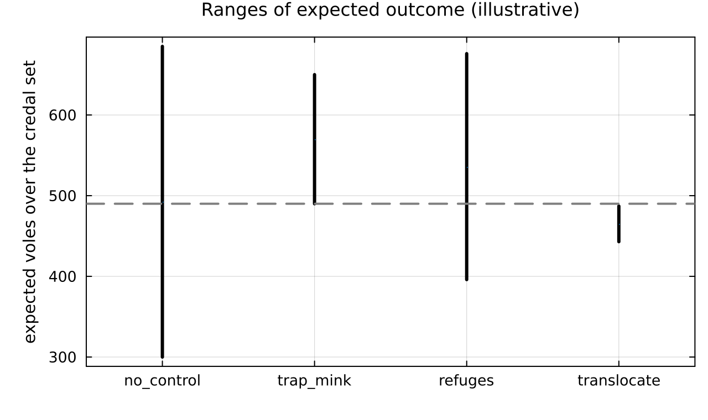

# Uncertain beliefs: sets of priors and scenarios
Simon Frost

- [Motivation](#motivation)
- [The problem](#the-problem)
- [A credal set](#a-credal-set)
- [Rules that choose one action](#rules-that-choose-one-action)
- [Rules that return a set](#rules-that-return-a-set)
  - [E-admissibility is not a check of the stated
    priors](#e-admissibility-is-not-a-check-of-the-stated-priors)
  - [The three sets can differ](#the-three-sets-can-differ)
- [The value of information under a set of
  priors](#the-value-of-information-under-a-set-of-priors)
  - [Information can have negative
    value](#information-can-have-negative-value)
- [Scenarios without probabilities](#scenarios-without-probabilities)
- [Robustness metrics from the same
  pieces](#robustness-metrics-from-the-same-pieces)
- [How far apart are the experts?](#how-far-apart-are-the-experts)
- [What to take away](#what-to-take-away)
- [Next](#next)

## Motivation

A single probability for each state is often more than anyone can
honestly supply. Experts disagree, models disagree, and for some states
nobody will name a number. Two weaker forms of belief cover these cases.

- A `CredalSet` is a set of priors: all the probability vectors that are
  mixtures of a few stated ones. It says “the probabilities are
  somewhere in here”.
- A `ScenarioSet` is a list of states held to be possible, with no
  probabilities.

With a set of priors each action has a range of expected outcomes
instead of one, and several rules compete: some pick one action, others
return the set of actions that cannot be ruled out. The value of
information also changes character, and can be negative. This vignette
goes through all of that on one table.

## The problem

The problem is the water-vole colony of the vignette on decision rules.
Mink may be absent, transient or established, and the manager can do
nothing, trap mink, build refuges, or translocate part of the colony.
Outcomes are water voles alive in five years. **All numbers are
illustrative.**

``` julia
using DecisionAnalysis
include(joinpath("..", "_common.jl"))
using Plots

actions = [:no_control, :trap_mink, :refuges, :translocate]
states = [:absent, :transient, :established]
payoff = PayoffTable(actions, states,
                     [800 400 50; 700 600 300; 760 480 200; 500 450 420])
payoff_markdown(payoff)
```

| action        | `absent` | `transient` | `established` |
|:--------------|---------:|------------:|--------------:|
| `no_control`  |      800 |         400 |            50 |
| `trap_mink`   |      700 |         600 |           300 |
| `refuges`     |      760 |         480 |           200 |
| `translocate` |      500 |         450 |           420 |

Three ecologists give three different probabilities for the mink
(illustrative).

``` julia
experts = [:optimist => [4 // 5, 1 // 10, 1 // 10],
           :moderate => [2 // 5, 2 // 5, 1 // 5],
           :pessimist => [1 // 10, 1 // 2, 2 // 5]]
md_table(vcat("expert", states), [vcat(n, exact.(q)) for (n, q) in experts])
```

| expert      | `absent` | `transient` | `established` |
|:------------|---------:|------------:|--------------:|
| `optimist`  |      4/5 |        1/10 |          1/10 |
| `moderate`  |      2/5 |         2/5 |           1/5 |
| `pessimist` |     1/10 |         1/2 |           2/5 |

Taken one at a time, each expert has an expected-utility choice and an
expected gain over no control.

``` julia
md_table(["expert", "expected-utility choice", "its expected gain over no control", "EVPI"],
         [begin
              single = DecisionProblem(payoff, q; baseline=:no_control)
              [n, first_choice(decide(single, MaxExpectedUtility())),
               maximum(expected_gain_over_baseline(single)), evpi(single)]
          end
          for (n, q) in experts])
```

| expert      | expected-utility choice | its expected gain over no control | EVPI |
|:------------|------------------------:|----------------------------------:|-----:|
| `optimist`  |            `no_control` |                                 0 |   57 |
| `moderate`  |             `trap_mink` |                                90 |   64 |
| `pessimist` |             `trap_mink` |                               190 |   58 |

## A credal set

The credal set is the convex hull of the three priors: every weighted
average of them is also in the set.

``` julia
credal = CredalSet(states, last.(experts))
problem = DecisionProblem(payoff, credal; baseline=:no_control)
```

    DecisionProblem(4 feasible of 4 actions × 3 states, CredalSet)

Each action now has a lower and an upper expected count over the set.
The expectation is linear in the prior, so both ends are reached at one
of the three stated priors.

``` julia
lower = aggregate(LowerExpectation(), problem)
upper = aggregate(UpperExpectation(), problem)
md_table(["action", "lower expectation", "upper expectation"],
         [[a, l, u] for (a, l, u) in zip(actions, lower, upper)])
```

| action        | lower expectation | upper expectation |
|:--------------|------------------:|------------------:|
| `no_control`  |               300 |               685 |
| `trap_mink`   |               490 |               650 |
| `refuges`     |               396 |               676 |
| `translocate` |               443 |               487 |

``` julia
mid = Float64.(lower .+ upper) ./ 2
half = Float64.(upper .- lower) ./ 2
plt = scatter(1:4, mid; yerror=half, xticks=(1:4, String.(actions)), legend=false,
              markersize=0, linewidth=3, xlims=(0.5, 4.5),
              ylabel="expected voles over the credal set",
              title="Ranges of expected outcome (illustrative)")
hline!(plt, [Float64(maximum(lower))]; linestyle=:dash, color=:gray)
png_figure(plt)
```



The dashed line is the largest lower expectation. It is used by two of
the rules below.

An expectation under a credal set is not defined, and the package says
so instead of picking a prior:

``` julia
try
    decide(problem, MaxExpectedUtility())
catch err
    print(sprint(showerror, err))
end
```

    BeliefFormError: Expectation is not defined for a CredalSet: it needs a single prior; use LowerExpectation, UpperExpectation or AlphaMaxmin over the set

## Rules that choose one action

**Γ-maximin** maximises the lower expectation: the best guaranteed
expected outcome.

``` julia
gamma = decide(problem, GammaMaximin())
first_choice(gamma), maximum(gamma.scores)
```

    (:trap_mink, 490//1)

**α-maxmin** mixes the lower and upper expectations, with weight `α` on
the lower one. `AlphaMaxmin(1)` is Γ-maximin and `AlphaMaxmin(0)`
maximises the upper expectation. (The index of `Hurwicz` goes the other
way: it puts its weight on the best state.)

``` julia
md_table(["α (weight on the lower expectation)", "choice"],
         [[exact(α), decide(problem, DecisionRule(AlphaMaxmin(α))).chosen]
          for α in 0:(1 // 4):1])
```

| α (weight on the lower expectation) |       choice |
|:------------------------------------|-------------:|
| 0                                   | `no_control` |
| 1/4                                 |  `trap_mink` |
| 1/2                                 |  `trap_mink` |
| 3/4                                 |  `trap_mink` |
| 1                                   |  `trap_mink` |

The gain over no control has a range too. `gain_over_baseline` needs no
prior, so the table of gains can be given the same credal set.

``` julia
gains = DecisionProblem(gain_over_baseline(problem), credal)
md_table(["action", "lowest expected gain over no control", "highest expected gain"],
         [[a, l, u]
          for (a, l, u) in zip(actions, aggregate(LowerExpectation(), gains),
                               aggregate(UpperExpectation(), gains))])
```

| action        | lowest expected gain over no control | highest expected gain |
|:--------------|-------------------------------------:|----------------------:|
| `no_control`  |                                    0 |                     0 |
| `trap_mink`   |                                  -35 |                   190 |
| `refuges`     |                                   -9 |                    96 |
| `translocate` |                                 -198 |                   143 |

Trapping gains between −35 and 190 voles over no control, depending on
which prior in the set is right. Every intervention has an expected gain
that is negative under the optimist’s prior and positive under the
pessimist’s: whether to intervene at all is what the experts disagree
about.

## Rules that return a set

Three rules do not pick a winner. They discard the actions that can be
ruled out and return the rest.

- **E-admissible**: optimal under at least one prior in the set.
- **Maximal**: no other action is better under every prior in the set.
- **Interval dominance**: its upper expectation reaches the largest
  lower expectation.

Every E-admissible action is maximal, and every maximal action passes
interval dominance, so the sets are nested.

``` julia
sets = ["E-admissible" => decide(problem, EAdmissible()),
        "maximal" => decide(problem, Maximal()),
        "interval dominance" => decide(problem, IntervalDominance())]
md_table(["rule", "actions kept"], [[n, r.chosen] for (n, r) in sets])
```

| rule               |                         actions kept |
|:-------------------|-------------------------------------:|
| E-admissible       | `no_control`, `trap_mink`, `refuges` |
| maximal            | `no_control`, `trap_mink`, `refuges` |
| interval dominance | `no_control`, `trap_mink`, `refuges` |

Translocation is ruled out by all three: its best expected outcome over
the set, 487 voles, is below the 490 that trapping guarantees.

### E-admissibility is not a check of the stated priors

No expert, taken alone, chooses refuges: the table above shows the
optimist choosing no control and the other two trapping. Refuges are
E-admissible all the same, because they are optimal under a prior
*between* the experts. `decide` finds such a prior by linear programme
and returns it, with the weights on the stated priors that produce it.

``` julia
e = decide(problem, EAdmissible())
md_table(vcat("action", "weights on the three experts", "witness prior"),
         [[a, join(exact.(e.details.weights[a]), ", "),
           join(exact.(e.details.witnesses[a]), ", ")] for a in e.chosen])
```

| action       | weights on the three experts |           witness prior |
|:-------------|-----------------------------:|------------------------:|
| `no_control` |               46/55, 9/55, 0 | 202/275, 41/275, 32/275 |
| `trap_mink`  |              22/35, 13/35, 0 | 114/175, 37/175, 24/175 |
| `refuges`    |              22/35, 13/35, 0 | 114/175, 37/175, 24/175 |

``` julia
witness = e.details.witnesses[:refuges]
at_witness = DecisionProblem(payoff, witness)
aggregate(Expectation(), at_witness), decide(at_witness, MaxExpectedUtility()).chosen
```

    (Rational{BigInt}[4288//7, 624, 624, 16746//35], [:trap_mink, :refuges])

At that prior refuges tie for the best. Checking only the three stated
priors would have missed them.

### The three sets can differ

Add a fifth action: half the traps and half the refuges, which does
slightly worse in every state than the average of the two full measures.

``` julia
payoff5 = PayoffTable(vcat(actions, :half_measures), states,
                      vcat(payoff.Q, [725 535 245]))
problem5 = DecisionProblem(payoff5, credal; baseline=:no_control)
md_table(["rule", "actions kept"],
         [["E-admissible", decide(problem5, EAdmissible()).chosen],
          ["maximal", decide(problem5, Maximal()).chosen],
          ["interval dominance", decide(problem5, IntervalDominance()).chosen]])
```

| rule               |                                          actions kept |
|:-------------------|------------------------------------------------------:|
| E-admissible       |                  `no_control`, `trap_mink`, `refuges` |
| maximal            | `no_control`, `trap_mink`, `refuges`, `half_measures` |
| interval dominance | `no_control`, `trap_mink`, `refuges`, `half_measures` |

The half measures are never the best action under any prior in the set,
so they are not E-admissible. They are maximal, because no single other
action beats them under every prior. Interval dominance keeps the same
four actions here; in general it keeps at least the maximal ones and
often more. Which set to report depends on what “cannot be ruled out” is
meant to mean.

## The value of information under a set of priors

With several priors there are two different things that “the value of
perfect information” can mean, and `robust_evpi` returns both.

``` julia
v = robust_evpi(problem)
md_table(["quantity", "voles"],
         [["Γ-maximin value of acting now", v.act_now],
          ["Γ-maximin value with perfect information", v.informed],
          ["rule-specific EVPI (the difference)", v.value],
          ["EVPI under each expert's prior", join(fmt.(v.members), ", ")],
          ["smallest EVPI over the credal set", v.lower],
          ["largest EVPI over the credal set", v.upper]])
```

| quantity                                 |      voles |
|:-----------------------------------------|-----------:|
| Γ-maximin value of acting now            |        490 |
| Γ-maximin value with perfect information |        548 |
| rule-specific EVPI (the difference)      |         58 |
| EVPI under each expert’s prior           | 57, 64, 58 |
| smallest EVPI over the credal set        |         57 |
| largest EVPI over the credal set         |      84.63 |

The rule-specific value is what perfect information is worth to a
Γ-maximin decision-maker. The envelope is the range of the ordinary
single-prior EVPI as the prior moves over the set. The largest value is
above the EVPI of every expert: it is reached at a prior between them,
and is found by linear programme.

For a survey, `robust_evsi` gives the rule-specific value and the
single-prior EVSI of each stated prior. Take a search for field signs of
mink, which a Γ-maximin manager values at 3.7 voles:

``` julia
signs = Experiment([9//10 1//2 1//10; 1//10 1//2 9//10];
                   signals=[:no_sign, :sign], states=states)
s = robust_evsi(problem, signs)
md_table(["quantity", "voles"],
         [["Γ-maximin value of acting now", s.act_now],
          ["Γ-maximin value of surveying first", s.informed],
          ["rule-specific EVSI", s.value],
          ["EVSI under each expert's prior", join(fmt.(s.members), ", ")]])
```

| quantity                           |        voles |
|:-----------------------------------|-------------:|
| Γ-maximin value of acting now      |          490 |
| Γ-maximin value of surveying first |        493.7 |
| rule-specific EVSI                 |          3.7 |
| EVSI under each expert’s prior     | 24.5, 0, 3.7 |

### Information can have negative value

Under a single prior, information is never harmful: EVSI is at least
zero. Under a set of priors that guarantee is lost. The package returns
the value as computed and never rounds a negative value up to zero.

An example. Mink are present on this stretch with probability 1/2:
everyone agrees on that. A neighbouring catchment may or may not have
mink, and nobody is willing to put a probability on it. So the credal
set has two extreme priors, one in which the neighbouring catchment
certainly has no mink and one in which it certainly has. A ranger’s note
arrives that says only whether the two catchments have the *same* status
or a *different* one.

``` julia
states2 = [:neither, :here_only, :there_only, :both]
payoff2 = PayoffTable([:no_control, :trap_mink, :translocate], states2,
                      [800  50 800  50      # the outcome depends only on mink here
                       700 300 700 300
                       450 420 450 420])
credal2 = CredalSet(states2, [[1 // 2, 1 // 2, 0, 0],      # no mink in the other catchment
                              [0, 0, 1 // 2, 1 // 2]])     # mink in the other catchment
note = Experiment([1 0 0 1      # "same":      neither, or both
                   0 1 1 0];    # "different": here only, or there only
                  signals=[:same, :different], states=states2)
problem2 = DecisionProblem(payoff2, credal2; baseline=:no_control)
n = robust_evsi(problem2, note)
md_table(["quantity", "voles"],
         [["Γ-maximin choice now", first_choice(decide(problem2, GammaMaximin()))],
          ["Γ-maximin value of acting now", n.act_now],
          ["Γ-maximin value of reading the note first", n.informed],
          ["rule-specific EVSI", n.value],
          ["EVSI under each extreme prior", join(fmt.(n.members), ", ")]])
```

| quantity                                  |       voles |
|:------------------------------------------|------------:|
| Γ-maximin choice now                      | `trap_mink` |
| Γ-maximin value of acting now             |         500 |
| Γ-maximin value of reading the note first |         435 |
| rule-specific EVSI                        |         -65 |
| EVSI under each extreme prior             |    110, 110 |

Before the note, the probability of mink here is 1/2 under every prior
in the set, and the Γ-maximin choice is to trap, with a guaranteed
expectation of 500 voles. After the note, whichever way it reads, the
probability of mink here is anything from 0 to 1, because its meaning
depends on the unknown status of the other catchment. This is
*dilation*. Faced with that, Γ-maximin retreats to translocation after
either reading, and the plan “read the note, then act” is worth 435
voles: 65 fewer than not reading it. Each extreme prior, taken alone,
values the note at 110 voles. A Γ-maximin manager would prefer not to be
told.

The lesson is not that surveys are harmful. It is that “more information
is always better” is a theorem about single priors, and that a robust
rule applied after the fact need not form the plan the same rule would
have chosen in advance.

## Scenarios without probabilities

A `ScenarioSet` lists the states held possible. The state-wise rules
then range over those states only, and regret is measured within them.
Suppose mink have been seen upstream, so “absent” is no longer a
scenario.

``` julia
all_states = DecisionProblem(payoff, ScenarioSet(states); baseline=:no_control)
seen = DecisionProblem(payoff, ScenarioSet([:transient, :established]);
                       baseline=:no_control)
statewise = ["maximin" => Maximin(), "maximax" => Maximax(),
             "Laplace" => DecisionRule(Laplace()), "minimax regret" => MinimaxRegret()]
md_table(["rule", "all three states", "mink seen upstream"],
         [[n, first_choice(decide(all_states, r)), first_choice(decide(seen, r))]
          for (n, r) in statewise])
```

| rule           | all three states | mink seen upstream |
|:---------------|-----------------:|-------------------:|
| maximin        |    `translocate` |      `translocate` |
| maximax        |     `no_control` |        `trap_mink` |
| Laplace        |      `trap_mink` |        `trap_mink` |
| minimax regret |      `trap_mink` |        `trap_mink` |

Rules that need probabilities are not defined for a scenario set, and
the value of information is not defined either.

``` julia
try
    evpi(seen)
catch err
    print(sprint(showerror, err))
end
```

    BeliefFormError: evpi is not defined for a ScenarioSet: a scenario set carries no probabilities; supply a FiniteBelief

## Robustness metrics from the same pieces

A rule is a transform of the table (none, regret or relative regret), a
subset of scenarios, an aggregator and a selector. The first three
without the selector are a `RobustnessMetric`: a score per action that
can be tabulated without choosing. Named metrics exist for the common
cases and any combination can be written down.

``` julia
metrics = ["worst case, `maximin_metric()`" => maximin_metric(),
           "best case, `maximax_metric()`" => maximax_metric(),
           "Hurwicz at 1/2, `hurwicz_metric(1 // 2)`" => hurwicz_metric(1 // 2),
           "mean over states, `laplace_metric()`" => laplace_metric(),
           "largest regret, `minimax_regret_metric()`" => minimax_regret_metric(),
           "largest regret, mink seen upstream" =>
               minimax_regret_metric(; scenarios=[:transient, :established]),
           "largest expected regret over the priors" =>
               RobustnessMetric(LowerExpectation(); transform=RegretTransform()),
           "lowest expected voles over the priors" =>
               RobustnessMetric(LowerExpectation())]
md_table(vcat("metric", actions),
         [vcat(n, robustness(problem, m)) for (n, m) in metrics])
```

| metric | `no_control` | `trap_mink` | `refuges` | `translocate` |
|:---|---:|---:|---:|---:|
| worst case, `maximin_metric()` | 50 | 300 | 200 | 420 |
| best case, `maximax_metric()` | 800 | 700 | 760 | 500 |
| Hurwicz at 1/2, `hurwicz_metric(1 // 2)` | 425 | 500 | 480 | 460 |
| mean over states, `laplace_metric()` | 416.67 | 533.33 | 480 | 456.67 |
| largest regret, `minimax_regret_metric()` | 370 | 120 | 220 | 300 |
| largest regret, mink seen upstream | 370 | 120 | 220 | 150 |
| largest expected regret over the priors | 248 | 92 | 152 | 255 |
| lowest expected voles over the priors | 300 | 490 | 396 | 443 |

Metrics on a regret table are losses: lower is better, and the “lower
expectation” of a loss is its worst case over the priors, the largest
expected regret. Putting a selector on a metric makes it a rule again:

``` julia
rule = DecisionRule(RobustnessMetric(LowerExpectation(); transform=RegretTransform());
                    name=:MinimaxExpectedRegret)
first_choice(decide(problem, rule))
```

    :trap_mink

## How far apart are the experts?

`total_variation` is the distance between two beliefs, half the sum of
the absolute differences. `decision_loss_bound(B, ε)` bounds what can be
lost by deciding under a belief that is within total-variation distance
`ε` of the right one, when the payoffs span a range `B`: at most
`2 B ε`.

``` julia
B = maximum(payoff.Q) - minimum(payoff.Q)
optimist, moderate = last(experts[1]), last(experts[2])
ε = total_variation(optimist, moderate)

choice = first_choice(decide(DecisionProblem(payoff, optimist), MaxExpectedUtility()))
truth = DecisionProblem(payoff, moderate)
actual = act_now_value(truth) -
         aggregate(Expectation(), truth)[findfirst(==(choice), actions)]

md_table(["quantity", "value"],
         [["range of the payoffs, B", B],
          ["distance between optimist and moderate, ε", exact(ε)],
          ["bound on the loss, 2 B ε", decision_loss_bound(B, ε)],
          ["actual loss from acting on the optimist's prior when the moderate is right",
           actual]])
```

| quantity | value |
|:---|---:|
| range of the payoffs, B | 750 |
| distance between optimist and moderate, ε | 2/5 |
| bound on the loss, 2 B ε | 600 |
| actual loss from acting on the optimist’s prior when the moderate is right | 90 |

The bound holds for any table with that range, so it is loose for this
one. It is of most use when `ε` is small, for example when a belief has
been rounded or comes from an approximate model: a distance of 1/100
bounds the loss here at `decision_loss_bound(750, 1 // 100)` = 15 voles.

## What to take away

- A `CredalSet` is a set of priors and a `ScenarioSet` a set of possible
  states. An operation that needs a single prior throws
  `BeliefFormError` on either; it never picks a prior for you.
- `GammaMaximin` maximises the lower expectation and
  `DecisionRule(AlphaMaxmin(α))` mixes lower and upper. `AlphaMaxmin`
  puts `α` on the lower expectation; `Hurwicz` puts its index on the
  best state.
- `EAdmissible`, `Maximal` and `IntervalDominance` return nested sets of
  actions that cannot be ruled out. E-admissibility is decided over the
  whole set of priors, and can admit an action that no stated prior
  chooses.
- `robust_evpi` and `robust_evsi` keep the rule-specific value apart
  from the range of single-prior values. The rule-specific value of a
  survey can be negative, and is reported as such.
- A `RobustnessMetric` is a transform, a scenario subset and an
  aggregator; adding a selector makes a `DecisionRule`.
- Under every prior in the set considered here, the choice lies between
  no control, trapping and refuges. Translocation is ruled out by all
  three set-valued rules.

## Next

[Several objectives](08_several_objectives.md)
keeps the single prior and instead declines to combine two outcomes into
one number.
