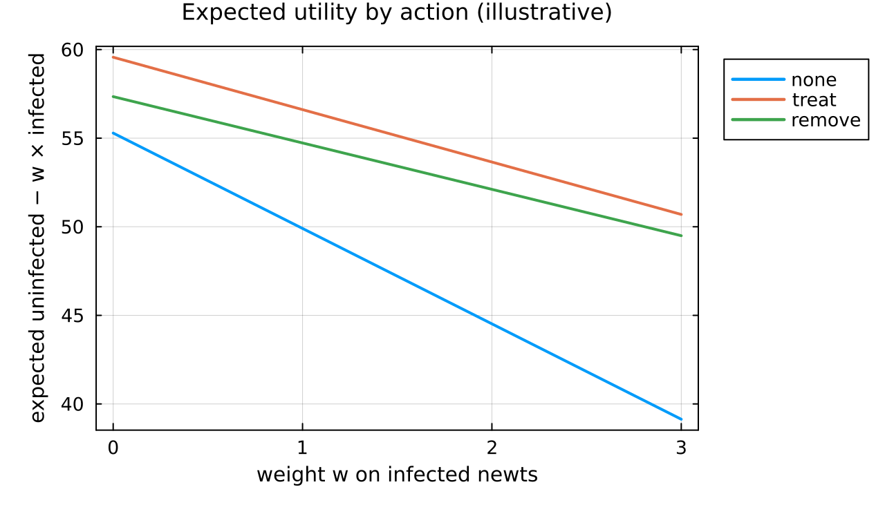

# Sample beliefs and outcome tables
Simon Frost

- [Motivation](#motivation)
- [The problem](#the-problem)
- [The model and the four adapter
  verbs](#the-model-and-the-four-adapter-verbs)
- [A sample belief](#a-sample-belief)
- [An outcome table](#an-outcome-table)
  - [From a table of runs](#from-a-table-of-runs)
- [Utilities counted in animals](#utilities-counted-in-animals)
- [The decision](#the-decision)
  - [Rules on a sample](#rules-on-a-sample)
  - [The weight on infected animals](#the-weight-on-infected-animals)
- [Value of information from a
  sample](#value-of-information-from-a-sample)
- [The report](#the-report)
- [What to take away](#what-to-take-away)
- [Next](#next)

## Motivation

The first ten vignettes worked with a handful of named states and exact
probabilities. Most models are not like that. Their uncertain parameters
are continuous, a belief about them is a set of **draws** (from a
posterior, or from an elicited prior), and the model is a simulator that
returns a different outcome each time it is run.

This vignette takes a decision problem from a simulator to a decision in
four steps:

1.  a `SampleBelief`: draws of named parameters, with weights;
2.  an `OutcomeTable`: what the model produced for every draw, action
    and replicate;
3.  a utility counted in animals, which turns outcomes into a
    `PayoffTable` whose Monte Carlo standard errors are kept in a
    separate field;
4.  the rules and the value of information of the earlier vignettes, now
    as **estimates**, each reported with its standard error.

**All numbers are illustrative.** The model is a toy, and its parameter
values are not estimates for any real species or site.

## The problem

A fungal skin disease has reached a pond of newts. One infected animal
has been found. The manager can mount one intervention, in week 3, or
none:

- `none`: no intervention, the baseline;
- `treat`: catch 70% of the newts and bathe them in an antifungal. An
  infected newt is cured; handling kills 8% of the animals caught;
- `remove`: catch 70% of the newts and remove those that test positive:
  every infected newt caught and, through false positives, 12% of the
  uninfected ones.

Three things are uncertain: the weekly transmission rate (`contact`),
the number of newts in the pond (`newts`), and whether the pond is open
or shaded (`habitat`; warm water in an open pond clears infections
faster).

## The model and the four adapter verbs

`DecisionAnalysis.jl` never looks inside a model. It reaches it through
four verbs, which a model package (or, here, a script) gives methods
for:

| verb | meaning |
|:---|:---|
| `with_parameters(prob, θ)` | the problem with its uncertain parameters set to one draw |
| `apply_action(prob, a)` | the problem under an intervention |
| `simulate(prob; rng)` | one run, with every random number taken from `rng` |
| `outcome(solution)` | the named outcomes of the run, as counts |

The toy model is in `vignettes/_toy_pond.jl`, shared with the next two
vignettes:

``` julia
using DecisionAnalysis
using Random: Xoshiro
include(joinpath("..", "_common.jl"))
include(joinpath("..", "_toy_pond.jl"))
println("```julia\n", read(joinpath("..", "_toy_pond.jl"), String), "```")
```

``` julia
# A toy stochastic model of a fungal disease in a pond of newts, used by the
# sample-based vignettes. All numbers are illustrative. The model is reached by
# DecisionAnalysis through four adapter verbs only.

using DecisionAnalysis
using Random: AbstractRNG

"""
A pond: `newts` animals, one of them infected at the start; `contact` is the weekly
transmission rate, `open` says whether the pond is unshaded (warm water clears
infections faster), and `action` is the management applied in week 3.
"""
Base.@kwdef struct ToyPond
    newts::Int = 60
    contact::Float64 = 0.5
    open::Bool = false
    action::Symbol = :none
    weeks::Int = 12
end

# Uncertain parameters come from one row of the draws.
function DecisionAnalysis.with_parameters(pond::ToyPond, θ)
    return ToyPond(; newts=θ.newts, contact=θ.contact, open=θ.habitat == "open",
                   action=pond.action, weeks=pond.weeks)
end

# An action is an intervention in week 3:
#   :none    no intervention (the baseline);
#   :treat   catch 70% of the newts and bathe them in antifungal: an infected newt is
#            cured, and handling kills 8% of the newts caught;
#   :remove  catch 70% of the newts and remove those that test positive: every
#            infected newt caught, and 12% of the uninfected ones (false positives).
function DecisionAnalysis.apply_action(pond::ToyPond, action::Symbol)
    action in (:none, :treat, :remove) || throw(ArgumentError("unknown action $action"))
    return ToyPond(; newts=pond.newts, contact=pond.contact, open=pond.open, action,
                   weeks=pond.weeks)
end

binomial(rng::AbstractRNG, n::Integer, p::Real) = count(_ -> rand(rng) < p, 1:n)

# One run: a chain-binomial epidemic in weekly steps. Every random number comes from
# `rng`, so two actions run with the same generator see the same epidemic until week 3.
function DecisionAnalysis.simulate(pond::ToyPond; rng::AbstractRNG)
    S, I = pond.newts - 1, 1
    handled = 0
    for week in 1:(pond.weeks)
        if week == 3 && pond.action !== :none
            caught_S, caught_I = binomial(rng, S, 0.7), binomial(rng, I, 0.7)
            handled = caught_S + caught_I
            if pond.action === :treat
                dead_S, dead_I = binomial(rng, caught_S, 0.08),
                                 binomial(rng, caught_I, 0.08)
                S += (caught_I - dead_I) - dead_S
                I -= caught_I
            else
                S -= binomial(rng, caught_S, 0.12)
                I -= caught_I
            end
        end
        N = S + I
        N == 0 && break
        infections = binomial(rng, S, 1 - exp(-pond.contact * I / N))
        deaths = binomial(rng, I, 0.25)
        recoveries = binomial(rng, I - deaths, pond.open ? 0.35 : 0.05)
        S += recoveries - infections
        I += infections - deaths - recoveries
    end
    return (; uninfected=S, infected=I, handled)
end

# The named outcomes of a run: counts of animals, not utilities.
function DecisionAnalysis.outcome(run::NamedTuple)
    return (; uninfected=run.uninfected,
            infected=run.infected,
            alive=run.uninfected + run.infected,
            handled=run.handled)
end

"Draws of the uncertain parameters: an illustrative prior, not an estimate."
function toy_draws(rng::AbstractRNG, n::Integer)
    return (; contact=exp.(log(0.45) .+ 0.7 .* randn(rng, n)), newts=rand(rng, 30:120, n),
            habitat=[rand(rng) < 0.35 ? "open" : "shaded" for _ in 1:n])
end

const TOY_ACTIONS = [:none, :treat, :remove]
```

Outcomes are counts of animals. No utility has been applied yet, and no
cost appears anywhere: this package counts individuals, never money.

## A sample belief

A `SampleBelief` is a table of draws, one row per draw and one column
per named parameter, with weights. Equal weights are the default and are
held exactly, as `1 // n`.

``` julia
draws = toy_draws(Xoshiro(11), 300)
belief = SampleBelief(draws)
```

    SampleBelief(300 draws, parameters contact, newts, habitat, effective sample size 300.0)

``` julia
md_table(["draw", "contact", "newts", "habitat", "weight"],
         [[s, draws.contact[i], draws.newts[i], draws.habitat[i],
           exact(probabilities(belief)[i])] for (i, s) in enumerate(state_labels(belief)[1:5])];
         digits=3)
```

| draw | contact | newts | habitat | weight |
|:-----|--------:|------:|--------:|-------:|
| `s1` |   0.348 |    45 |    open |  1/300 |
| `s2` |   0.278 |    90 |  shaded |  1/300 |
| `s3` |    0.35 |    72 |  shaded |  1/300 |
| `s4` |   0.283 |    92 |    open |  1/300 |
| `s5` |   0.202 |    71 |  shaded |  1/300 |

Weights need not be equal. A weighted sample has fewer effective draws
than rows:

``` julia
weighted = SampleBelief((; contact=[0.2, 0.5, 0.9], weight=[1, 1, 6]); weights=:weight)
(probabilities(weighted), effective_sample_size(weighted))
```

    (Rational{Int64}[1//8, 1//8, 3//4], 32//19)

## An outcome table

`outcomes` runs the model over draws × actions × replicates. Each draw
is propagated on its own; the mean of the parameters is never plugged
in.

``` julia
table = outcomes(ToyPond(), TOY_ACTIONS, belief; replicates=20, seed=2026)
```

    OutcomeTable(300 draws × 3 actions × 20 replicates; outcomes uninfected, infected, alive, handled; 18000 runs ok, 0 failed, 0 absent)

``` julia
run_counts(table)
```

    (runs = 18000, ok = 18000, failed = 0, absent = 0)

The `seed` is required. The run of replicate `r` at draw `d` gets a
generator whose seed depends on `(seed, d, r)` and **not on the
action**: these are common random numbers. Two actions in the same cell
see the same epidemic up to week 3, so their difference is not blurred
by luck. The achieved correlation of the simulation noise between
actions says how well this worked:

``` julia
alive = IndividualsUtility(:alive)
crn_correlation(table, alive)
```

    0.6391914962593434

A simulator that draws from one stream in event order loses this
correlation once the runs diverge. An individual-based model keeps it
longer by giving every individual its own stream derived from `rng`.

### From a table of runs

Runs made elsewhere go in directly. Any table with one row per run will
do; the keywords name its columns. A run with a failing status is **kept
and counted**, never silently dropped, and is left out of the means.

``` julia
runs = [(; point=d, arm=a, rep=r, status=(d == 2 && a == "treat" && r == 3) ? "timeout" : "ok",
         alive=40 + 5d + 3 * (a == "treat") + r) for d in 1:3 for a in ("none", "treat") for r in 1:4]
precomputed = OutcomeTable(runs; draw=:point, action=:arm, replicate=:rep,
                           outcomes=[:alive], status=:status)
```

    OutcomeTable(3 draws × 2 actions × 4 replicates; outcomes alive; 23 runs ok, 1 failed, 0 absent)

``` julia
failed_runs(precomputed)
```

    1-element Vector{@NamedTuple{action::Symbol, draw::Symbol, replicate::Symbol, status::String}}:
     (action = :treat, draw = Symbol("2"), replicate = Symbol("3"), status = "timeout")

## Utilities counted in animals

A utility maps the outcomes of one run to a number. Three are shown
here.

- `IndividualsUtility(:alive)`: every surviving newt counts, infected or
  not.
- `InfectionUtility(; weight=0)`: only uninfected newts count.
- `InfectionUtility(; weight=1)`: uninfected minus infected. An infected
  survivor is set against an uninfected one, because it is a source of
  further infection.

Whether an infected but living animal counts towards the population is a
modelling choice. It is stated here, and the weight on infected animals
is swept below.

`payoff_table` applies the utility to every run and averages inside each
cell, so a cell holds a **conditional expected utility**. The standard
error of each cell is kept in its own field and is never folded into the
payoff.

``` julia
payoff = payoff_table(table, alive)
md_table(["action", "payoff at draw 1", "standard error", "payoff at draw 2", "standard error"],
         [[a, Float64(payoff.Q[i, 1]), payoff.standard_errors[i, 1], Float64(payoff.Q[i, 2]),
           payoff.standard_errors[i, 2]] for (i, a) in enumerate(action_labels(payoff))])
```

| action   | payoff at draw 1 | standard error | payoff at draw 2 | standard error |
|:---------|-----------------:|---------------:|-----------------:|---------------:|
| `none`   |             43.6 |           0.59 |             86.1 |           0.73 |
| `treat`  |             41.7 |           0.44 |            83.95 |           0.65 |
| `remove` |            39.75 |           0.53 |            80.75 |           0.63 |

With one run per cell there is nothing to average. The table is then
flagged, and no standard error is invented:

``` julia
one_run = outcomes(ToyPond(), TOY_ACTIONS, belief; replicates=1, seed=2026)
flagged = payoff_table(one_run, alive)
(single_replicate(flagged), flagged.standard_errors === nothing)
```

    (true, true)

A flagged table holds single outcomes, not conditional expectations.
Every maximum taken over it is a maximum over noise, so the best
reported value and the value with information are each too high.

## The decision

``` julia
problem = DecisionProblem(table, alive; baseline=:none)
```

    DecisionProblem(3 feasible of 3 actions × 300 states, SampleBelief)

Expected utility is now an estimate. `expected_utility_estimates` gives
it with two errors: the standard error when the draws are a random
sample of the belief, and the part that comes from the simulator alone,
with the draws held fixed.

``` julia
md_table(["action", "expected newts alive", "standard error", "simulation only"],
         [[e.action, Float64(e.value), e.standard_error, e.simulation_error]
          for e in expected_utility_estimates(problem)])
```

| action   | expected newts alive | standard error | simulation only |
|:---------|---------------------:|---------------:|----------------:|
| `none`   |                60.67 |           1.63 |            0.13 |
| `treat`  |                62.52 |           1.48 |            0.13 |
| `remove` |                59.96 |           1.44 |            0.12 |

The actions are close, and the standard errors are large beside the
differences. That comparison is misleading, because the three actions
were run on the same draws with the same random numbers. The right error
for a difference is the error of the paired difference. `payoff_table`
with a `baseline` computes the gain of each action over no intervention
replicate by replicate:

``` julia
gains = DecisionProblem(payoff_table(table, alive; baseline=:none), belief)
md_table(["action", "expected gain over no intervention", "standard error", "simulation only"],
         [[e.action, Float64(e.value), e.standard_error, e.simulation_error]
          for e in expected_utility_estimates(gains)])
```

| action   | expected gain over no intervention | standard error | simulation only |
|:---------|-----------------------------------:|---------------:|----------------:|
| `none`   |                                  0 |              0 |               0 |
| `treat`  |                               1.85 |            0.4 |            0.14 |
| `remove` |                              -0.71 |            0.4 |            0.13 |

Treatment gains about two newts on average, and the gain is several
standard errors from zero.

### Rules on a sample

The rules of the earlier vignettes apply unchanged. A sample is a single
prior.

``` julia
rules = ["expected utility" => MaxExpectedUtility(),
         "CVaR, worst 20%" => DecisionRule(CVaR(0.2)),
         "lower quartile" => DecisionRule(Quantile(0.25)), "maximin" => Maximin(),
         "minimax regret" => MinimaxRegret()]
md_table(["rule", "first choice", "score of the choice"],
         [[name, first_choice(decide(problem, rule)),
           Float64(decide(problem, rule).scores[findfirst(==(first_choice(decide(problem, rule))),
                                                          action_labels(problem))])]
          for (name, rule) in rules])
```

| rule             | first choice | score of the choice |
|:-----------------|-------------:|--------------------:|
| expected utility |      `treat` |               62.52 |
| CVaR, worst 20%  |      `treat` |               28.15 |
| lower quartile   |      `treat` |                40.8 |
| maximin          |      `treat` |                 5.3 |
| minimax regret   |      `treat` |                 6.7 |

The worst case over a sample is the worst draw that happened to be
sampled. A larger sample can only make it worse. The result says so:

``` julia
decide(problem, Maximin()).details.sample_note
```

    "The worst and best cases are taken over the draws in the sample, whatever their weights, so this score depends on which draws were sampled: a larger sample can only make the worst case worse and the best case better."

Operations that have no meaning for a sample throw `BeliefFormError`. An
unweighted mean over draws ignores their weights:

``` julia
try
    aggregate(Laplace(), problem)
catch err
    sprint(showerror, err)
end
```

    "BeliefFormError: Laplace is not defined for a SampleBelief: an unweighted mean over the draws ignores their weights; use Expectation"

### The weight on infected animals

The infection utility is uninfected − w × infected. Expected utility is
linear in w, so the values of w at which the choice changes are found
exactly, not on a grid.

``` julia
uninfected = individuals_payoff(table, :uninfected)
infected = individuals_payoff(table, :infected)
base = DecisionProblem(uninfected, belief; baseline=:none)
regions = policy_regions(base, -infected; from=0, to=3)
md_table(["from w", "to w", "best action"],
         [[Float64(r.from), Float64(r.to), r.actions] for r in regions])
```

| from w | to w | best action |
|:-------|-----:|------------:|
| 0      |    3 |     `treat` |

``` julia
sweep = weight_sweep(w -> DecisionProblem(table, InfectionUtility(; weight=w); baseline=:none),
                     0:0.25:3)
plt = Plots.plot(; xlabel="weight w on infected newts", ylabel="expected uninfected − w × infected",
                 title="Expected utility by action (illustrative)")
for (i, a) in enumerate(TOY_ACTIONS)
    Plots.plot!(plt, [row.weight for row in sweep], [Float64(row.scores[i]) for row in sweep];
                label=String(a))
end
png_figure(plt)
```



## Value of information from a sample

`evpi(problem)` applies the definition to the sample. Called with a
method, `evpi` returns the same number with its Monte Carlo error and
its two selection biases beside it, never folded in.

``` julia
plain = evpi(problem, SampleAverage(); noise_correlation=crn_correlation(table, alive))
regression = evpi(problem, SplineRegression())
voi_table(["EVPI, plain sample average" => plain,
           "EVPI, all-parameter regression" => regression])
```

| estimate | value | standard error | act-now bias | cell-noise bias |
|:---|---:|---:|---:|---:|
| EVPI, plain sample average | 1.599 | 0.108 | 0 | 0.169 |
| EVPI, all-parameter regression | 1.493 | 0.112 | 0 | \- |

Two things bias the pieces of this calculation, and both are instances
of the optimiser’s curse: a maximum of estimates overstates, on average,
what the chosen action is worth.

- The **act-now bias** is the upward bias of the best expected utility,
  from maximising over sample means. It belongs to the reported value of
  the chosen action.
- The **cell-noise bias** is the upward bias of the perfect-information
  value, from taking a maximum over noisy cells at every draw.

EVPI is the difference of two terms that are each biased upwards, so the
sign of its bias is not determined in general. The regression estimate
replaces the noisy cells by fitted conditional means given all the
parameters, so the simulation noise is smoothed and not maximised over.
It is the estimate to prefer for a stochastic simulator.

The split of each action’s variance says how much of the spread across
cells is the parameters and how much is the simulator:

``` julia
md_table(["action", "total variance", "simulation", "parameter", "parameter share"],
         [[v.action, v.total, v.simulation, v.parameter, v.parameter_share]
          for v in variance_components(problem)])
```

| action   | total variance | simulation | parameter | parameter share |
|:---------|---------------:|-----------:|----------:|----------------:|
| `none`   |         800.69 |       5.42 |    795.27 |            0.99 |
| `treat`  |         653.53 |       4.83 |    648.71 |            0.99 |
| `remove` |         621.56 |       4.55 |       617 |            0.99 |

Here almost all of the variance is between draws: twenty replicates are
plenty. The EVPI is about a newt and a half per pond, small beside the
sixty or so that survive. The next vignette asks which parameter that
value sits in.

## The report

`DecisionReport` works for a sample-based problem and shows the Monte
Carlo standard errors beside every estimate.

``` julia
DecisionReport(problem; parameters=[:contact, :habitat],
               noise_correlation=crn_correlation(table, alive))
```

**DecisionReport: 3 actions × 300 states, SampleBelief**  
**Baseline (no intervention): none**

**Scores by rule (\* marks the chosen actions)**

| action   | MaxExpectedUtility | Maximin |   Maximax | MinimaxRegret |
|:---------|-------------------:|--------:|----------:|--------------:|
| `none`   |            60.6713 |     3.7 | 118.45 \* |          25.1 |
| `treat`  |         62.5245 \* |  5.3 \* |    112.85 |        6.7 \* |
| `remove` |            59.9613 |     4.5 |    109.25 |          10.5 |

**First choice by rule**

| rule                 | first choice | baseline             |
|:---------------------|:-------------|:---------------------|
| `MaxExpectedUtility` | `treat`      | \[not the baseline\] |
| `Maximin`            | `treat`      | \[not the baseline\] |
| `Maximax`            | `none`       | \[the baseline\]     |
| `MinimaxRegret`      | `treat`      | \[not the baseline\] |

Minimax regret depends on the menu of actions: adding or removing an
action, even one that is never chosen, can change its choice.

**Monte Carlo standard errors (shown beside the values, never folded
into them)**

| action | expected utility | standard error | simulation only | gain over baseline | standard error of gain |
|:---|---:|---:|---:|---:|---:|
| `none` | 60.6713 | 1.6337 | 0.134391 | 0 | 0.0 |
| `treat` | 62.5245 | 1.47596 | 0.126825 | 1.85317 | 0.396214 |
| `remove` | 59.9613 | 1.43939 | 0.12322 | -0.71 | 0.400961 |

Standard error: the draws taken as a random sample of the belief.
Simulation only: the simulator’s noise with the draws held fixed (- when
the table has no standard errors).

**Variance of the payoff across draws**

| action   |   total | simulation | parameter | parameter share |
|:---------|--------:|-----------:|----------:|----------------:|
| `none`   | 800.691 |    5.41825 |   795.272 |        0.993233 |
| `treat`  | 653.535 |    4.82534 |   648.709 |        0.992617 |
| `remove` | 621.557 |    4.55496 |   617.002 |        0.992672 |

**Expected gain over the baseline (none)**

| action   | expected gain |
|:---------|--------------:|
| `none`   |             0 |
| `treat`  |       1.85317 |
| `remove` |         -0.71 |

**Regret profile**

| action   | max regret | expected regret |
|:---------|-----------:|----------------:|
| `none`   |       25.1 |         3.45183 |
| `treat`  |        6.7 |         1.59867 |
| `remove` |       10.5 |         4.16183 |

**Value of information**

| estimate | value | standard error | act-now bias | cell-noise bias |
|:---|---:|---:|---:|---:|
| EVPI | 1.59867 | 0.108259 | 0.0 | 0.168519 |
| EVPI, all-parameter regression | 1.49272 | 0.11212 | 0.0 | \- |
| EVPPI of contact (SplineRegression) | 1.40528 | 0.112442 | 0.0 | \- |
| EVPPI of habitat (Grouping) | 0.140833 | 0.180273 | 0.0 | \- |

Errors and biases are beside the values, not in them. The act-now bias
is the upward bias of the best reported value from maximising sample
means: the chosen action is on average worth less than its score. The
cell-noise bias is the upward bias of the perfect-information value from
maximising noisy cells. A value of information is a difference of two
such terms, so the sign of its bias is not determined.

**Assumptions**

1.  Payoffs are conditional expected utilities of each action in each
    state; higher is better.
2.  State-wise rules (maximin, maximax, Laplace, Hurwicz, minimax
    regret) ignore probabilities and range over the draws in the sample,
    whatever their weights, so their scores depend on which draws were
    sampled; Laplace is not shown for a sample.
3.  Regret is measured against the best feasible action in each state,
    so it changes when the set of actions changes. Minimax regret
    therefore depends on the menu of actions: adding or removing an
    action, even one that is never chosen, can change its choice.
4.  Tied actions are all reported; the first choice is the tied action
    that comes first in the payoff table.
5.  Expected utility, expected regret and EVPI are under the single
    stated prior; EVPI is the value of learning the state exactly and at
    no cost.
6.  The baseline (no intervention) is none; gains are payoffs minus the
    payoff of the baseline in the same state.
7.  The belief is a sample of 300 draws (effective sample size 300.0):
    expected utility, regret and every value of information are
    estimates. Standard errors are shown beside them and are not folded
    into any value; they treat the draws as a random sample of the
    belief.
8.  The all-parameter regression estimate of EVPI replaces the noisy
    cells by fitted conditional means, so simulation noise is smoothed
    and not maximised over; it is the estimate to prefer when cells are
    noisy.
9.  Selection bias (the optimiser’s curse) is reported, not removed. It
    belongs to the best reported value and the chosen action: a maximum
    of estimates overstates, on average, what the chosen action is
    worth. The act-now value and the value with perfect information are
    each biased upwards (by sampled draws and by noisy cells); EVPI is
    their difference, so the sign of its bias is not determined in
    general. With exact payoffs and sampled draws, the plain EVPI is
    biased downwards.

## What to take away

- A `SampleBelief` holds draws of named parameters with weights. It is a
  single prior, and everything computed from it is an estimate.
- An `OutcomeTable` holds outcomes by draw × action × replicate. Build
  it with `outcomes` from a model that implements the four adapter
  verbs, or from any table of runs. Failed runs are kept and counted.
- `outcomes` uses common random numbers across actions;
  `crn_correlation` reports what they achieved.
- `payoff_table(outcomes, utility)` gives conditional expected
  utilities, with standard errors and replicate counts in separate
  fields. One run per cell is flagged.
- For a difference between actions use `payoff_table(...; baseline)`:
  its errors are those of the paired differences.
- `evpi(problem, method)` returns a `VOIEstimate`: value, standard
  error, and the two selection biases. With noisy cells, prefer the
  all-parameter regression.
- Selection bias belongs to the best reported value and the chosen
  action. The sign of the bias of EVPI is not determined.

## Next

[EVPPI from a sample](12_evppi_methods.md) asks
which of the three uncertain parameters is worth learning, and compares
the methods for estimating that.
