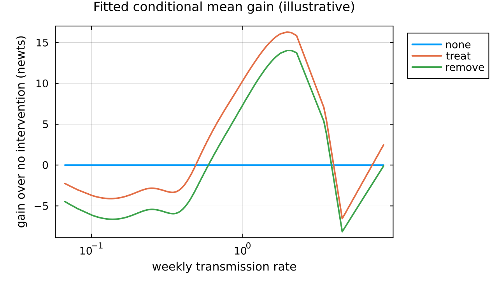
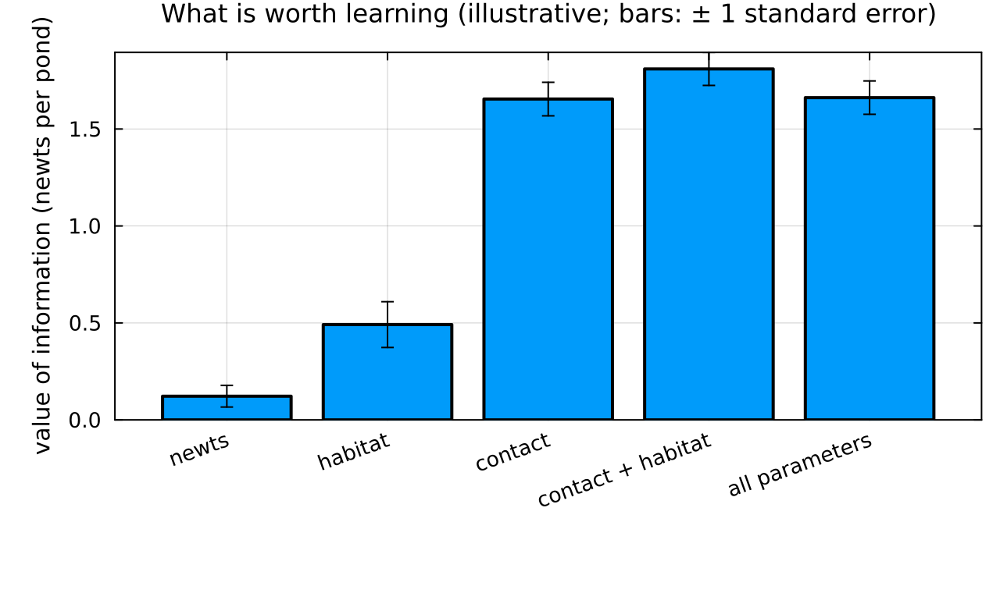

# EVPPI from a sample: which parameter is worth learning
Simon Frost

- [Motivation](#motivation)
- [The problem](#the-problem)
- [One numeric parameter](#one-numeric-parameter)
  - [The standard error](#the-standard-error)
- [A discrete parameter](#a-discrete-parameter)
- [All three, and groups of
  parameters](#all-three-and-groups-of-parameters)
- [Five or more parameters: a Gaussian
  process](#five-or-more-parameters-a-gaussian-process)
- [A check against closed forms](#a-check-against-closed-forms)
- [What to take away](#what-to-take-away)
- [Next](#next)

## Motivation

The expected value of partial perfect information (EVPPI) is the value
of learning one parameter, or one group of parameters, exactly and
nothing else. [Partial
information](05_partial_information.md)
computed it exactly on a finite problem from a partition of the states.
With draws of continuous parameters there is no partition to read off.
The EVPPI needs the **conditional mean** of each action’s payoff given
the focal parameter, and that has to be estimated.

`DecisionAnalysis.jl` has several estimators, which share one formula
and differ only in how they get the conditional means `g`:

    EVPPI ≈ Σ_i w_i max_a g[a, i] − max_a Σ_i w_i Q[a, i].

| method | for | how the conditional mean is obtained |
|:---|:---|:---|
| `Grouping()` | a discrete parameter | the mean within each cell |
| `StrongOakley()` | one numeric parameter | the mean within blocks of the sorted parameter |
| `Sadatsafavi()` | one numeric parameter | the best one or two cut points along the parameter |
| `SplineRegression()` | up to about four parameters | an additive regression spline, built in |
| `GAMRegression()` | up to about four parameters | penalised smooths from GAM.jl, an optional extension |
| `GaussianProcessRegression()` | five or more parameters | a Gaussian process with a linear mean, built in |

Without a method, `evppi` chooses one by the focal parameters, as the R
package `voi` does: grouping for a discrete parameter, a regression with
smooths for up to four numeric parameters, a Gaussian process from five
on.

Each returns a `VOIEstimate`: the value, its standard error and the
selection biases, in separate fields.

**All numbers are illustrative.**

## The problem

The pond of newts of [the previous
vignette](11_sample_beliefs_and_outcome_tables.md):
no intervention (the baseline), an antifungal treatment, or removal of
animals that test positive. Utility is the number of newts alive at the
end of the season. The uncertain parameters are the transmission rate
`contact`, the number of `newts` and the `habitat`.

``` julia
using DecisionAnalysis
using GAM: GAM          # loads the extension behind GAMRegression
using Random: Xoshiro
include(joinpath("..", "_common.jl"))
include(joinpath("..", "_toy_pond.jl"))

belief = SampleBelief(toy_draws(Xoshiro(12), 600))
table = outcomes(ToyPond(), TOY_ACTIONS, belief; replicates=10, seed=2026)
alive = IndividualsUtility(:alive)
problem = DecisionProblem(table, alive; baseline=:none)
md_table(["action", "expected newts alive", "expected gain over no intervention"],
         [[a, Float64(e), Float64(g)]
          for (a, e, g) in zip(action_labels(problem), aggregate(Expectation(), problem),
                               expected_gain_over_baseline(problem))])
```

| action   | expected newts alive | expected gain over no intervention |
|:---------|---------------------:|-----------------------------------:|
| `none`   |                64.51 |                                  0 |
| `treat`  |                66.02 |                               1.51 |
| `remove` |                63.23 |                              -1.28 |

## One numeric parameter

The transmission rate is the obvious candidate. All five methods
estimate the same quantity.

``` julia
contact = ["additive spline (built in)" => evppi(problem, :contact, SplineRegression()),
           "Strong and Oakley, blocks" => evppi(problem, :contact, StrongOakley()),
           "Sadatsafavi, one cut" => evppi(problem, :contact, Sadatsafavi()),
           "Sadatsafavi, two cuts" => evppi(problem, :contact, Sadatsafavi(; separators=2)),
           "ten bins of equal weight" => evppi(problem, :contact, Grouping(; bins=10)),
           "GAM.jl smooth" => evppi(problem, :contact, GAMRegression())]
voi_table(contact)
```

| estimate                   | value | standard error | act-now bias | cell-noise bias |
|:---------------------------|------:|---------------:|-------------:|----------------:|
| additive spline (built in) | 1.654 |          0.087 |            0 |              \- |
| Strong and Oakley, blocks  |  1.63 |          0.087 |            0 |              \- |
| Sadatsafavi, one cut       | 1.663 |          0.089 |            0 |              \- |
| Sadatsafavi, two cuts      | 1.663 |          0.089 |            0 |              \- |
| ten bins of equal weight   | 1.638 |          0.088 |            0 |              \- |
| GAM.jl smooth              | 1.503 |          0.086 |            0 |              \- |

`SplineRegression()` chooses the size of its basis from the draws: a
constant (the payoffs do not depend on the parameter, and the value is
zero), a polynomial, or a cubic with one to four knots, whichever has
the smallest generalised cross-validation score. A basis that is too
large fits the simulation noise and reports value that is not there; one
that is too small misses a curve. The estimate records the choice and
every score:

``` julia
chosen = contact[1][2].details
md_table(["degree", "knots", "coefficients", "score"],
         [[s.degree, s.knots, s.coefficients, s.gcv] for s in chosen.gcv]; digits=4)
```

| degree | knots | coefficients |   score |
|:-------|------:|-------------:|--------:|
| 0      |     0 |            1 | 60.2022 |
| 1      |     0 |            2 | 44.9407 |
| 2      |     0 |            3 | 30.8938 |
| 3      |     0 |            4 | 27.0048 |
| 3      |     1 |            5 | 25.5051 |
| 3      |     2 |            6 | 25.2909 |
| 3      |     3 |            7 | 25.4578 |
| 3      |     4 |            8 | 25.1645 |

``` julia
(degree=chosen.degree, knots=chosen.knots)
```

    (degree = 3, knots = 4)

The estimates agree to within about two standard errors (they share one
sample, so their errors are correlated). Learning the transmission rate
is worth about a newt and a half per pond.

The methods differ in what they assume. The cut-point method is right
when the best action changes at most once (or twice) along the
parameter. The blocks and bins assume nothing about shape, but each
block mean is noisy, and a maximum over noisy means is too high; more
blocks follow the curve better and make that worse. The regressions
borrow strength along the parameter. The fitted conditional means show
why one cut is enough here:

``` julia
Q = Float64.(problem.payoff.Q)
w = Float64.(probabilities(belief))
x = parameter_draws(belief).contact
fit = fitted_conditional_means(SplineRegression(), (; contact=x), Q, w)
order = sortperm(x)
plt = Plots.plot(; xlabel="weekly transmission rate", ylabel="gain over no intervention (newts)",
                 title="Fitted conditional mean gain (illustrative)", xscale=:log10)
for (i, a) in enumerate(TOY_ACTIONS)
    Plots.plot!(plt, x[order], fit[i, order] .- fit[1, order]; label=String(a))
end
png_figure(plt)
```



At low transmission the outbreak fades out by itself, and catching
animals only costs some. Above a threshold, treatment pays.

### The standard error

The default standard error comes from the per-draw gains of following
the fitted policy instead of the act-now action, evaluated on the
payoffs themselves. To first order it includes the uncertainty of the
fit. A bootstrap over draws, with the fit redone each time, is the
check:

``` julia
boot = evppi(problem, :contact, SplineRegression(); bootstrap=200, seed=1)
md_table(["standard error", "value"],
         [["linearised (default)", contact[1][2].standard_error],
          ["bootstrap, 200 resamples", boot.standard_error]]; digits=3)
```

| standard error           | value |
|:-------------------------|------:|
| linearised (default)     | 0.087 |
| bootstrap, 200 resamples | 0.081 |

## A discrete parameter

`habitat` takes two values. The conditional mean is the mean within each
group, which is what `Grouping()` computes, and it is the default for a
non-numeric parameter.

``` julia
habitat = evppi(problem, :habitat)
voi_table(["EVPPI of habitat (" * String(habitat.method) * ")" => habitat])
```

| estimate | value | standard error | act-now bias | cell-noise bias |
|:---|---:|---:|---:|---:|
| EVPPI of habitat (Grouping) | 0.492 | 0.118 | 0 | \- |

`conditional_problem` gives the table behind that number: the expected
payoff of each action in each group, with the weight of each group as a
finite belief. It is the table a manager would look at if the group were
known.

``` julia
by_habitat = conditional_problem(problem, :habitat)
gain_over_baseline(by_habitat)
```

**PayoffTable{Rational{Int64}}: 3 actions × 2 states**

| action   |   `open` | `shaded` |
|:---------|---------:|---------:|
| `none`   |        0 |        0 |
| `treat`  | -1.44559 |   3.0399 |
| `remove` | -4.26471 | 0.260101 |

``` julia
md_table(["habitat", "share of draws", "best action"],
         [[s, Float64(p),
           first_choice(decide(restrict_scenarios(by_habitat, [s]), MaxExpectedUtility()))]
          for (s, p) in zip(state_labels(by_habitat), probabilities(by_habitat.belief))])
```

| habitat  | share of draws | best action |
|:---------|---------------:|------------:|
| `open`   |           0.34 |      `none` |
| `shaded` |           0.66 |     `treat` |

In an open pond infections clear faster and no intervention holds its
own. The EVPPI of `habitat` is exactly the EVPI of this small table:

``` julia
(evpi(by_habitat), habitat.value)
```

    (983//2000, 983//2000)

## All three, and groups of parameters

``` julia
single = ["contact" => evppi(problem, :contact), "newts" => evppi(problem, :newts),
          "habitat" => evppi(problem, :habitat)]
voi_table(single)
```

| estimate | value | standard error | act-now bias | cell-noise bias |
|:---------|------:|---------------:|-------------:|----------------:|
| contact  | 1.654 |          0.087 |            0 |              \- |
| newts    | 0.122 |          0.056 |            0 |              \- |
| habitat  | 0.492 |          0.118 |            0 |              \- |

The number of newts is uncertain, and the payoff depends on it strongly:
a pond with twice the animals ends with about twice the survivors. Its
EVPPI is still small, because knowing it would seldom change the action.
Value of information is about the decision, not about the variance of
the outcome.

The EVPPI of a group of parameters is the value of learning them
together. It is at least the largest single value and can exceed the
sum.

``` julia
groups = ["contact and habitat, spline" => evppi(problem, (:contact, :habitat), SplineRegression()),
          "contact and habitat, spline with interaction" =>
              evppi(problem, (:contact, :habitat), SplineRegression(; interactions=true)),
          "contact and habitat, GAM.jl" => evppi(problem, (:contact, :habitat), GAMRegression()),
          "contact and newts, spline" => evppi(problem, (:contact, :newts), SplineRegression()),
          "contact and newts, Gaussian process" =>
              evppi(problem, (:contact, :newts), GaussianProcessRegression()),
          "all three: the regression EVPI" => evpi(problem, SplineRegression()),
          "EVPI, plain sample average" =>
              evpi(problem, SampleAverage(); noise_correlation=crn_correlation(table, alive))]
voi_table(groups)
```

| estimate | value | standard error | act-now bias | cell-noise bias |
|:---|---:|---:|---:|---:|
| contact and habitat, spline | 1.709 | 0.085 | 0 | \- |
| contact and habitat, spline with interaction | 1.81 | 0.085 | 0 | \- |
| contact and habitat, GAM.jl | 1.612 | 0.084 | 0 | \- |
| contact and newts, spline | 1.662 | 0.086 | 0 | \- |
| contact and newts, Gaussian process | 1.678 | 0.089 | 0 | \- |
| all three: the regression EVPI | 1.717 | 0.085 | 0 | \- |
| EVPI, plain sample average | 1.914 | 0.082 | 0 | 0.269 |

Transmission and habitat together account for most of the value of
perfect information about the parameters. The Gaussian process is shown
on the two numeric parameters beside the spline, as a cross-check: it is
a different regression of the same payoffs on the same columns, and the
two agree within their standard errors. It is not needed for two
parameters; its use is for many. The plain sample average also counts
the simulator’s own randomness as something to be learned, which no
study of the parameters can deliver; its cell-noise bias column says how
much its perfect-information term is inflated by that.

``` julia
labels = ["newts", "habitat", "contact", "contact + habitat", "all parameters"]
values = [single[2][2], single[3][2], single[1][2], groups[2][2], groups[4][2]]
plt = Plots.bar(labels, [Float64(v.value) for v in values];
                yerror=[v.standard_error for v in values], legend=false,
                ylabel="value of information (newts per pond)",
                title="What is worth learning (illustrative; bars: ± 1 standard error)",
                xrotation=20, bottom_margin=10Plots.mm)
png_figure(plt)
```



## Five or more parameters: a Gaussian process

An additive spline misses interactions between parameters, and a spline
surface with every interaction has too many coefficients once there are
more than a few. From five focal parameters on, `evppi` therefore uses
`GaussianProcessRegression()`: a linear trend plus a smooth random
function of all the parameters at once, with one length scale per
parameter and a **nugget** for everything the focal parameters do not
explain. The length scales and the nugget are chosen for each action by
maximising the marginal likelihood on a seeded subsample of the draws,
the process is conditioned on at most `max_points` draws (1500 by
default), and it then predicts the conditional mean at **every** draw,
so the whole sample enters the estimate.

The pond has only three uncertain parameters, so the illustration adds
four that a manager might also be unsure of. Each draw now carries a
multiplier of the handling mortality, of the capture rate and of the two
test errors, and the payoff of each intervention is adjusted by a
made-up smooth function of them. **This adjustment is invented for the
illustration** and is not part of the toy model.

``` julia
rng = Xoshiro(21)
n = length(belief)
extra = (; handling=randn(rng, n), capture=randn(rng, n), sensitivity=randn(rng, n),
         specificity=randn(rng, n))
base = payoff_table(table, alive).Q
adjusted = Float64.(base)
adjusted[2, :] .+= 1.5 .* extra.capture .- 2.0 .* extra.handling .+ 0.8 .* extra.capture .* extra.handling
adjusted[3, :] .+= 1.5 .* extra.capture .+ 1.2 .* extra.sensitivity .- 1.0 .* extra.specificity
wide_draws = merge((; contact=belief.draws.contact, newts=Float64.(belief.draws.newts)), extra)
wide = DecisionProblem(PayoffTable(adjusted; actions=TOY_ACTIONS), SampleBelief(wide_draws);
                       baseline=:none)
five = (:contact, :handling, :capture, :sensitivity, :specificity)
many = ["five parameters (default: Gaussian process)" => evppi(wide, five),
        "the same five, additive spline" => evppi(wide, five, SplineRegression()),
        "all six" => evppi(wide, (five..., :newts)),
        "the four added ones only (spline, by default)" =>
            evppi(wide, (:handling, :capture, :sensitivity, :specificity))]
md_table(["focal parameters", "method chosen", "EVPPI (newts)", "standard error"],
         [[name, String(e.method), Float64(e.value), e.standard_error] for (name, e) in many];
         digits=3)
```

| focal parameters | method chosen | EVPPI (newts) | standard error |
|:---|---:|---:|---:|
| five parameters (default: Gaussian process) | GaussianProcessRegression | 1.928 | 0.112 |
| the same five, additive spline | SplineRegression | 1.795 | 0.109 |
| all six | GaussianProcessRegression | 2.067 | 0.113 |
| the four added ones only (spline, by default) | SplineRegression | 0.429 | 0.147 |

The method column shows the rule at work: four parameters go to the
spline and five or six to the Gaussian process. An explicit method
always overrides it.

## A check against closed forms

The estimators are tested against exact enumeration on finite problems
in the package’s test suite. A second check is a model with a
closed-form answer. The R package `voi` uses this one in its vignette:
two actions with payoffs 0 and p₁ − p₂, where p₁ ~ N(1, 1) and p₂ ~ N(0,
2²). For X normal with mean μ and standard deviation σ, E max(0, X) =
μΦ(μ/σ) + σφ(μ/σ), which gives EVPI = 0.4798107, EVPPI(p₁) = 0.0833155
and EVPPI(p₂) = 0.3955931.

``` julia
rng = Xoshiro(20261123)
n = 40_000
p1, p2 = 1 .+ randn(rng, n), 2 .* randn(rng, n)
normal = DecisionProblem(PayoffTable(permutedims(hcat(zeros(n), p1 .- p2));
                                     actions=[:reference, :new]),
                         SampleBelief((; p1, p2)); baseline=:reference)
checks = ["EVPI, sample average" => evpi(normal, SampleAverage()),
          "EVPI, regression on p1 and p2" => evpi(normal, SplineRegression()),
          "EVPPI(p1), spline" => evppi(normal, :p1),
          "EVPPI(p1), Strong and Oakley" => evppi(normal, :p1, StrongOakley()),
          "EVPPI(p1), Sadatsafavi" => evppi(normal, :p1, Sadatsafavi()),
          "EVPPI(p2), spline" => evppi(normal, :p2),
          "EVPPI(p2), Strong and Oakley" => evppi(normal, :p2, StrongOakley()),
          "EVPPI(p2), Sadatsafavi" => evppi(normal, :p2, Sadatsafavi())]
voi_table(checks; digits=4,
          truth=[0.4798107, 0.4798107, 0.0833155, 0.0833155, 0.0833155, 0.3955931, 0.3955931,
                 0.3955931])
```

| estimate | value | standard error | act-now bias | cell-noise bias | reference |
|:---|---:|---:|---:|---:|---:|
| EVPI, sample average | 0.4871 | 0.0049 | 0 | 0 | 0.4798 |
| EVPI, regression on p1 and p2 | 0.4871 | 0.0049 | 0 | \- | 0.4798 |
| EVPPI(p1), spline | 0.0892 | 0.0043 | 0 | \- | 0.0833 |
| EVPPI(p1), Strong and Oakley | 0.0927 | 0.0044 | 0 | \- | 0.0833 |
| EVPPI(p1), Sadatsafavi | 0.0935 | 0.0044 | 0 | \- | 0.0833 |
| EVPPI(p2), spline | 0.4017 | 0.005 | 0 | \- | 0.3956 |
| EVPPI(p2), Strong and Oakley | 0.4009 | 0.005 | 0 | \- | 0.3956 |
| EVPPI(p2), Sadatsafavi | 0.4012 | 0.005 | 0 | \- | 0.3956 |

Every estimate is within about two standard errors of its closed form.
The estimates share one sample, so their errors are correlated: they
miss on the same side.

The same model with four more parameters checks the Gaussian process,
since the closed form extends: with payoffs 0 and p₁ − p₂ + (x₃ + x₄ +
x₅ + x₆) / 2 and x₃ to x₆ standard normal, learning a set of parameters
leaves a normal conditional mean whose variance is the sum of their
contributions.

``` julia
x = [randn(rng, 4000) for _ in 1:4]
q1, q2 = p1[1:4000], p2[1:4000]
six = DecisionProblem(PayoffTable(permutedims(hcat(zeros(4000), q1 .- q2 .+ 0.5 .* sum(x)));
                                  actions=[:reference, :new]),
                      SampleBelief((; p1=q1, p2=q2, x3=x[1], x4=x[2], x5=x[3], x6=x[4]));
                      baseline=:reference)
# E max(0, X) − 1 for X ~ N(1, σ²) is Φ(1/σ) + σ φ(1/σ) − 1; Φ by the midpoint rule.
φ(z) = exp(-z^2 / 2) / sqrt(2π)
Φ(z) = 0.5 + sum(φ((k - 0.5) * z / 20_000) for k in 1:20_000) * z / 20_000
closed(variance) = (σ = sqrt(variance); Φ(1 / σ) + σ * φ(1 / σ) - 1)
gp_checks = ["EVPPI(p1, x3..x6), Gaussian process" => evppi(six, (:p1, :x3, :x4, :x5, :x6)),
             "EVPPI(p2, x3..x6), Gaussian process" => evppi(six, (:p2, :x3, :x4, :x5, :x6))]
voi_table(gp_checks; digits=4, truth=[closed(1 + 1), closed(4 + 1)])
```

| estimate | value | standard error | act-now bias | cell-noise bias | reference |
|:---|---:|---:|---:|---:|---:|
| EVPPI(p1, x3..x6), Gaussian process | 0.2245 | 0.0176 | 0 | \- | 0.1996 |
| EVPPI(p2, x3..x6), Gaussian process | 0.4957 | 0.0177 | 0 | \- | 0.4798 |

These estimators are also compared with the R package `voi` on the same
draws: its `so` and `sal` methods agree with `StrongOakley` and
`Sadatsafavi` to rounding, and its generalised additive model and
Gaussian process agree with `GAMRegression` and
`GaussianProcessRegression` to within a small fraction of a standard
error. The scripts and the numbers are in the `validation/` directory of
the package.

## What to take away

- `evppi(problem, focal, method)` estimates the value of learning the
  named parameters of the draws. Without a method, a non-numeric
  parameter uses `Grouping()`, one to four numeric ones
  `SplineRegression()` and five or more `GaussianProcessRegression()`.
- `Grouping`, `StrongOakley` and `Sadatsafavi` need no regression, and
  are cross-checks on it. `GAMRegression` needs `using GAM`; GAM.jl is
  not a dependency of the package.
- `conditional_problem(problem, :group)` is the payoff table by group,
  and its EVPI is the EVPPI of the group.
- A parameter can drive the outcome and be worth nothing to learn. EVPPI
  ranks uncertainties by what resolving them does for the decision.
- The standard error is beside the value, never in it. `bootstrap = B`
  checks it by refitting on resampled draws.
- Regression EVPI, on all the parameters, is the value of information
  about the parameters. The plain sample average also counts simulation
  noise.

## Next

Learning a parameter exactly is an ideal. A real study gives data. [EVSI
from a sample](13_evsi_methods.md) values a study
before it is run.
