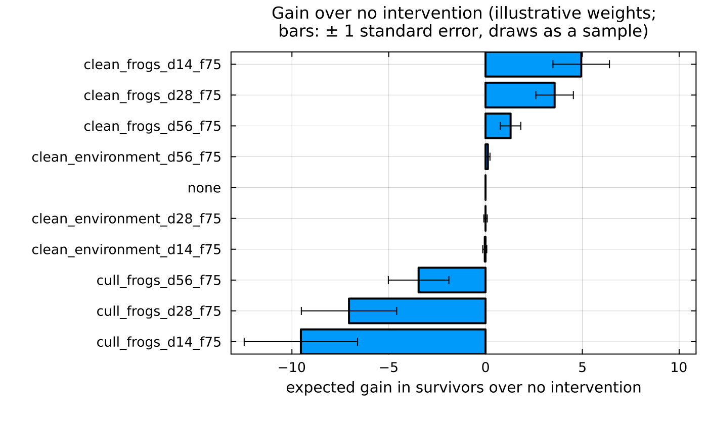
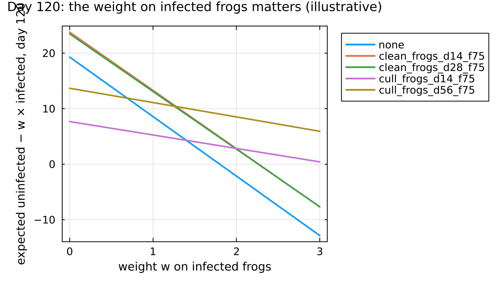

# Bd epizootic response on the Drawert et al. (2017) model
Simon Frost

- [Motivation](#motivation)
  - [What this is and is not](#what-this-is-and-is-not)
- [The cached outcome table](#the-cached-outcome-table)
  - [The actions](#the-actions)
  - [The outcomes, and three modelling
    choices](#the-outcomes-and-three-modelling-choices)
- [The draws are a design, not a
  posterior](#the-draws-are-a-design-not-a-posterior)
- [Payoffs and gains over no
  intervention](#payoffs-and-gains-over-no-intervention)
- [By group](#by-group)
  - [Pulses that were not applied](#pulses-that-were-not-applied)
- [Several rules](#several-rules)
- [Count or fraction of the pond](#count-or-fraction-of-the-pond)
- [The weight on infected frogs, and when the frogs are
  counted](#the-weight-on-infected-frogs-and-when-the-frogs-are-counted)
- [The value of perfect information, in
  frogs](#the-value-of-perfect-information-in-frogs)
- [What is worth learning: EVPPI](#what-is-worth-learning-evppi)
- [The value of a survey before the decision:
  EVSI](#the-value-of-a-survey-before-the-decision-evsi)
  - [Sensitivity to the assay scales and the
    design](#sensitivity-to-the-assay-scales-and-the-design)
- [The report](#the-report)
- [What to take away](#what-to-take-away)

## Motivation

*Batrachochytrium dendrobatidis* (Bd), the fungus that causes
chytridiomycosis, has arrived at a pond that holds a susceptible frog
population. One intervention can be mounted this season. Which, and
when?

This vignette runs that question through the whole package: a cached
table of model runs, utilities counted in frogs, gains over no
intervention with their Monte Carlo errors, several decision rules, and
the value of information, including the value of a survey made before
the decision.

### What this is and is not

- The **model** is the stochastic individual-based model of Drawert,
  Griesemer, Petzold and Briggs (2017, *J. R. Soc. Interface*
  14:20170480,
  [doi:10.1098/rsif.2017.0480](https://doi.org/10.1098/rsif.2017.0480)),
  as implemented in `Chytridiomycosis.jl`. The parameter points are the
  authors’.
- The **runs** are ours, not the authors’: `Chytridiomycosis.jl` ran the
  model at 100 of the authors’ 2,132 parameter points under ten actions,
  30 times each, and stores the result. Numbers read from that table are
  labelled *from the cached table*.
- **Everything else is illustrative**: the weights on the draws, the
  utilities, the assay scales of the survey, and therefore every
  expected value, gain and value of information below. **Nothing here is
  a published result**, and none of it is advice for a real pond.

## The cached outcome table

``` julia
using DecisionAnalysis
using Chytridiomycosis: Chytridiomycosis, DrawertIBMProblem, DrawertParameters, SurveyObservation,
                        SurveyPond, drawert_run_seed, load_drawert_decisions, simulate_survey,
                        survey_loglikelihood
using Random: Xoshiro
include(joinpath("..", "_common.jl"))

runs = load_drawert_decisions()
(rows=length(runs), columns=keys(first(runs)))
```

    (rows = 30000, columns = (:draw_id, :group, :variant, :action, :kind, :day, :fraction, :replicate, :seed, :surviving_fraction, :survivors, :outcome, :first_loss, :frogs_at_intervention, :applied, :handled, :treatment_deaths, :initial_frogs, :uninfected, :infected, :uninfected_d120, :infected_d120, :uninfected_d365, :infected_d365, :status, :seconds))

One row per run. The parameters of the draws, with their sampling
weights, are in a second file, read here with a few lines because it is
a plain CSV:

``` julia
function read_draws(path)
    lines = readlines(path)
    names = Tuple(Symbol.(split(lines[1], ',')))
    return map(lines[2:end]) do line
        v = split(line, ',')
        return NamedTuple{names}((parse(Int, v[1]), String(v[2]), parse.(Float64, v[3:end])...))
    end
end
draws = read_draws(joinpath(pkgdir(Chytridiomycosis), "data", "drawert2017", "decision_draws.csv"))
first(draws)
```

    (draw_id = 37, group = "A", N = 62.0, γ = 5.73927902388375e-5, η = 17.8777834423818, ν0 = 0.0862707584165037, f = 0.530253593111411, σ0 = 0.478287360817194, μ = 1.03837436286965, load_growth_rate = 0.341402, weight = 32.23255813953488)

The run table goes into an `OutcomeTable` by naming its columns. Runs
with a failing status would be kept and counted; this table has none.

``` julia
table = OutcomeTable(runs; draw=:draw_id, action=:action, replicate=:replicate,
                     outcomes=[:survivors, :uninfected, :infected, :uninfected_d120,
                               :infected_d120, :uninfected_d365, :infected_d365,
                               :initial_frogs, :handled],
                     status=:status, parameters=draws, key=:draw_id, weights=:weight)
```

    OutcomeTable(100 draws × 10 actions × 30 replicates; outcomes survivors, uninfected, infected, uninfected_d120, infected_d120, uninfected_d365, infected_d365, initial_frogs, handled; 30000 runs ok, 0 failed, 0 absent)

``` julia
run_counts(table)
```

    (runs = 30000, ok = 30000, failed = 0, absent = 0)

### The actions

Ten actions (*from the cached table*): no intervention, and one pulse at
75% coverage of one of three kinds on day 14, 28 or 56 after Bd arrives.

| label | meaning |
|:---|:---|
| `none` | no intervention: **the baseline** |
| `clean_frogs_dNN_f75` | capture 75% of the frogs and clear their infection (antifungal treatment) |
| `cull_frogs_dNN_f75` | capture and kill 75% of the frogs |
| `clean_environment_dNN_f75` | remove 75% of the zoospores in the water |

### The outcomes, and three modelling choices

For every run the table records the frogs alive at the end of the run,
split into uninfected and infected (carrying any sporangia), and the
same split on day 120 and on day 365. The choices that turn these into a
utility are stated here because they are choices, not facts.

1.  **Culled frogs are not survivors.** A culled frog is dead. The table
    counts it in neither `uninfected` nor `infected`, so culling can
    only help through the frogs it spares.
2.  **Whether an infected but living frog counts.** Three utilities are
    carried throughout: every survivor counts (`survivors`); only
    uninfected frogs count (uninfected − 0 × infected); and uninfected
    minus infected (weight 1), which sets a frog that carries Bd against
    a clean one because it is a reservoir. The weight is swept in its
    own section.
3.  **Count or fraction.** The initial pond size `N` differs between
    draws, from a handful of frogs to a couple of hundred. A count of
    frogs lets big ponds dominate the expectation; the fraction of `N`
    surviving treats every pond alike. The main analysis uses the
    **count**, because the owner’s currency is individuals; the fraction
    is shown beside it, and a section checks whether the two disagree.

``` julia
survivors = IndividualsUtility(:survivors)
fraction = FunctionUtility(o -> o.survivors / o.initial_frogs; name=:surviving_fraction)
clean_only = InfectionUtility(; weight=0)
net_clean = InfectionUtility(; weight=1)
actions = action_labels(table)
```

    10-element Vector{Symbol}:
     :none
     :clean_frogs_d14_f75
     :clean_frogs_d28_f75
     :clean_frogs_d56_f75
     :cull_frogs_d14_f75
     :cull_frogs_d28_f75
     :cull_frogs_d56_f75
     :clean_environment_d14_f75
     :clean_environment_d28_f75
     :clean_environment_d56_f75

## The draws are a design, not a posterior

The 100 draws are a stratified sample of the authors’ 2,132 points, and
those points are a **space-filling design** over plausible parameter
ranges. They are not a posterior distribution and not a prior that
anyone elicited. The authors sort the points into five groups, A to E,
by what the model does there without intervention (A: the frogs always
go extinct; D: Bd usually dies out; B, C and E in between or variable).
The sample takes more than their share from the small groups, and the
`weight` column undoes that: it is the number of design points each
sampled draw stands for.

**Assumption.** Using these weights as a belief says: *every one of the
2,132 design points is equally likely to be the pond at hand.* That is a
convenient reference, not knowledge. The section on groups shows how the
decision changes if the group is known, which is the form in which a
manager would most plausibly hold better information.

``` julia
belief = SampleBelief(table)
groups = parameter_draws(belief).group
weights = Float64.(probabilities(belief))
md_table(["group", "sampled draws", "weight of the group", "mean N"],
         [[g, count(==(g), groups), sum(weights[groups .== g]),
           sum(parameter_draws(belief).N[groups .== g]) / count(==(g), groups)]
          for g in ("A", "B", "C", "D", "E")])
```

| group | sampled draws | weight of the group | mean N |
|:------|--------------:|--------------------:|-------:|
| A     |            43 |                0.65 | 102.28 |
| B     |            12 |                0.05 |  92.42 |
| C     |            17 |                 0.1 |  54.76 |
| D     |            23 |                0.19 |  78.87 |
| E     |             5 |                0.01 |     79 |

``` julia
(draws=length(belief), effective_sample_size=effective_sample_size(belief))
```

    (draws = 100, effective_sample_size = 81.99482891894394)

Group A, where the frogs go extinct if nothing is done, carries about
two thirds of the weight.

## Payoffs and gains over no intervention

`payoff_table` averages the utility over the 30 replicates of each cell
and keeps the standard error of each cell apart. The expected payoff
over the draws then has two errors, and they answer different questions:

- **simulation only**: the simulator’s noise with the 100 draws held
  fixed. This is the error of the number *for this design*.
- **draws as a sample**: the error if the 100 draws are regarded as a
  random sample of the 2,132 points. It is much larger, because ponds
  differ far more than replicates.

``` julia
problem = DecisionProblem(table, survivors; baseline=:none)
gains = DecisionProblem(payoff_table(table, survivors; baseline=:none), belief)
level = expected_utility_estimates(problem)
gain = expected_utility_estimates(gains)
md_table(["action", "expected survivors", "gain over no intervention", "error: simulation only",
          "error: draws as a sample"],
         [[l.action, Float64(l.value), Float64(g.value), g.simulation_error, g.standard_error]
          for (l, g) in zip(level, gain)])
```

| action | expected survivors | gain over no intervention | error: simulation only | error: draws as a sample |
|:---|---:|---:|---:|---:|
| `none` | 17.06 | 0 | 0 | 0 |
| `clean_frogs_d14_f75` | 22 | 4.94 | 0.34 | 1.46 |
| `clean_frogs_d28_f75` | 20.63 | 3.57 | 0.31 | 0.97 |
| `clean_frogs_d56_f75` | 18.36 | 1.29 | 0.13 | 0.53 |
| `cull_frogs_d14_f75` | 7.52 | -9.54 | 0.14 | 2.93 |
| `cull_frogs_d28_f75` | 10.01 | -7.05 | 0.18 | 2.46 |
| `cull_frogs_d56_f75` | 13.6 | -3.46 | 0.16 | 1.56 |
| `clean_environment_d14_f75` | 17.02 | -0.04 | 0.09 | 0.1 |
| `clean_environment_d28_f75` | 17.06 | 0 | 0.07 | 0.09 |
| `clean_environment_d56_f75` | 17.18 | 0.12 | 0.06 | 0.11 |

The gains are computed replicate by replicate against the `none` run
with the same seed, so their simulation error is that of the paired
differences.

Under the design weights, **cleaning frogs early** gains about five
frogs per pond over no intervention, and the gain shrinks as the pulse
is delayed. Culling loses frogs. Cleaning the environment once does
nothing measurable.

The same in the other utilities, and as a fraction of the initial
population:

``` julia
utilities = ["survivors" => survivors, "uninfected (w = 0)" => clean_only,
             "uninfected − infected (w = 1)" => net_clean, "fraction of N surviving" => fraction]
gain_of(u) = [Float64(e.value)
              for e in expected_utility_estimates(DecisionProblem(payoff_table(table, u; baseline=:none),
                                                                  belief))]
labelled_table("gain over no intervention", actions, first.(utilities),
               reduce(hcat, [gain_of(u) for (_, u) in utilities]); digits=3)
```

| gain over no intervention | survivors | uninfected (w = 0) | uninfected − infected (w = 1) | fraction of N surviving |
|:---|---:|---:|---:|---:|
| `none` | 0 | 0 | 0 | 0 |
| `clean_frogs_d14_f75` | 4.941 | 4.956 | 4.972 | 0.063 |
| `clean_frogs_d28_f75` | 3.568 | 3.585 | 3.602 | 0.044 |
| `clean_frogs_d56_f75` | 1.294 | 1.296 | 1.299 | 0.02 |
| `cull_frogs_d14_f75` | -9.538 | -9.88 | -10.222 | -0.144 |
| `cull_frogs_d28_f75` | -7.052 | -7.549 | -8.045 | -0.09 |
| `cull_frogs_d56_f75` | -3.457 | -3.816 | -4.174 | -0.047 |
| `clean_environment_d14_f75` | -0.039 | -0.039 | -0.039 | 0.002 |
| `clean_environment_d28_f75` | 0 | -0.004 | -0.009 | 0.002 |
| `clean_environment_d56_f75` | 0.121 | 0.121 | 0.12 | 0.002 |

At the end of a run the three count utilities nearly coincide: by then a
pond has usually lost either its frogs or its Bd, so few survivors are
infected.

``` julia
order = sortperm([Float64(g.value) for g in gain])
plt = Plots.bar(String.(actions[order]), [Float64(gain[i].value) for i in order];
                yerror=[gain[i].standard_error for i in order], legend=false, permute=(:x, :y),
                xlabel="", ylabel="expected gain in survivors over no intervention",
                title="Gain over no intervention (illustrative weights;\nbars: ± 1 standard error, draws as a sample)",
                size=(700, 420), left_margin=6Plots.mm)
png_figure(plt)
```



## By group

The group is what a manager would most want to know.
`conditional_problem` collapses the draws onto it: the expected payoff
of each action within each group.

``` julia
by_group = conditional_problem(problem, :group)
gain_over_baseline(by_group)
```

**PayoffTable{Float64}: 10 actions × 5 states**

| action | `A` | `B` | `C` | `D` | `E` |
|:---|---:|---:|---:|---:|---:|
| `none` | 0.0 | 0.0 | 0.0 | 0.0 | 0.0 |
| `clean_frogs_d14_f75` | 3.57674 | 23.4722 | 12.0627 | 0.875362 | 0.3 |
| `clean_frogs_d28_f75` | 1.8155 | 17.2556 | 13.7588 | 0.413043 | 0.3 |
| `clean_frogs_d56_f75` | 0.124031 | 6.38333 | 8.0549 | 0.265217 | 0.313333 |
| `cull_frogs_d14_f75` | 2.56434 | 13.3639 | -10.3353 | -57.9971 | -4.79333 |
| `cull_frogs_d28_f75` | 1.4186 | 10.9306 | -8.41373 | -40.9754 | -5.36667 |
| `cull_frogs_d56_f75` | 0.642636 | 7.28611 | -6.9098 | -18.7638 | -4.89333 |
| `clean_environment_d14_f75` | -0.000775194 | 0.158333 | -0.594118 | 0.0652174 | 0.28 |
| `clean_environment_d28_f75` | -0.000775194 | -0.422222 | 0.15098 | 0.0289855 | 0.106667 |
| `clean_environment_d56_f75` | 0.0 | 0.0305556 | 1.07059 | 0.0318841 | 0.24 |

``` julia
function group_gain(g)
    members = state_labels(belief)[groups .== g]
    return expected_utility_estimates(restrict_scenarios(gains, members))
end
cells = Dict(g => group_gain(g) for g in ("A", "B", "C", "D", "E"))
md_table(vcat("gain (standard error, draws as a sample)", ["group $g" for g in ("A", "B", "C", "D", "E")]),
         [vcat(a, [string(round(Float64(cells[g][i].value); digits=1), " (",
                          round(cells[g][i].standard_error; digits=1), ")")
                   for g in ("A", "B", "C", "D", "E")]) for (i, a) in enumerate(actions)])
```

| gain (standard error, draws as a sample) | group A | group B | group C | group D | group E |
|:---|---:|---:|---:|---:|---:|
| `none` | 0.0 (0.0) | 0.0 (0.0) | 0.0 (0.0) | 0.0 (0.0) | 0.0 (0.0) |
| `clean_frogs_d14_f75` | 3.6 (1.9) | 23.5 (7.2) | 12.1 (4.9) | 0.9 (0.1) | 0.3 (0.1) |
| `clean_frogs_d28_f75` | 1.8 (1.0) | 17.3 (5.0) | 13.8 (5.3) | 0.4 (0.1) | 0.3 (0.2) |
| `clean_frogs_d56_f75` | 0.1 (0.1) | 6.4 (2.7) | 8.1 (4.4) | 0.3 (0.1) | 0.3 (0.2) |
| `cull_frogs_d14_f75` | 2.6 (0.9) | 13.4 (2.5) | -10.3 (4.9) | -58.0 (9.1) | -4.8 (4.2) |
| `cull_frogs_d28_f75` | 1.4 (0.7) | 10.9 (2.0) | -8.4 (4.9) | -41.0 (9.5) | -5.4 (4.2) |
| `cull_frogs_d56_f75` | 0.6 (0.5) | 7.3 (1.7) | -6.9 (4.0) | -18.8 (6.8) | -4.9 (4.2) |
| `clean_environment_d14_f75` | -0.0 (0.0) | 0.2 (0.6) | -0.6 (0.9) | 0.1 (0.0) | 0.3 (0.2) |
| `clean_environment_d28_f75` | -0.0 (0.0) | -0.4 (0.4) | 0.2 (0.8) | 0.0 (0.0) | 0.1 (0.2) |
| `clean_environment_d56_f75` | 0.0 (0.0) | 0.0 (0.0) | 1.1 (1.0) | 0.0 (0.0) | 0.2 (0.1) |

``` julia
best_in(g) = decide(restrict_scenarios(by_group, [Symbol(g)]), MaxExpectedUtility())
md_table(["group", "weight", "best action", "its gain over no intervention"],
         [[g, Float64(probabilities(by_group.belief)[i]), first_choice(best_in(g)),
           Float64(maximum(gain_over_baseline(by_group).Q[:, i]))]
          for (i, g) in enumerate(String.(state_labels(by_group)))])
```

| group | weight |           best action | its gain over no intervention |
|:------|-------:|----------------------:|------------------------------:|
| A     |   0.65 | `clean_frogs_d14_f75` |                          3.58 |
| B     |   0.05 | `clean_frogs_d14_f75` |                         23.47 |
| C     |    0.1 | `clean_frogs_d28_f75` |                         13.76 |
| D     |   0.19 | `clean_frogs_d14_f75` |                          0.88 |
| E     |   0.01 | `clean_frogs_d56_f75` |                          0.31 |

The size of the gain changes greatly with the group; the best kind of
action does not.

- In **group A** no frog survives without intervention. Early treatment
  rescues a few (under four frogs per pond on average, with a standard
  error of about two), and so, to a lesser degree, does an early cull,
  which thins the hosts.
- In **group B** early treatment saves over twenty frogs per pond, and
  even a cull gains, for the same reason as in A.
- In **group C** treatment on day 14 or day 28 saves twelve to fourteen
  frogs; the two days cannot be told apart at this sample size. Culling
  loses frogs.
- In **group D** Bd usually dies out by itself. Treatment adds less than
  one frog, and an early cull destroys nearly sixty frogs per pond that
  would have lived.
- **Group E** has five sampled draws; its row is too noisy to read much
  into.

Groups B and C carry about 15% of the weight and most of the gain.
Treating the frogs early is best, or within error of best, in every
group. What the group changes is how much is at stake, and how bad the
wrong action (a cull in group D) would be.

### Pulses that were not applied

One feature of the cached table must be kept in view wherever a late
cull looks harmless. As in the authors’ code, **a pulse is skipped once
the frogs or Bd have gone**. The share of runs in which the pulse was
not applied (*from the cached table*):

``` julia
group_of = Dict(d.draw_id => d.group for d in draws)
function share_skipped(kind, day, g)
    rows = [r for r in runs if r.kind == kind && r.day == day && group_of[r.draw_id] == g]
    return count(r -> r.applied === false, rows) / length(rows)
end
md_table(["group", "day 14", "day 28", "day 56"],
         [[g, share_skipped("cull_frogs", 14.0, g), share_skipped("cull_frogs", 28.0, g),
           share_skipped("cull_frogs", 56.0, g)] for g in ("A", "B", "C", "D", "E")])
```

| group | day 14 | day 28 | day 56 |
|:------|-------:|-------:|-------:|
| A     |      0 |   0.05 |   0.61 |
| B     |      0 |      0 |   0.01 |
| C     |      0 |   0.11 |   0.26 |
| D     |      0 |   0.43 |   0.72 |
| E     |      0 |      0 |      0 |

In groups C and D, where Bd has often died out by day 56, most late
pulses never happen: no frog is culled in those runs, and `handled` is
zero. A manager who did not know that Bd had gone would have culled. So
the table makes **a late cull look much less harmful than it would be**
in practice, and the small losses shown for `cull_frogs_d56_f75` in
groups C and D are a lower bound on the harm. The same applies, in the
other direction, to late treatment: where the pulse is skipped the
action costs nothing and gains nothing.

## Several rules

Expected utility under the design weights is one rule. Others answer to
different attitudes to the uncertainty.

**Over the draws.** The worst case over 100 sampled draws is
uninformative here: in group A every action leaves no frogs, so every
action has the same worst case. CVaR looks at the worst share of the
weight and has the same problem until the share passes the weight of
group A.

``` julia
over_draws = ["expected survivors" => MaxExpectedUtility(), "maximin over draws" => Maximin(),
              "CVaR, worst 20% of the weight" => DecisionRule(CVaR(0.2)),
              "CVaR, worst 80% of the weight" => DecisionRule(CVaR(0.8)),
              "minimax regret over draws" => MinimaxRegret()]
md_table(["rule", "chosen", "tied actions"],
         [[name, first_choice(decide(problem, rule)), length(decide(problem, rule).chosen)]
          for (name, rule) in over_draws])
```

| rule                          |                chosen | tied actions |
|:------------------------------|----------------------:|-------------:|
| expected survivors            | `clean_frogs_d14_f75` |            1 |
| maximin over draws            |                `none` |           10 |
| CVaR, worst 20% of the weight |                `none` |           10 |
| CVaR, worst 80% of the weight | `clean_frogs_d14_f75` |            1 |
| minimax regret over draws     | `clean_frogs_d14_f75` |            1 |

When a rule ties across all ten actions, `first_choice` is the first in
table order, which is `none`: the rule gives no reason to act. The
result also says that a worst case over a sample depends on which draws
were sampled.

**Over the groups as scenarios.** A manager who refuses to weight the
groups can treat them as five scenarios with no probabilities. Maximin
then asks for the best worst-group payoff, and minimax regret for the
smallest worst-group shortfall from the best action for that group.

``` julia
scenario_problem = DecisionProblem(by_group.payoff, ScenarioSet(state_labels(by_group));
                                   baseline=:none)
maximin = decide(scenario_problem, Maximin())
regret = decide(scenario_problem, MinimaxRegret())
md_table(["action", "worst group payoff", "largest regret over groups"],
         [[a, Float64(maximin.scores[i]), Float64(regret.scores[i])]
          for (i, a) in enumerate(actions)])
```

| action                      | worst group payoff | largest regret over groups |
|:----------------------------|-------------------:|---------------------------:|
| `none`                      |                  0 |                      23.47 |
| `clean_frogs_d14_f75`       |               3.58 |                        1.7 |
| `clean_frogs_d28_f75`       |               1.82 |                       6.22 |
| `clean_frogs_d56_f75`       |               0.12 |                      17.09 |
| `cull_frogs_d14_f75`        |               2.57 |                      58.87 |
| `cull_frogs_d28_f75`        |               1.42 |                      41.85 |
| `cull_frogs_d56_f75`        |               0.64 |                      20.67 |
| `clean_environment_d14_f75` |                  0 |                      23.31 |
| `clean_environment_d28_f75` |                  0 |                      23.89 |
| `clean_environment_d56_f75` |                  0 |                      23.44 |

``` julia
(maximin=maximin.chosen, minimax_regret=regret.chosen)
```

    (maximin = [:clean_frogs_d14_f75], minimax_regret = [:clean_frogs_d14_f75])

With groups as scenarios both rules choose early treatment of the frogs.
Its worst group is A, where it still leaves a few survivors and no
intervention leaves none, and it is never more than about two frogs
behind the best action for any group.

Minimax regret **depends on the menu of actions**: regret is measured
against the best action on offer in each scenario, so removing an
action, even one that is never chosen, can change the choice. The result
carries that note:

``` julia
regret.details.note
```

    "Regret is measured against the best feasible action in each state, so this rule depends on the menu of actions: adding or removing an action, even one that is never chosen, can change the choice (independence of irrelevant alternatives fails)."

``` julia
no_culls = DecisionProblem(by_group.payoff, ScenarioSet(state_labels(by_group));
                           baseline=:none, feasible=a -> !startswith(String(a), "cull"))
(with_culls=first_choice(regret), without_culls=first_choice(decide(no_culls, MinimaxRegret())))
```

    (with_culls = :clean_frogs_d14_f75, without_culls = :clean_frogs_d14_f75)

Here taking the culls off the menu leaves the choice as it was. That is
a property of this table, not of the rule.

## Count or fraction of the pond

``` julia
fraction_problem = DecisionProblem(table, fraction; baseline=:none)
reversals = rank_reversals(problem, fraction_problem)
(best_by_count=first_choice(decide(problem, MaxExpectedUtility())),
 best_by_fraction=first_choice(decide(fraction_problem, MaxExpectedUtility())),
 pairs_of_actions_that_swap=length(reversals), top_changed=any(r -> r.top_changed, reversals))
```

    (best_by_count = :clean_frogs_d14_f75, best_by_fraction = :clean_frogs_d14_f75, pairs_of_actions_that_swap = 3, top_changed = false)

``` julia
reversals
```

    3-element Vector{@NamedTuple{actions::Tuple{Symbol, Symbol}, top_changed::Bool}}:
     (actions = (:none, :clean_environment_d14_f75), top_changed = 0)
     (actions = (:none, :clean_environment_d28_f75), top_changed = 0)
     (actions = (:clean_environment_d14_f75, :clean_environment_d28_f75), top_changed = 0)

The best action is the same on both scales. The pairs that swap are
among the environmental cleaning actions and no intervention, whose
differences are within the simulation error. The count and the fraction
do not disagree about anything that matters here, so the count is used
from here on.

## The weight on infected frogs, and when the frogs are counted

The infection utility is uninfected − w × infected. Expected utility is
linear in w, so `policy_regions` finds the values of w at which the best
action changes exactly. The answer depends on **when** the frogs are
counted.

``` julia
function regions_at(uninfected, infected)
    base = DecisionProblem(individuals_payoff(table, uninfected), belief; baseline=:none)
    return policy_regions(base, -individuals_payoff(table, infected); from=0, to=3)
end
evaluation = ["end of the run" => (:uninfected, :infected), "day 120" => (:uninfected_d120, :infected_d120),
              "day 365" => (:uninfected_d365, :infected_d365)]
md_table(["counted at", "from w", "to w", "best action"],
         [[when, Float64(r.from), Float64(r.to), r.actions]
          for (when, (u, i)) in evaluation for r in regions_at(u, i)]; digits=3)
```

| counted at     | from w |  to w |           best action |
|:---------------|-------:|------:|----------------------:|
| end of the run |      0 |     3 | `clean_frogs_d14_f75` |
| day 120        |      0 | 1.277 | `clean_frogs_d14_f75` |
| day 120        |  1.277 |     3 |  `cull_frogs_d56_f75` |
| day 365        |      0 |     3 | `clean_frogs_d14_f75` |

``` julia
function gains_at(u, i, w)
    return gain_of(InfectionUtility(; uninfected=u, infected=i, weight=w))
end
labelled_table("gain over no intervention", actions,
               ["end, w = 0", "end, w = 1", "day 120, w = 0", "day 120, w = 1", "day 365, w = 0",
                "day 365, w = 1"],
               reduce(hcat, [gains_at(u, i, w) for (_, (u, i)) in evaluation for w in (0, 1)]);
               digits=2)
```

| gain over no intervention | end, w = 0 | end, w = 1 | day 120, w = 0 | day 120, w = 1 | day 365, w = 0 | day 365, w = 1 |
|:---|---:|---:|---:|---:|---:|---:|
| `none` | 0 | 0 | 0 | 0 | 0 | 0 |
| `clean_frogs_d14_f75` | 4.96 | 4.97 | 4.5 | 4.72 | 4.47 | 4.55 |
| `clean_frogs_d28_f75` | 3.59 | 3.6 | 4.18 | 4.52 | 3.14 | 3.22 |
| `clean_frogs_d56_f75` | 1.3 | 1.3 | 2.69 | 2.56 | 0.91 | 1.04 |
| `cull_frogs_d14_f75` | -9.88 | -10.22 | -11.61 | -3.31 | -10.37 | -11.2 |
| `cull_frogs_d28_f75` | -7.55 | -8.04 | -9.07 | -0.82 | -8.02 | -9.24 |
| `cull_frogs_d56_f75` | -3.82 | -4.17 | -5.61 | 2.52 | -4.26 | -5.21 |
| `clean_environment_d14_f75` | -0.04 | -0.04 | 0.24 | 0.26 | 0 | -0.01 |
| `clean_environment_d28_f75` | 0 | -0.01 | 0.08 | 0.11 | 0.04 | 0.05 |
| `clean_environment_d56_f75` | 0.12 | 0.12 | 0.07 | 0.09 | 0.08 | 0.11 |

At the end of a run and at one year the weight does not matter: early
treatment is best for every w from 0 to 3. **At day 120 it does.** Four
months in, many ponds still hold infected frogs, and under w = 1 each of
them counts against. Early treatment remains best in expectation at w =
0 and at w = 1, but a late cull, which removes infected frogs, now shows
a *gain* at w = 1, and for w above about 1.3 it overtakes treatment.
That gain should be read with the caveat above: the late cull is skipped
in the runs where it would have done most harm. It also depends on
valuing the removal of an infected frog at more than the life of a clean
one.

``` julia
ws = 0:0.25:3
sweep = weight_sweep(w -> DecisionProblem(table, InfectionUtility(; uninfected=:uninfected_d120,
                                                                   infected=:infected_d120, weight=w);
                                          baseline=:none), ws)
shown = [:none, :clean_frogs_d14_f75, :clean_frogs_d28_f75, :cull_frogs_d14_f75, :cull_frogs_d56_f75]
plt = Plots.plot(; xlabel="weight w on infected frogs", ylabel="expected uninfected − w × infected, day 120",
                 title="Day 120: the weight on infected frogs matters (illustrative)")
for a in shown
    i = findfirst(==(a), actions)
    Plots.plot!(plt, collect(ws), [Float64(row.scores[i]) for row in sweep]; label=String(a))
end
png_figure(plt)
```



## The value of perfect information, in frogs

EVPI is the expected gain from learning which draw the pond is before
choosing. The plain estimate applies the definition to the table. Its
cells are means of 30 noisy runs, so its perfect-information term is a
maximum over noise at every draw; the cell-noise bias estimates that
inflation, using the achieved correlation between actions from the
common random numbers.

``` julia
rho = crn_correlation(table, survivors)
plain = evpi(problem, SampleAverage(); noise_correlation=rho)
linear = SplineRegression(; knots=0, degree=1)
regression = evpi(DecisionProblem(problem.payoff,
                                  SampleBelief(belief.states,
                                               (; group=groups, growth=parameter_draws(belief).load_growth_rate,
                                                N=parameter_draws(belief).N), belief.weights)),
                  linear)
(noise_correlation_between_actions=rho,)
```

    (noise_correlation_between_actions = 0.3046910749975807,)

``` julia
voi_table(["EVPI, plain sample average" => plain,
           "regression on group, Bd growth rate and N (not reliable here)" => regression];
          digits=2)
```

| estimate | value | standard error | act-now bias | cell-noise bias |
|:---|---:|---:|---:|---:|
| EVPI, plain sample average | 1.64 | 0.59 | 0 | 0.19 |
| regression on group, Bd growth rate and N (not reliable here) | 3.5 | 0.34 | 0 | \- |

Perfect knowledge of the pond is worth **about one and a half frogs per
pond** (standard error 0.6) under the design weights, beside an expected
seventeen survivors with no intervention and five gained by acting now.
The standard error is large because 100 draws are few.

The plain estimate is the one to use here. The variance split below
shows that the cells are almost free of simulation noise, so there is
little for a regression to smooth. The regression row is shown as a
warning: 100 draws spread over five very different groups cannot support
a regression of ten payoff surfaces, and a linear fit on three
parameters returns a figure *above* the plain EVPI, which the value of
learning three parameters cannot be. A regression estimate is only as
good as its fit.

On the selection bias: the best reported expected value (early
treatment) is a maximum over ten sample means and so, on average,
overstates what the chosen action is worth; the act-now bias column
estimates by how much. EVPI is a difference of two terms that are each
biased upwards, and the sign of its own bias is not determined.

``` julia
md_table(["action", "total variance", "simulation", "parameter", "parameter share"],
         [[v.action, v.total, v.simulation, v.parameter, v.parameter_share]
          for v in variance_components(problem)]; digits=3)
```

| action | total variance | simulation | parameter | parameter share |
|:---|---:|---:|---:|---:|
| `none` | 1579.674 | 1.341 | 1578.332 | 0.999 |
| `clean_frogs_d14_f75` | 1708.316 | 10.971 | 1697.345 | 0.994 |
| `clean_frogs_d28_f75` | 1653.191 | 10.187 | 1643.004 | 0.994 |
| `clean_frogs_d56_f75` | 1634.372 | 2.821 | 1631.551 | 0.998 |
| `cull_frogs_d14_f75` | 133.122 | 1.076 | 132.046 | 0.992 |
| `cull_frogs_d28_f75` | 380.03 | 3.449 | 376.581 | 0.991 |
| `cull_frogs_d56_f75` | 1005.687 | 3.387 | 1002.3 | 0.997 |
| `clean_environment_d14_f75` | 1584.061 | 0.854 | 1583.208 | 0.999 |
| `clean_environment_d28_f75` | 1585.105 | 1.02 | 1584.085 | 0.999 |
| `clean_environment_d56_f75` | 1584.26 | 1.334 | 1582.925 | 0.999 |

Nearly all the variance of the cell means is between draws. Thirty
replicates per cell are enough; the binding limit is the number of
draws.

## What is worth learning: EVPPI

``` julia
focal_belief = SampleBelief(belief.states,
                            merge(parameter_draws(belief),
                                  (; log_N=log.(parameter_draws(belief).N))), belief.weights)
focal = DecisionProblem(problem.payoff, focal_belief; baseline=:none)
coarse = SplineRegression(; knots=1)
partial = ["group (cell means)" => evppi(focal, :group),
           "Bd growth rate λ, spline" => evppi(focal, :load_growth_rate, coarse),
           "Bd growth rate λ, Strong and Oakley, 5 blocks" =>
               evppi(focal, :load_growth_rate, StrongOakley(; blocks=5)),
           "initial frogs N, spline on log N" => evppi(focal, :log_N, coarse),
           "initial frogs N, Sadatsafavi" => evppi(focal, :log_N, Sadatsafavi()),
           "EVPI, plain (for scale)" => plain]
voi_table(partial; digits=2)
```

| estimate | value | standard error | act-now bias | cell-noise bias |
|:---|---:|---:|---:|---:|
| group (cell means) | 0.18 | 0.18 | 0 | \- |
| Bd growth rate λ, spline | 0.59 | 0.33 | 0 | \- |
| Bd growth rate λ, Strong and Oakley, 5 blocks | 0.41 | 0.32 | 0 | \- |
| initial frogs N, spline on log N | 0.29 | 0.34 | 0 | \- |
| initial frogs N, Sadatsafavi | 0.37 | 0.31 | 0 | \- |
| EVPI, plain (for scale) | 1.64 | 0.59 | 0 | 0.19 |

None of the partial values is clearly different from zero at this sample
size, and that is itself the finding: under the design weights **early
treatment of the frogs is best, or within error of best, in every
group**, so knowing the group, the growth rate or the pond size would
seldom change the action. The single-parameter methods are used with few
blocks and one knot because there are only 100 draws.

The conclusion is different for a utility under which the best action
does change between groups. Counting at day 120 with w = 1 is one:

``` julia
day120 = DecisionProblem(table, InfectionUtility(; uninfected=:uninfected_d120,
                                                 infected=:infected_d120, weight=1); baseline=:none)
day120_focal = DecisionProblem(day120.payoff, focal_belief; baseline=:none)
voi_table(["day 120, w = 1: EVPPI of group" => evppi(day120_focal, :group),
           "day 120, w = 1: EVPPI of Bd growth rate λ" => evppi(day120_focal, :load_growth_rate, coarse),
           "day 120, w = 1: EVPI, plain" =>
               evpi(day120, SampleAverage(); noise_correlation=crn_correlation(table, net_clean))];
          digits=2)
```

| estimate | value | standard error | act-now bias | cell-noise bias |
|:---|---:|---:|---:|---:|
| day 120, w = 1: EVPPI of group | 6.32 | 3.41 | 0.82 | \- |
| day 120, w = 1: EVPPI of Bd growth rate λ | 3.7 | 3.54 | 0.82 | \- |
| day 120, w = 1: EVPI, plain | 8.97 | 3.3 | 0.82 | 0.21 |

``` julia
by_group_120 = conditional_problem(day120, :group)
md_table(["group", "best action at day 120, w = 1"],
         [[g, first_choice(decide(restrict_scenarios(by_group_120, [g]), MaxExpectedUtility()))]
          for g in state_labels(by_group_120)])
```

| group | best action at day 120, w = 1 |
|:------|------------------------------:|
| `A`   |          `cull_frogs_d14_f75` |
| `B`   |         `clean_frogs_d14_f75` |
| `C`   |         `clean_frogs_d28_f75` |
| `D`   |         `clean_frogs_d14_f75` |
| `E`   |          `cull_frogs_d14_f75` |

There the group is worth several frogs, with a wide standard error:
under that utility the best action is a cull in group A and treatment in
groups B, C and D.

## The value of a survey before the decision: EVSI

A manager cannot observe the group. A survey can be run instead.

**The survey.** On day 7 after Bd is detected, before any action, skin
swabs are taken from 10 frogs (or all of them in a smaller pond), each
assayed by qPCR, and two water samples are assayed for environmental
DNA. `Chytridiomycosis.jl` provides the observation model
(`simulate_survey`, which draws such data from a run of the model) and
its likelihood (`survey_loglikelihood`).

**Assumptions, and they are large.** The assay scales have **no
published values** for this model: `ρ`, the Bd copies recovered per
sporangium on a swabbed frog; `κ`, the eDNA copies per unit of zoospore
density; and `σe`, the standard deviation of log eDNA copies. The
reference values used here are ρ = 1, κ = 1 and σe = 1. They are
placeholders, and the sensitivity of the result to them is shown.

**Method.** Importance sampling needs the likelihood of a simulated data
set under each draw. The model is stochastic, so the likelihood of a
draw integrates over its runs: each draw is run 30 times to day 7 with
the seeds of the cached table (the same pond histories as the outcome
runs up to that day), three data sets are simulated from the first three
runs of every draw, and the likelihood of a data set under a draw is the
average over that draw’s 30 runs.

``` julia
const solve = Chytridiomycosis.solve
survey_day = 7.0
ids = [d.draw_id for d in draws]
parameters = [DrawertParameters(id) for id in ids]
histories = [[solve(DrawertIBMProblem(p; tfinal=survey_day, saveat=[survey_day], save_loads=true);
                    rng=Xoshiro(drawert_run_seed(id, r))) for r in 1:30]
             for (id, p) in zip(ids, parameters)]
(draws=length(histories), runs_per_draw=length(first(histories)))
```

    (draws = 100, runs_per_draw = 30)

``` julia
logmeanexp(x) = (m = maximum(x); isfinite(m) ? m + log(sum(exp.(x .- m)) / length(x)) : -Inf)

function survey_study(obs; swabs=10, edna=2, datasets_per_draw=3, seed=1)
    rng = Xoshiro(seed)
    L = zeros(datasets_per_draw * length(ids), length(ids))
    data_weights = repeat(weights ./ datasets_per_draw; inner=datasets_per_draw)
    row = 0
    for (k, p) in enumerate(parameters), r in 1:datasets_per_draw
        pond = SurveyPond(; N=p.N, days=[survey_day], swabs=min(swabs, p.N), edna)
        data = simulate_survey(rng, p, histories[k][r], obs, pond)
        row += 1
        for (j, q) in enumerate(parameters)
            L[row, j] = logmeanexp([survey_loglikelihood(data, q, run, obs) for run in histories[j]])
        end
    end
    return ImportanceSampling(L; weights=data_weights)
end

reference = SurveyObservation(; ρ=1.0, κ=1.0, σe=1.0)
study = survey_study(reference)
survey = evsi(problem, study)
voi_table(["EVSI of the day-7 survey (10 swabs, 2 eDNA samples)" => survey,
           "EVPI, plain (the ceiling)" => plain]; digits=2)
```

| estimate | value | standard error | act-now bias | cell-noise bias |
|:---|---:|---:|---:|---:|
| EVSI of the day-7 survey (10 swabs, 2 eDNA samples) | 0.42 | 0.33 | 0 | \- |
| EVPI, plain (the ceiling) | 1.64 | 0.59 | 0 | 0.19 |

The effective sample sizes are part of the estimate, and its standard
error has two parts, from the simulated data sets and from the 100
draws:

``` julia
survey
```

    VOIEstimate(evsi by ImportanceSampling: 0.422605 ± 0.333572 (standard error); act-now bias 0.0; posterior effective sample size: median 9.93627, smallest 1.00589 of 100 draws)

``` julia
(standard_error=survey.standard_error,
 from_data_sets=survey.details.datasets_standard_error,
 from_draws=survey.details.draws_standard_error)
```

    (standard_error = 0.3335717774214111, from_data_sets = 0.04617170710850643, from_draws = 0.3303608695877369)

**How to read this.** The effective sample sizes are small: after a
typical simulated survey about ten of the 100 draws carry the posterior
weight, and after some a single one does. In that regime the estimate
drifts upwards towards the plain EVPI. The honest reading is an order of
magnitude: under these assumptions a day-7 survey is worth **a few
tenths of a frog per pond**, perhaps a quarter of what perfect knowledge
would be worth, and small beside the five frogs gained by simply
treating early. The standard error covers both the simulated data sets
and the fact that there are only 100 draws, and the second part is by
far the larger: it is nearly as large as the estimate, so with 100 draws
the value of the survey is not distinguished from zero. It is a
first-order calculation, too: with effective sample sizes this small it
still understates the uncertainty, and it does not measure the upward
drift.

Two further limits. The survey also tells the manager about *this
pond’s* epidemic trajectory, not only its parameters; the payoffs here
are averages over replicates, so that part of the survey’s value is not
counted. And the number of swabs taken reveals `N` for small ponds,
which the likelihood does not use.

### Sensitivity to the assay scales and the design

``` julia
variants = ["reference: ρ = 1, κ = 1, σe = 1" => (reference, (;)),
            "swab yield ρ = 0.1" => (SurveyObservation(; ρ=0.1, κ=1.0, σe=1.0), (;)),
            "swab yield ρ = 10" => (SurveyObservation(; ρ=10.0, κ=1.0, σe=1.0), (;)),
            "eDNA yield κ = 0.01" => (SurveyObservation(; ρ=1.0, κ=0.01, σe=1.0), (;)),
            "eDNA noise σe = 2" => (SurveyObservation(; ρ=1.0, κ=1.0, σe=2.0), (;)),
            "swabs only" => (reference, (; edna=0)),
            "eDNA only" => (reference, (; swabs=0)),
            "30 swabs, 2 eDNA" => (reference, (; swabs=30))]
results = [name => evsi(problem, survey_study(obs; design...)) for (name, (obs, design)) in variants]
md_table(["assumption or design", "EVSI (frogs)", "standard error", "median effective sample size"],
         [[name, Float64(e.value), e.standard_error, e.details.median_ess] for (name, e) in results])
```

| assumption or design | EVSI (frogs) | standard error | median effective sample size |
|:---|---:|---:|---:|
| reference: ρ = 1, κ = 1, σe = 1 | 0.42 | 0.33 | 9.94 |
| swab yield ρ = 0.1 | 0.33 | 0.31 | 10.26 |
| swab yield ρ = 10 | 0.38 | 0.26 | 9.49 |
| eDNA yield κ = 0.01 | 0.42 | 0.33 | 16.06 |
| eDNA noise σe = 2 | 0.29 | 0.32 | 15.12 |
| swabs only | 0.05 | 0.05 | 50.99 |
| eDNA only | 0.23 | 0.28 | 25.43 |
| 30 swabs, 2 eDNA | 0.76 | 0.48 | 8.12 |

Across a hundredfold range of the swab yield, a hundredfold lower eDNA
yield and a doubling of the eDNA noise, the estimate stays between about
0.3 and 0.4 frogs per pond. The design matters more than the scales. On
day 7 few frogs carry Bd, so ten swabs alone say little, and under the
reference scales most of the value comes from the water samples; thirty
swabs with the water samples do better than ten.

These comparisons are suggestive only. The standard errors, which
include the error from having 100 draws, are as large as the differences
between most rows; the rows with the most informative data have the
smallest effective sample sizes and so the most upward drift, and the
assay scales are placeholders. A sharper answer needs more draws (the
full 2,132 points), so that the importance weights are not carried by a
few of them, and assay scales measured for the system at hand.

`enbs` is not used here: a survey’s cost would have to be stated in
frogs, additively, and swabbing does not kill frogs in this model.

## The report

``` julia
DecisionReport(problem; parameters=[:group], regression=nothing, noise_correlation=rho,
               assumptions=["The draws are a stratified sample of a space-filling design, weighted to " *
                            "stand for its 2,132 points; treating that as a belief is an assumption.",
                            "Runs are ours, of the Drawert et al. (2017) model; nothing here is a " *
                            "published result.",
                            "A pulse is skipped once the frogs or Bd have gone, which makes late " *
                            "culls look less harmful than they would be."])
```

**DecisionReport: 10 actions × 100 states, SampleBelief**  
**Baseline (no intervention): none**

**Scores by rule (\* marks the chosen actions)**

| action | MaxExpectedUtility | Maximin | Maximax | MinimaxRegret |
|:---|---:|---:|---:|---:|
| `none` | 17.061 | 0 \* | 195 | 83 |
| `clean_frogs_d14_f75` | 22.0021 \* | 0 \* | 195.767 \* | 25.6667 \* |
| `clean_frogs_d28_f75` | 20.6292 | 0 \* | 195.633 | 42.5333 |
| `clean_frogs_d56_f75` | 18.3552 | 0 \* | 195 | 65.8667 |
| `cull_frogs_d14_f75` | 7.52257 | 0 \* | 49.1333 | 146.633 |
| `cull_frogs_d28_f75` | 10.0088 | 0 \* | 103.533 | 147.1 |
| `cull_frogs_d56_f75` | 13.6039 | 0 \* | 195 | 108.767 |
| `clean_environment_d14_f75` | 17.0218 | 0 \* | 195 | 84.9333 |
| `clean_environment_d28_f75` | 17.061 | 0 \* | 195 | 84.9333 |
| `clean_environment_d56_f75` | 17.1817 | 0 \* | 195 | 83.0333 |

**First choice by rule**

| rule | first choice | baseline | tied |
|:---|:---|:---|:---|
| `MaxExpectedUtility` | `clean_frogs_d14_f75` | \[not the baseline\] |  |
| `Maximin` | `none` | \[the baseline\] | none, clean_frogs_d14_f75, clean_frogs_d28_f75, clean_frogs_d56_f75, cull_frogs_d14_f75, cull_frogs_d28_f75, cull_frogs_d56_f75, clean_environment_d14_f75, clean_environment_d28_f75, clean_environment_d56_f75 |
| `Maximax` | `clean_frogs_d14_f75` | \[not the baseline\] |  |
| `MinimaxRegret` | `clean_frogs_d14_f75` | \[not the baseline\] |  |

Minimax regret depends on the menu of actions: adding or removing an
action, even one that is never chosen, can change its choice.

**Monte Carlo standard errors (shown beside the values, never folded
into them)**

| action | expected utility | standard error | simulation only | gain over baseline | standard error of gain |
|:---|---:|---:|---:|---:|---:|
| `none` | 17.061 | 3.73027 | 0.0886898 | 0.0 | 0.0 |
| `clean_frogs_d14_f75` | 22.0021 | 3.96533 | 0.330578 | 4.94106 | 1.45982 |
| `clean_frogs_d28_f75` | 20.6292 | 3.85312 | 0.310208 | 3.5682 | 0.968109 |
| `clean_frogs_d56_f75` | 18.3552 | 3.80206 | 0.133713 | 1.29414 | 0.528292 |
| `cull_frogs_d14_f75` | 7.52257 | 1.13065 | 0.114943 | -9.53845 | 2.92864 |
| `cull_frogs_d28_f75` | 10.0088 | 1.85261 | 0.169775 | -7.05225 | 2.46276 |
| `cull_frogs_d56_f75` | 13.6039 | 2.98158 | 0.159675 | -3.45709 | 1.56382 |
| `clean_environment_d14_f75` | 17.0218 | 3.73351 | 0.0697655 | -0.0392542 | 0.103429 |
| `clean_environment_d28_f75` | 17.061 | 3.7346 | 0.077978 | -5.55253e-5 | 0.0866045 |
| `clean_environment_d56_f75` | 17.1817 | 3.7367 | 0.0884416 | 0.120711 | 0.10934 |

Standard error: the draws taken as a random sample of the belief.
Simulation only: the simulator’s noise with the draws held fixed (- when
the table has no standard errors).

**Variance of the payoff across draws**

| action                      |   total | simulation | parameter | parameter share |
|:----------------------------|--------:|-----------:|----------:|----------------:|
| `none`                      | 1579.67 |    1.34129 |   1578.33 |        0.999151 |
| `clean_frogs_d14_f75`       | 1708.32 |    10.9711 |   1697.34 |        0.993578 |
| `clean_frogs_d28_f75`       | 1653.19 |     10.187 |    1643.0 |        0.993838 |
| `clean_frogs_d56_f75`       | 1634.37 |    2.82127 |   1631.55 |        0.998274 |
| `cull_frogs_d14_f75`        | 133.122 |     1.0757 |   132.046 |        0.991919 |
| `cull_frogs_d28_f75`        |  380.03 |    3.44933 |   376.581 |        0.990924 |
| `cull_frogs_d56_f75`        | 1005.69 |    3.38702 |    1002.3 |        0.996632 |
| `clean_environment_d14_f75` | 1584.06 |   0.853664 |   1583.21 |        0.999461 |
| `clean_environment_d28_f75` | 1585.11 |    1.02006 |   1584.09 |        0.999356 |
| `clean_environment_d56_f75` | 1584.26 |    1.33446 |   1582.93 |        0.999158 |

**Expected gain over the baseline (none)**

| action                      | expected gain |
|:----------------------------|--------------:|
| `none`                      |           0.0 |
| `clean_frogs_d14_f75`       |       4.94106 |
| `clean_frogs_d28_f75`       |        3.5682 |
| `clean_frogs_d56_f75`       |       1.29414 |
| `cull_frogs_d14_f75`        |      -9.53845 |
| `cull_frogs_d28_f75`        |      -7.05225 |
| `cull_frogs_d56_f75`        |      -3.45709 |
| `clean_environment_d14_f75` |    -0.0392542 |
| `clean_environment_d28_f75` |   -5.55253e-5 |
| `clean_environment_d56_f75` |      0.120711 |

**Regret profile**

| action                      | max regret | expected regret |
|:----------------------------|-----------:|----------------:|
| `none`                      |         83 |         6.58471 |
| `clean_frogs_d14_f75`       |    25.6667 |         1.64364 |
| `clean_frogs_d28_f75`       |    42.5333 |          3.0165 |
| `clean_frogs_d56_f75`       |    65.8667 |         5.29056 |
| `cull_frogs_d14_f75`        |    146.633 |         16.1232 |
| `cull_frogs_d28_f75`        |      147.1 |          13.637 |
| `cull_frogs_d56_f75`        |    108.767 |         10.0418 |
| `clean_environment_d14_f75` |    84.9333 |         6.62396 |
| `clean_environment_d28_f75` |    84.9333 |         6.58476 |
| `clean_environment_d56_f75` |    83.0333 |         6.46399 |

**Value of information**

| estimate | value | standard error | act-now bias | cell-noise bias |
|:---|---:|---:|---:|---:|
| EVPI | 1.64364 | 0.588737 | 0.0 | 0.186724 |
| EVPPI of group (Grouping) | 0.175938 | 0.177791 | 0.0 | \- |

Errors and biases are beside the values, not in them. The act-now bias
is the upward bias of the best reported value from maximising sample
means: the chosen action is on average worth less than its score. The
cell-noise bias is the upward bias of the perfect-information value from
maximising noisy cells. A value of information is a difference of two
such terms, so the sign of its bias is not determined.

**Assumptions**

1.  Payoffs are conditional expected utilities of each action in each
    state; higher is better.
2.  State-wise rules (maximin, maximax, Laplace, Hurwicz, minimax
    regret) ignore probabilities and range over the draws in the sample,
    whatever their weights, so their scores depend on which draws were
    sampled; Laplace is not shown for a sample.
3.  Regret is measured against the best feasible action in each state,
    so it changes when the set of actions changes. Minimax regret
    therefore depends on the menu of actions: adding or removing an
    action, even one that is never chosen, can change its choice.
4.  Tied actions are all reported; the first choice is the tied action
    that comes first in the payoff table.
5.  Expected utility, expected regret and EVPI are under the single
    stated prior; EVPI is the value of learning the state exactly and at
    no cost.
6.  The baseline (no intervention) is none; gains are payoffs minus the
    payoff of the baseline in the same state.
7.  The belief is a sample of 100 draws (effective sample size 81.99):
    expected utility, regret and every value of information are
    estimates. Standard errors are shown beside them and are not folded
    into any value; they treat the draws as a random sample of the
    belief.
8.  Selection bias (the optimiser’s curse) is reported, not removed. It
    belongs to the best reported value and the chosen action: a maximum
    of estimates overstates, on average, what the chosen action is
    worth. The act-now value and the value with perfect information are
    each biased upwards (by sampled draws and by noisy cells); EVPI is
    their difference, so the sign of its bias is not determined in
    general. With exact payoffs and sampled draws, the plain EVPI is
    biased downwards.
9.  The draws are a stratified sample of a space-filling design,
    weighted to stand for its 2,132 points; treating that as a belief is
    an assumption.
10. Runs are ours, of the Drawert et al. (2017) model; nothing here is a
    published result.
11. A pulse is skipped once the frogs or Bd have gone, which makes late
    culls look less harmful than they would be.

## What to take away

About the problem, under the stated assumptions (all illustrative):

- Under the design weights, **treating the frogs early (day 14) is the
  best single action**: about five more survivors per pond than no
  intervention, from an expected seventeen. The gain shrinks with delay.
- **Culling loses frogs** on every utility that counts survivors. It
  shows a gain only when infected frogs are counted against (w = 1)
  part-way through the epidemic, and that gain is flattered by pulses
  that were skipped.
- **A single cleaning of the environment does nothing measurable.**
- The stakes change with the **group**, the best kind of action hardly
  does: early treatment rescues a few frogs in group A, many in groups B
  and C, and is barely needed in group D, where a cull would be a
  disaster.
- **Perfect information is worth about one and a half frogs per pond**
  (standard error 0.6), and a day-7 survey a few tenths of a frog, with
  errors that are understated. Acting early matters more than learning
  more.
- The choices that could change these conclusions are the weights on the
  draws, the weight on infected frogs, and the evaluation day. All three
  are shown.

About the package:

- A table of runs from another package becomes an `OutcomeTable` by
  naming its columns; the model package knows nothing of this one.
- Standard errors are reported beside every value, in two kinds, and are
  never folded in.
- `conditional_problem` gives the payoff by group; a `ScenarioSet` over
  the groups gives maximin and minimax regret without weights.
- `policy_regions` finds the switch points of a weight exactly.
- `evsi` with `ImportanceSampling` needs only a log-likelihood, and
  reports the effective sample sizes that say how far to trust it.

Not done here: the structural variants of the model (the authors’ Nu and
Sigma models) are not in the cached table, so structural uncertainty is
not analysed.
