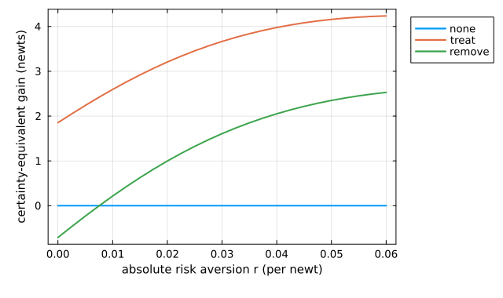

# Risk attitude and several attributes
Simon Frost

- [Motivation](#motivation)
- [A lottery over a count](#a-lottery-over-a-count)
- [The pond, valued without risk
  attitude](#the-pond-valued-without-risk-attitude)
- [Risk attitude on a table of runs](#risk-attitude-on-a-table-of-runs)
- [Two attributes: uninfected and
  infected](#two-attributes-uninfected-and-infected)
- [Summary](#summary)

## Motivation

So far a utility has been a count of animals. A count is a **linear**
utility: sixty newts for certain are worth exactly as much as an even
chance of none or a hundred and twenty. That is risk neutrality, and
many managers of small populations do not hold it. A pond that ends with
a handful of newts may not recover, so the bad outcomes weigh more than
their share.

This vignette keeps the outcomes as counts of animals and changes only
how they are valued:

1.  the **certainty equivalent** and the **risk premium** of a lottery
    over a count;
2.  utilities with a risk attitude, `ExponentialUtility` and
    `PowerUtility`, applied to a table of simulator runs;
3.  two attributes at once, uninfected and infected animals, with
    `AdditiveUtility` and the multiplicative form of Keeney and Raiffa,
    `MultiplicativeUtility`.

There is still no money anywhere. **All numbers are illustrative**: the
model is the toy pond of [vignette
11](11_sample_beliefs_and_outcome_tables.md),
and its parameters are not estimates for any real species or site.

## A lottery over a count

Take an even chance of 0 or 40 newts. Its mean is 20. A utility `u`
turns the lottery into an expected utility, and the certainty equivalent
turns that back into newts: the sure number that is exactly as good as
the lottery, `CE = u⁻¹(E u(X))`.

``` julia
using DecisionAnalysis
using Random: Xoshiro
include(joinpath("..", "_common.jl"))
include(joinpath("..", "_toy_pond.jl"))

lottery = [0, 40]
utilities = ["linear" => LinearUtility(:newts),
             "exponential, r = 0.02" => ExponentialUtility(:newts; risk_aversion=0.02),
             "exponential, r = 0.05" => ExponentialUtility(:newts; risk_aversion=0.05),
             "power, ρ = 0.5" => PowerUtility(:newts; risk_aversion=0.5),
             "exponential, r = −0.02 (risk-seeking)" => ExponentialUtility(:newts; risk_aversion=-0.02)]
md_table(["utility", "certainty equivalent (newts)", "risk premium (newts)"],
         [[name, Float64(certainty_equivalent(u, lottery)), Float64(risk_premium(u, lottery))]
          for (name, u) in utilities])
```

| utility | certainty equivalent (newts) | risk premium (newts) |
|:---|---:|---:|
| linear | 20 | 0 |
| exponential, r = 0.02 | 16.1 | 3.9 |
| exponential, r = 0.05 | 11.32 | 8.68 |
| power, ρ = 0.5 | 10 | 10 |
| exponential, r = −0.02 (risk-seeking) | 23.9 | -3.9 |

The risk premium is the mean minus the certainty equivalent: the number
of newts of expected outcome a manager would give up to be rid of the
risk. It is zero for the linear utility, positive for a risk-averse one
and negative for a risk-seeking one.

The two families differ in what the attitude is attached to.

- `ExponentialUtility(name; risk_aversion=r)` has constant **absolute**
  risk aversion: `u(x) = (1 − exp(−r x)) / r`. Adding ten newts to every
  outcome adds ten to the certainty equivalent. `1 / r` is the risk
  tolerance, in newts.
- `PowerUtility(name; risk_aversion=ρ)` has constant **relative** risk
  aversion: `u(x) = x^(1 − ρ) / (1 − ρ)`. Doubling every outcome doubles
  the certainty equivalent. It needs a positive count when `ρ ≥ 1`,
  since a count of zero then has utility −∞.

``` julia
cara = ExponentialUtility(:newts; risk_aversion=0.05)
crra = PowerUtility(:newts; risk_aversion=0.5)
md_table(["lottery", "exponential CE", "power CE"],
         [["0 or 40", certainty_equivalent(cara, [0, 40]), certainty_equivalent(crra, [0, 40])],
          ["10 or 50 (ten more)", certainty_equivalent(cara, [10, 50]), certainty_equivalent(crra, [10, 50])],
          ["0 or 80 (doubled)", certainty_equivalent(cara, [0, 80]), certainty_equivalent(crra, [0, 80])]])
```

| lottery             | exponential CE | power CE |
|:--------------------|---------------:|---------:|
| 0 or 40             |          11.32 |       10 |
| 10 or 50 (ten more) |          21.32 |    26.18 |
| 0 or 80 (doubled)   |           13.5 |       20 |

## The pond, valued without risk attitude

The problem is that of vignette 11. A fungal disease has reached a pond
of newts and the manager can mount one intervention in week 3, or none:
`none` (the baseline), `treat` (catch 70% and bathe them in antifungal;
handling kills 8% of those caught) or `remove` (catch 70% and remove
those that test positive, with 12% false positives).

``` julia
belief = SampleBelief(toy_draws(Xoshiro(11), 300))
table = outcomes(ToyPond(), TOY_ACTIONS, belief; replicates=20, seed=2026)
```

    OutcomeTable(300 draws × 3 actions × 20 replicates; outcomes uninfected, infected, alive, handled; 18000 runs ok, 0 failed, 0 absent)

Counting every newt alive at the end, the risk-neutral analysis is:

``` julia
alive = IndividualsUtility(:alive)
neutral = DecisionProblem(payoff_table(table, alive; baseline=:none), belief; baseline=:none)
md_table(["action", "expected gain over no intervention (newts)", "standard error"],
         [[e.action, Float64(e.value), e.standard_error]
          for e in expected_utility_estimates(neutral)])
```

| action   | expected gain over no intervention (newts) | standard error |
|:---------|-------------------------------------------:|---------------:|
| `none`   |                                          0 |              0 |
| `treat`  |                                       1.85 |            0.4 |
| `remove` |                                      -0.71 |            0.4 |

On average `treat` saves a couple of newts and `remove` loses some:
removal takes animals out of the pond, and in expectation that costs
more than the infections it prevents.

## Risk attitude on a table of runs

A utility with a risk attitude is not linear, and that changes the order
of the calculation. **The utility must be applied to every run, and only
then averaged**: the utility of the mean count of a cell is not the mean
utility. `payoff_table` does this for any utility. One cell shows the
difference:

``` julia
averse = ExponentialUtility(:alive; risk_aversion=0.02)
cell_runs = [v for v in table.values[1, 1, :, findfirst(==(:alive), outcome_names(table))]]
md_table(["quantity", "value"],
         [["runs of the cell (no intervention, draw 1)", join(Int.(cell_runs), ", ")],
          ["mean of the utilities of the runs (what `payoff_table` gives)", payoff_table(table, averse).Q[1, 1]],
          ["utility of the mean count (wrong)", averse(sum(cell_runs) / length(cell_runs))]]; digits=4)
```

| quantity | value |
|:---|---:|
| runs of the cell (no intervention, draw 1) | 45, 43, 44, 43, 45, 45, 43, 44, 44, 43, 33, 45, 45, 44, 45, 43, 45, 44, 45, 44 |
| mean of the utilities of the runs (what `payoff_table` gives) | 29.0652 |
| utility of the mean count (wrong) | 29.0943 |

Expected utility is now in units of utility and **no longer a count of
newts**. `certainty_equivalent` on the outcome table returns to newts.
For each action it takes the lottery over all its runs (a draw with its
weight, then a replicate) and gives the expected count, the certainty
equivalent and the risk premium:

``` julia
summary = certainty_equivalent(table, averse)
base = summary[1].certainty_equivalent
md_table(["action", "expected newts alive", "certainty equivalent", "risk premium",
          "certainty-equivalent gain over no intervention"],
         [[s.action, Float64(s.expected_outcome), s.certainty_equivalent, s.risk_premium,
           s.certainty_equivalent - base] for s in summary])
```

| action | expected newts alive | certainty equivalent | risk premium | certainty-equivalent gain over no intervention |
|:---|---:|---:|---:|---:|
| `none` | 60.67 | 51.99 | 8.68 | 0 |
| `treat` | 62.52 | 55.2 | 7.33 | 3.21 |
| `remove` | 59.96 | 52.99 | 6.97 | 1 |

Every action carries a risk premium of several newts, because the number
alive at the end varies a great deal between draws and runs. The premium
of `none` is the largest: doing nothing leaves the widest spread of
outcomes. That reverses one comparison. In expected newts `remove` was
worse than doing nothing; in certainty equivalents it is slightly
better, because removing infected animals trims the worst epidemics.
`treat` is best either way.

The choice of `r` is a value judgement, like the weight on infected
animals in earlier vignettes, so it is shown as a sweep:

``` julia
rs = 0.0:0.0025:0.06
gain(r) = let s = certainty_equivalent(table, ExponentialUtility(:alive; risk_aversion=r))
    [Float64(x.certainty_equivalent - s[1].certainty_equivalent) for x in s]
end
gains = reduce(hcat, [gain(r) for r in rs])
plt = Plots.plot(; xlabel="absolute risk aversion r (per newt)",
                 ylabel="certainty-equivalent gain (newts)")
for (i, a) in enumerate(TOY_ACTIONS)
    Plots.plot!(plt, collect(rs), gains[i, :]; label=String(a))
end
plt
```

```@raw html
<div id="fig-risk-sweep">
```



Figure 1: Certainty-equivalent gain over no intervention against the
manager’s risk aversion (illustrative).

```@raw html
</div>
```

At `r = 0` the gains are the expected gains of the risk-neutral table.
As `r` grows both interventions gain on the baseline, and `remove`
crosses from below it to above it at a small risk aversion.

The same decision problem goes through every rule and every value of
information of the package; only the units change.

``` julia
problem = DecisionProblem(table, averse; baseline=:none)
result = decide(problem, MaxExpectedUtility())
estimate = evpi(problem, SampleAverage())
md_table(["quantity", "value"],
         [["action with the largest expected utility", first_choice(result)],
          ["EVPI, in units of utility (not newts)", Float64(estimate.value)],
          ["its standard error", estimate.standard_error]]; digits=3)
```

| quantity                                 |   value |
|:-----------------------------------------|--------:|
| action with the largest expected utility | `treat` |
| EVPI, in units of utility (not newts)    |   0.346 |
| its standard error                       |   0.022 |

## Two attributes: uninfected and infected

The disease gives two counts at the end of a run: uninfected newts, of
which more is better, and infected newts, of which fewer is better.
Earlier vignettes combined them as `uninfected − w × infected`. That is
an **additive** utility over two attributes, and `AdditiveUtility`
writes it as such:

``` julia
w = 1 // 2
reference = payoff_table(table, InfectionUtility(; weight=w))
additive = payoff_table(table, AdditiveUtility(:uninfected => 1, :infected => -w))
additive.Q == reference.Q
```

    true

The usual way to state a multi-attribute utility is with every attribute
**scaled to \[0, 1\]** between a worst and a best level, and weights
that say how much the move from worst to best is worth on each. The
largest pond in the draws has 120 newts, so the scales run from 0 to 120
uninfected (more is better) and from 120 to 0 infected (fewer is
better):

``` julia
N = 120
uninfected = LinearUtility(:uninfected; worst=0, best=N)
infected = LinearUtility(:infected; worst=N, best=0)
scaled = AdditiveUtility(uninfected => 2 // 3, infected => 1 // 3)
scaled((; uninfected=60, infected=30))
```

    7//12

With weights 2/3 and 1/3 this is the same preference as
`uninfected − w × infected` at `w = 1/2` (a positive affine map of it),
so it makes the same choice:

``` julia
by_scaled = DecisionProblem(table, scaled; baseline=:none)
by_count = DecisionProblem(table, InfectionUtility(; weight=w); baseline=:none)
(decide(by_scaled, MaxExpectedUtility()).chosen, decide(by_count, MaxExpectedUtility()).chosen)
```

    ([:treat], [:treat])

The additive form assumes that what an improvement in one attribute is
worth does not depend on the level of the other. The **multiplicative**
form of Keeney and Raiffa drops that assumption with one more number.
With weights `k₁`, `k₂` it is

    1 + K U = (1 + K k₁ u₁)(1 + K k₂ u₂),

where the interaction constant `K` is fixed by the weights. If they sum
to one, `K = 0` and the form is additive. If they sum to more than one,
the attributes are **substitutes**: doing well on either is already
worth a lot. If they sum to less than one, they are **complements**: the
manager wants a pond that has many uninfected newts and few infected
ones at once.

``` julia
forms = ["additive, weights 2/3 and 1/3" => scaled,
         "substitutes, weights 0.8 and 0.8" => MultiplicativeUtility(uninfected => 0.8, infected => 0.8),
         "complements, weights 0.3 and 0.3" => MultiplicativeUtility(uninfected => 0.3, infected => 0.3),
         "infection first, weights 0.5 and 0.9" => MultiplicativeUtility(uninfected => 0.5, infected => 0.9)]
rows = map(forms) do (name, u)
    p = DecisionProblem(table, u; baseline=:none)
    scores = Float64.(aggregate(Expectation(), p))
    K = u isa MultiplicativeUtility ? Float64(u.interaction) : 0.0
    return [name, K, scores[1], scores[2], scores[3], first_choice(decide(p, MaxExpectedUtility()))]
end
md_table(["utility", "interaction K", "none", "treat", "remove", "choice"], rows; digits=4)
```

| utility | interaction K | none | treat | remove | choice |
|:---|---:|---:|---:|---:|---:|
| additive, weights 2/3 and 1/3 | 0 | 0.6255 | 0.656 | 0.6446 | `treat` |
| substitutes, weights 0.8 and 0.8 | -0.9375 | 0.8615 | 0.8821 | 0.8803 | `treat` |
| complements, weights 0.3 and 0.3 | 4.4444 | 0.6055 | 0.6384 | 0.6266 | `treat` |
| infection first, weights 0.5 and 0.9 | -0.8889 | 0.9092 | 0.9291 | 0.9296 | `remove` |

These expected utilities lie between 0 and 1 and are not counts of
animals, and a multi-attribute utility has no certainty equivalent:
there is no single count to return to. The comparison with no
intervention is still there, as the difference from the `none` column.
Treatment is chosen under most of these value judgements. When having
few infected animals matters much more than having many uninfected ones,
removal overtakes it, since it leaves fewer infected newts behind.

Risk attitude and several attributes combine: any attribute may carry
its own risk attitude, scaled the same way.

``` julia
cautious = MultiplicativeUtility(ExponentialUtility(:uninfected; risk_aversion=0.02, worst=0, best=N) => 0.6,
                                 infected => 0.6)
p = DecisionProblem(table, cautious; baseline=:none)
md_table(["action", "expected utility", "gain over no intervention"],
         [[a, Float64(s), Float64(g)] for (a, s, g) in
          zip(feasible_actions(p), aggregate(Expectation(), p), expected_gain_over_baseline(p))]; digits=4)
```

| action   | expected utility | gain over no intervention |
|:---------|-----------------:|--------------------------:|
| `none`   |           0.8341 |                         0 |
| `treat`  |           0.8655 |                    0.0314 |
| `remove` |           0.8618 |                    0.0277 |

## Summary

- A count of animals is a linear, risk-neutral utility.
  `ExponentialUtility` and `PowerUtility` add a risk attitude to one
  named outcome; `certainty_equivalent` and `risk_premium` report it in
  animals.
- A non-linear utility is applied to every run before averaging.
  `payoff_table` does this; averaging the outcomes first would be wrong.
- With a non-linear utility, expected utility and the value of
  information are in units of utility. Return to animals with the
  certainty equivalent.
- `AdditiveUtility` and `MultiplicativeUtility` combine attributes
  scaled to \[0, 1\]; `InfectionUtility` is the additive case with
  unscaled counts.
- The risk aversion and the attribute weights are value judgements. Show
  the choice across them, and always beside the no-intervention
  baseline.
