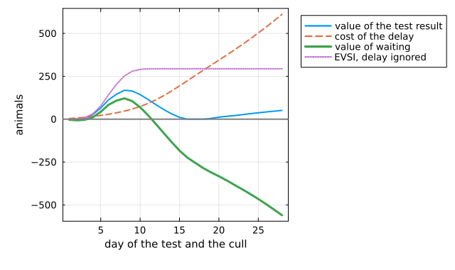

# Act now, or wait and learn?
Simon Frost

- [The question](#the-question)
- [Acting now](#acting-now)
- [Waiting a week](#waiting-a-week)
- [How long to wait](#how-long-to-wait)
- [What to take from this](#what-to-take-from-this)

## The question

An outbreak has started in a herd, and it is not yet known how fast the
disease spreads. A pre-emptive cull would slow it, at the price of the
animals culled. If the disease is slow a large cull loses far more
animals than it saves; if it is fast, a large cull is the least bad
course. Testing a sample of the herd in a week or two would show how
fast the disease is spreading, but by then it will have spread further
and a cull will protect less. Is the information worth the wait?

The expected value of sample information (`evsi`) does not answer this.
It values a study as if its result arrived at once and the same actions,
with the same consequences, were still available. `value_of_waiting`
compares acting now with acting late on what was learned, with the
damage done during the wait counted in the outcome.

**The herd, the disease and every number below are invented** to show
the calculation. They describe no real outbreak.

**Actions.** No cull (`none`, the `baseline`), or a cull of 30% or of
60% of the animals that are still susceptible on the day of the cull.

**States.** The disease is `slow`, `moderate` or `fast`: each infected
animal infects 1.2, 1.8 or 3 others in a fully susceptible herd.

**Outcome.** Animals lost over one year, out of 10,000: those infected
(the disease is taken to kill) and those culled. Utility is minus that
number. No money is involved, and the cost of waiting is itself in
animals.

**Information.** On the day of the decision, 200 animals are tested and
the number that have been infected is counted.

``` julia
using DecisionAnalysis
include(joinpath("..", "_common.jl"))
using Plots

const HERD, SEED, RECOVERY, HORIZON = 10_000, 10, 1 / 5, 365
const SPREAD = [1.2, 1.8, 3.0]
const STATES = [:slow, :moderate, :fast]
const CULLS = [0.0, 0.3, 0.6]
const ACTIONS = [:none, :cull_30, :cull_60]

# A deterministic SIR model in tenths of a day. A fraction `cull` of the susceptible
# animals is removed at the start of day `day`. Returns the animals lost over the year
# and the number ever infected by the start of each day.
function outbreak(spread; cull=0.0, day=0)
    S, I, infected, culled = float(HERD - SEED), float(SEED), float(SEED), 0.0
    ever = [infected]
    for t in 0:(HORIZON - 1)
        if t == day
            culled = cull * S
            S -= culled
        end
        for _ in 1:10
            new = 0.1 * spread * RECOVERY * S * I / HERD
            S -= new
            I += new - 0.1 * RECOVERY * I
            infected += new
        end
        push!(ever, infected)
    end
    return (; lost=infected + culled, ever)
end

# The payoffs of each action taken on day `day`, over the whole year.
function payoffs(day)
    return PayoffTable(ACTIONS, STATES,
                       [-outbreak(R; cull=c, day).lost for c in CULLS, R in SPREAD])
end

# Testing `n` animals on day `day`: the number found to have been infected is binomial.
function testing(day; n=200)
    share = [outbreak(R).ever[day + 1] / HERD for R in SPREAD]
    L = [Float64(binomial(big(n), k)) * q^k * (1 - q)^(n - k) for k in 0:n, q in share]
    return Experiment(L; signals=[Symbol("positive", k) for k in 0:n], states=STATES)
end
nothing
```

## Acting now

The prior gives the slow and the moderate disease a probability of 0.4
each and the fast one 0.2.

``` julia
problem = DecisionProblem(payoffs(0), [0.4, 0.4, 0.2]; baseline=:none)
labelled_table("animals lost", ACTIONS, STATES, -problem.payoff.Q; digits=0)
```

| animals lost | `slow` | `moderate` | `fast` |
|:-------------|-------:|-----------:|-------:|
| `none`       |   3177 |       7339 |   9418 |
| `cull_30`    |   3058 |       5707 |   8766 |
| `cull_60`    |   6013 |       6029 |   7297 |

``` julia
gains = expected_gain_over_baseline(problem)
md_table(["action", "expected animals lost", "animals saved against no cull"],
         [[a, -aggregate(Expectation(), problem)[i], gains[i]]
          for (i, a) in enumerate(ACTIONS)]; digits=0)
```

| action    | expected animals lost | animals saved against no cull |
|:----------|----------------------:|------------------------------:|
| `none`    |                  6090 |                             0 |
| `cull_30` |                  5259 |                           831 |
| `cull_60` |                  6276 |                          -187 |

No single action is best in every state: a small cull is best if the
disease is slow or moderate (if slow, by little over no cull), and the
large one if it is fast. On the prior the small cull is best, and the
large one is worse than no cull at all. Knowing the state before acting
would save

``` julia
round(evpi(problem); digits=1)
```

    293.8

animals on average. That is the most that any information could be
worth, if it were free and immediate.

## Waiting a week

Suppose the cull is put off for seven days and 200 animals are tested on
the seventh day. The payoff table for a cull on day 7 comes from the
same model, over the same year:

``` julia
labelled_table("animals lost, cull on day 7", ACTIONS, STATES, -payoffs(7).Q; digits=0)
```

| animals lost, cull on day 7 | `slow` | `moderate` | `fast` |
|:----------------------------|-------:|-----------:|-------:|
| `none`                      |   3177 |       7339 |   9418 |
| `cull_30`                   |   3087 |       5752 |   8804 |
| `cull_60`                   |   6024 |       6096 |   7685 |

Every cull does less than it would have done on day 0, most of all if
the disease is fast. The row for no cull is unchanged.

``` julia
week = value_of_waiting(problem, payoffs(7), testing(7))
md_table(["quantity (animals)", "value"],
         [["expected loss, best action now (" * String(week.act_now_action) * ")",
           -week.act_now_value],
          ["expected loss, wait a week, test, then act", -week.waiting_value],
          ["value of waiting", week.value],
          ["   of which: value of the test result to the late decision", week.evsi_delayed],
          ["   of which: cost of the delay alone", -week.delay_cost],
          ["EVSI of the same test on the payoffs of acting now", week.evsi_now]]; digits=1)
```

| quantity (animals)                                      |  value |
|:--------------------------------------------------------|-------:|
| expected loss, best action now (cull_30)                | 5259.1 |
| expected loss, wait a week, test, then act              | 5150.8 |
| value of waiting                                        |  108.3 |
| of which: value of the test result to the late decision |  145.4 |
| of which: cost of the delay alone                       |  -37.1 |
| EVSI of the same test on the payoffs of acting now      |    204 |

Waiting a week is worth it: about a hundred animals. The value splits in
two. The test result is worth something to the decision taken on day 7,
and the delay costs something whatever is learned; the value of waiting
is the first minus the second.

The last row is what `evsi` gives if the delay is ignored: the test is
valued as if a cull on day 7 did what a cull on day 0 does. It is nearly
twice the value of waiting. Whenever no action does better late than
now, this number can only overstate the value of waiting (proved in the
Lean development, `valueOfWaiting_le_evsi`), and subtracting a fee for
the study from it would not put that right, because the loss is in what
the actions can still achieve.

What is done after the test:

``` julia
chosen = Dict(a => [parse(Int, String(z)[9:end]) for (z, b) in week.policy if b == a]
              for a in ACTIONS)
md_table(["animals positive, of 200", "action on day 7"],
         [Any[isempty(chosen[a]) ? "never" :
              a == :cull_60 ? string(minimum(chosen[a]), " or more") :
              string(minimum(chosen[a]), " to ", maximum(chosen[a])), a] for a in ACTIONS])
```

| animals positive, of 200 | action on day 7 |
|:-------------------------|----------------:|
| never                    |          `none` |
| 0 to 2                   |       `cull_30` |
| 3 or more                |       `cull_60` |

## How long to wait

Waiting longer makes the test more telling, because more animals have
been infected and the three rates of spread have drawn apart. It also
makes every cull weaker. `value_of_waiting` takes several lengths of
wait at once and names the best.

``` julia
days = 1:28
waits = value_of_waiting(problem, [Symbol("day", d) => (payoffs(d), testing(d))
                                   for d in days])
waits.best, round(maximum(waits.values); digits=1)
```

    (:day8, 121.5)

``` julia
plot(days, [r.evsi_delayed for r in waits.results]; label="value of the test result",
     xlabel="day of the test and the cull", ylabel="animals")
plot!(days, [r.delay_cost for r in waits.results]; label="cost of the delay",
      linestyle=:dash)
plot!(days, waits.values; label="value of waiting", linewidth=3)
plot!(days, [r.evsi_now for r in waits.results]; label="EVSI, delay ignored",
      linestyle=:dot)
hline!([0]; color=:grey, label="")
```



``` julia
shown = [3, 7, 10, 14, 21, 28]
md_table(["day", "value of the test result", "cost of the delay", "value of waiting",
          "wait?", "EVSI, delay ignored"],
         [Any[d, waits.results[d].evsi_delayed, waits.results[d].delay_cost,
              waits.values[d], waits.results[d].wait, waits.results[d].evsi_now]
          for d in shown]; digits=1)
```

| day | value of the test result | cost of the delay | value of waiting | wait? | EVSI, delay ignored |
|:---|---:|---:|---:|---:|---:|
| 3 | 7.9 | 11.3 | -3.4 | \- | 8.8 |
| 7 | 145.4 | 37.1 | 108.3 | yes | 204 |
| 10 | 143.3 | 73.9 | 69.4 | yes | 290.4 |
| 14 | 31.1 | 164.7 | -133.6 | \- | 293.8 |
| 21 | 16.9 | 374.2 | -357.3 | \- | 293.8 |
| 28 | 51.1 | 610.8 | -559.7 | \- | 293.8 |

There is a window, and the best wait here is eight days. In the first
days too few animals have been infected for 200 tests to tell the rates
apart, and the little that is learned does not repay even a short delay.
Between day 10 and day 14 the cost of the delay overtakes the value of
the result, and from then on waiting is worse than acting now, although
the test is by then as good as knowing the rate of spread. The EVSI with
the delay ignored keeps rising towards the value of perfect information
and would recommend the longest wait.

The value of the test result to the late decision falls sharply in the
second week even though the test improves. Information is only worth
what can still be done with it, and late in a fast outbreak no cull does
much.

## What to take from this

- The value of waiting is the value of the information *for the decision
  that is still open after the wait*, minus what the wait costs with
  nothing learned. Both are in the units of the outcome.
- It needs a second payoff table: the consequences of each action taken
  late, over the same horizon as the first. That table comes from the
  model, not from the value of information.
- An EVSI computed on the payoffs of acting now is an upper bound when
  delay never helps, and can be far above the value of waiting.
- The comparison with no intervention stays in view throughout: the
  gains of each cull over no cull are what the wait erodes.
