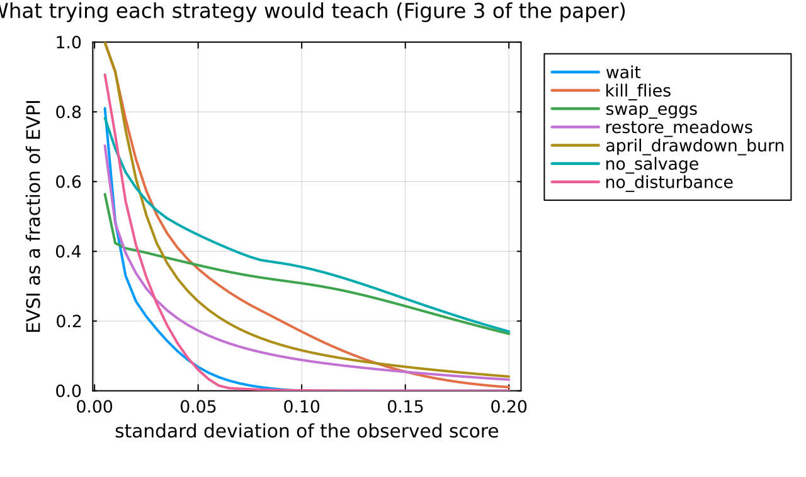

# Learning by doing for whooping cranes (Runge et al. 2011)
Simon Frost

- [About this case study](#about-this-case-study)
- [The paper](#the-paper)
- [EVPI, and the value of testing one
  hypothesis](#evpi-and-the-value-of-testing-one-hypothesis)
- [Learning by doing](#learning-by-doing)
- [What the package adds](#what-the-package-adds)
  - [Is the binned experiment
    accurate?](#is-the-binned-experiment-accurate)
  - [Net of what the trial year
    costs](#net-of-what-the-trial-year-costs)
  - [A set of weights](#a-set-of-weights)
- [What to take away](#what-to-take-away)
- [Next](#next)

## About this case study

This case study replicates a published analysis. The inputs are tables
printed in the paper, every result is shown beside the published one,
and the same comparisons are in the test suite
(`test/fixtures/replications/runge2011_cranes.json`,
`test/test_replications.jl`).

## The paper

Runge, Converse and Lyons (2011), “Which uncertainty? Using expert
elicitation and expected value of information to design an adaptive
program”, *Biological Conservation* 144:1214-1223,
[doi:10.1016/j.biocon.2010.12.020](https://doi.org/10.1016/j.biocon.2010.12.020).
The authors were employees of the United States Geological Survey and
the Fish and Wildlife Service. The inputs are Tables 2 and 5 of the
article.

**Decision.** How to manage Necedah National Wildlife Refuge so that the
reintroduced whooping cranes (*Grus americana*), which were abandoning
their nests, breed successfully.

**Actions.** Seven strategies: wait, kill black flies, swap eggs,
restore meadows, an April drawdown and burn, stop salvaging eggs, and
remove human disturbance. `wait` is the status quo and is the
`baseline`.

**States.** Eight hypotheses for the nest failures.

**Belief.** The weights that ten experts gave the hypotheses, averaged.
They are printed as percentages that sum to 100.1 and are normalised
here.

**Outcome.** A score between 0 and 1: the experts’ predictions for four
objectives (territorial pairs, fledging rate, adult survival, body
condition), each normalised and then weighted. It is dimensionless and
it is the paper’s. Table 2 of the paper, the fledging rate alone (young
fledged per pair), is used further down.

``` julia
using DecisionAnalysis
include(joinpath("..", "_common.jl"))
using Plots

strategies = [:wait, :kill_flies, :swap_eggs, :restore_meadows, :april_drawdown_burn,
              :no_salvage, :no_disturbance]
hypotheses = [:too_young, :black_flies, :social_conditioning, :nutrients_refuge,
              :nutrients_winter, :nutrients_both, :egg_salvage, :disturbance]
percent = [94, 291, 119, 228, 59, 66, 44, 100] .// 10       # Table 5, "Weight (%)"
weights = percent ./ sum(percent)
# Table 5: rows = hypotheses, columns = strategies; weighted score in thousandths.
score = [586 491 581 735 663 539 402
          21 425 242 373 253 589 139
          93 145 220 429 321 218 485
          36  81 254 992 863 128 166
          93 119 260 466 405 185 223
          36  77 243 792 703 172 179
         147 622 662 436 291 354 158
         120 393 740 363 216 168 256] .// 1000
problem = DecisionProblem(PayoffTable(strategies, hypotheses, permutedims(score)),
                          FiniteBelief(hypotheses, weights); baseline=:wait)
md_table(["strategy", "expected score, paper", "this package", "gain over waiting", "chosen"],
         [[a, q, e, g, a in decide(problem, MaxExpectedUtility()).chosen]
          for (a, q, e, g) in zip(strategies, (0.106, 0.284, 0.343, 0.590, 0.475, 0.331, 0.231),
                                  aggregate(Expectation(), problem),
                                  expected_gain_over_baseline(problem))]; digits=3)
```

| strategy | expected score, paper | this package | gain over waiting | chosen |
|:---|---:|---:|---:|---:|
| `wait` | 0.106 | 0.107 | 0 | \- |
| `kill_flies` | 0.284 | 0.284 | 0.177 | \- |
| `swap_eggs` | 0.343 | 0.343 | 0.237 | \- |
| `restore_meadows` | 0.59 | 0.59 | 0.483 | yes |
| `april_drawdown_burn` | 0.475 | 0.475 | 0.368 | \- |
| `no_salvage` | 0.331 | 0.332 | 0.225 | \- |
| `no_disturbance` | 0.231 | 0.231 | 0.124 | \- |

The printed row was computed from unrounded predictions; from the
three-decimal table every column agrees to 0.001.

## EVPI, and the value of testing one hypothesis

``` julia
v0 = act_now_value(problem)
md_table(["quantity", "paper", "this package"],
         [["expected score of the best strategy", 0.590, v0],
          ["expected score with the hypothesis known", 0.707, v0 + evpi(problem)],
          ["EVPI", 0.117, evpi(problem)],
          ["EVPI, % of the best expected score", 19.9, 100 * evpi(problem) / v0]]; digits=3)
```

| quantity                                 | paper | this package |
|:-----------------------------------------|------:|-------------:|
| expected score of the best strategy      |  0.59 |         0.59 |
| expected score with the hypothesis known | 0.707 |        0.707 |
| EVPI                                     | 0.117 |        0.117 |
| EVPI, % of the best expected score       |  19.9 |       19.855 |

The paper’s partial value, which it calls EVPXI, is the value of a
perfect test of one hypothesis: the test confirms it, or refutes it and
leaves the others with their weights in proportion. That is the EVPPI of
a two-cell partition, which `hypothesis_partition` builds.

``` julia
hypothesis_partition(problem, :black_flies)
```

    8-element Vector{Symbol}:
     :other
     :black_flies
     :other
     :other
     :other
     :other
     :other
     :other

``` julia
partial = [evppi(problem, hypothesis_partition(problem, h)) for h in hypotheses]
paper_share = Dict(:black_flies => "54", :disturbance => "32", :egg_salvage => "8",
                   :social_conditioning => "6")
md_table(["hypothesis tested", "value", "% of EVPI, paper", "% of EVPI, this package"],
         [[h, v, get(paper_share, h, "under 1"), 100 * v / evpi(problem)]
          for (h, v) in zip(hypotheses, partial)]; digits=3)
```

| hypothesis tested     | value | % of EVPI, paper | % of EVPI, this package |
|:----------------------|------:|-----------------:|------------------------:|
| `too_young`           |     0 |          under 1 |                       0 |
| `black_flies`         | 0.063 |               54 |                  53.648 |
| `social_conditioning` | 0.007 |                6 |                   5.688 |
| `nutrients_refuge`    |     0 |          under 1 |                       0 |
| `nutrients_winter`    |     0 |          under 1 |                       0 |
| `nutrients_both`      |     0 |          under 1 |                       0 |
| `egg_salvage`         |  0.01 |                8 |                   8.487 |
| `disturbance`         | 0.038 |               32 |                  32.177 |

The paper remarks that in this case the partial values sum to the EVPI.
They do, exactly:

``` julia
sum(partial) == evpi(problem)
```

    true

This is a property of this table, not of partial values (the next two
vignettes show sums above and below the whole). It holds here because
restoring meadows is the best strategy under four hypotheses and, when
any one of the other four is refuted, remains the best on the rest; so
each test is worth exactly the gain from switching under its own
hypothesis.

For the fledging rate on its own (Table 2 of the paper) the best
strategy under uncertainty is restoring meadows, which is the best
strategy under no single hypothesis:

``` julia
fledging = [246 216 235 244 256 223 181
             69 199 128 124 119 204  99
             74  97 108 139 141 113 191
             74  94 140 289 290 103 116
             74  89 125 144 156 103 116
             74  89 135 244 245 116 121
             94 226 227 147 128 166 105
             91 154 252 127 108 106 150] .// 1000
fproblem = DecisionProblem(PayoffTable(strategies, hypotheses, permutedims(fledging)),
                           FiniteBelief(hypotheses, weights); baseline=:wait)
f0 = act_now_value(fproblem)
md_table(["quantity (young fledged per pair)", "paper", "this package"],
         [["best expected fledging rate (restore meadows)", 0.185, f0],
          ["with the hypothesis known", 0.232, f0 + evpi(fproblem)],
          ["increase, %", 25.7, 100 * evpi(fproblem) / f0]]; digits=3)
```

| quantity (young fledged per pair)             | paper | this package |
|:----------------------------------------------|------:|-------------:|
| best expected fledging rate (restore meadows) | 0.185 |        0.185 |
| with the hypothesis known                     | 0.232 |        0.233 |
| increase, %                                   |  25.7 |       25.709 |

## Learning by doing

The paper then asks which strategy teaches most. Suppose one strategy is
applied and its weighted score observed with normally distributed error
of standard deviation `sd`. The observation updates the weights on the
hypotheses, and the strategy is then chosen again. Its value is an EVSI.
`gaussian_experiment` builds the experiment from the row of the table
for the strategy tried (the score each hypothesis predicts) and the
error; it discretises the observation into bins.

``` julia
Q = Float64.(permutedims(score))
fproblem64 = DecisionProblem(PayoffTable(strategies, hypotheses, Q),
                             FiniteBelief(hypotheses, Float64.(weights)); baseline=:wait)
total = evpi(fproblem64)
trial(a, sd) = gaussian_experiment(Q[findfirst(==(a), strategies), :], sd;
                                   states=hypotheses, bins=1200)
fraction(a, sd) = evsi(fproblem64, trial(a, sd)) / total
sds = 0.005:0.005:0.2
plt = plot(; xlabel="standard deviation of the observed score",
           ylabel="EVSI as a fraction of EVPI", ylims=(0, 1),
           title="What trying each strategy would teach (Figure 3 of the paper)")
for a in strategies
    plot!(plt, sds, [fraction(a, sd) for sd in sds]; label=String(a))
end
png_figure(plt)
```



The paper gives this result as a figure and three sentences. Against
values read from its Figure 3 by eye (to about 0.03):

``` julia
md_table(["strategy tried", "sd", "read from Figure 3", "this package"],
         [[a, sd, r, fraction(a, sd)]
          for (a, sd, r) in ((:swap_eggs, 0.10, 0.31), (:swap_eggs, 0.20, 0.17),
                             (:no_salvage, 0.10, 0.36), (:no_salvage, 0.20, 0.17))];
         digits=3)
```

| strategy tried |  sd | read from Figure 3 | this package |
|:---------------|----:|-------------------:|-------------:|
| `swap_eggs`    | 0.1 |               0.31 |        0.308 |
| `swap_eggs`    | 0.2 |               0.17 |        0.164 |
| `no_salvage`   | 0.1 |               0.36 |        0.355 |
| `no_salvage`   | 0.2 |               0.17 |         0.17 |

``` julia
most(sd) = strategies[argmax([fraction(a, sd) for a in strategies])]
md_table(["sd", "most informative strategy", "its share of EVPI", "share for kill flies"],
         [[sd, most(sd), fraction(most(sd), sd), fraction(:kill_flies, sd)]
          for sd in (0.01, 0.02, 0.023, 0.028, 0.03, 0.05, 0.1)]; digits=3)
```

| sd    | most informative strategy | its share of EVPI | share for kill flies |
|:------|--------------------------:|------------------:|---------------------:|
| 0.01  |     `april_drawdown_burn` |             0.916 |                0.914 |
| 0.02  |              `kill_flies` |             0.664 |                0.664 |
| 0.023 |              `kill_flies` |             0.607 |                0.607 |
| 0.028 |              `kill_flies` |              0.53 |                 0.53 |
| 0.03  |              `no_salvage` |             0.517 |                0.505 |
| 0.05  |              `no_salvage` |             0.447 |                 0.35 |
| 0.1   |              `no_salvage` |             0.355 |                 0.17 |

The paper’s sentences are: with a standard deviation “of 0.03 or less”
killing flies is the most informative strategy and generates more than
60% of the EVPI; above 0.03 the most informative is no salvage, followed
closely by swapping eggs; and restoring meadows is never very
informative. We find the same ordering and the same crossing, slightly
earlier: killing flies is the most informative up to a standard
deviation of 0.028 and passes 60% of the EVPI only up to 0.023 (it gives
50% at 0.03). The paper has no table to settle the difference, and its
figure agrees with ours to reading precision, so the sentence appears to
be a little generous at its upper end. In our calculation the April
drawdown is as informative as killing flies when the measurement is very
precise (a standard deviation of 0.01).

The strategy that is best to adopt, restoring meadows, is a poor one to
learn from: at a standard deviation of 0.05 it recovers 17% of the EVPI,
against 45% for stopping the egg salvage.

## What the package adds

### Is the binned experiment accurate?

The experiment is a discretised measurement, so its EVSI should not move
when the bins are refined.

``` julia
md_table(["bins", "EVSI of trying kill flies at sd = 0.03"],
         [[b, evsi(fproblem64, gaussian_experiment(Q[2, :], 0.03; states=hypotheses, bins=b))]
          for b in (100, 400, 1600, 6400)]; digits=6)
```

| bins | EVSI of trying kill flies at sd = 0.03 |
|:-----|---------------------------------------:|
| 100  |                               0.059134 |
| 400  |                               0.059076 |
| 1600 |                               0.059068 |
| 6400 |                               0.059068 |

### Net of what the trial year costs

Trying a strategy for a season is not free: the cranes get that
strategy’s outcome and not the best one. The paper leaves this out. In
the units of the score, the expected shortfall of each strategy from
restoring meadows is its expected regret less the EVPI, and the value of
what is learned can be set against it. Both are scores for one season,
so the comparison assumes that what is learned is used for one later
season; if it is used for `k` seasons the EVSI is multiplied by `k`.

``` julia
shortfall = Float64.(v0 .- aggregate(Expectation(), problem))
net(a, sd, k) = k * evsi(fproblem64, trial(a, sd)) - shortfall[findfirst(==(a), strategies)]
md_table(["strategy tried", "shortfall in the trial season", "EVSI at sd = 0.05",
          "net, used for 1 season", "net, used for 5 seasons"],
         [[a, s, evsi(fproblem64, trial(a, 0.05)), net(a, 0.05, 1), net(a, 0.05, 5)]
          for (a, s) in zip(strategies, shortfall)]; digits=3)
```

| strategy tried | shortfall in the trial season | EVSI at sd = 0.05 | net, used for 1 season | net, used for 5 seasons |
|:---|---:|---:|---:|---:|
| `wait` | 0.483 | 0.008 | -0.475 | -0.443 |
| `kill_flies` | 0.305 | 0.041 | -0.265 | -0.101 |
| `swap_eggs` | 0.246 | 0.042 | -0.204 | -0.035 |
| `restore_meadows` | 0 | 0.02 | 0.02 | 0.101 |
| `april_drawdown_burn` | 0.114 | 0.03 | -0.084 | 0.036 |
| `no_salvage` | 0.258 | 0.052 | -0.206 | 0.004 |
| `no_disturbance` | 0.358 | 0.007 | -0.351 | -0.323 |

Used for one season, no trial pays for itself: every departure from
restoring meadows costs more score than its information returns. Over
five seasons, of the two strategies the paper singles out, no salvage
just breaks even and swapping eggs does not, while restoring meadows,
which costs nothing to try and still teaches something, is well ahead.
Probing with another strategy overtakes learning passively from
restoring meadows only when the lesson is used for longer:

``` julia
horizon(a, sd) = findfirst(k -> net(a, sd, k) > net(:restore_meadows, sd, k), 1:200)
md_table(["strategy tried", "seasons of use needed to beat learning from restore meadows, sd = 0.05",
          "sd = 0.02"],
         [[a, something(horizon(a, 0.05), "never (within 200)"),
           something(horizon(a, 0.02), "never (within 200)")]
          for a in (:kill_flies, :swap_eggs, :no_salvage)])
```

| strategy tried | seasons of use needed to beat learning from restore meadows, sd = 0.05 | sd = 0.02 |
|:---|---:|---:|
| `kill_flies` | 15 | 8 |
| `swap_eggs` | 12 | 33 |
| `no_salvage` | 9 | 10 |

These horizons are ours and rest on the one-season reading of the score;
the paper reports the gross EVSI only.

### A set of weights

The weights are an average over ten experts and the paper does not print
the individual ones. As a check on how much rests on them, take the set
of all mixtures of the panel’s weights with the two beliefs that move a
quarter of the total weight towards one of the two hypotheses that
matter most, black flies or disturbance.

``` julia
function shifted(h, amount)
    w = (1 - amount) .* weights
    w[findfirst(==(h), hypotheses)] += amount
    return w
end
credal = CredalSet(hypotheses, [weights, shifted(:black_flies, 1 // 4),
                                shifted(:disturbance, 1 // 4)])
robust = DecisionProblem(PayoffTable(strategies, hypotheses, permutedims(score)), credal;
                         baseline=:wait)
v = robust_evpi(robust)
md_table(["quantity", "score"],
         [["lowest EVPI over the set", v.lower], ["highest EVPI over the set", v.upper]];
         digits=3)
```

| quantity                  | score |
|:--------------------------|------:|
| lowest EVPI over the set  | 0.117 |
| highest EVPI over the set | 0.182 |

The EVPI rises by half at the far end of the set, and the choice does
not move:

``` julia
md_table(["rule", "strategies kept"],
         [["Γ-maximin", decide(robust, GammaMaximin()).chosen],
          ["E-admissible", decide(robust, EAdmissible()).chosen],
          ["minimax regret (no weights at all)",
           decide(problem, MinimaxRegret()).chosen]])
```

| rule                               |   strategies kept |
|:-----------------------------------|------------------:|
| Γ-maximin                          | `restore_meadows` |
| E-admissible                       | `restore_meadows` |
| minimax regret (no weights at all) | `restore_meadows` |

## What to take away

- The paper’s expected scores, the best strategy (restore meadows,
  0.590), the value with perfect information (0.707) and the EVPI
  (0.117, 19.9%) are reproduced from Table 5, and the fledging-rate
  figures from Table 2.
- The paper’s “EVPXI” of a hypothesis is
  `evppi(problem, hypothesis_partition(problem, h))`. The shares of EVPI
  are reproduced (black flies 54%, disturbance 32%, egg salvage 8%,
  social conditioning 6%), and so is the remark that they sum to the
  EVPI.
- `gaussian_experiment` gives the EVSI of trying a strategy and
  observing its outcome with error. The curves agree with Figure 3 of
  the paper; the point at which killing flies stops being the most
  informative strategy is a standard deviation of 0.028, and it exceeds
  60% of the EVPI up to 0.023, where the text says 0.03.
- Added here: a check that the binning does not matter, the value of a
  trial net of the score forgone while trying it, and the range of the
  EVPI over a set of weights.

## Next

[ICU beds before a pandemic
wave](29_epidemiology_eze_icu.md) takes up
the difference between the value of testing a hypothesis and the value
of learning a parameter.
