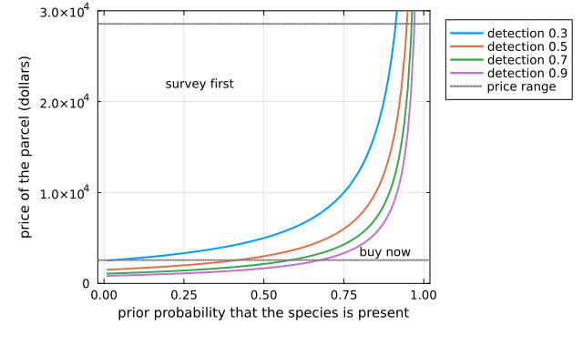
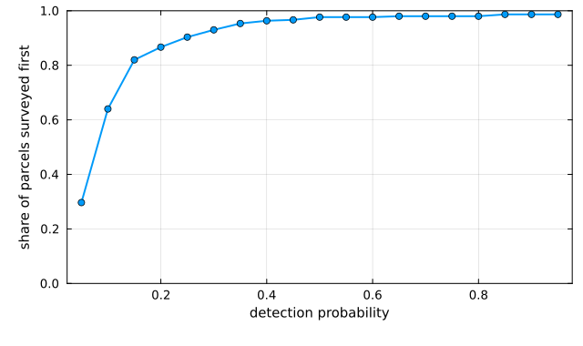
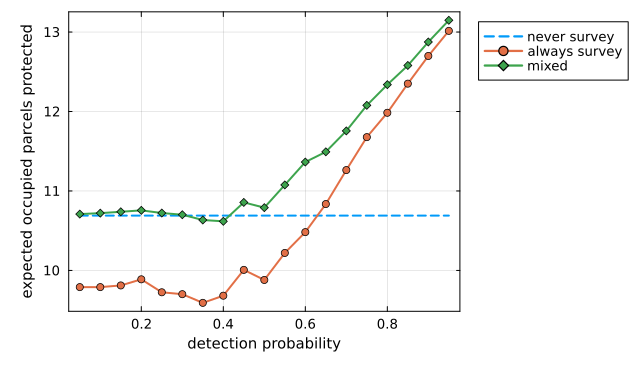

# Survey first or act now, under a budget
Simon Frost

- [The question](#the-question)
- [One parcel](#one-parcel)
- [The rule](#the-rule)
- [Three hundred synthetic parcels](#three-hundred-synthetic-parcels)
- [Spending the budget](#spending-the-budget)
- [What the budget means](#what-the-budget-means)
- [More than one species](#more-than-one-species)
- [What to take from this](#what-to-take-from-this)

## The question

A conservation agency can buy parcels of land to protect a species. For
each parcel it has a probability that the species is there. It can buy a
parcel now, or pay for a survey first and buy only if the survey finds
the species. A survey costs money that could have bought land, and it
can miss a species that is present. Which parcels should be surveyed,
and which should the budget be spent on?

This is the question of Raymond, Schuster, McCune and Bennett (2020),
“Combining species distribution models and value of information analysis
for spatial allocation of conservation resources”, *Journal of Applied
Ecology* 57:819-830,
[doi:10.1111/1365-2664.13580](https://doi.org/10.1111/1365-2664.13580).
The functions `survey_or_act` and `select_under_budget` follow the
method of that paper.

**This is not a replication.** The paper’s 238,247 parcels
(probabilities of occurrence and land prices in southern Ontario) are
licensed data and are not archived, so its tables cannot be recomputed.
The parcels below are **synthetic**: their probabilities and prices are
random numbers and describe no real place. Four numbers are the paper’s
own: a survey costs 750 Canadian dollars a parcel, the budget is 100,000
dollars, land prices lie between the smallest and largest per-hectare
prices it reports (2,573 and 28,560 dollars), and its worked example has
a prior of 0.10 and a detection probability of 0.70.

**Actions.** For each parcel, buy it (`protect`) or not (`none`). Not
buying is the `baseline`, and every value below is a gain over it.

**States.** The species is `present` or `absent`.

**Outcome.** Parcels protected that hold the species: protecting a
parcel is worth 1 where the species is present and 0 where it is not.
Money is not part of the outcome. It is the constraint: the question is
how many occupied parcels a budget protects.

**Information.** A survey finds a present species with probability `d`
and never reports an absent one.

``` julia
using DecisionAnalysis
include(joinpath("..", "_common.jl"))
using Plots
using Random

function parcel(prior)
    table = PayoffTable([:none, :protect], [:absent, :present], [0 0; 0 1])
    return DecisionProblem(table, [1 - prior, prior]; baseline=:none)
end
survey(d) = Experiment([1 1-d; 0 d]; signals=[:not_found, :found])
nothing
```

## One parcel

The paper’s worked example: the species is present with probability 0.10
and the survey detects it with probability 0.70. The paper gives this
parcel no price; the 7,146 dollars used here is the mean price per
hectare that it reports.

``` julia
unit = survey_or_act(parcel(1 // 10), survey(7 // 10); action_costs=[0, 7146],
                     survey_cost=750)
md_table(["option", "value (occupied parcels protected)", "expected cost (dollars)",
          "value per million dollars"],
         [["buy now", Float64(unit.act_now.value), Float64(unit.act_now.cost),
           1e6 * Float64(unit.act_now.cost_effectiveness)],
          ["survey first, buy if found", Float64(unit.survey.value),
           Float64(unit.survey.cost), 1e6 * Float64(unit.survey.cost_effectiveness)],
          ["do nothing (baseline)", 0, 0, 0]]; digits=3)
```

| option | value (occupied parcels protected) | expected cost (dollars) | value per million dollars |
|:---|---:|---:|---:|
| buy now | 0.1 | 7146 | 13.994 |
| survey first, buy if found | 0.07 | 1250.22 | 55.99 |
| do nothing (baseline) | 0 | 0 | 0 |

Surveying first protects less: the survey misses the species three times
in ten, and a parcel where nothing is found is not bought. But it also
spends much less, because the parcel is bought only with probability
`0.7 × 0.1 = 0.07`. Per dollar the survey wins here, so the parcel is
surveyed first.

``` julia
unit.choice, unit.survey.policy
```

    (:survey, [:not_found => :none, :found => :protect])

The policy, to buy only where the species is found, was not imposed.
`survey_or_act` looks for the policy with the most value per dollar, and
this is it. The cost of a surveyed parcel is an expectation. If the
survey does find the species the parcel costs its full price and the
survey as well:

``` julia
Float64(unit.survey.cost), unit.survey.largest_cost
```

    (1250.22, 7896)

## The rule

For one species the comparison has a closed form. With prior `p`,
detection `d`, price `C` and survey cost `M`, survey first exactly when

    d C (1 − p) > M.

The left side is what the survey is expected to save: the price of a
parcel that would have been bought, the species being absent, and that
the survey lets one avoid. A tie goes to buying now. The identity is
proved in the Lean development (`survey_first_iff`) and holds for every
parcel in the test suite. Cheap parcels, and parcels where the species
is almost certainly present, are bought without a survey.

``` julia
priors = 0.01:0.01:0.99
plot(; xlabel="prior probability that the species is present",
     ylabel="price of the parcel (dollars)", ylims=(0, 30_000))
for d in (0.3, 0.5, 0.7, 0.9)
    plot!(priors, [750 / (d * (1 - p)) for p in priors]; label="detection $d")
end
hline!([2573, 28560]; color=:grey, linestyle=:dot, label="price range")
annotate!(0.3, 22_000, text("survey first", 9))
annotate!(0.88, 3_500, text("buy now", 9))
```



Above a curve the parcel is surveyed first; below it, bought now. The
check that `survey_or_act` agrees with the closed form on a grid:

``` julia
agree = all(survey_or_act(parcel(p), survey(d); action_costs=[0, C],
                          survey_cost=750).survey_first == (d * C * (1 - p) > 750)
            for p in (1 // 20):(1 // 20):(19 // 20), d in (1 // 10):(1 // 5):(9 // 10),
                C in (2573, 7146, 28560))
agree
```

    true

## Three hundred synthetic parcels

The probabilities are skewed towards low values, as the suitability of
most of a landscape is; prices are uniform over the paper’s range.
Neither is fitted to anything.

``` julia
rng = Xoshiro(2020)
n = 300
prior = [round(0.05 + 0.9 * rand(rng)^3; digits=2) for _ in 1:n]
price = rand(rng, 2573:28560, n)
budget = 100_000

function strategies(d)
    units = [survey_or_act(parcel(p), survey(d); action_costs=[0, C], survey_cost=750)
             for (p, C) in zip(prior, price)]
    return (; units, mixed=select_under_budget(units, budget),
            never=select_under_budget(units, budget; option=:act_now),
            always=select_under_budget(units, budget; option=:survey))
end
detections = 0.05:0.05:0.95
results = [strategies(d) for d in detections]
nothing
```

For each detection probability, how many of the 300 parcels would be
surveyed first if each were considered alone:

``` julia
plot(detections, [count(u -> u.survey_first, r.units) / n for r in results];
     xlabel="detection probability", ylabel="share of parcels surveyed first",
     legend=false, marker=:circle, ylims=(0, 1))
```



Even a poor survey is worth having on most parcels, because most parcels
are probably empty and a survey costs far less than land. This is the
pattern of the paper’s Table B2.

## Spending the budget

`select_under_budget` ranks the parcels by value per dollar and takes
them from the top until the budget is spent. Three strategies are
compared: each parcel with the option it chose (mixed), every parcel
bought without a survey (never survey), and every parcel surveyed first
(always survey). All three are gains over buying nothing.

``` julia
rows = Vector{Any}[]
for (d, r) in zip(detections, results)
    d in (0.05, 0.25, 0.35, 0.55, 0.75, 0.95) || continue
    push!(rows, [d, r.never.value, r.always.value, r.mixed.value, length(r.mixed.selected),
                 count(==(:survey), r.mixed.choices)])
end
md_table(["detection", "never survey", "always survey", "mixed", "parcels taken (mixed)",
          "of which surveyed"], rows)
```

| detection | never survey | always survey | mixed | parcels taken (mixed) | of which surveyed |
|:---|---:|---:|---:|---:|---:|
| 0.05 | 10.69 | 9.79 | 10.71 | 19 | 1 |
| 0.25 | 10.69 | 9.72 | 10.72 | 23 | 7 |
| 0.35 | 10.69 | 9.59 | 10.63 | 30 | 19 |
| 0.55 | 10.69 | 10.22 | 11.08 | 34 | 28 |
| 0.75 | 10.69 | 11.68 | 12.08 | 38 | 34 |
| 0.95 | 10.69 | 13.01 | 13.15 | 34 | 31 |

``` julia
plot(detections, [r.never.value for r in results]; label="never survey",
     xlabel="detection probability",
     ylabel="expected occupied parcels protected", linestyle=:dash)
plot!(detections, [r.always.value for r in results]; label="always survey", marker=:circle)
plot!(detections, [r.mixed.value for r in results]; label="mixed", marker=:diamond)
```



Three things to read from this.

- **Surveying pays only when detection is good.** With a poor survey the
  budget is best spent on the parcels most likely to be occupied, bought
  outright, and the mixed strategy does just that: at a detection of
  0.05 it surveys one of the 19 parcels it takes, although nearly a
  third of all parcels would be surveyed if considered alone. The paper
  reports the same pattern for its own parcels.
- **Always surveying is worse than never surveying** until detection
  passes about 0.6, because every missed species is a parcel not
  protected.
- **The mixed strategy is not always the best of the three.** At some
  detection probabilities it protects slightly less than never
  surveying. Ranking by value per dollar is a rule of thumb for a
  problem (which set of parcels has the most value within the budget)
  that it does not solve exactly.

``` julia
worse = [d for (d, r) in zip(detections, results) if r.mixed.value < r.never.value]
```

    2-element Vector{Float64}:
     0.35
     0.4

## What the budget means

The cost of a surveyed parcel is its expected cost, so the budget holds
on average over what the surveys find, not for certain. `largest_cost`
is the bill if every survey found its species:

``` julia
r = results[findfirst(==(0.75), detections)]
md_table(["strategy at detection 0.75", "parcels", "expected cost (dollars)",
          "cost if every survey finds the species (dollars)"],
         [["never survey", length(r.never.selected), r.never.cost, r.never.largest_cost],
          ["always survey", length(r.always.selected), r.always.cost,
           r.always.largest_cost],
          ["mixed", length(r.mixed.selected), r.mixed.cost, r.mixed.largest_cost]];
         digits=0)
```

| strategy at detection 0.75 | parcels | expected cost (dollars) | cost if every survey finds the species (dollars) |
|:---|---:|---:|---:|
| never survey | 18 | 98730 | 98730 |
| always survey | 38 | 99931 | 252124 |
| mixed | 38 | 99977 | 236444 |

A manager who cannot overspend should not read the expected cost as a
commitment. The surveys come first in practice, and the parcels are then
bought in order as the money allows.

The paper’s text takes parcels until none fits in what is left of the
budget, and `select_under_budget` does the same by default. The listing
printed in its supplement stops after two passes down the ranking;
`passes=2` follows it. On these parcels the difference is small:

``` julia
low = results[findfirst(==(0.05), detections)]
two = select_under_budget(low.units, budget; passes=2)
(; passes=low.mixed.passes, parcels=length(low.mixed.selected),
 value=round(low.mixed.value; digits=2), parcels_two_passes=length(two.selected),
 value_two_passes=round(two.value; digits=2))
```

    (passes = 4, parcels = 19, value = 10.71, parcels_two_passes = 18, value_two_passes = 10.69)

## More than one species

The same function takes any payoff table and any survey. With three
species in a parcel, protecting it is worth the number present, and one
survey looks for all three. The detection probabilities 0.6, 0.7 and 0.9
are the paper’s; the priors are ours.

``` julia
species_prior = [1 // 5, 1 // 10, 3 // 10]
detect = [3 // 5, 7 // 10, 9 // 10]
subsets = vec(collect(Iterators.product(0:1, 0:1, 0:1)))
joint = [prod(s[k] == 1 ? species_prior[k] : 1 - species_prior[k] for k in 1:3)
         for s in subsets]
table = PayoffTable([:none, :protect], [Symbol("present", join(s)) for s in subsets],
                    vcat(zeros(Int, 1, 8), permutedims(sum.(subsets))))
three = DecisionProblem(table, joint; baseline=:none)
found = [Symbol("found", join(z)) for z in subsets]
L = [prod(z[k] == 0 ? 1 - s[k] * detect[k] : s[k] * detect[k] for k in 1:3)
     for z in subsets, s in subsets]
buy_if_any = [found[i] => (sum(subsets[i]) > 0 ? :protect : :none) for i in 1:8]
u = survey_or_act(three, Experiment(L; signals=found); action_costs=[0, 7146],
                  survey_cost=750, policy=buy_if_any)
md_table(["quantity", "value"],
         [["buy now: expected species protected", Float64(u.act_now.value)],
          ["survey first, buy if any is found: expected species protected",
           Float64(u.survey.value)],
          ["the same, counting only the species found", Float64(sum(detect .* species_prior))],
          ["probability that the parcel is bought", Float64(u.survey.probability_of_acting)]];
         digits=4)
```

| quantity                                                      |  value |
|:--------------------------------------------------------------|-------:|
| buy now: expected species protected                           |    0.6 |
| survey first, buy if any is found: expected species protected | 0.5019 |
| the same, counting only the species found                     |   0.46 |
| probability that the parcel is bought                         | 0.4026 |

The second and third rows differ. A parcel bought because one species
was found may also hold a species that the survey missed, and that
species is protected too. The listing in the paper’s supplement values a
surveyed parcel by the species found (the third row); `survey_or_act`
returns the expected number present where the parcel is bought (the
second), which is what the outcome was defined to be.

## What to take from this

- `survey_or_act` compares buying now with surveying first by what each
  dollar is expected to protect, against a baseline of doing nothing.
- A survey earns its place by the money it saves on parcels that turn
  out to be empty. It is worth most on expensive parcels of uncertain
  occupancy.
- Most parcels are worth surveying when looked at alone, and yet a
  budget is often best spent without surveys unless detection is good.
- The budget is met in expectation only, and the ranking is a rule of
  thumb. Both are reported, not hidden.
