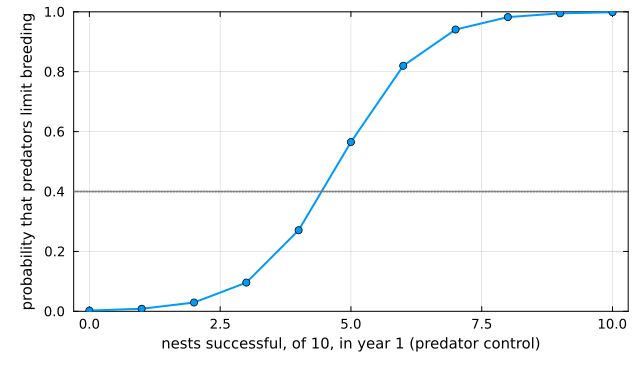
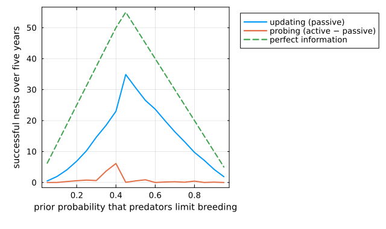

# Learning while managing
Simon Frost

- [The question](#the-question)
- [One year](#one-year)
- [Five years](#five-years)
- [When probing pays](#when-probing-pays)
- [The size of the calculation](#the-size-of-the-calculation)
- [What to take from this](#what-to-take-from-this)

## The question

A colony of ground-nesting birds breeds poorly, and there are two
explanations: nests are lost to predators, or the nesting habitat has
degraded. Each explanation has its remedy, the remedies are chosen
afresh every year, and every year’s breeding season shows a little more
about which explanation is right. Should the manager do what looks best
each year, or sometimes do what teaches most?

Earlier vignettes value information that arrives once, before one
decision. Here the decision is repeated, and what is learned depends on
what is done. `adaptive_management` values four ways of managing over a
fixed number of years:

- **no learning**: the best action on today’s belief, every year,
  whatever happens;
- **passive adaptive management**: each year the best action for the
  current belief, which is updated from what was seen, but never an
  action chosen for what it teaches;
- **active adaptive management**: the best policy, which may give up
  some breeding success now for a clearer answer;
- **perfect information**: the explanation known from the start.

**The colony and every number below are invented** to show the
calculation.

**Actions.** Each year: do nothing (`none`, the `baseline`), control
predators, or restore habitat.

**States.** Breeding is limited by `predators` or by `habitat`. The
state does not change over the years.

**Outcome.** Successful nests a year, out of 100 pairs. No money is
involved.

**Information.** Ten nests are watched each year and the number that
succeed is counted. What that shows depends on the action: under
predator control the two explanations predict very different success
(0.60 against 0.30), under habitat restoration less different (0.35
against 0.50), and with no action the same (0.30), so doing nothing
teaches nothing.

``` julia
using DecisionAnalysis
include(joinpath("..", "_common.jl"))
using Plots

const ACTIONS = [:none, :control_predators, :restore_habitat]
const STATES = [:predators, :habitat]
# Probability that a nest succeeds: rows are actions, columns are states.
const SUCCESS = [0.30 0.30; 0.60 0.30; 0.35 0.50]
const PAIRS, WATCHED = 100, 10

table = PayoffTable(ACTIONS, STATES, PAIRS .* SUCCESS)

# The number of watched nests that succeed under action `a` is binomial.
function watching(a)
    L = [binomial(WATCHED, k) * SUCCESS[a, s]^k * (1 - SUCCESS[a, s])^(WATCHED - k)
         for k in 0:WATCHED, s in 1:2]
    return Experiment(L; signals=[Symbol("nests", k) for k in 0:WATCHED], states=STATES)
end
seen = (; control_predators=watching(2), restore_habitat=watching(3))
colony(prior) = DecisionProblem(table, [prior, 1 - prior]; baseline=:none)
nothing
```

## One year

The manager thinks predators are the less likely explanation, with
probability 0.4.

``` julia
problem = colony(0.4)
gains = expected_gain_over_baseline(problem)
md_table(["action", "successful nests if predators", "if habitat", "expected",
          "gain over doing nothing"],
         [Any[a, table.Q[i, 1], table.Q[i, 2], aggregate(Expectation(), problem)[i],
              gains[i]] for (i, a) in enumerate(ACTIONS)]; digits=1)
```

| action | successful nests if predators | if habitat | expected | gain over doing nothing |
|:---|---:|---:|---:|---:|
| `none` | 30 | 30 | 30 | 0 |
| `control_predators` | 60 | 30 | 42 | 12 |
| `restore_habitat` | 35 | 50 | 44 | 14 |

For one year, habitat restoration is best, by a little. But predator
control is the better experiment.

## Five years

``` julia
five = adaptive_management(problem, seen; horizon=5)
md_table(["way of managing", "successful nests over five years",
          "gain over doing nothing"],
         [["do nothing (baseline)", five.baseline, 0.0],
          ["no learning", five.no_learning, five.no_learning - five.baseline],
          ["passive adaptive management", five.passive, five.passive - five.baseline],
          ["active adaptive management", five.active, five.active - five.baseline],
          ["perfect information", five.perfect, five.perfect - five.baseline]]; digits=1)
```

| way of managing | successful nests over five years | gain over doing nothing |
|:---|---:|---:|
| do nothing (baseline) | 150 | 0 |
| no learning | 220 | 70 |
| passive adaptive management | 243 | 93 |
| active adaptive management | 249.1 | 99.1 |
| perfect information | 270 | 120 |

``` julia
md_table(["quantity (successful nests over five years)", "value"],
         [["value of learning (active against no learning)", five.value_of_learning],
          ["   of which, from updating alone (passive against no learning)",
           five.passive - five.no_learning],
          ["   of which, from probing (active against passive)", five.value_of_probing],
          ["value of perfect information", five.evpi]]; digits=1)
```

| quantity (successful nests over five years)                 | value |
|:------------------------------------------------------------|------:|
| value of learning (active against no learning)              |  29.1 |
| of which, from updating alone (passive against no learning) |    23 |
| of which, from probing (active against passive)             |   6.1 |
| value of perfect information                                |    50 |

Most of what can be gained by learning comes from simply paying
attention: the passive manager restores habitat, watches the nests, and
switches if the results point to predators. Probing adds a little more.
The order of the four values is not particular to this example: no
learning ≤ passive ≤ active ≤ perfect information always holds, and is
proved in the Lean development (`Finite/Adaptive.lean`).

The first actions differ:

``` julia
five.act_now_action, five.first_action
```

    (:restore_habitat, :control_predators)

The active manager starts with predator control, which is expected to do
slightly worse this year, because its results separate the two
explanations better. What it does in the second year depends on what it
saw:

``` julia
second = Dict(a => [parse(Int, String(z)[6:end]) for (z, node) in five.policy.branches
                    if node.action == a] for a in ACTIONS)
md_table(["nests successful, of 10, in year 1", "action in year 2"],
         [Any[string(minimum(second[a]), " to ", maximum(second[a])), a]
          for a in ACTIONS if !isempty(second[a])])
```

| nests successful, of 10, in year 1 |    action in year 2 |
|:-----------------------------------|--------------------:|
| 5 to 10                            | `control_predators` |
| 0 to 4                             |   `restore_habitat` |

``` julia
plot([parse(Int, String(z)[6:end]) for (z, _) in five.policy.branches],
     [node.belief[1] for (_, node) in five.policy.branches];
     xlabel="nests successful, of 10, in year 1 (predator control)",
     ylabel="probability that predators limit breeding", legend=false, marker=:circle,
     ylims=(0, 1))
hline!([0.4]; color=:grey, linestyle=:dot)
```



The dotted line is the belief before the first season.

## When probing pays

Probing is an investment: it is repaid over the years that remain. With
one year left there is nothing to learn for, and the longer the horizon
the more a clear answer is worth.

``` julia
horizons = 1:6
runs = [adaptive_management(problem, seen; horizon=h, depth=0) for h in horizons]
md_table(["years", "first action, passive", "first action, active",
          "value of updating", "value of probing", "value of perfect information"],
         [Any[h, r.act_now_action, r.first_action, r.passive - r.no_learning,
              r.value_of_probing, r.evpi] for (h, r) in zip(horizons, runs)]; digits=1)
```

| years | first action, passive | first action, active | value of updating | value of probing | value of perfect information |
|:---|---:|---:|---:|---:|---:|
| 1 | `restore_habitat` | `restore_habitat` | 0 | 0 | 10 |
| 2 | `restore_habitat` | `control_predators` | 3.1 | 1.5 | 20 |
| 3 | `restore_habitat` | `control_predators` | 8.4 | 3.7 | 30 |
| 4 | `restore_habitat` | `control_predators` | 15.3 | 5.1 | 40 |
| 5 | `restore_habitat` | `control_predators` | 23 | 6.1 | 50 |
| 6 | `restore_habitat` | `control_predators` | 31.3 | 6.9 | 60 |

It also depends on the belief. Where one action is clearly best there is
little to learn; where predator control is already the best action for
this year the manager learns from it without having to give anything up.
Probing matters in between, where the best action for this year is the
less informative one.

``` julia
priors = 0.05:0.05:0.95
sweep = [adaptive_management(colony(q), seen; horizon=5, depth=0) for q in priors]
plot(priors, [r.passive - r.no_learning for r in sweep]; label="updating (passive)",
     xlabel="prior probability that predators limit breeding",
     ylabel="successful nests over five years")
plot!(priors, [r.value_of_probing for r in sweep]; label="probing (active − passive)")
plot!(priors, [r.evpi for r in sweep]; label="perfect information", linestyle=:dash)
```



``` julia
probing = [q for (q, r) in zip(priors, sweep) if r.first_action != r.act_now_action]
```

    3-element Vector{Float64}:
     0.3
     0.35
     0.4

are the priors at which the active manager’s first action differs from
the passive one’s.

## The size of the calculation

The recursion visits each distinct belief once. Beliefs reached by the
same observations in a different order are the same belief, but with
eleven possible counts a year and two informative actions their number
still grows quickly:

``` julia
md_table(["years", "beliefs evaluated"],
         [[h, r.beliefs_evaluated] for (h, r) in zip(horizons, runs)])
```

| years | beliefs evaluated |
|:------|------------------:|
| 1     |                 1 |
| 2     |                24 |
| 3     |               300 |
| 4     |              2585 |
| 5     |             16888 |
| 6     |             86831 |

Ten years of this problem need about ten million beliefs and most of a
minute. Longer horizons need a coarser observation (fewer nests watched,
or the count grouped into a few classes).

## What to take from this

- With a decision that is repeated, most of the value of learning can
  come from updating on what management shows anyway.
  `adaptive_management` separates that from the value of acting in order
  to learn.
- Probing pays where the action that is best for now is not the one that
  teaches most, and only if enough years remain to use the answer.
- All four values are totals of the outcome itself, here successful
  nests, and the baseline of doing nothing is reported beside them.
- The state is taken not to change. A system whose state moves from year
  to year needs a model of that movement, which this function does not
  have.
