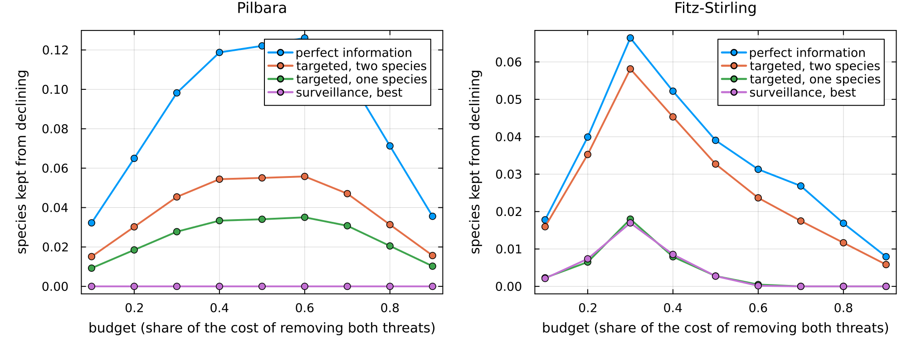

# Which species to monitor, and how (Bal et al. 2018)
Simon Frost

- [About this case study](#about-this-case-study)
- [The paper](#the-paper)
- [The tabulated results: Table S2](#the-tabulated-results-table-s2)
- [The case studies](#the-case-studies)
- [What was not reproduced](#what-was-not-reproduced)

## About this case study

This case study replicates a published analysis. Here the input is not a
payoff table but a small model, printed in full in the paper, with the
parameter values of its two case studies. Every result is shown beside
the published one, and the same comparisons are in the test suite
(`test/fixtures/replications/bal2018_monitoring.json`,
`test/test_replications.jl`).

## The paper

Bal, Tulloch, Chadès, Carwardine, McDonald-Madden and Rhodes (2018),
“Quantifying the value of monitoring species in multi-species,
multi-threat systems”, *Methods in Ecology and Evolution* 9:1706-1717,
[doi:10.1111/2041-210X.13037](https://doi.org/10.1111/2041-210X.13037).
The model is equations 2 to 6 of the article and Appendices S1 to S4 of
its supporting information; the inputs are Table S1 and the targets
Table S2 and the text of Section 3.2.

**Decision.** How to split a fixed budget between the management of two
threats.

**Actions.** An amount `m1` for the first threat and the rest of the
budget for the second. Spending nothing is added here as the `baseline`;
it is never the best action and changes no value.

**States.** It is not known which threat causes which species to
decline. With two threats and three species there are 64 models `d`,
where `d[i, j] = 1` when threat `i` causes species `j` to decline, and
the prior probability of each such link is `p[i, j]`.

**Outcome.** The expected number of species declining, out of three,
which the manager minimises. Spending `m` on a threat that costs `c` to
remove leaves a fraction `(c - m) / c` of it. **No money is valued**:
costs only say how far a budget goes. Utility below is minus the number
of species declining, so values of information are species kept from
declining.

**Information.** *Surveillance* watches whether a species declines.
*Targeted monitoring* watches a species in a control and in an
experiment in which one threat is removed.

``` julia
using DecisionAnalysis
include(joinpath("..", "_common.jl"))
using Plots

const MODELS = vec([permutedims(reshape(collect(d), 3, 2))
                    for d in Iterators.product(ntuple(_ -> (0, 1), 6)...)])
const STATES = [Symbol("model", k) for k in 1:64]

# Equation S1.4; `wallaby` switches on the term of equation S4.1 for the third species
# of the Fitz-Stirling case.
function declines(d, q, c, m1, m2; wallaby=false)
    r1, r2 = (c[1] - m1) / c[1], (c[2] - m2) / c[2]
    return sum(1:3) do j
        second = wallaby && j == 3 ? d[2, j] - d[2, j] * r2 : 1 - d[2, j] * r2
        return q[j] + (1 - q[j]) * (1 - (1 - d[1, j] * r1) * second)
    end
end

function allocation_problem(p, q, c, budget; wallaby=false, n=2000)
    lo, hi = max(0.0, budget - c[2]), min(budget, c[1])
    grid = [lo + max(hi - lo, 0.0) * g / n for g in 0:n]
    Q = zeros(n + 2, 64)
    for (s, d) in enumerate(MODELS)
        Q[1, s] = -declines(d, q, c, 0.0, 0.0; wallaby)
        for (g, m1) in enumerate(grid)
            Q[g + 1, s] = -declines(d, q, c, m1, budget - m1; wallaby)
        end
    end
    prior = [prod(d[i, j] == 1 ? p[i, j] : 1 - p[i, j] for i in 1:2, j in 1:3) for d in MODELS]
    actions = vcat(:no_management, [Symbol("split", g) for g in 0:n])
    return DecisionProblem(PayoffTable(actions, STATES, Q),
                           FiniteBelief(STATES, prior ./ sum(prior)); baseline=:no_management)
end

# Probability that a decline is recorded for species j under model d, with one threat
# removed (`manage`) or none, and with type I (alpha) and type II (beta) errors.
function recorded(d, q, j, alpha, beta, manage)
    cause = maximum(i == manage ? 0 : d[i, j] for i in 1:2)
    D = q[j] + (1 - q[j]) * cause
    return D * (1 - beta) + (1 - D) * alpha
end

function monitoring(q, species; manage=nothing, alpha=0.0, beta=0.0)
    probs = Vector{Float64}[]
    for j in species
        push!(probs, [recorded(d, q, j, alpha, beta, nothing) for d in MODELS])
        manage === nothing ||
            push!(probs, [recorded(d, q, j, alpha, beta, manage) for d in MODELS])
    end
    outcomes = vec(collect(Iterators.product(ntuple(_ -> (0, 1), length(probs))...)))
    L = [prod(x[k] == 1 ? probs[k][s] : 1 - probs[k][s] for k in eachindex(probs))
         for x in outcomes, s in 1:64]
    return Experiment(L; signals=[Symbol("x", join(x)) for x in outcomes], states=STATES)
end
nothing
```

The budget split is continuous in the paper, which minimises with a
numerical optimiser. The expected number of declines is a quadratic in
`m1`, so a grid of 2,001 splits finds its minimum far more closely than
the four decimals printed.

## The tabulated results: Table S2

Table S2 takes a symmetric system: every link has probability 0.5, every
species a background probability of decline of 0.01, the budget is half
of the total cost, and the first threat costs 70% of the total.

``` julia
p, q, c = fill(0.5, 2, 3), fill(0.01, 3), (0.7, 0.3)
symmetric = allocation_problem(p, q, c, 0.5)
gains = expected_gain_over_baseline(symmetric)
md_table(["quantity (species declining, of 3)", "value"],
         [["expected, with no management", -Float64(aggregate(Expectation(), symmetric)[1])],
          ["expected, with the best split of the budget", -Float64(act_now_value(symmetric))],
          ["gain of the best split over no management", Float64(maximum(gains))],
          ["value of perfect information: paper 0.1329", Float64(evpi(symmetric))]]; digits=4)
```

| quantity (species declining, of 3)          |  value |
|:--------------------------------------------|-------:|
| expected, with no management                | 2.2575 |
| expected, with the best split of the budget | 1.0907 |
| gain of the best split over no management   | 1.1668 |
| value of perfect information: paper 0.1329  | 0.1329 |

``` julia
printed = [(0.0, 0.0, (0.0127, 0.0012), (0.0650, 0.0296)), (0.0, 0.05, (0.0049, 0.0011), (0.0473, 0.0246)),
           (0.05, 0.0, (0.0104, 0.0003), (0.0586, 0.0229)), (0.05, 0.05, (0.0036, 0.0003), (0.0408, 0.0185))]
rows = Vector{Any}[]
for (alpha, beta, one, two) in printed, (label, species, paper) in (("one species", [1], one), ("two species", [1, 2], two))
    value(threat) = evsi(symmetric, monitoring(q, species; manage=threat, alpha, beta))
    push!(rows, [alpha, beta, label, paper[1], value(1), paper[2], value(2),
                 evsi(symmetric, monitoring(q, species; alpha, beta))])
end
md_table(["type I", "type II", "monitored", "paper: remove threat 1", "ours", "paper: remove threat 2",
          "ours", "surveillance (paper: 0)"], rows; digits=4)
```

| type I | type II | monitored | paper: remove threat 1 | ours | paper: remove threat 2 | ours | surveillance (paper: 0) |
|:---|---:|---:|---:|---:|---:|---:|---:|
| 0 | 0 | one species | 0.0127 | 0.0127 | 0.0012 | 0.0012 | 0 |
| 0 | 0 | two species | 0.065 | 0.065 | 0.0296 | 0.0296 | 0 |
| 0 | 0.05 | one species | 0.0049 | 0.0049 | 0.0011 | 0.0011 | 0 |
| 0 | 0.05 | two species | 0.0473 | 0.0473 | 0.0246 | 0.0246 | 0 |
| 0.05 | 0 | one species | 0.0104 | 0.0104 | 0.0003 | 0.0003 | 0 |
| 0.05 | 0 | two species | 0.0586 | 0.0586 | 0.0229 | 0.0229 | 0 |
| 0.05 | 0.05 | one species | 0.0036 | 0.0036 | 0.0003 | 0.0003 | 0 |
| 0.05 | 0.05 | two species | 0.0408 | 0.0408 | 0.0185 | 0.0185 | 0 |

Every cell agrees to the four decimals printed. (The paper prints the
same value for each species and each pair, as the system is symmetric;
one of each is shown.) Watching without intervening is worth nothing
here: a decline says that some threat acts on the species and not which
one, and by symmetry that does not move the best split.

## The case studies

Table S1 gives the parameters of two Australian case studies. Budgets
are reported as a share of the cost of removing both threats; the grid
is not printed, and steps of 10% are used here, as the markers of the
paper’s Figure 4 suggest.

``` julia
pilbara = (species=["bilby", "northern quoll", "pale field-rat"], threats=["grazing", "fire"],
           p=[0.1121 0.0679 0.0952; 0.2328 0.1975 0.2381], q=[0.2717, 0.1900, 0.4750],
           c=(1.49e6, 2.68e6), wallaby=false)
fitz = (species=["bandicoot", "brushtail possum", "tammar wallaby"], threats=["fox", "fire"],
        p=[0.4831 0.1637 0.9488; 0.0177 0.2053 0.6199], q=[0.1246, 0.0030, 0.2301],
        c=(10209.72, 22951.62), wallaby=true)
sets = [[1], [2], [3], [1, 2], [1, 3], [2, 3]]
strategies = [(species, threat) for threat in 1:2 for species in sets]
shares = 0.1:0.1:0.9
function sweep(k; wallaby=k.wallaby)
    map(shares) do share
        pr = allocation_problem(k.p, k.q, k.c, share * sum(k.c); wallaby)
        (; evpi=evpi(pr),
         targeted=Dict(s => evsi(pr, monitoring(k.q, s[1]; manage=s[2])) for s in strategies),
         surveillance=maximum(evsi(pr, monitoring(k.q, s)) for s in sets))
    end
end
best(row, n) = argmax(s -> row.targeted[s], filter(s -> length(s[1]) == n, strategies))
describe(k, row, n) = row.targeted[best(row, n)] < 1e-6 ? "none is worth anything" :
                      join(k.species[best(row, n)[1]], " and ") * ", removing " *
                      k.threats[best(row, n)[2]]
results = (pilbara=sweep(pilbara), fitz=sweep(fitz))
nothing
```

``` julia
function figure(k, rows, title)
    plt = plot(; xlabel="budget (share of the cost of removing both threats)",
               ylabel="species kept from declining", title, legend=:topright)
    plot!(plt, shares, [r.evpi for r in rows]; label="perfect information", marker=:circle)
    plot!(plt, shares, [r.targeted[best(r, 2)] for r in rows]; label="targeted, two species", marker=:circle)
    plot!(plt, shares, [r.targeted[best(r, 1)] for r in rows]; label="targeted, one species", marker=:circle)
    plot!(plt, shares, [r.surveillance for r in rows]; label="surveillance, best", marker=:circle)
    return plt
end
png_figure(plot(figure(pilbara, results.pilbara, "Pilbara"), figure(fitz, results.fitz, "Fitz-Stirling");
                layout=(1, 2), size=(1000, 400), bottom_margin=5Plots.mm, left_margin=5Plots.mm))
```



``` julia
at(rows, share) = rows[findfirst(≈(share), shares)]
f30, p60 = at(results.fitz, 0.3), at(results.pilbara, 0.6)
md_table(["quantity", "paper", "this package"],
         [["Fitz-Stirling: EVPI (ours at 30% of the budget, where it is largest)", "0.066", f30.evpi],
          ["Fitz-Stirling: largest EVSI", "c. 0.058", f30.targeted[best(f30, 2)]],
          ["Fitz-Stirling: two species over one", "three-fold",
           f30.targeted[best(f30, 2)] / f30.targeted[best(f30, 1)]],
          ["Pilbara: largest EVSI (ours at 60%)", "c. 0.058", p60.targeted[best(p60, 2)]],
          ["Pilbara: largest EVSI as a share of EVPI", "up to 45%",
           maximum(r.targeted[best(r, 2)] / r.evpi for r in results.pilbara)]]; digits=4)
```

| quantity | paper | this package |
|:---|---:|---:|
| Fitz-Stirling: EVPI (ours at 30% of the budget, where it is largest) | 0.066 | 0.0664 |
| Fitz-Stirling: largest EVSI | c. 0.058 | 0.0581 |
| Fitz-Stirling: two species over one | three-fold | 3.2341 |
| Pilbara: largest EVSI (ours at 60%) | c. 0.058 | 0.0558 |
| Pilbara: largest EVSI as a share of EVPI | up to 45% | 0.4686 |

``` julia
md_table(["budget", "Pilbara: one species", "Pilbara: two species", "Fitz-Stirling: one species",
          "Fitz-Stirling: two species"],
         [[string(round(Int, 100 * share), "%"), describe(pilbara, a, 1), describe(pilbara, a, 2),
           describe(fitz, b, 1), describe(fitz, b, 2)]
          for (share, a, b) in zip(shares, results.pilbara, results.fitz)])
```

| budget | Pilbara: one species | Pilbara: two species | Fitz-Stirling: one species | Fitz-Stirling: two species |
|:---|---:|---:|---:|---:|
| 10% | bilby, removing grazing | bilby and northern quoll, removing grazing | brushtail possum, removing fire | bandicoot and brushtail possum, removing fire |
| 20% | bilby, removing grazing | bilby and northern quoll, removing grazing | bandicoot, removing fire | bandicoot and brushtail possum, removing fire |
| 30% | bilby, removing grazing | bilby and northern quoll, removing grazing | bandicoot, removing fire | bandicoot and brushtail possum, removing fire |
| 40% | bilby, removing grazing | bilby and northern quoll, removing grazing | bandicoot, removing fire | bandicoot and brushtail possum, removing fire |
| 50% | bilby, removing grazing | bilby and northern quoll, removing grazing | brushtail possum, removing fire | bandicoot and brushtail possum, removing fire |
| 60% | bilby, removing fire | bilby and northern quoll, removing grazing | brushtail possum, removing fire | bandicoot and brushtail possum, removing fire |
| 70% | bilby, removing fire | bilby and northern quoll, removing grazing | none is worth anything | bandicoot and brushtail possum, removing fire |
| 80% | bilby, removing fire | bilby and northern quoll, removing grazing | none is worth anything | bandicoot and brushtail possum, removing fire |
| 90% | bilby, removing fire | bilby and northern quoll, removing grazing | none is worth anything | bandicoot and brushtail possum, removing fire |

The choices are those of the paper’s Section 3.2. In the Pilbara the
largest EVSI is 0.44 of the EVPI at the budget where it is largest (60%)
and 0.47 at the smallest budget; the paper says “up to 45%”.

- **Pilbara.** The bilby is the species to monitor at every budget, the
  experiment changes from removing grazing to removing fire at 60%, and
  the best pair is the bilby and the quoll with grazing removed.
  Surveillance is worth nothing.
- **Fitz-Stirling.** The best pair is the bandicoot and the possum with
  fire removed at every budget; for one species it is the possum at low
  and at middle-high budgets and the bandicoot between, and from 70% of
  the budget monitoring one species is worth nothing.

Two points needed resolving.

- **The Fitz-Stirling numbers need the wallaby term.** Appendix S4 gives
  the tammar wallaby a different term in the objective (equation S4.1).
  With the standard objective the published numbers are not reached:

``` julia
standard = at(sweep(fitz; wallaby=false), 0.3)
md_table(["Fitz-Stirling at 30% of the budget", "EVPI", "largest EVSI"],
         [["paper", "0.066", "c. 0.058"], ["with equation S4.1", f30.evpi, f30.targeted[best(f30, 2)]],
          ["standard objective", standard.evpi, standard.targeted[best(standard, 2)]]]; digits=4)
```

| Fitz-Stirling at 30% of the budget |   EVPI | largest EVSI |
|:-----------------------------------|-------:|-------------:|
| paper                              |  0.066 |     c. 0.058 |
| with equation S4.1                 | 0.0664 |       0.0581 |
| standard objective                 | 0.0504 |       0.0153 |

- **The paper’s Discussion and Results disagree on the Pilbara.** The
  Discussion says the best strategy was always to remove grazing
  experimentally; the Results, and the table above, have the experiment
  change to fire at 60% for one species.

The absolute values are small, as the paper stresses: at best about six
hundredths of a species kept from declining. A share of perfect
information near one half says little when perfect information is itself
worth a tenth of a species.

## What was not reproduced

The simulated systems of the paper’s Figures 2 and 3 are printed as
figures only, with no grid, and the statements that targeted monitoring
reaches “up to 50%” of the EVPI for one species and “80%” for two are
not tied to a stated setting. The decline probabilities behind Table S1
are unpublished.
