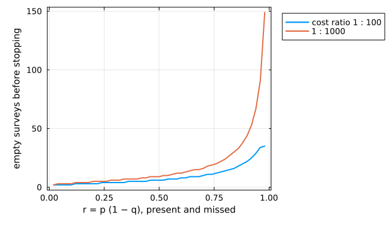
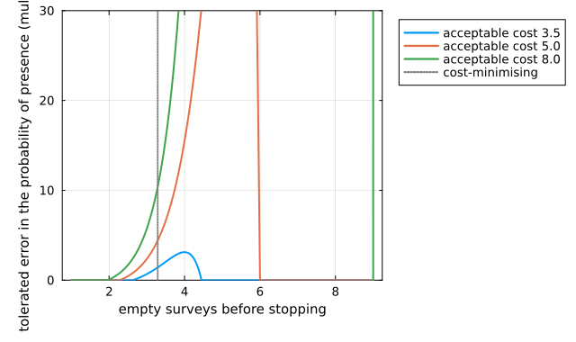

# When to stop looking for an invasive plant (Regan et al. 2006; Rout et al. 2009)
Simon Frost

- [About this case study](#about-this-case-study)
- [The papers](#the-papers)
- [The rule of thumb](#the-rule-of-thumb)
  - [With discounting: not reproduced](#with-discounting-not-reproduced)
- [The case study](#the-case-study)
- [The dynamic programme](#the-dynamic-programme)
- [How robust is the answer?](#how-robust-is-the-answer)
- [What was not reproduced](#what-was-not-reproduced)
- [What to take from this](#what-to-take-from-this)

## About this case study

This case study replicates two published analyses of one decision: after
a weed has gone unseen, how many more empty surveys should be made
before it is declared eradicated? The first paper gives a rule of thumb
and a dynamic programme; the second asks how robust the answer is. The
rule of thumb and the second paper’s numbers are reproduced exactly.
Three things in the first paper are not: its results with discounting,
the upper end of its range for the case study, and the size of one
difference between its two methods. Each is shown below. The comparisons
are in the test suite
(`test/fixtures/replications/regan2006_eradication.json`,
`test/test_replications.jl`).

The weed of the case study, *Helenium amarum* in Queensland, was
declared eradicated in 1992 after five years without a sighting. It was
found again at the site in 2007.

## The papers

Regan, McCarthy, Baxter, Panetta and Possingham (2006), “Optimal
eradication: when to stop looking for an invasive plant”, *Ecology
Letters* 9(7):759–766,
[doi:10.1111/j.1461-0248.2006.00920.x](https://doi.org/10.1111/j.1461-0248.2006.00920.x).

Rout, Thompson and McCarthy (2009), “Robust decisions for declaring
eradication of invasive species”, *Journal of Applied Ecology*
46(4):782–786,
[doi:10.1111/j.1365-2664.2009.01678.x](https://doi.org/10.1111/j.1365-2664.2009.01678.x).

Both are all rights reserved; only their formulas, parameter values and
printed results are used here.

**Decision.** Each year in which the last survey found nothing: survey
again, or stop and declare the plant eradicated.

**Actions.** `stop` (the `baseline`: no further surveying) or `survey`.

**States.** The plant is `present`, as adults or in the seed bank, or
`absent`.

**Movement.** A plant that is present persists to the next year with
probability `p`. Once absent it stays absent.

**Information.** A survey finds a plant that is present with probability
`q`, and never reports one that is absent.

**Outcome.** Cost, in units of one annual survey. Stopping while the
plant is present costs `Ce`, the expected cost of its escape and the
damage it does. The papers work with the ratio of the two costs. For the
case study `Ce` is **the authors’ valuation**, from the value of dairy
production in south-east Queensland; nothing is valued by this package.

## The rule of thumb

If stopping after `n` empty surveys, the first of them free, the
expected cost is `(n − 1) Cs + Ce rⁿ` with `r = p (1 − q)`, the chance
that the plant is there and is missed. The paper minimises this.

``` julia
using DecisionAnalysis
include(joinpath("..", "_common.jl"))
using Plots

# Expected cost of stopping after n empty surveys, in survey costs (equation 3), the
# n that minimises it, and the paper's formula for that n (equation 4).
nec(n, r, ratio) = (n - 1) + ratio * r^n
rule(r, ratio) = argmin(n -> nec(n, r, ratio), 1:3000)
formula(r, ratio) = log(-1 / (ratio * log(r))) / log(r)

md_table(["quantity", "paper", "this package"],
         [["surveys, r = 0.1, cost ratio 1 : 100", 2, rule(0.1, 100)],
          ["surveys, r = 0.9, cost ratio 1 : 100", 22, rule(0.9, 100)],
          ["surveys, r = 0.1, cost ratio 1 : 1000", 3, rule(0.1, 1000)],
          ["surveys, r = 0.9, cost ratio 1 : 1000", 44, rule(0.9, 1000)],
          ["surveys, r = 0.99, cost ratio 1 : 1000", 230, rule(0.99, 1000)],
          ["r at which no survey is worth making, 1 : 1000", 0.999, exp(-1 / 1000)],
          ["the same, 1 : 2", "above 0.7", exp(-1 / 2)]]; digits=3)
```

| quantity                                       |     paper | this package |
|:-----------------------------------------------|----------:|-------------:|
| surveys, r = 0.1, cost ratio 1 : 100           |         2 |            2 |
| surveys, r = 0.9, cost ratio 1 : 100           |        22 |           22 |
| surveys, r = 0.1, cost ratio 1 : 1000          |         3 |            3 |
| surveys, r = 0.9, cost ratio 1 : 1000          |        44 |           44 |
| surveys, r = 0.99, cost ratio 1 : 1000         |       230 |          230 |
| r at which no survey is worth making, 1 : 1000 |     0.999 |        0.999 |
| the same, 1 : 2                                | above 0.7 |        0.607 |

The formula reaches zero at `r = exp(−Cs / Ce)`: a plant so persistent
or so hard to find that searching costs more than the escape it might
prevent. For a ratio of 1 : 2 that is 0.607; the paper’s 0.7 is read
from a figure drawn in steps of 0.1.

``` julia
rs = 0.02:0.02:0.98
plot(rs, [rule(r, 100) for r in rs]; label="cost ratio 1 : 100",
     xlabel="r = p (1 − q), present and missed", ylabel="empty surveys before stopping")
plot!(rs, [rule(r, 1000) for r in rs]; label="1 : 1000")
```



### With discounting: not reproduced

The paper also discounts future costs at 5% a year, by its equations 5
and 6, and reports that this *shortens* the search: to between 2 and 5
surveys at 1 : 100, and between 2 and 15 at 1 : 1000.

``` julia
# Equations 5 and 6 as printed: n − 1 surveys and the escape cost, both discounted.
discounted(n, r, ratio, d) = (1 - (1 + d)^-(n - 1)) / d + ratio * r^n / (1 + d)^n
discounted_rule(r, ratio) = argmin(n -> discounted(n, r, ratio, 0.05), 1:3000)
md_table(["r", "1 : 100, no discounting", "1 : 100, discounted", "1 : 1000, no discounting",
          "1 : 1000, discounted"],
         [Any[r, rule(r, 100), discounted_rule(r, 100), rule(r, 1000),
              discounted_rule(r, 1000)] for r in 0.1:0.2:0.9]; digits=1)
```

| r | 1 : 100, no discounting | 1 : 100, discounted | 1 : 1000, no discounting | 1 : 1000, discounted |
|:---|---:|---:|---:|---:|
| 0.1 | 2 | 2 | 3 | 3 |
| 0.3 | 4 | 4 | 6 | 6 |
| 0.5 | 6 | 6 | 9 | 10 |
| 0.7 | 10 | 10 | 16 | 17 |
| 0.9 | 22 | 26 | 44 | 48 |

With the equations as printed, discounting *lengthens* the search: 26
surveys, not 5, at `r = 0.9` and 1 : 100. Next year’s survey becomes
cheaper, and the escape cost falls by the same factor every year, which
does not favour stopping sooner. How the paper obtained shorter times is
not determined.

## The case study

``` julia
# Table 1 of Regan et al.: lower, best and upper values.
const DETECTION = (lower=0.59, best=0.83, upper=0.95)
const PERSISTENCE = (lower=0.50, best=0.80, upper=0.90)
const RATIO = (lower=197, best=354, upper=1317)
missed(q, p) = PERSISTENCE[p] * (1 - DETECTION[q])

md_table(["parameters", "r", "paper", "this package"],
         [["best estimates", missed(:best, :best), 3,
           rule(missed(:best, :best), RATIO.best)],
          ["easiest: best detection, least persistence, lowest cost",
           missed(:upper, :lower), "at least 2", rule(missed(:upper, :lower), RATIO.lower)],
          ["hardest: worst detection, most persistence, highest cost",
           missed(:lower, :upper), "no more than 5",
           rule(missed(:lower, :upper), RATIO.upper)],
          ["worst detection, least persistence, highest cost", missed(:lower, :lower),
           "", rule(missed(:lower, :lower), RATIO.upper)]]; digits=3)
```

| parameters | r | paper | this package |
|:---|---:|---:|---:|
| best estimates | 0.136 | 3 | 3 |
| easiest: best detection, least persistence, lowest cost | 0.025 | at least 2 | 2 |
| hardest: worst detection, most persistence, highest cost | 0.369 | no more than 5 | 7 |
| worst detection, least persistence, highest cost | 0.205 |  | 5 |

The best estimate, 3 surveys, and the lower end, 2, are the paper’s. The
upper end is not: the hardest combination of the paper’s Table 1 gives 7
surveys, not 5. Five appears with the worst detection but the *least*
persistent plant; the paper does not say which combination its “upper”
is. This matters for the paper’s conclusion that stopping after five
years “was a precautionary decision”: on its own ranges, five surveys
could have been two too few.

## The dynamic programme

The rule ignores that a survey may find the plant, after which the count
starts again. The paper’s dynamic programme allows for that. It is the
problem that `adaptive_management` solves, with the state moving and a
survey as the experiment:

- the state is the plant’s status this year, before the survey;
- `stop` pays `Ce` if the plant is present, and ends the matter;
- `survey` pays one survey cost, and shows the plant with probability
  `q` if it is there, after which it persists with probability `p`.

With two states the long-horizon method, `method=:vectors`, is exact.
The paper does not state its horizon; 300 years are used.

``` julia
const R = Rational{BigInt}
# The number of empty surveys after which stopping is first the best action, starting
# from a year in which the plant was seen.
function stops_after(p, q, ratio; years=300)
    table = PayoffTable([:stop, :survey], [:present, :absent], R[-ratio 0; -1 -1])
    moves = (; stop=R[0 0; 1 1], survey=R[p 0; 1-p 1])              # T[next, present]
    seen = (; survey=Experiment(R[1-q 1; q 0]; signals=[:not_seen, :seen]))
    start = R[p, 1 - p]
    solved = adaptive_management(DecisionProblem(table, start; baseline=:stop), seen;
                                 horizon=years, transitions=moves, depth=0,
                                 passive=false, method=:vectors)
    belief, surveys = start, 0
    for left in years:-1:1
        pieces = solved.value_function[left]
        pieces.actions[argmax(pieces.vectors * belief)] == :stop && return surveys
        surveys += 1
        unseen = moves.survey * (belief .* R[1 - q, 1])
        belief = unseen ./ sum(unseen)
    end
    return surveys
end

exact(x) = rationalize(BigInt, x; tol=1e-9)
md_table(["case study", "rule of thumb", "dynamic programme"],
         [Any[label, rule(missed(q, p), RATIO[c]),
              stops_after(exact(PERSISTENCE[p]), exact(DETECTION[q]), RATIO[c])]
          for (label, q, p, c) in (("easiest", :upper, :lower, :lower),
                                   ("best estimates", :best, :best, :best),
                                   ("hardest", :lower, :upper, :upper))])
```

| case study     | rule of thumb | dynamic programme |
|:---------------|--------------:|------------------:|
| easiest        |             2 |                 2 |
| best estimates |             3 |                 4 |
| hardest        |             7 |                 9 |

For the best estimates the dynamic programme asks for one survey more
than the rule, and for the hardest combination two more: nine empty
surveys.

The paper compares the two methods at a cost ratio of 1 : 100 (its Fig.
2) and says that when persistence is above 0.8 the rule underestimates
“by one or two surveys if the probability of detection is high (q =
0.95), and about five surveys if the probability of detection is very
low (q = 0.05)”.

``` julia
persistences = [8 // 10, 9 // 10, 95 // 100, 98 // 100]
md_table(["persistence", "q = 0.95: rule", "dynamic programme", "q = 0.05: rule",
          "dynamic programme"],
         [Any[Float64(p), rule(Float64(p * 5 // 100), 100), stops_after(p, 95 // 100, 100),
              rule(Float64(p * 95 // 100), 100), stops_after(p, 5 // 100, 100)]
          for p in persistences]; digits=2)
```

| persistence | q = 0.95: rule | dynamic programme | q = 0.05: rule | dynamic programme |
|:---|---:|---:|---:|---:|
| 0.8 | 2 | 2 | 12 | 12 |
| 0.9 | 2 | 3 | 18 | 18 |
| 0.95 | 2 | 3 | 23 | 25 |
| 0.98 | 2 | 3 | 28 | 29 |

The first statement is reproduced: one survey more at high detection.
The second is not: at low detection the dynamic programme asks for at
most two surveys more than the rule here, not about five. The paper does
not state its horizon, nor how it counts the first survey in the
comparison, and either could account for part of this.

The paper also notes that for a plant that almost never dies out the
best course is not to search at all. The dynamic programme agrees, and
shows that this depends on how far ahead one looks:

``` julia
md_table(["persistence 0.99, cost ratio 1 : 100", "300 years", "600 years"],
         [Any["empty surveys before stopping, q = 0.95",
              stops_after(99 // 100, 95 // 100, 100),
              stops_after(99 // 100, 95 // 100, 100; years=600)],
          Any["empty surveys before stopping, q = 0.05",
              stops_after(99 // 100, 5 // 100, 100),
              stops_after(99 // 100, 5 // 100, 100; years=600)]])
```

| persistence 0.99, cost ratio 1 : 100    | 300 years | 600 years |
|:----------------------------------------|----------:|----------:|
| empty surveys before stopping, q = 0.95 |         2 |         0 |
| empty surveys before stopping, q = 0.05 |         0 |         0 |

## How robust is the answer?

Rout et al. take the same model and ask what happens if the probability
that the plant is still there, `rᵈ` after `d` empty surveys, is wrong.
They treat `d` as a real number.

``` julia
ratio = 354.55                      # the cost ratio used by Rout et al.
r = 0.8 * (1 - 0.83)
optimum = formula(r, ratio)
md_table(["quantity", "paper (Rout et al.)", "this package"],
         [["r", 0.136, r], ["cost-minimising number of surveys", 3.29, optimum],
          ["its expected cost, in survey costs", 2.79, nec(optimum, r, ratio)],
          ["1 / ln r", -0.5, 1 / log(r)]]; digits=3)
```

| quantity                           | paper (Rout et al.) | this package |
|:-----------------------------------|--------------------:|-------------:|
| r                                  |               0.136 |        0.136 |
| cost-minimising number of surveys  |                3.29 |        3.289 |
| its expected cost, in survey costs |                2.79 |         2.79 |
| 1 / ln r                           |                -0.5 |       -0.501 |

Suppose the manager will accept a total expected cost of `Nc`. The
robustness of stopping after `d` surveys is the largest proportional
error in the probability of presence at which the cost still stays
within `Nc`. The paper’s result (its equation 5) is that the most robust
choice is `d = Nc / Cs + 1 / ln r + 1`.

``` julia
robustness(d, limit) = (limit - (d - 1)) / (ratio * r^d) - 1
robust_optimal(limit) = limit + 1 / log(r) + 1
limits = [nec(optimum, r, ratio), 3.5, 4.0, 5.0, 6.0, 8.0]
md_table(["acceptable cost, in survey costs", "most robust number of surveys (equation 5)",
          "the same, found by search",
          "error in the probability that it tolerates (multiples of the estimate)"],
         [Any[limit, robust_optimal(limit),
              argmax(d -> robustness(d, limit), 1:0.001:20),
              round(robustness(robust_optimal(limit), limit); digits=1)]
          for limit in limits]; digits=2)
```

| acceptable cost, in survey costs | most robust number of surveys (equation 5) | the same, found by search | error in the probability that it tolerates (multiples of the estimate) |
|:---|---:|---:|---:|
| 2.79 | 3.29 | 3.29 | 0 |
| 3.5 | 4 | 4 | 3.1 |
| 4 | 4.5 | 4.5 | 10.2 |
| 5 | 5.5 | 5.5 | 81.2 |
| 6 | 6.5 | 6.5 | 603.4 |
| 8 | 8.5 | 8.5 | 32673.8 |

``` julia
ds = 1:0.05:9
plot(; xlabel="empty surveys before stopping", ylims=(0, 30),
     ylabel="tolerated error in the probability of presence (multiples)")
for limit in (3.5, 5.0, 8.0)
    plot!(ds, [max(robustness(d, limit), 0) for d in ds];
          label="acceptable cost " * string(limit))
end
vline!([optimum]; linestyle=:dot, color=:grey, label="cost-minimising")
```



The first row of the table is the cost-minimising answer itself: it is
the most robust choice only for a manager who will accept no more than
the minimum cost, and it tolerates no error at all. Anyone willing to
pay a little more should survey longer, and the formula for how much
longer does not involve the cost of escape. The paper’s general
conclusion follows: to be robust, survey at least as many times as the
number that minimises the expected cost.

Five surveys, the number actually made, is the most robust choice for a
manager willing to accept an expected cost of about 4.5 surveys, and
tolerates a probability of presence many times larger than estimated:

``` julia
accepted = 5 - 1 - 1 / log(r)
accepted, robustness(5, accepted)
```

    (4.501227909826118, 29.38527800543495)

The plant came back all the same. Robustness to an error in one
probability is not protection against every error in the model.

## What was not reproduced

- **The discounted results** of Regan et al., shown above.
- **The upper end of the range for the case study**, five surveys.
- **The size of the difference between the rule and the dynamic
  programme at low detection**, “about five surveys”.
- **The figures of both papers** beyond the numbers quoted in their
  text, and the alternative models of uncertainty in the second paper’s
  Appendix S2, whose equations are not recoverable from the file.

## What to take from this

- The rule of thumb and every number of the second paper are reproduced
  exactly: three surveys at the best estimates, and 3.29 as a real
  number at a cost of 2.79 surveys.
- On the paper’s own parameter ranges the answer runs from 2 to 7
  surveys by the rule and up to 9 by the dynamic programme. Five surveys
  was not the cautious end of that range.
- The dynamic programme is `adaptive_management` with a state that
  moves, and with two states it is solved exactly over centuries.
- Every cost is in units of one survey, beside the baseline of stopping
  at once.
