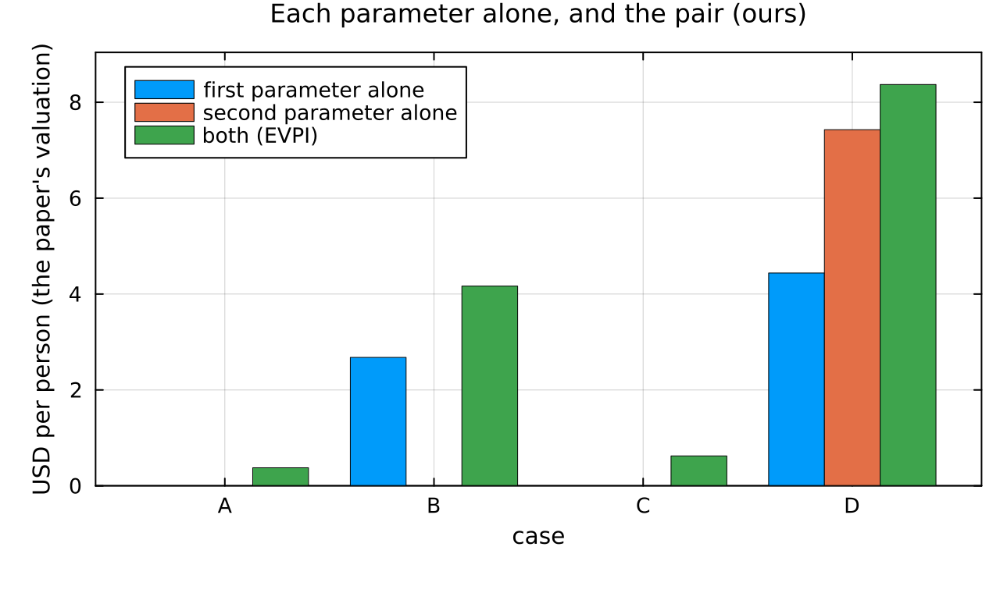

# Which entomological uncertainty matters for malaria control (Kim et al. 2017)
Simon Frost

- [About this case study](#about-this-case-study)
- [The paper](#the-paper)
- [Without further information](#without-further-information)
- [The published numbers](#the-published-numbers)
- [Which of the two parameters
  (ours)](#which-of-the-two-parameters-ours)
- [What was not reproduced](#what-was-not-reproduced)

## About this case study

This case study replicates a published analysis. The inputs are tables
printed in the paper, every result is shown beside the published one,
and the same comparisons are in the test suite
(`test/fixtures/replications/kim2017_malaria.json`,
`test/test_replications.jl`).

## The paper

Kim, Brown, Anderson, Mutero, Miranda, Wiener and Kramer (2017), “The
value of information in decision-analytic modeling for malaria vector
control in East Africa”, *Risk Analysis* 37:231-244,
[doi:10.1111/risa.12606](https://doi.org/10.1111/risa.12606). The inputs
are Tables III and IV of the article and the targets its Table V.

**Decision.** Which vector-control programme to run for ten years in a
rural East African setting.

**Actions.** The status quo, indoor residual spraying of 90% of houses,
which is the `baseline`; larviciding four times a year; larviciding
eight times a year; and spraying together with larviciding four times a
year.

**States.** Four entomological parameters are uncertain: the fitness
cost of insecticide resistance, the speed of its evolution, and the
initial efficacy and the half-life of the larvicide. The paper takes
three values of each and analyses them **two at a time**, in four cases
of nine scenarios, the two parameters of a case being independent.

**Outcome.** Money: **the paper’s valuation**, net benefit in US dollars
per person over ten years relative to the status quo
(disability-adjusted life years averted at 7,773 dollars each, less the
cost of the programme, discounted at 3% a year). The payoffs are outputs
of the authors’ model, which is not rerun here. Nothing is valued by
this package.

``` julia
using DecisionAnalysis
include(joinpath("..", "_common.jl"))

# Table III: the three values of each parameter and their probabilities (lognormal).
probability = (fitness_cost=[65, 19, 16] .// 100, evolutionary_speed=[42, 45, 13] .// 100,
               half_life=[39, 18, 43] .// 100, initial_efficacy=[65, 17, 18] .// 100)
level = (fitness_cost=["3%", "11%", "19%"], evolutionary_speed=["5", "9", "13"],
         half_life=["3 days", "2 weeks", "3 months"], initial_efficacy=["70%", "85%", "100%"])
# Table IV: payoffs relative to the status quo, nine scenarios (the first parameter
# varies slowest) by larviciding x 4, larviciding x 8, spraying + larviciding x 4.
table4 = (A=(:fitness_cost, :half_life,
             [153.3 183.6 150.0; 79.4 158.6 76.1; 47.2 117.6 43.9;
              -47.7 25.5 20.9; -14.4 68.0 43.0; 62.2 93.9 96.4;
              -47.7 25.5 20.9; -14.4 68.0 43.0; 62.2 93.9 96.4]),
          B=(:fitness_cost, :initial_efficacy,
             [69.6 127.3 66.3; 79.4 158.6 76.1; 12.8 48.2 9.5;
              -24.8 35.2 37.7; -14.4 68.0 43.0; -81.8 -46.6 10.5;
              -24.8 35.2 37.7; -14.4 68.0 43.0; -81.8 -46.6 10.5]),
          C=(:evolutionary_speed, :half_life,
             [-11.9 60.1 27.2; 21.0 102.1 53.4; 96.4 127.6 115.4;
              -47.7 25.5 20.9; -14.4 68.0 43.0; 62.2 93.9 96.4;
              -47.7 25.5 20.9; -14.4 68.0 43.0; 62.2 93.9 96.4]),
          D=(:evolutionary_speed, :initial_efficacy,
             [10.8 69.8 47.2; 21.0 102.1 53.4; -46.2 -11.0 8.4;
              -24.8 35.2 37.7; -14.4 68.0 43.0; -81.8 -46.6 10.5;
              -24.8 35.2 37.7; -14.4 68.0 43.0; -81.8 -46.6 10.5]))
actions = [:status_quo, :larviciding_4, :larviciding_8, :spraying_and_larviciding_4]

function case(name)
    first, second, payoff = table4[name]
    states = [Symbol(level[first][i], " / ", level[second][j]) for i in 1:3 for j in 1:3]
    prior = [probability[first][i] * probability[second][j] for i in 1:3 for j in 1:3]
    Q = vcat(zeros(Rational{Int}, 1, 9), permutedims(rationalize.(payoff; tol=1e-9)))
    return DecisionProblem(PayoffTable(actions, states, Q), FiniteBelief(states, prior);
                           baseline=:status_quo)
end
name(parameter) = replace(String(parameter), "_" => " ")
problems = (A=case(:A), B=case(:B), C=case(:C), D=case(:D))
problems.D.payoff
```

**PayoffTable{Rational{Int64}}: 4 actions × 9 states**

| action | `5 / 70%` | `5 / 85%` | `5 / 100%` | `9 / 70%` | `9 / 85%` | `9 / 100%` | `13 / 70%` | `13 / 85%` | `13 / 100%` |
|:---|---:|---:|---:|---:|---:|---:|---:|---:|---:|
| `status_quo` | 0 | 0 | 0 | 0 | 0 | 0 | 0 | 0 | 0 |
| `larviciding_4` | 10.8 | 21 | -46.2 | -24.8 | -14.4 | -81.8 | -24.8 | -14.4 | -81.8 |
| `larviciding_8` | 69.8 | 102.1 | -11 | 35.2 | 68 | -46.6 | 35.2 | 68 | -46.6 |
| `spraying_and_larviciding_4` | 47.2 | 53.4 | 8.4 | 37.7 | 43 | 10.5 | 37.7 | 43 | 10.5 |

## Without further information

``` julia
md_table(["case", "parameters", "chosen", "expected gain over the status quo (USD per person)"],
         [[String(k), name(table4[k][1]) * " and " * name(table4[k][2]),
           decide(problems[k], MaxExpectedUtility()).chosen,
           Float64(act_now_value(problems[k]))] for k in keys(problems)])
```

| case | parameters | chosen | expected gain over the status quo (USD per person) |
|:---|---:|---:|---:|
| A | fitness cost and half life | `larviciding_8` | 119.86 |
| B | fitness cost and initial efficacy | `larviciding_8` | 86.07 |
| C | evolutionary speed and half life | `larviciding_8` | 76.89 |
| D | evolutionary speed and initial efficacy | `larviciding_8` | 40.62 |

Larviciding eight times a year is the best programme in all four cases,
as the paper reports. The status quo has payoff zero, so the expected
payoff is the gain over it.

## The published numbers

``` julia
published = (A=(119.9, 120.2, 0.3), B=(86.1, 90.2, 4.1), C=(76.9, 77.5, 0.6), D=(40.6, 49.0, 8.4))
md_table(["case", "quantity (USD per person)", "paper (Table V, lognormal)", "this package"],
         reduce(vcat,
                [[[String(k), "best expected payoff", published[k][1], Float64(act_now_value(problems[k]))],
                  ["", "with perfect information", published[k][2],
                   Float64(act_now_value(problems[k]) + evpi(problems[k]))],
                  ["", "value of perfect information", published[k][3], Float64(evpi(problems[k]))]]
                 for k in keys(problems)]))
```

| case |    quantity (USD per person) | paper (Table V, lognormal) | this package |
|:-----|-----------------------------:|---------------------------:|-------------:|
| A    |         best expected payoff |                      119.9 |       119.86 |
|      |     with perfect information |                      120.2 |       120.24 |
|      | value of perfect information |                        0.3 |         0.38 |
| B    |         best expected payoff |                       86.1 |        86.07 |
|      |     with perfect information |                       90.2 |        90.23 |
|      | value of perfect information |                        4.1 |         4.17 |
| C    |         best expected payoff |                       76.9 |        76.89 |
|      |     with perfect information |                       77.5 |        77.52 |
|      | value of perfect information |                        0.6 |         0.62 |
| D    |         best expected payoff |                       40.6 |        40.62 |
|      |     with perfect information |                         49 |        48.99 |
|      | value of perfect information |                        8.4 |         8.37 |

The two expected payoffs agree to the tenth of a dollar that the paper
prints. The paper’s value of information is the difference of the two
**after** rounding, so it prints 0.3 and 4.1 where the unrounded
differences are 0.38 and 4.17. The largest value, 8.4 dollars per person
for the speed of evolution with the initial efficacy, is a fifth of the
expected gain of 40.6.

## Which of the two parameters (ours)

The paper values each pair together. The same tables give the value of
each parameter of a pair alone; these numbers are **ours, not the
paper’s**.

``` julia
alone(k) = (evppi(problems[k], [div(s - 1, 3) for s in 1:9]),
            evppi(problems[k], [mod1(s, 3) for s in 1:9]))
md_table(["case", "first parameter alone", "second parameter alone", "both"],
         [[String(k) * ": " * name(table4[k][1]) * ", " * name(table4[k][2]), Float64(alone(k)[1]),
           Float64(alone(k)[2]), Float64(evpi(problems[k]))] for k in keys(problems)]; digits=3)
```

| case | first parameter alone | second parameter alone | both |
|:---|---:|---:|---:|
| A: fitness cost, half life | 0 | 0 | 0.376 |
| B: fitness cost, initial efficacy | 2.679 | 0 | 4.166 |
| C: evolutionary speed, half life | 0 | 0 | 0.624 |
| D: evolutionary speed, initial efficacy | 4.439 | 7.428 | 8.37 |

``` julia
M = reduce(vcat, [Float64[alone(k)... evpi(problems[k])] for k in keys(problems)])
plt = grouped_bars(["A", "B", "C", "D"],
                   ["first parameter alone", "second parameter alone", "both (EVPI)"], M;
                   xlabel="case", ylabel="USD per person (the paper's valuation)",
                   title="Each parameter alone, and the pair (ours)", legend=:topleft)
png_figure(plt)
```



Parts do not add up to the whole. In case D the two values alone sum to
more than the value of the pair, because what they tell overlaps. In
cases A and C neither parameter alone is worth anything although the
pair is: only knowing both changes the programme. The two higher values
of the fitness cost give identical payoffs in Table IV, and so do the
two higher speeds of evolution (the paper calls it saturation), so all
that can be learned about either is whether it is at its low value.

## What was not reproduced

Table V has a second column, for uniform distributions (EVPI 0.6, 13.1,
0.6 and 15.2). The probabilities of the three values under the uniform
distributions are not printed, and equal thirds do not give the column:

``` julia
function uniform_case(name)
    p = problems[name]
    return DecisionProblem(p.payoff, FiniteBelief(p.payoff.states, fill(1 // 9, 9));
                           baseline=:status_quo)
end
md_table(["case", "paper: best expected payoff (uniform)", "equal thirds", "chosen with equal thirds"],
         [[String(k), u, Float64(act_now_value(uniform_case(k))),
           decide(uniform_case(k), MaxExpectedUtility()).chosen]
          for (k, u) in zip(keys(problems), (91.8, 49.2, 73.1, 30.2))])
```

| case | paper: best expected payoff (uniform) | equal thirds | chosen with equal thirds |
|:---|---:|---:|---:|
| A | 91.8 | 92.73 | `larviciding_8` |
| B | 49.2 | 49.7 | `larviciding_8` |
| C | 73.1 | 73.84 | `larviciding_8` |
| D | 30.2 | 32.38 | `spraying_and_larviciding_4` |

In case D equal thirds make spraying with larviciding the best
programme, where the paper says that larviciding eight times a year is
best under both distributions. The uniform column is therefore quoted,
not recomputed.
