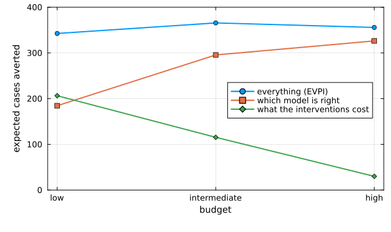

# Epidemiological and operational uncertainty in Ebola control (Li et al. 2019)
Simon Frost

- [About this case study](#about-this-case-study)
- [The paper](#the-paper)
- [What to do under present
  knowledge](#what-to-do-under-present-knowledge)
- [The published table](#the-published-table)
- [Which uncertainty matters depends on the
  budget](#which-uncertainty-matters-depends-on-the-budget)
- [The counts quoted in the text](#the-counts-quoted-in-the-text)
- [What the package adds](#what-the-package-adds)
  - [Which intervention’s cost function is worth
    knowing](#which-interventions-cost-function-is-worth-knowing)
  - [What a cautious manager would
    choose](#what-a-cautious-manager-would-choose)
- [What was not reproduced](#what-was-not-reproduced)
- [What to take from this](#what-to-take-from-this)

## About this case study

This case study replicates a published analysis. Its input is one table
of the paper’s supplement, the caseload under each intervention for 37
published Ebola models and 27 assumptions about what interventions cost,
and every cell of the paper’s table of results is reproduced from it.
Two counts quoted in the paper’s text are not, and the vignette says
which. The comparisons are in the test suite
(`test/fixtures/replications/li2019_ebola.json`,
`test/test_replications.jl`).

## The paper

Li, Ferrari, Bjørnstad, Runge, Fonnesbeck, Tildesley, Pannell and Shea
(2019), “Concurrent assessment of epidemiological and operational
uncertainties for optimal outbreak control: Ebola as a case study”,
*Proceedings of the Royal Society B* 286:20190774,
[doi:10.1098/rspb.2019.0774](https://doi.org/10.1098/rspb.2019.0774), CC
BY 4.0. The input is Table S3 of its electronic supplementary material.

**Decision.** Which intervention to put a fixed budget into during an
Ebola outbreak.

**Actions.** Reduce transmission in the community (`community`), reduce
transmission at funerals (`funeral`), or improve hospitalisation
(`hospitalization`).

**States.** Two things are unknown at once:

- *epidemiological*: which of 37 published models of Ebola transmission
  is right;
- *operational*: how effectiveness grows with spending for each
  intervention. Each intervention has one of three cost functions,
  “cheap and effective” (1), “expensive and effective” (2) or “cheap and
  partly effective” (3), which gives 27 combinations.

A state is a model together with a combination: 999 states.

**Belief.** Equal weight on every model and on every combination, as in
the paper.

**Outcome.** Cases in a simulated population of 10,000, the mean of 1000
stochastic simulations of each model. Fewer is better, so the payoff is
minus the caseload. No money is involved; the budget is in the paper’s
units of spending (25, 50 or 75 of 100) and each budget is a separate
problem.

**Baseline.** The paper simulated an outbreak with no intervention but
prints it only as curves, so Table S3 has no such column. The reference
here is `community`, the intervention that is best on average under
present knowledge at every budget. It is also what the paper measures
every improvement against.

``` julia
using DecisionAnalysis
include(joinpath("..", "_common.jl"))
using Plots

const ACTIONS = [:community, :funeral, :hospitalization]
const BUDGETS = ["low", "intermediate", "high"]

# Table S3, from the fixture of the test suite: one line for each model and cost
# combination, with nine caseloads (three interventions at each of three budgets).
fixture = joinpath("..", "..", "test", "fixtures", "replications", "li2019_ebola.json")
pattern = r"^\s*\[(\d+),(\d),(\d),(\d),(.*?)\],?\s*$"
rows = [m for m in match.(pattern, readlines(fixture)) if m !== nothing]
@assert length(rows) == 37 * 27

models = [parse(Int, m[1]) for m in rows]
combinations = [(parse(Int, m[2]), parse(Int, m[3]), parse(Int, m[4])) for m in rows]
# "2847.182" as the exact number 2847182 // 1000.
exact(s) = (parts = split(s, '.');
            parse(BigInt, parts[1]) + (length(parts) == 1 ? 0 // 1 :
                                       parse(BigInt, parts[2]) // big(10)^length(parts[2])))
caseloads = [exact.(strip.(split(m[5], ','), '"')) for m in rows]
states = [Symbol("model", m, "_cost", c...) for (m, c) in zip(models, combinations)]

function ebola(budget)
    first_column = 3 * (findfirst(==(budget), BUDGETS) - 1)
    cases = [caseloads[j][first_column + a] for a in 1:3, j in eachindex(states)]
    return DecisionProblem(PayoffTable(ACTIONS, states, -cases),
                           FiniteBelief(states, fill(1 // big(999), 999));
                           baseline=:community)
end
problems = Dict(b => ebola(b) for b in BUDGETS)
length(states)
```

    999

## What to do under present knowledge

``` julia
md_table(["budget", "community", "funeral", "hospitalization", "chosen"],
         [Any[b, (-Float64.(aggregate(Expectation(), problems[b])))...,
              first_choice(decide(problems[b], MaxExpectedUtility()))] for b in BUDGETS];
         digits=0)
```

| budget       | community | funeral | hospitalization |      chosen |
|:-------------|----------:|--------:|----------------:|------------:|
| low          |      1829 |    2027 |            2392 | `community` |
| intermediate |       881 |    1107 |            1923 | `community` |
| high         |       621 |     792 |            1746 | `community` |

The entries are expected cases. Reducing community transmission is best
on average at every budget.

``` julia
md_table(["budget", "expected cases averted by funeral instead of community",
          "by hospitalization instead of community"],
         [Any[b, Float64.(expected_gain_over_baseline(problems[b])[2:3])...]
          for b in BUDGETS]; digits=0)
```

| budget | expected cases averted by funeral instead of community | by hospitalization instead of community |
|:---|---:|---:|
| low | -198 | -563 |
| intermediate | -226 | -1042 |
| high | -172 | -1125 |

Both are negative: on average the other two do worse than the baseline.

## The published table

The paper’s Table 2 gives, for each budget, the value of resolving
everything (EVPI) and of resolving each source alone, which it calls
EVXI. Here these are `evpi`, and `evppi` with the states grouped by
model or by cost combination.

``` julia
published = Dict("low" => (1829, 343, 18.7, 185, 10.1, 206, 11.3),
                 "intermediate" => (881, 366, 41.5, 296, 33.6, 115, 13.1),
                 "high" => (621, 356, 57.3, 326, 52.6, 30, 4.8))
ours = Dict(map(BUDGETS) do b
                p = problems[b]
                now = -act_now_value(p)
                all, epi, op = evpi(p), evppi(p, models), evppi(p, combinations)
                return b => Float64.((now, all, 100 * all / now, epi, 100 * epi / now, op,
                                      100 * op / now))
            end)
labels = ["expected cases, best intervention now", "EVPI (cases)", "EVPI, % of cases",
          "epidemiological uncertainty resolved (cases)", "   % of cases",
          "operational uncertainty resolved (cases)", "   % of cases"]
md_table(["quantity", "low: paper", "ours", "intermediate: paper", "ours", "high: paper",
          "ours"],
         [Any[labels[k], published["low"][k], ours["low"][k],
              published["intermediate"][k], ours["intermediate"][k],
              published["high"][k], ours["high"][k]] for k in eachindex(labels)];
         digits=1)
```

| quantity | low: paper | ours | intermediate: paper | ours | high: paper | ours |
|:---|---:|---:|---:|---:|---:|---:|
| expected cases, best intervention now | 1829 | 1829 | 881 | 880.7 | 621 | 620.5 |
| EVPI (cases) | 343 | 342.6 | 366 | 365.7 | 356 | 355.7 |
| EVPI, % of cases | 18.7 | 18.7 | 41.5 | 41.5 | 57.3 | 57.3 |
| epidemiological uncertainty resolved (cases) | 185 | 184.5 | 296 | 295.6 | 326 | 326.3 |
| % of cases | 10.1 | 10.1 | 33.6 | 33.6 | 52.6 | 52.6 |
| operational uncertainty resolved (cases) | 206 | 206.4 | 115 | 115.4 | 30 | 30 |
| % of cases | 11.3 | 11.3 | 13.1 | 13.1 | 4.8 | 4.8 |

Every cell agrees to the precision printed.

One sentence of the paper’s Results says that resolving operational
uncertainty improves the outcome “by 11.3% and 13.1% under intermediate
and low budget levels, respectively”. Its Table 2 and the calculation
above have them the other way round: 11.3% at the low budget and 13.1%
at the intermediate one. The paper’s next sentence uses 11.3% for the
low budget, so the two figures are transposed in that sentence.

## Which uncertainty matters depends on the budget

``` julia
epi = [ours[b][4] for b in BUDGETS]
op = [ours[b][6] for b in BUDGETS]
whole = [ours[b][2] for b in BUDGETS]
plot(1:3, whole; label="everything (EVPI)", marker=:circle, xticks=(1:3, BUDGETS),
     xlabel="budget", ylabel="expected cases averted", ylims=(0, 400), legend=:right)
plot!(1:3, epi; label="which model is right", marker=:square)
plot!(1:3, op; label="what the interventions cost", marker=:diamond)
```



With little money it matters about as much to know what the
interventions cost as to know which model is right. With a large budget
the cost functions hardly matter, since every intervention can be bought
in full, and almost all of the value lies in the epidemiology.

The two partial values do not add up to the whole:

``` julia
md_table(["budget", "model + cost (cases)", "EVPI (cases)", "difference"],
         [Any[b, epi[k] + op[k], whole[k], epi[k] + op[k] - whole[k]]
          for (k, b) in enumerate(BUDGETS)]; digits=1)
```

| budget       | model + cost (cases) | EVPI (cases) | difference |
|:-------------|---------------------:|-------------:|-----------:|
| low          |                390.9 |        342.6 |       48.3 |
| intermediate |                  411 |        365.7 |       45.3 |
| high         |                356.3 |        355.7 |        0.6 |

At the low and intermediate budgets the sum exceeds the whole by 45 to
48 cases: part of what one source would tell is also told by the other,
so the two cannot both be credited in full. At the high budget they are
almost exactly additive.

## The counts quoted in the text

For the low budget the paper’s Table 1 marks the best intervention for
every model and combination, and its text quotes counts from it.

``` julia
low = problems["low"]
# The best intervention on the average of each group of states.
function best_by(problem, group)
    Q = problem.payoff.Q
    return [ACTIONS[argmax([sum(Q[a, j] for j in eachindex(group) if group[j] == g)
                            for a in 1:3])] for g in unique(group)]
end
# In how many of the 37 models `action` has the lowest caseload for one combination.
wins(action, combination) = count(j -> combinations[j] == combination &&
                                       ACTIONS[argmax(view(low.payoff.Q, :, j))] == action,
                                  eachindex(states))
only_cheap(place, form) = ntuple(k -> k == place ? form : 2, 3)

md_table(["count at the low budget", "paper", "ours"],
         [["cost combinations in which community is best across models, of 27", 16,
           count(==(:community), best_by(low, combinations))],
          ["models in which funeral is best across combinations, of 37", 22,
           count(==(:funeral), best_by(low, models))],
          ["models in which community is best when it alone is cheap (function 1)", 37,
           wins(:community, only_cheap(1, 1))],
          ["   the same, function 3", 37, wins(:community, only_cheap(1, 3))],
          ["models in which funeral is best when it alone is cheap (function 1)", 36,
           wins(:funeral, only_cheap(2, 1))],
          ["   the same, function 3", 36, wins(:funeral, only_cheap(2, 3))],
          ["models in which hospitalization is best when it alone is cheap (function 1)",
           31, wins(:hospitalization, only_cheap(3, 1))],
          ["   the same, function 3", 31, wins(:hospitalization, only_cheap(3, 3))]];
         digits=0)
```

| count at the low budget | paper | ours |
|:---|---:|---:|
| cost combinations in which community is best across models, of 27 | 16 | 16 |
| models in which funeral is best across combinations, of 37 | 22 | 22 |
| models in which community is best when it alone is cheap (function 1) | 37 | 37 |
| the same, function 3 | 37 | 37 |
| models in which funeral is best when it alone is cheap (function 1) | 36 | 34 |
| the same, function 3 | 36 | 34 |
| models in which hospitalization is best when it alone is cheap (function 1) | 31 | 29 |
| the same, function 3 | 31 | 28 |

The first four are reproduced. The last four are **not**: from Table S3
the counts are 34 and 34 for funerals and 29 and 28 for hospitalisation,
where the text has 36 and 31 “in both cases”. “Alone is cheap” is our
reading of the paper’s “assuming both other interventions are
expensive”, but no other reading rescues the figures:

``` julia
(any(wins(:funeral, c) == 36 for c in unique(combinations)),
 any(wins(:hospitalization, c) == 31 for c in unique(combinations)))
```

    (false, false)

No combination of Table S3 gives either count. The paper’s Table 1 is
printed as a picture and was not transcribed, so the reason is not
known.

## What the package adds

### Which intervention’s cost function is worth knowing

The operational uncertainty is three unknowns, one cost function for
each intervention. Grouping the states by one of them gives the value of
learning that one alone.

``` julia
of(place) = [c[place] for c in combinations]
md_table(["budget", "cost of community", "cost of funeral", "cost of hospitalization",
          "all three"],
         [Any[b, (Float64(evppi(problems[b], of(k))) for k in 1:3)...,
              Float64(evppi(problems[b], combinations))] for b in BUDGETS]; digits=1)
```

| budget | cost of community | cost of funeral | cost of hospitalization | all three |
|:---|---:|---:|---:|---:|
| low | 168.6 | 79.9 | 0 | 206.4 |
| intermediate | 67.8 | 73.3 | 0 | 115.4 |
| high | 2.6 | 0 | 0 | 30 |

The entries are expected cases averted. At the low budget most of the
operational value is in the cost function of community transmission, the
intervention chosen under present knowledge: the question that matters
is whether it is the expensive kind. At the intermediate budget the
costs of community and of funeral interventions are worth about the
same. What hospitalisation costs is worth nothing to know on its own at
any budget. At the high budget no single cost function is worth much,
although the three together are worth 30 cases: there the value comes
only from knowing them jointly.

### What a cautious manager would choose

The paper weights all states equally. A rule that makes no use of the
weights, minimax regret, looks at the worst shortfall from the best
intervention over the 999 states.

``` julia
md_table(["budget", "expected-value choice", "minimax-regret choice",
          "largest regret of the expected-value choice (cases)",
          "largest regret of the minimax-regret choice (cases)"],
         map(BUDGETS) do b
             p = problems[b]
             R = regret_table(p).R
             bayes = first_choice(decide(p, MaxExpectedUtility()))
             cautious = first_choice(decide(p, MinimaxRegret()))
             worst(a) = Float64(maximum(R[findfirst(==(a), ACTIONS), :]))
             return Any[b, bayes, cautious, worst(bayes), worst(cautious)]
         end; digits=0)
```

| budget | expected-value choice | minimax-regret choice | largest regret of the expected-value choice (cases) | largest regret of the minimax-regret choice (cases) |
|:---|---:|---:|---:|---:|
| low | `community` | `community` | 2370 | 2370 |
| intermediate | `community` | `funeral` | 5957 | 5785 |
| high | `community` | `community` | 5317 | 5317 |

The two rules agree at the low and high budgets. At the intermediate
budget minimax regret prefers reducing funeral transmission, whose worst
case is a little smaller. The largest regrets are thousands of cases in
10,000 people: in some models the wrong intervention leaves most of the
outbreak uncontrolled.

## What was not reproduced

- **The simulations behind Table S3**: the 37 models, each run 1000
  times, in the authors’ R script. The case study starts from the
  published caseloads, as the paper’s own value-of-information analysis
  does. The script was not translated or run.
- **Two counts of the text**, shown above.
- **Figs. 3 and 4 and Table S1**, which describe the cost functions and
  the models, and the scaling of the percentages to the 2014 outbreak
  (“3753 fewer cases”).

## What to take from this

- The paper’s Table 2 follows exactly from its Table S3: perfect
  information is worth 343, 366 and 356 cases in 10,000 people at the
  three budgets.
- Which uncertainty to resolve depends on the money available. At a low
  budget costs matter about as much as epidemiology; at a high one,
  epidemiology is nearly everything.
- Of the operational unknowns, the cost of community transmission
  carries most of the value at a low budget, and what hospitalisation
  costs is never worth knowing alone.
- Partial values do not add up to the value of knowing everything.
