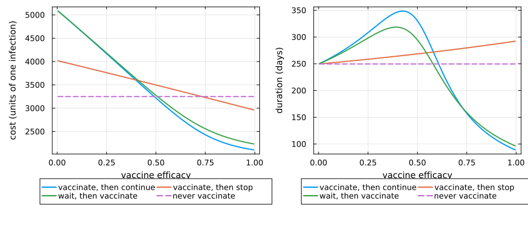
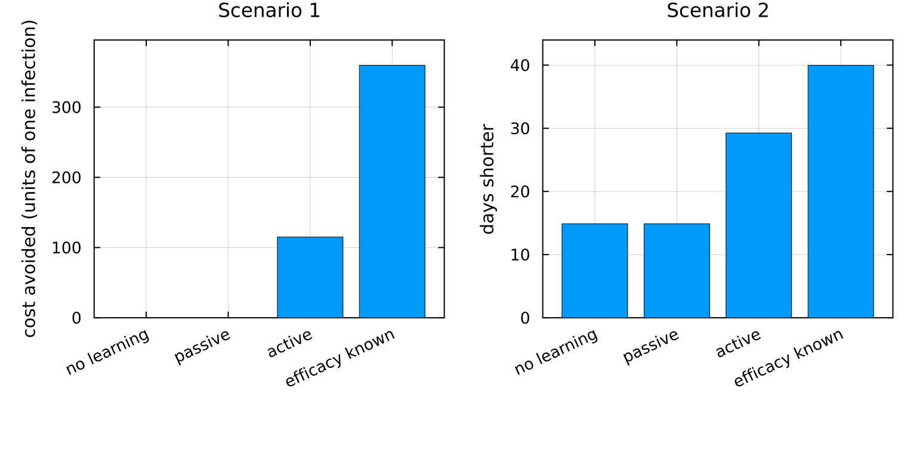

# Vaccinating before the efficacy is known (Atkins et al. 2020)
Simon Frost

- [About this case study](#about-this-case-study)
- [The paper](#the-paper)
- [The epidemic](#the-epidemic)
- [As a problem of two periods](#as-a-problem-of-two-periods)
- [Scenario 1: cost](#scenario-1-cost)
- [Scenario 2: duration](#scenario-2-duration)
- [The four ways of managing](#the-four-ways-of-managing)
- [How much monitoring is needed](#how-much-monitoring-is-needed)
- [What was not reproduced](#what-was-not-reproduced)
- [What to take from this](#what-to-take-from-this)

## About this case study

This case study replicates a published analysis of exactly the question
that `adaptive_management` answers: does it change the first decision to
know that something will be learned before the second? The paper prints
no table of outcomes and cites no code, so its epidemic model is rebuilt
here from its appendix. The choices and the thresholds it reports are
reproduced; two readings of the appendix were needed to do so, and one
published difference is matched only against a different comparison from
the one the paper names. All of that is said below, and pinned in the
test suite (`test/fixtures/replications/atkins2020_vaccination.json`,
`test/test_replications.jl`).

## The paper

Atkins, Jewell, Runge, Ferrari, Shea, Probert and Tildesley (2020),
“Anticipating future learning affects current control decisions: a
comparison between passive and active adaptive management in an
epidemiological setting”, *Journal of Theoretical Biology* 506:110380,
[doi:10.1016/j.jtbi.2020.110380](https://doi.org/10.1016/j.jtbi.2020.110380),
CC BY 4.0. The inputs are its Table A.2 and Appendix A.

**Decision.** An epidemic is detected in a population of 5000. Vaccinate
at once or not; seven days later, continue (or start) or stop.

**Actions.** `vaccinate` or `not`, at each of the two decision days.
Vaccination is of 100 susceptibles a day until the pool of vaccines runs
out. Not vaccinating at either day is the `baseline`.

**States.** The efficacy of the vaccine, the probability that a
vaccination immunises. It is the only unknown.

**Belief.** A Beta(1.1, 1.1) prior on the efficacy, in 100 bins of 1%.

**Information.** If vaccination starts at once, 5% of the 700
vaccinations of the first week are tested: 35 results, each a success
with probability equal to the efficacy. If it does not, nothing is
learned.

**Outcome.** The paper’s own, in two scenarios, both minimised:

- *Scenario 1*, a flu-like disease: a cost in units of one infection,
  with 0.6 for each vaccine given and 350 for running a campaign at all.
  These weights are the paper’s.
- *Scenario 2*, a faster disease: the duration of the outbreak in days.

**Two readings of the appendix**, without which the results are not
reproduced:

- The transmission term is printed as `β S I`. With the reproduction
  numbers the paper quotes (1.6 and 2) it is `β S I / N`.
- The infection term of the cost is printed as the integral of `I(t)`,
  which is person-days of infection. The text calls it “the number of
  infections caused by the outbreak”, and it is taken here as new
  infections from the day of detection. With the integral as printed the
  cost is about four times larger and vaccinating at once is best under
  every approach, which is not what the paper reports.

## The epidemic

``` julia
using DecisionAnalysis
include(joinpath("..", "_common.jl"))
using Plots

# Table A.2 of the paper. Weights: per day of outbreak, per infection, per vaccine,
# and for running a campaign.
const SCENARIOS = (flu=(beta=0.23, sigma=0.5, gamma=0.14, pool=2500.0,
                        weights=(0.0, 1.0, 0.6, 350.0)),
                   fast=(beta=0.2, sigma=0.2, gamma=0.1, pool=4500.0,
                         weights=(1.0, 0.0, 0.0, 0.0)))
const DECISION_DAY, PER_DAY, POPULATION = 7.0, 100.0, 5001.0

# The state is (S, E, I, R, new infections, vaccines given).
function rates(u, p, efficacy, vaccinating)
    S, E, I = u[1], u[2], u[3]
    given = vaccinating && u[6] < p.pool ? min(PER_DAY, max(S, 0.0)) : 0.0
    infection = p.beta * S * I / POPULATION
    return (-infection - efficacy * given, infection - p.sigma * E,
            p.sigma * E - p.gamma * I, p.gamma * I + efficacy * given, infection, given)
end
function runge_kutta(u, p, efficacy, vaccinating, dt)
    k1 = rates(u, p, efficacy, vaccinating)
    k2 = rates(u .+ dt / 2 .* k1, p, efficacy, vaccinating)
    k3 = rates(u .+ dt / 2 .* k2, p, efficacy, vaccinating)
    k4 = rates(u .+ dt .* k3, p, efficacy, vaccinating)
    return u .+ dt / 6 .* (k1 .+ 2 .* k2 .+ 2 .* k3 .+ k4)
end
# The cost of a campaign that runs from day `from` to day `to`. Day 0 is the day on
# which 20 are infected; the outbreak ends when exposed plus infected fall below 1.
function campaign_cost(p, efficacy, from, to; dt=0.01)
    u = (5000.0, 0.0, 1.0, 0.0, 0.0, 0.0)
    while u[3] < 20
        u = runge_kutta(u, p, efficacy, false, dt)
    end
    u, t = (u[1], u[2], u[3], u[4], 0.0, 0.0), 0.0
    while u[2] + u[3] >= 1
        u = runge_kutta(u, p, efficacy, from <= t < to, dt)
        t += dt
    end
    w = p.weights
    return w[1] * t + w[2] * u[5] + w[3] * min(u[6], p.pool) + w[4] * (to > from)
end

const EFFICACIES = [(k - 0.5) / 100 for k in 1:100]
prior = [x^0.1 * (1 - x)^0.1 for x in EFFICACIES]
prior ./= sum(prior)
# The four campaigns that two decisions can make.
const CAMPAIGNS = (vaccinate_then_continue=(0.0, Inf), vaccinate_then_stop=(0.0, DECISION_DAY),
                   wait_then_vaccinate=(DECISION_DAY, Inf), never=(0.0, 0.0))
costs = map(p -> map(c -> [campaign_cost(p, e, c...) for e in EFFICACIES], CAMPAIGNS),
            SCENARIOS)
nothing
```

``` julia
function cost_plot(c, ylabel)
    plot(EFFICACIES, c.vaccinate_then_continue; label="vaccinate, then continue",
         xlabel="vaccine efficacy", ylabel, legend=:outerbottom, legendcolumns=2)
    plot!(EFFICACIES, c.vaccinate_then_stop; label="vaccinate, then stop")
    plot!(EFFICACIES, c.wait_then_vaccinate; label="wait, then vaccinate")
    plot!(EFFICACIES, c.never; label="never vaccinate", linestyle=:dash)
end
plot(cost_plot(costs.flu, "cost (units of one infection)"),
     cost_plot(costs.fast, "duration (days)"); layout=(1, 2), size=(900, 420))
```



These are the paper’s Figs. 2 and 4. In the second scenario a weak or
short campaign *lengthens* the outbreak, because it slows the epidemic
without stopping it.

``` julia
md_table(["campaign", "scenario 1: expected cost", "scenario 2: expected days"],
         [Any[replace(String(k), "_" => " "), sum(prior .* costs.flu[k]),
              sum(prior .* costs.fast[k])] for k in keys(CAMPAIGNS)]; digits=1)
```

| campaign | scenario 1: expected cost | scenario 2: expected days |
|:---|---:|---:|
| vaccinate then continue | 3330.7 | 244.9 |
| vaccinate then stop | 3494.7 | 269.2 |
| wait then vaccinate | 3397.3 | 234.7 |
| never | 3249.9 | 249.6 |

## As a problem of two periods

`adaptive_management` wants a payoff for each period that depends on the
action and the state. Here the cost belongs to the whole campaign, so
the state carries what was done in the first week:

- a state is an efficacy together with a phase: `start`, `vaccinated` or
  `waited`;
- the first period pays nothing, and the action moves `start` to
  `vaccinated` or to `waited` (the `transitions`);
- the second period pays minus the cost of the campaign that the two
  actions make;
- `vaccinate` shows the number of successes among the monitored
  vaccinations, and `not` shows nothing.

``` julia
function two_periods(cost; monitored=35)
    n = length(EFFICACIES)
    states = vcat([Symbol(phase, k) for phase in (:start, :vaccinated, :waited)
                   for k in 1:n])
    Q = zeros(2, 3n)                      # rows: vaccinate, not
    Q[1, (n + 1):(2n)], Q[2, (n + 1):(2n)] = -cost.vaccinate_then_continue,
                                             -cost.vaccinate_then_stop
    Q[1, (2n + 1):(3n)], Q[2, (2n + 1):(3n)] = -cost.wait_then_vaccinate, -cost.never
    vaccinating, waiting = zeros(3n, 3n), zeros(3n, 3n)     # T[next, present]
    for k in 1:n
        vaccinating[n + k, k] = waiting[2n + k, k] = 1
        for later in (n + k, 2n + k)
            vaccinating[later, later] = waiting[later, later] = 1
        end
    end
    successes = [binomial(monitored, x) * e^x * (1 - e)^(monitored - x)
                 for x in 0:monitored, e in repeat(EFFICACIES, 3)]
    seen = (; vaccinate=Experiment(successes;
                                   signals=[Symbol("successes", x) for x in 0:monitored],
                                   states))
    problem = DecisionProblem(PayoffTable([:vaccinate, :not], states, Q),
                              vcat(prior, zeros(2n)); baseline=:not)
    return adaptive_management(problem, seen; horizon=2,
                               transitions=(; vaccinate=vaccinating, not=waiting), depth=2)
end
results = map(two_periods, costs)
# The fewest successes after which the active manager continues.
needed(r) = minimum(parse(Int, String(z)[10:end]) for (z, node) in r.policy.branches
                    if node.action == :vaccinate)
nothing
```

The paper’s three approaches are three of the four values that
`adaptive_management` returns:

- its *passive* approach makes the first decision as if the second would
  be made on the prior, and then updates: this is `passive`;
- its *active* approach makes the first decision knowing that the
  monitored vaccinations will be seen: this is `active`;
- its *non-adaptive* approach chooses once between a full campaign and
  none. `no_learning` is close to it but not the same: it is the best
  plan fixed in advance among all four campaigns.

## Scenario 1: cost

``` julia
flu = results.flu
md_table(["", "paper", "this package"],
         [["non-adaptive choice", "never vaccinate", join(flu.plan, ", then ")],
          ["passive: first action", "not", flu.act_now_action],
          ["active: first action", "vaccinate", flu.first_action],
          ["active: continue if at least this many of 35 succeed", 14, needed(flu)],
          ["efficacy above which continuing beats stopping", "about 40%",
           string(round(Int, 100 * (EFFICACIES[findfirst(costs.flu.vaccinate_then_continue .<
                                                          costs.flu.vaccinate_then_stop)] -
                                    0.005)), "%")],
          ["gain of active over passive (units)", "over 100", flu.value_of_probing],
          ["   as a share of the passive cost", "about 3%",
           string(round(100 * flu.value_of_probing / -flu.passive; digits=1), "%")]];
         digits=1)
```

|  | paper | this package |
|:---|---:|---:|
| non-adaptive choice | never vaccinate | not, then not |
| passive: first action | not | `not` |
| active: first action | vaccinate | `vaccinate` |
| active: continue if at least this many of 35 succeed | 14 | 14 |
| efficacy above which continuing beats stopping | about 40% | 40% |
| gain of active over passive (units) | over 100 | 115 |
| as a share of the passive cost | about 3% | 3.5% |

On the prior, a full campaign costs more than none, so a manager who
does not count on learning never starts. One who does starts at once,
because a campaign that proves ineffective can be stopped after a week.

## Scenario 2: duration

``` julia
fast = results.fast
md_table(["", "paper", "this package"],
         [["non-adaptive choice (a full campaign or none)", "vaccinate throughout",
           sum(prior .* costs.fast.vaccinate_then_continue) <
           sum(prior .* costs.fast.never) ? "vaccinate throughout" : "never vaccinate"],
          ["passive: first action, then", "not, then vaccinate", join(fast.plan, ", then ")],
          ["active: first action", "vaccinate", fast.first_action],
          ["active: continue if at least this many of 35 succeed", 21, needed(fast)],
          ["efficacy above which continuing beats stopping", "about 60%",
           string(round(Int, 100 * (EFFICACIES[findfirst(costs.fast.vaccinate_then_continue .<
                                                          costs.fast.vaccinate_then_stop)] -
                                    0.005)), "%")]]; digits=1)
```

|  | paper | this package |
|:---|---:|---:|
| non-adaptive choice (a full campaign or none) | vaccinate throughout | vaccinate throughout |
| passive: first action, then | not, then vaccinate | not, then vaccinate |
| active: first action | vaccinate | `vaccinate` |
| active: continue if at least this many of 35 succeed | 21 | 21 |
| efficacy above which continuing beats stopping | about 60% | 58% |

The choices and the threshold are the paper’s. Its last figure is not,
as stated: the paper says that active management gives “an expected
duration that is almost 30 days shorter than if we followed a passive AM
approach, a decrease of approximately 12%”.

``` julia
md_table(["active management compared with", "expected days", "days shorter", "%"],
         [["itself", -fast.active, 0.0, 0.0],
          ["the passive policy (wait, then vaccinate)", -fast.passive,
           fast.active - fast.passive, 100 * (fast.active - fast.passive) / -fast.passive],
          ["a full campaign whatever is seen",
           sum(prior .* costs.fast.vaccinate_then_continue),
           fast.active + sum(prior .* costs.fast.vaccinate_then_continue),
           100 * (fast.active + sum(prior .* costs.fast.vaccinate_then_continue)) /
           sum(prior .* costs.fast.vaccinate_then_continue)],
          ["never vaccinating", -fast.baseline, fast.active - fast.baseline,
           100 * (fast.active - fast.baseline) / -fast.baseline]]; digits=1)
```

| active management compared with           | expected days | days shorter |    % |
|:------------------------------------------|--------------:|-------------:|-----:|
| itself                                    |         220.3 |            0 |    0 |
| the passive policy (wait, then vaccinate) |         234.7 |         14.4 |  6.1 |
| a full campaign whatever is seen          |         244.9 |         24.6 |   10 |
| never vaccinating                         |         249.6 |         29.3 | 11.7 |

Against the passive policy that the paper itself describes, the gain
here is about 14 days, or 6%. The published “almost 30 days” and “12%”
are what the comparison with never vaccinating gives. The model is
rebuilt, not the authors’ own, so this is a likely explanation and not a
certain one.

## The four ways of managing

``` julia
md_table(["way of managing", "scenario 1: cost", "gain over never vaccinating",
          "scenario 2: days", "days shorter than never vaccinating"],
         [Any[label, -getfield(flu, f), getfield(flu, f) - flu.baseline,
              -getfield(fast, f), getfield(fast, f) - fast.baseline]
          for (label, f) in (("never vaccinate (baseline)", :baseline),
                             ("no learning (best fixed plan)", :no_learning),
                             ("passive adaptive management", :passive),
                             ("active adaptive management", :active),
                             ("efficacy known from the start", :perfect))]; digits=1)
```

| way of managing | scenario 1: cost | gain over never vaccinating | scenario 2: days | days shorter than never vaccinating |
|:---|---:|---:|---:|---:|
| never vaccinate (baseline) | 3249.9 | 0 | 249.6 | 0 |
| no learning (best fixed plan) | 3249.9 | 0 | 234.7 | 14.9 |
| passive adaptive management | 3249.9 | 0 | 234.7 | 14.9 |
| active adaptive management | 3135 | 115 | 220.3 | 29.3 |
| efficacy known from the start | 2890.3 | 359.6 | 209.6 | 40 |

``` julia
ways = ["no learning" => :no_learning, "passive" => :passive, "active" => :active,
        "efficacy known" => :perfect]
function panel(r, ylabel, title)
    gains = [Float64(getfield(r, f) - r.baseline) for (_, f) in ways]
    return bar(first.(ways), gains; legend=false, xrotation=25, linewidth=0.5,
               ylims=(0, 1.1 * maximum(gains)), ylabel, title)
end
png_figure(plot(panel(flu, "cost avoided (units of one infection)", "Scenario 1"),
                panel(fast, "days shorter", "Scenario 2"); layout=(1, 2), size=(760, 380),
                bottom_margin=10Plots.mm))
```



Both panels are gains over never vaccinating, which is the baseline.

In the second scenario the best fixed plan is to wait a week and then
vaccinate, which the paper’s non-adaptive manager cannot choose. Passive
management follows the same plan and, having vaccinated nobody in the
first week, learns nothing, so the two are worth the same.

## How much monitoring is needed

The paper remarks that “only one monitored vaccination” is enough to
make vaccinating at once the best first action.

``` julia
monitoring = 0:5
runs = map(c -> [two_periods(c; monitored=m) for m in monitoring], costs)
md_table(["vaccinations monitored", "scenario 1: first action", "expected cost",
          "scenario 2: first action", "expected days"],
         [Any[m, runs.flu[k].first_action, -runs.flu[k].active,
              runs.fast[k].first_action, -runs.fast[k].active]
          for (k, m) in enumerate(monitoring)]; digits=1)
```

| vaccinations monitored | scenario 1: first action | expected cost | scenario 2: first action | expected days |
|:---|---:|---:|---:|---:|
| 0 | `not` | 3249.9 | `not` | 234.7 |
| 1 | `vaccinate` | 3242.2 | `not` | 234.7 |
| 2 | `vaccinate` | 3205.8 | `not` | 234.7 |
| 3 | `vaccinate` | 3204.4 | `vaccinate` | 230.6 |
| 4 | `vaccinate` | 3180.2 | `vaccinate` | 229.8 |
| 5 | `vaccinate` | 3175.4 | `vaccinate` | 228.2 |

That holds here in the first scenario. In the second, the rebuilt model
needs three: with one or two results no outcome would change the
decision to continue, so nothing is gained by starting early.

## What was not reproduced

- **The absolute expected costs and durations**, which the paper shows
  only in figures.
- **The sensitivity analyses** of its Sections 3.3 to 3.7 (prior,
  monitoring share, restrictions on control, objective, epidemiological
  parameters).
- **The authors’ solver.** The paper does not name one; the model here
  is integrated by the classical Runge-Kutta method with a step of 0.01
  day.

## What to take from this

- The paper’s central result is reproduced in both scenarios: a manager
  who counts on learning vaccinates at once, and one who does not, does
  not. The numbers of successes that decide whether to continue, 14 and
  21 of 35, are the paper’s.
- The paper’s passive and active approaches are the `passive` and
  `active` values of `adaptive_management`, once the first week’s action
  is made part of the state.
- Reproducing it needed two readings of the appendix that differ from
  what is printed, and one published difference is matched only against
  a different comparison.
