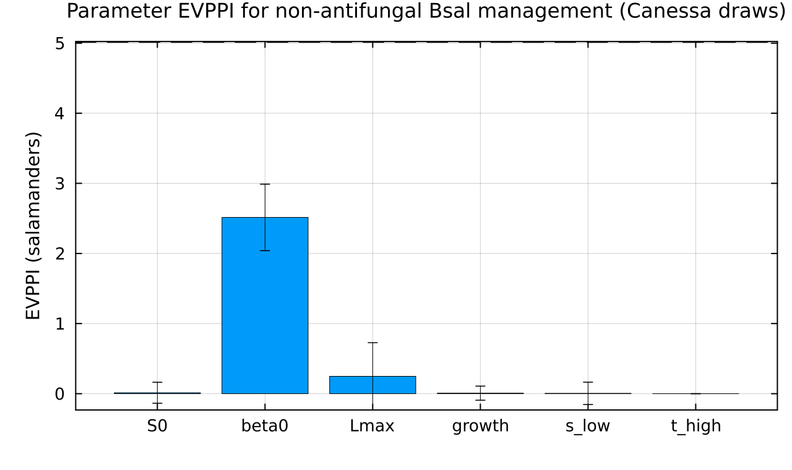
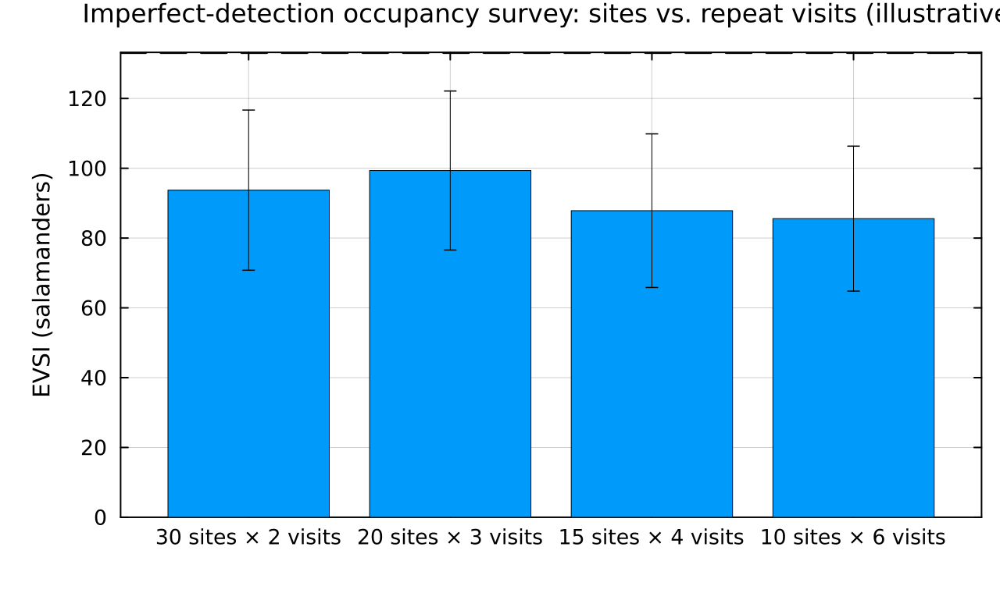

# Mitigating Bsal invasion in fire salamanders under expert uncertainty and imperfect detection
Simon Frost

- [About this case study](#about-this-case-study)
  - [What is published and what is
    ours](#what-is-published-and-what-is-ours)
- [Running the 8-action ensemble](#running-the-8-action-ensemble)
- [Decision rules and stochastic
  dominance](#decision-rules-and-stochastic-dominance)
- [Risk aversion and certainty-equivalent
  VOI](#risk-aversion-and-certainty-equivalent-voi)
- [Parameter EVPPI with GAM
  diagnostics](#parameter-evppi-with-gam-diagnostics)
- [Scenario discovery: when does 90% pre-emptive thinning achieve
  $R_0 < 1$?](#scenario-discovery-when-does-90-pre-emptive-thinning-achieve-r_0--1)
- [Deep uncertainty across initial density
  regimes](#deep-uncertainty-across-initial-density-regimes)
- [Imperfect-detection surveillance: sites versus repeat visits
  (`OccupancyStudy`)](#imperfect-detection-surveillance-sites-versus-repeat-visits-occupancystudy)

## About this case study

*Batrachochytrium salamandrivorans* (Bsal) is an emerging chytrid fungus
causing rapid declines in European fire salamanders (*Salamandra
salamandra*). Canessa et al. (2018, *Journal of Applied Ecology*
55:1987–1996,
[doi:10.1111/1365-2664.13089](https://doi.org/10.1111/1365-2664.13089))
built an integral projection model (IPM) over infection load and
evaluated eight exploratory management actions across 1,000 parameter
sets drawn from pooled expert elicitation (archived on Dryad, CC0, and
shipped in `Chytridiomycosis.jl`).

### What is published and what is ours

- The **model, actions and 1,000 parameter draws** come directly from
  `Chytridiomycosis.jl` (`load_canessa2018()`, `canessa_actions()`,
  `canessa_ensemble()`), using a 120-cell midpoint mesh on $[-10, 15]$
  so the full 8,000-run ensemble executes in seconds while reproducing
  the published medians closely.
- The **decision analysis** — susceptible salamanders remaining on the
  0.475-ha Stegen transect after 90 days, stochastic dominance,
  risk-averse certainty-equivalent VOI, parameter EVPPI with GAM
  diagnostics, PRIM scenario discovery for eradication ($R_0 < 1$),
  credal-set robustness across density regimes, and imperfect-detection
  swabbing (`OccupancyStudy`) — is **ours and illustrative**. Every
  utility is counted in salamanders (or dimensionless ratios), with no
  invented monetary prices; action `:a` (*No action*) is the `baseline`.

## Running the 8-action ensemble

``` julia
using DecisionAnalysis
using Chytridiomycosis: CANESSA_ACTION_NAMES, canessa_actions, canessa_ensemble,
                        load_canessa2018
using GAM: GAM
using Random: Xoshiro
using Statistics: mean, median, quantile
include(joinpath("..", "_common.jl"))

draws = load_canessa2018()
actions_spec = canessa_actions()
action_names = [a.name for a in actions_spec]
action_labels_str = Dict(a.name => a.label for a in actions_spec)

# Run the IPM for every action over all 1,000 expert-elicited draws.
mesh = (-10.0, 15.0, 120)
ensembles = [canessa_ensemble(a; draws, mesh) for a in actions_spec]

n_draws = length(draws)
transect_ha = 0.475
# Uninfected, unmanaged baseline survivors on the 0.475-ha Stegen transect at day 90.
s_free = [d.S0 * transect_ha * d.survival[1]^30 for d in draws]

Q_ratio = zeros(length(actions_spec), n_draws)
Q_surv = zeros(length(actions_spec), n_draws)
R0_mat = zeros(length(actions_spec), n_draws)
for (ai, ens) in enumerate(ensembles), j in 1:n_draws
    Q_ratio[ai, j] = ens[j].ratio
    Q_surv[ai, j] = ens[j].ratio * s_free[j]
    R0_mat[ai, j] = ens[j].R0
end

belief = SampleBelief((;
    S0=[d.S0 for d in draws],
    beta0=[d.β0 for d in draws],
    Lmax=[d.Lmax for d in draws],
    growth=[d.growth for d in draws],
    s_low=[d.survival[2] for d in draws],
    t_high=[d.transmission[5] for d in draws],
))
prob_surv = DecisionProblem(PayoffTable(Q_surv; actions=action_names), belief; baseline=:a)
prob_ratio = DecisionProblem(PayoffTable(Q_ratio; actions=action_names), belief; baseline=:a)

md_table(["action", "description", "E[survivors]", "gain vs `:a`", "median ratio",
          "P(R0 < 1)"],
         [[a.name, a.label, mean(Q_surv[i, :]),
           mean(Q_surv[i, :]) - mean(Q_surv[1, :]),
           median(Q_ratio[i, :]), mean(R0_mat[i, :] .< 1.0)]
          for (i, a) in enumerate(actions_spec)]; digits=3)
```

| action | description | E\[survivors\] | gain vs `:a` | median ratio | P(R0 \< 1) |
|:---|---:|---:|---:|---:|---:|
| `a` | No action | 4.598 | 0 | 0.013 | 0 |
| `b` | Improve body condition | 5.639 | 1.04 | 0.016 | 0 |
| `c` | Probiotic treatment | 4.388 | -0.21 | 0.012 | 0 |
| `d` | Antifungal, 100% coverage | 205.404 | 200.806 | 1 | 1 |
| `e` | Antifungal, 80% coverage | 186.797 | 182.199 | 0.951 | 0.003 |
| `f` | Pre-emptive thinning 50% | 21.548 | 16.95 | 0.081 | 0 |
| `g` | Pre-emptive thinning 90% | 19.806 | 15.208 | 0.097 | 0.591 |
| `h` | Post-detection removal | 0 | -4.598 | 0 | 1 |

Full-coverage antifungal treatment (`:d`) preserves the largest expected
number of susceptible adults on the transect, followed by 80%-coverage
antifungal treatment (`:e`) and 50% pre-emptive thinning (`:f`).
Aggressive 90% pre-emptive thinning (`:g`) reduces $R_0$ below 1 in over
half of draws, yet removes so many healthy hosts beforehand that fewer
susceptible adults remain at day 90 than under antifungal treatment.

## Decision rules and stochastic dominance

Even without specifying a single risk-aversion parameter, first- and
second-order stochastic dominance prune actions that no monotone (or
risk-averse) manager would ever prefer.

``` julia
eu_res = decide(prob_surv, MaxExpectedUtility())
reg_res = decide(prob_surv, MinimaxRegret())
cvar_res = decide(prob_surv, DecisionRule(CVaR(0.10)))
fsd_res = decide(prob_surv, StochasticDominance(; order=1))
ssd_res = decide(prob_surv, StochasticDominance(; order=2))

md_table(["rule", "chosen action(s)"],
         [["MaxExpectedUtility", eu_res.chosen],
          ["MinimaxRegret", reg_res.chosen],
          ["CVaR(0.10)", cvar_res.chosen],
          ["First-order stochastic dominance (FSD)", fsd_res.chosen],
          ["Second-order stochastic dominance (SSD)", ssd_res.chosen]])
```

| rule                                    | chosen action(s) |
|:----------------------------------------|-----------------:|
| MaxExpectedUtility                      |              `d` |
| MinimaxRegret                           |              `d` |
| CVaR(0.10)                              |              `d` |
| First-order stochastic dominance (FSD)  |              `d` |
| Second-order stochastic dominance (SSD) |              `d` |

Because full-coverage antifungal treatment (`:d`) is often infeasible in
field habitats, the practical management choice usually sits among the
**feasible field actions** excluding `:d` (actions `:a`, `:b`, `:c`,
`:e`, `:f`, `:g`, `:h`).

``` julia
field_actions = [:a, :b, :c, :e, :f, :g, :h]
prob_field = DecisionProblem(prob_surv.payoff, belief; feasible=field_actions, baseline=:a)

md_table(["rule (feasible field actions)", "chosen action(s)"],
         [["MaxExpectedUtility", decide(prob_field, MaxExpectedUtility()).chosen],
          ["MinimaxRegret", decide(prob_field, MinimaxRegret()).chosen],
          ["CVaR(0.10)", decide(prob_field, DecisionRule(CVaR(0.10))).chosen],
          ["FSD undominated", decide(prob_field, StochasticDominance(; order=1)).chosen],
          ["SSD undominated", decide(prob_field, StochasticDominance(; order=2)).chosen]])
```

| rule (feasible field actions) | chosen action(s) |
|:------------------------------|-----------------:|
| MaxExpectedUtility            |              `e` |
| MinimaxRegret                 |              `e` |
| CVaR(0.10)                    |              `e` |
| FSD undominated               |              `e` |
| SSD undominated               |              `e` |

## Risk aversion and certainty-equivalent VOI

When antifungal treatment is unavailable or infeasible at landscape
scale, managers must choose among the **non-antifungal field options**:
no action (`:a`), improving body condition (`:b`), 50% pre-emptive
thinning (`:f`), or 90% pre-emptive thinning (`:g`). Across the 1,000
Dryad draws, `:f` and `:g` genuinely trade off depending on transmission
and survival parameters. Under risk aversion (`ExponentialUtility`,
`PowerUtility`), `ce_evpi` reports the value of resolving parameter
uncertainty in **salamanders** rather than utiles.

``` julia
prob_nonaf = DecisionProblem(prob_surv.payoff, belief; feasible=[:a, :b, :f, :g],
                             baseline=:a)
u_lin = LinearUtility(:survivors)
u_cara = ExponentialUtility(:survivors; risk_aversion=0.03)
u_crra = PowerUtility(:survivors; risk_aversion=0.5)

ce_lin = ce_evpi(prob_nonaf, u_lin)
ce_cara = ce_evpi(prob_nonaf, u_cara)
ce_crra = ce_evpi(prob_nonaf, u_crra)

md_table(["utility", "act-now CE (adults)", "informed CE (adults)",
          "CE-EVPI (adults)"],
         [["Linear (risk neutral)", ce_lin.act_now_ce, ce_lin.informed_ce, ce_lin.value],
          ["ExponentialUtility (r = 0.03)", ce_cara.act_now_ce, ce_cara.informed_ce,
           ce_cara.value],
          ["PowerUtility (ρ = 0.5)", ce_crra.act_now_ce, ce_crra.informed_ce,
           ce_crra.value]]; digits=3)
```

| utility | act-now CE (adults) | informed CE (adults) | CE-EVPI (adults) |
|:---|---:|---:|---:|
| Linear (risk neutral) | 21.548 | 26.571 | 5.023 |
| ExponentialUtility (r = 0.03) | 19.344 | 23.927 | 4.583 |
| PowerUtility (ρ = 0.5) | 19.41 | 24.935 | 5.172 |

## Parameter EVPPI with GAM diagnostics

Which of the six elicited biological parameters drives the choice
between `:f` (50% thinning) and `:g` (90% thinning) in the
non-antifungal decision problem? Here we compare standard
`GAMRegression()` (with `edf` diagnostics surfaced from GAM.jl) against
chunked `GAMRegression(; backend=:bam)`.

``` julia
evpi_tr = evpi(prob_nonaf, SampleAverage())
params = [:S0, :beta0, :Lmax, :growth, :s_low, :t_high]
gam_fits = [evppi(prob_nonaf, p, GAMRegression()) for p in params]
bam_fits = [evppi(prob_nonaf, p, GAMRegression(; backend=:bam)) for p in params]

md_table(["parameter", "GAM EVPPI", "SE", "GAM EDF (mean)", "BAM EVPPI"],
         [[p, g.value, g.standard_error, mean(g.details.edf), b.value]
          for (p, g, b) in zip(params, gam_fits, bam_fits)]; digits=3)
```

| parameter | GAM EVPPI |    SE | GAM EDF (mean) | BAM EVPPI |
|:----------|----------:|------:|---------------:|----------:|
| `S0`      |     0.013 | 0.076 |          3.551 |     0.008 |
| `beta0`   |     2.514 | 0.242 |          9.442 |       2.5 |
| `Lmax`    |     0.247 | 0.245 |          2.142 |     0.253 |
| `growth`  |     0.007 | 0.051 |          2.229 |     0.013 |
| `s_low`   |     0.005 | 0.081 |          4.553 |         0 |
| `t_high`  |         0 |     0 |              2 |         0 |

``` julia
plt = Plots.bar(String.(params), [g.value for g in gam_fits];
                yerror=[1.96 * g.standard_error for g in gam_fits],
                legend=false, linewidth=0.5,
                ylabel="EVPPI (salamanders)",
                title="Parameter EVPPI for non-antifungal Bsal management (Canessa draws)")
Plots.hline!(plt, [evpi_tr.value]; linestyle=:dash, color=:black,
             label="Sample EVPI")
png_figure(plt)
```



## Scenario discovery: when does 90% pre-emptive thinning achieve $R_0 < 1$?

`prim_boxes` searches the 6-dimensional elicited parameter space for
interpretable axis-aligned boxes in which `:g` (90% pre-emptive
thinning, overall eradication rate 59.1%) keeps $R_0 < 1$.

``` julia
erad_g = R0_mat[7, :] .< 1.0
prim = prim_boxes(belief, erad_g; peel_alpha=0.05, min_mass=0.10)
top_boxes = prim.frontier[1:min(4, length(prim.frontier))]

md_table(["box", "density P(R0 < 1)", "coverage", "mass", "restricted dimensions"],
         [[i, b.density, b.coverage, b.mass,
           join(["$(k) ∈ [$(round(lo; digits=2)), $(round(hi; digits=2))]"
                 for (k, (lo, hi)) in pairs(b.bounds)], "; ")]
          for (i, b) in enumerate(top_boxes)]; digits=3)
```

| box | density P(R0 \< 1) | coverage | mass | restricted dimensions |
|:---|---:|---:|---:|---:|
| 1 | 0.591 | 1 | 1 | growth ∈ \[13.62, 93.47\]; s*low ∈ \[0.95, 0.99\]; beta0 ∈ \[0.0, 0.02\]; Lmax ∈ \[5390.59, 18535.98\]; t*high ∈ \[0.91, 1.0\]; S0 ∈ \[204.21, 993.68\] |
| 2 | 0.611 | 0.981 | 0.949 | growth ∈ \[13.62, 93.47\]; s*low ∈ \[0.95, 0.99\]; beta0 ∈ \[0.0, 0.01\]; Lmax ∈ \[5390.59, 18535.98\]; t*high ∈ \[0.91, 1.0\]; S0 ∈ \[204.21, 993.68\] |
| 3 | 0.624 | 0.951 | 0.901 | growth ∈ \[13.62, 93.47\]; s*low ∈ \[0.95, 0.99\]; beta0 ∈ \[0.0, 0.01\]; Lmax ∈ \[5390.59, 18535.98\]; t*high ∈ \[0.91, 1.0\]; S0 ∈ \[204.21, 993.68\] |
| 4 | 0.644 | 0.932 | 0.855 | growth ∈ \[13.62, 93.47\]; s*low ∈ \[0.95, 0.99\]; beta0 ∈ \[0.0, 0.01\]; Lmax ∈ \[5390.59, 18535.98\]; t*high ∈ \[0.91, 1.0\]; S0 ∈ \[204.21, 993.68\] |

## Deep uncertainty across initial density regimes

Expert beliefs about pre-invasion host density `S0` can differ sharply
across valleys. Splitting the 1,000 draws into three density strata
(low, medium, high `S0`) builds a three-prior `CredalSet` over those
regimes; `prune_generators` removes a redundant interior mixture
`[1/3, 1/3, 1/3]`, and `SmoothAmbiguity` interpolates between
risk-neutral averaging and `GammaMaximin`.

``` julia
q33, q67 = quantile([d.S0 for d in draws], (1 / 3, 2 / 3))
strata = [d.S0 <= q33 ? 1 : (d.S0 <= q67 ? 2 : 3) for d in draws]
nonaf_idx = [1, 2, 6, 7]
Q_strata = [mean(Q_surv[nonaf_idx[a], strata .== s]) for a in 1:4, s in 1:3]
pay_strata = PayoffTable([:a, :b, :f, :g], [:low_S0, :mid_S0, :high_S0], Q_strata)
# Credal set with an interior mixture included to illustrate pruning.
cred_raw = CredalSet([:low_S0, :mid_S0, :high_S0],
                     [[0.7, 0.2, 0.1], [0.2, 0.6, 0.2], [0.1, 0.2, 0.7],
                      [1 / 3, 1 / 3, 1 / 3]])
cred = prune_generators(cred_raw)
prob_cred = DecisionProblem(pay_strata, cred; baseline=:a)

rob_pi = robust_evpi(prob_cred)
md_table(["quantity / rule", "result"],
         [["generators before -> after prune_generators",
           "$(length(extreme_points(cred_raw))) -> $(length(extreme_points(cred)))"],
          ["EAdmissible", decide(prob_cred, EAdmissible()).chosen],
          ["GammaMaximin", decide(prob_cred, GammaMaximin()).chosen],
          ["SmoothAmbiguity(η = 0.05)",
           decide(prob_cred, DecisionRule(SmoothAmbiguity(0.05))).chosen],
          ["robust_evpi (lower, upper)",
           "$(round(rob_pi.lower; digits=2)), $(round(rob_pi.upper; digits=2))"]])
```

| quantity / rule                              |   result |
|:---------------------------------------------|---------:|
| generators before -\> after prune_generators |  4 -\> 3 |
| EAdmissible                                  |      `f` |
| GammaMaximin                                 |      `f` |
| SmoothAmbiguity(η = 0.05)                    |      `f` |
| robust_evpi (lower, upper)                   | 0.0, 0.0 |

## Imperfect-detection surveillance: sites versus repeat visits (`OccupancyStudy`)

Before committing regional resources across a network of 40 salamander
ponds, managers can run skin-swabbing occupancy surveys
(`OccupancyStudy`) under imperfect detection (MacKenzie et al. 2002).
With a fixed budget of 60 total pond-visits (illustrative), is it more
informative to visit **more sites fewer times** ($30 \times 2$) or
**fewer sites more times** ($15 \times 4$, $10 \times 6$)?

``` julia
rng = Xoshiro(202636)
n_occ = 1200
# Illustrative prior over regional Bsal site occupancy ψ and per-visit swab detection p.
psi = 0.05 .+ 0.55 .* rand(rng, n_occ)
p_det = 0.20 .+ 0.60 .* rand(rng, n_occ)
# Acting regionally saves 40 * psi * 80 salamanders minus 1,200 handling-equivalent units.
Q_reg = vcat(zeros(1, n_occ), permutedims(40 .* psi .* 80 .- 1200.0))
prob_reg = DecisionProblem(PayoffTable(Q_reg; actions=[:wait, :regional_treatment]),
                           SampleBelief((; occupancy=psi, detection=p_det));
                           baseline=:wait)

designs = [(30, 2), (20, 3), (15, 4), (10, 6)]
occ_rows = map(designs) do (S, K)
    st = OccupancyStudy(:occupancy, :detection; sites=S, visits=K)
    est_is = evsi(prob_reg, ImportanceSampling(prob_reg, st; datasets=180, seed=11))
    est_ss = evsi(prob_reg, SummaryStatistics(prob_reg, st; seed=11))
    return ["$(S) sites × $(K) visits", est_is.value, est_is.standard_error,
            est_is.details.median_pareto_k, est_ss.value]
end

md_table(["survey design (60 pond-visits)", "IS EVSI (salamanders)", "IS SE",
          "median PSIS k̂", "SummaryStats EVSI"], occ_rows; digits=2)
```

| survey design (60 pond-visits) | IS EVSI (salamanders) | IS SE | median PSIS k̂ | SummaryStats EVSI |
|:---|---:|---:|---:|---:|
| 30 sites × 2 visits | 93.73 | 11.71 | -0.73 | 86.86 |
| 20 sites × 3 visits | 99.36 | 11.63 | -0.71 | 90.61 |
| 15 sites × 4 visits | 87.85 | 11.23 | -0.79 | 87.92 |
| 10 sites × 6 visits | 85.57 | 10.6 | -0.74 | 78.75 |

``` julia
plt_occ = Plots.bar([r[1] for r in occ_rows], [Float64(r[2]) for r in occ_rows];
                    yerror=[1.96 * Float64(r[3]) for r in occ_rows],
                    legend=false, linewidth=0.5,
                    ylabel="EVSI (salamanders)",
                    title="Imperfect-detection occupancy survey: sites vs. repeat visits (illustrative)")
Plots.hline!(plt_occ, [evpi(prob_reg)]; linestyle=:dash, color=:black, label="EVPI")
png_figure(plt_occ)
```



All PSIS $\hat{k}$ tail diagnostics stay well below the $0.7$
reliability threshold, confirming stable importance weights across
designs. Splitting 60 pond-visits across moderate repeat visits
($15 \times 4$ or $20 \times 3$) resolves occupancy uncertainty without
collapsing detection identifiability.
