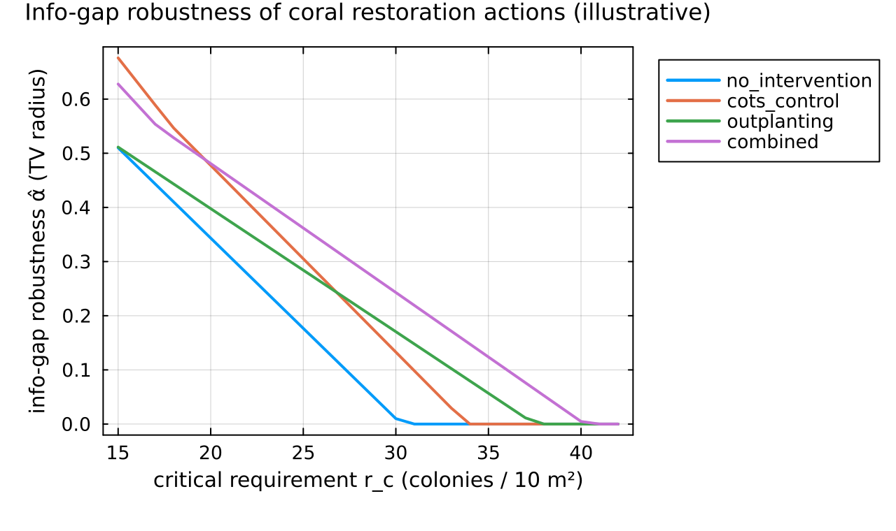

# Coral reef restoration under warming bleaching schedules and deep uncertainty
Simon Frost

- [Motivation](#motivation)
- [1. Non-stationary adaptive management under a warming
  schedule](#1-non-stationary-adaptive-management-under-a-warming-schedule)
- [2. Act now, or delay outplanting to run a transect count
  survey?](#2-act-now-or-delay-outplanting-to-run-a-transect-count-survey)
- [3. Risk aversion and certainty-equivalent
  VOI](#3-risk-aversion-and-certainty-equivalent-voi)
- [4. Deep uncertainty (info-gap), decision curves, and implementation
  gaps](#4-deep-uncertainty-info-gap-decision-curves-and-implementation-gaps)

## Motivation

Fore-reef coral assemblages (such as the Mo’orea reefs studied by Kayal
et al. 2018, *Ecology Letters* 21:1790–1799) face recurring disturbances
from crown-of-thorns starfish (*Acanthaster* spp., COTS) outbreaks and
thermal bleaching events whose frequency is rising under ocean warming.
Managers must decide each season whether to leave a reef unmanaged
(`:no_intervention`, the `baseline`), remove starfish (`:cots_control`),
outplant nursery-grown *Acropora* colonies (`:outplanting`), or mount
both (`:combined`).

**All parameters, transition matrices and payoffs in this vignette are
illustrative**, expressed in **living coral colonies per 10 m²** (with
no invented monetary prices). The example showcases non-stationary
`adaptive_management`, sample-based `value_of_waiting` with
`CountStudy`, certainty-equivalent VOI (`ce_evpi`, `ce_evsi`), info-gap
robustness and opportuneness, `decision_curve`, and implementation /
model-improvement VOI (`evim`, `evmi`).

## 1. Non-stationary adaptive management under a warming schedule

Reef condition moves among three discrete states: `:recovery` (healthy
recruitment), `:cots_outbreak` (active starfish predation), and
`:bleaching` (acute thermal stress). An annual diver transect
(`obs_monitor`) reveals the reef state with imperfect accuracy, whereas
`:no_intervention` relies on a coarser remote-sensing signal
(`obs_remote`). Under a **warming schedule**, the probability of
transitioning into `:bleaching` rises steadily across a 6-year horizon.

``` julia
using DecisionAnalysis
using Random: Xoshiro
include(joinpath("..", "_common.jl"))

states = [:recovery, :cots_outbreak, :bleaching]
actions = [:no_intervention, :cots_control, :outplanting, :combined]

# Per-year net living coral colonies per 10 m² (illustrative).
Q_base = PayoffTable(actions, states,
                     [42.0 18.0 12.0;   # no_intervention (baseline)
                      40.0 34.0 11.0;   # cots_control
                      54.0 21.0 10.0;   # outplanting (vulnerable during bleaching)
                      51.0 36.0  9.0])  # combined

prior = FiniteBelief(states, [0.55, 0.30, 0.15])
prob = DecisionProblem(Q_base, prior; baseline=:no_intervention)

obs_remote = Experiment([0.65 0.25 0.20;
                         0.20 0.55 0.25;
                         0.15 0.20 0.55];
                        signals=[:low_alert, :cots_alert, :heat_alert], states)
obs_diver = Experiment([0.88 0.08 0.06;
                        0.07 0.84 0.09;
                        0.05 0.08 0.85];
                       signals=[:low_alert, :cots_alert, :heat_alert], states)
exps = (; no_intervention=obs_remote, cots_control=obs_diver,
        outplanting=obs_diver, combined=obs_diver)

# Column-stochastic transition matrices T[next, present] parameterised by bleaching risk b.
function reef_transitions(b::Real)
    T_none = [0.75 - b   0.20       0.35 - 0.5b;
              0.20       0.70 - b   0.20;
              0.05 + b   0.10 + b   0.45 + 0.5b]
    T_cots = [0.80 - b   0.55       0.35 - 0.5b;
              0.15       0.35 - b   0.15;
              0.05 + b   0.10 + b   0.50 + 0.5b]
    T_outp = [0.82 - b   0.22       0.38 - 0.5b;
              0.13       0.68 - b   0.17;
              0.05 + b   0.10 + b   0.45 + 0.5b]
    T_comb = [0.86 - b   0.58       0.38 - 0.5b;
              0.09       0.32 - b   0.12;
              0.05 + b   0.10 + b   0.50 + 0.5b]
    return (; no_intervention=T_none, cots_control=T_cots,
            outplanting=T_outp, combined=T_comb)
end

H = 6
stationary_T = reef_transitions(0.05)
warming_T = [reef_transitions(0.05 + 0.04 * (t - 1)) for t in 1:H]

am_stat = adaptive_management(prob, exps; transitions=stationary_T, horizon=H,
                              discount=0.95, method=:points, grid=6)
am_warm = adaptive_management(prob, exps; transitions=warming_T, horizon=H,
                              discount=0.95, method=:points, grid=6)

md_table(["climate regime (6-year horizon, grid=6)", "active lower bound",
          "active upper bound", "perfect information", "baseline"],
         [["Stationary bleaching risk (b = 0.05)", am_stat.active, am_stat.active_upper,
           am_stat.perfect, am_stat.baseline],
          ["Warming schedule (b: 0.05 -> 0.25)", am_warm.active, am_warm.active_upper,
           am_warm.perfect, am_warm.baseline]]; digits=2)
```

| climate regime (6-year horizon, grid=6) | active lower bound | active upper bound | perfect information | baseline |
|:---|---:|---:|---:|---:|
| Stationary bleaching risk (b = 0.05) | 218.92 | 221.36 | 230.07 | 150.94 |
| Warming schedule (b: 0.05 -\> 0.25) | 203.85 | 206.59 | 215.68 | 143.67 |

Under rising bleaching frequency, expected cumulative colonies drop
across all policies, and the adaptive policy shifts away from vulnerable
outplanting toward COTS control as bleaching becomes more probable late
in the horizon.

## 2. Act now, or delay outplanting to run a transect count survey?

Before launching a seasonal outplanting campaign, managers can count
crown-of-thorns starfish along $n$ reef transects
(`CountStudy(:cots_rate; n)`). Waiting one month to complete the survey
forfeits part of the favourable seasonal window (illustrative delay
losses of 1.5 colonies per 10 m² on `:cots_control` and 2.5 colonies per
10 m² on `:outplanting`). Sample-based `value_of_waiting` weighs the
delayed EVSI directly against that delay cost.

``` julia
rng = Xoshiro(202638)
n_draws = 1500
# Illustrative prior over COTS density (starfish per transect): Gamma-like positive draws.
cots_rate = 0.2 .+ 4.8 .* rand(rng, n_draws) .^ 2
# Outplanting succeeds when COTS density is low (< 1.5), loses colonies when high.
Q_now_mat = vcat(
    fill(30.0, 1, n_draws),                                     # no_intervention
    permutedims(28.0 .+ 3.0 .* min.(cots_rate, 3.0)),           # cots_control
    permutedims(46.0 .- 12.0 .* cots_rate),                     # outplanting
)
Q_late_mat = copy(Q_now_mat)
Q_late_mat[2, :] .-= 1.5   # late COTS removal allows extra grazing
Q_late_mat[3, :] .-= 2.5   # lost early-season settlement from waiting

sb_cots = SampleBelief((; cots_rate))
p_now = DecisionProblem(PayoffTable(Q_now_mat; actions=[:no_intervention, :cots_control,
                                                        :outplanting]),
                        sb_cots; baseline=:no_intervention)
p_late = PayoffTable(Q_late_mat; actions=[:no_intervention, :cots_control, :outplanting])

wait_rows = map([2, 5, 10, 20]) do n_transects
    design = CountStudy(:cots_rate; n=n_transects)
    study = SummaryStatistics(p_now, design; seed=7)
    vw = value_of_waiting(p_now, p_late, study; seed=7)
    return ["$(n_transects) transects", vw.evsi_delayed.value, vw.delay_cost,
            vw.value, vw.standard_error]
end

md_table(["COTS transect survey", "EVSI (delayed)", "delay cost",
          "value of waiting (colonies)", "SE"], wait_rows; digits=2)
```

| COTS transect survey | EVSI (delayed) | delay cost | value of waiting (colonies) | SE |
|:---|---:|---:|---:|---:|
| 2 transects | 3.41 | 1.5 | 1.91 | 0.18 |
| 5 transects | 3.98 | 1.5 | 2.48 | 0.15 |
| 10 transects | 4.17 | 1.5 | 2.67 | 0.15 |
| 20 transects | 4.28 | 1.5 | 2.78 | 0.14 |

## 3. Risk aversion and certainty-equivalent VOI

A risk-averse reef manager values avoiding catastrophic low-colony
outcomes more than symmetric gains. `ce_evpi` and `ce_evsi` compute
willingness to trade for perfect or diver-survey information in
**colonies per 10 m²** under `ExponentialUtility` and `PowerUtility`.

``` julia
u_lin = LinearUtility(:colonies)
u_cara = ExponentialUtility(:colonies; risk_aversion=0.04)
u_crra = PowerUtility(:colonies; risk_aversion=0.5)

md_table(["utility", "act-now CE", "CE-EVPI (colonies)", "CE-EVSI diver (colonies)"],
         [["Linear (risk neutral)", ce_evpi(prob, u_lin).act_now_ce,
           ce_evpi(prob, u_lin).value, ce_evsi(prob, u_lin, obs_diver).value],
          ["ExponentialUtility (r = 0.04)", ce_evpi(prob, u_cara).act_now_ce,
           ce_evpi(prob, u_cara).value, ce_evsi(prob, u_cara, obs_diver).value],
          ["PowerUtility (ρ = 0.5)", ce_evpi(prob, u_crra).act_now_ce,
           ce_evpi(prob, u_crra).value, ce_evsi(prob, u_crra, obs_diver).value]];
         digits=2)
```

| utility | act-now CE | CE-EVPI (colonies) | CE-EVSI diver (colonies) |
|:---|---:|---:|---:|
| Linear (risk neutral) | 40.2 | 2.1 | 1.1 |
| ExponentialUtility (r = 0.04) | 34.93 | 2.1 | 0.73 |
| PowerUtility (ρ = 0.5) | 38.17 | 2.14 | 0.93 |

## 4. Deep uncertainty (info-gap), decision curves, and implementation gaps

When even the nominal reef-regime probabilities `[0.55, 0.30, 0.15]` are
uncertain, `info_gap_robustness` asks how large a total-variation
perturbation $\alpha$ each action can tolerate while still guaranteeing
a critical colony threshold $r_c$ (say 30 colonies per 10 m²), while
`info_gap_opportuneness` asks how small a perturbation suffices to
achieve an ambitious windfall $r_w$ (45 colonies per 10 m²).

``` julia
rob = info_gap_robustness(prob, 30.0)
opp = info_gap_opportuneness(prob, 45.0)

md_table(["action", "nominal EU", "robustness α̂ (≥ 30 colonies)",
          "opportuneness β̂ (≥ 45 colonies)"],
         [[a, aggregate(Expectation(), prob)[i], rob.robustness[i], opp.opportuneness[i]]
          for (i, a) in enumerate(actions)]; digits=3)
```

| action | nominal EU | robustness α̂ (≥ 30 colonies) | opportuneness β̂ (≥ 45 colonies) |
|:---|---:|---:|---:|
| `no_intervention` | 30.3 | 0.01 | none |
| `cots_control` | 33.85 | 0.133 | none |
| `outplanting` | 37.5 | 0.17 | 0.177 |
| `combined` | 40.2 | 0.243 | 0.114 |

``` julia
# Sweep critical colony requirement r_c to show the classic info-gap trade-off curves.
reqs = collect(15.0:1.0:42.0)
plt_ig = Plots.plot(; xlabel="critical requirement r_c (colonies / 10 m²)",
                    ylabel="info-gap robustness α̂ (TV radius)",
                    title="Info-gap robustness of coral restoration actions (illustrative)")
for (i, a) in enumerate(actions)
    alphas = [info_gap_robustness(prob, r).robustness[i] for r in reqs]
    Plots.plot!(plt_ig, reqs, alphas; label=String(a))
end
png_figure(plt_ig)
```



Finally, managers face two operational frictions beyond ecological
uncertainty: **imperfect implementation** (`evim`, when field crews only
reach partial compliance with the recommended action) and **model
discrepancy** (`evmi`, when a simplified recruitment model disagrees
with an alternative density-dependent model).

``` julia
# Suppose current practice splits effort 50% no_intervention, 25% cots_control,
# 15% outplanting, 10% combined (illustrative).
im_perf = evim(prob; implementation=(; no_intervention=0.50, cots_control=0.25,
                                     outplanting=0.15, combined=0.10))
im_with_diver = evim(prob, obs_diver;
                     implementation=(; no_intervention=0.50, cots_control=0.25,
                                     outplanting=0.15, combined=0.10))

# Alternative recruitment model where outplanting suffers heavy post-outplant mortality,
# making :cots_control optimal instead of :combined.
Q_alt = PayoffTable(actions, states,
                    [42.0 18.0 12.0;
                     40.0 34.0 11.0;
                     36.0 12.0  5.0;
                     35.0 26.0  4.0])
prob_alt = DecisionProblem(Q_alt, prior; baseline=:no_intervention)
mi_ens = evmi([prob, prob_alt], [0.5, 0.5])

# Decision curve (Vickers & Elkin 2006) for triggering COTS control from an outbreak
# risk score across the 1,500 simulated reefs (illustrative threshold sweep).
outbreak_y = Int.(cots_rate .>= 1.5)
risk_score = clamp.(1 ./ (1 .+ exp.(-(cots_rate .- 1.5))), 0.01, 0.99)
dc = decision_curve(outbreak_y, risk_score; thresholds=[0.1, 0.25, 0.4, 0.6])

md_table(["value decomposition", "colonies / 10 m²"],
         [["EVPIM (perfect implementation)", im_perf.value],
          ["EVSI of diver transect alone", evsi(prob, obs_diver)],
          ["Joint value of diver survey + perfect implementation", im_with_diver.value],
          ["EVMI across two coral recruitment models", mi_ens.value]]; digits=3)
```

| value decomposition                                  | colonies / 10 m² |
|:-----------------------------------------------------|-----------------:|
| EVPIM (perfect implementation)                       |            6.943 |
| EVSI of diver transect alone                         |            1.101 |
| Joint value of diver survey + perfect implementation |            8.044 |
| EVMI across two coral recruitment models             |              3.1 |

``` julia
md_table(["threshold p_t", "net benefit (risk score)", "treat all",
          "interventions avoided"],
         [[r.threshold, r.net_benefit, r.treat_all, r.interventions_avoided]
          for r in dc]; digits=3)
```

| threshold p_t | net benefit (risk score) | treat all | interventions avoided |
|:--------------|-------------------------:|----------:|----------------------:|
| 0.1           |                    0.396 |     0.396 |                     0 |
| 0.25          |                     0.35 |     0.275 |                 0.225 |
| 0.4           |                    0.396 |     0.093 |                 0.453 |
| 0.6           |                    0.381 |     -0.36 |                 0.494 |

Closing the implementation gap (`evim`) can be worth more than
collecting new survey data alone, and combining both
(`evim(prob, obs_diver; ...)`) equals the sum of perfect implementation
plus the diver survey’s EVSI.
