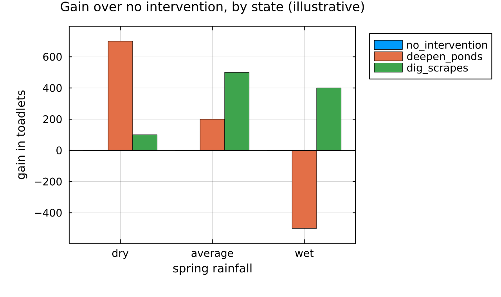

# A first decision table
Simon Frost

- [Motivation](#motivation)
- [The problem](#the-problem)
- [A belief about the states](#a-belief-about-the-states)
- [The decision problem and its
  baseline](#the-decision-problem-and-its-baseline)
- [Expected number of individuals](#expected-number-of-individuals)
- [Gain over no intervention](#gain-over-no-intervention)
- [When the state is known](#when-the-state-is-known)
- [What the feasibility filter did](#what-the-feasibility-filter-did)
- [What to take away](#what-to-take-away)
- [Next](#next)

## Motivation

A manager has to choose one of a few actions without knowing which state
of the world will hold. Decision analysis starts by writing that down as
a table: one row per action, one column per state, and in each cell the
outcome of taking that action when that state holds. This vignette
builds such a table with `DecisionAnalysis.jl`, attaches a belief about
the states, and finds the action with the largest expected outcome. It
also introduces the comparison that every vignette in this series makes:
each action is measured against doing nothing.

The currency is individuals. Outcomes are counted as the number of
animals of the focal species, never as money.

## The problem

Natterjack toads breed in shallow, temporary ponds on a dune system.
Shallow ponds warm quickly and hold few predators, but in a dry spring
they dry out before the tadpoles have metamorphosed. The manager can
leave the ponds alone, deepen the existing ponds, or dig new shallow
scrapes. The outcome is the number of toadlets that leave the ponds this
year. Every toadlet counts as one individual.

The state of the world is the spring rainfall: dry, average or wet.

**All numbers in this vignette are illustrative.** They were chosen to
make the arithmetic easy to follow. They are not data and they are not
estimates for any real site.

``` julia
using DecisionAnalysis
include(joinpath("..", "_common.jl"))   # plot defaults and small tables, no analysis

actions = [:no_intervention, :deepen_ponds, :dig_scrapes, :deepen_and_dig]
states = [:dry, :average, :wet]
toadlets = [ 200 1200 2000     # no intervention: the ponds dry out in a dry spring
             900 1400 1500     # deeper ponds hold water, and in a wet spring hold predators
             300 1700 2400     # more shallow ponds: more habitat, the same drying risk
            1000 1800 2000]    # both at once
payoff = individuals_payoff(PayoffTable(actions, states, toadlets))
```

**PayoffTable{Int64}: 4 actions × 3 states**

| action            | `dry` | `average` | `wet` |
|:------------------|------:|----------:|------:|
| `no_intervention` |   200 |      1200 |  2000 |
| `deepen_ponds`    |   900 |      1400 |  1500 |
| `dig_scrapes`     |   300 |      1700 |  2400 |
| `deepen_and_dig`  |  1000 |      1800 |  2000 |

`PayoffTable(actions, states, Q)` stores `Q[a, θ]`, with rows for
actions and columns for states. Higher is better. `individuals_payoff`
says what the utility is: the payoff of an action in a state *is* the
count of individuals, so the table of counts is the payoff table (the
function checks that no count is negative and returns it). A
`PayoffTable` displays itself as a table; nothing else is needed to
print it.

The fourth action is the best or equal best in two of the three springs,
but the site has machinery for one kind of work this season, so it
cannot be carried out. It stays in the table and is excluded by a
feasibility filter below.

## A belief about the states

The belief is a probability for each state. Here a dry spring has
probability 3/10, an average one 1/2 and a wet one 1/5 (illustrative).
Writing them as rationals keeps every later number exact.

``` julia
belief = FiniteBelief(states, [3 // 10, 1 // 2, 1 // 5])
md_table(["state", "probability"],
         [[s, exact(p)] for (s, p) in zip(state_labels(belief), probabilities(belief))])
```

| state     | probability |
|:----------|------------:|
| `dry`     |        3/10 |
| `average` |         1/2 |
| `wet`     |         1/5 |

## The decision problem and its baseline

A `DecisionProblem` pairs the table with the belief. Two keywords matter
here.

- `baseline` names the action that stands for no intervention, business
  as usual. Setting it changes no score and no choice. It adds the
  comparison with doing nothing.
- `feasible` filters the actions. Infeasible actions get no score and
  cannot be chosen.

``` julia
problem = DecisionProblem(payoff, belief;
                          baseline=:no_intervention,
                          feasible=[:no_intervention, :deepen_ponds, :dig_scrapes])
feasible_actions(problem)
```

    3-element Vector{Symbol}:
     :no_intervention
     :deepen_ponds
     :dig_scrapes

## Expected number of individuals

The expected number of toadlets under an action is the
probability-weighted mean of its row: the sum over states of probability
times outcome. `aggregate` with the `Expectation` aggregator computes it
for every feasible action, and `decide` with `MaxExpectedUtility` picks
the largest.

``` julia
result = decide(problem, MaxExpectedUtility())
```

**DecisionResult: MaxExpectedUtility (higher is better)**

| action            | score | chosen |
|:------------------|------:|-------:|
| `no_intervention` |  1060 |     \- |
| `deepen_ponds`    |  1270 |     \- |
| `dig_scrapes`     |  1420 |    yes |

First choice: dig_scrapes

``` julia
first_choice(result), act_now_value(problem)
```

    (:dig_scrapes, 1420//1)

`decide` returns a `DecisionResult` with the scores, every chosen action
(ties are all listed) and the rule, and it displays as the table above.
`first_choice` gives the single deterministic choice, and
`act_now_value` the expected number of toadlets under it.

As a check by hand, for digging scrapes: 3/10 × 300 + 1/2 × 1700 + 1/5 ×
2400 = 90 + 850 + 480 = 1420.

## Gain over no intervention

The number that matters to a manager is how many more individuals an
action yields than doing nothing. `gain_over_baseline` gives that
difference in every state, and `expected_gain_over_baseline` its
expectation.

``` julia
gain_over_baseline(problem)
```

**PayoffTable{Int64}: 3 actions × 3 states**

| action            | `dry` | `average` | `wet` |
|:------------------|------:|----------:|------:|
| `no_intervention` |     0 |         0 |     0 |
| `deepen_ponds`    |   700 |       200 |  -500 |
| `dig_scrapes`     |   100 |       500 |   400 |

``` julia
gain = expected_gain_over_baseline(problem)
md_table(["action", "expected gain over no intervention"],
         [[a, g] for (a, g) in zip(feasible_actions(problem), gain)])
```

| action            | expected gain over no intervention |
|:------------------|-----------------------------------:|
| `no_intervention` |                                  0 |
| `deepen_ponds`    |                                210 |
| `dig_scrapes`     |                                360 |

The gain table shows something the expectations hide: an action can have
a positive expected gain and still lose individuals in some state.
Deepening the ponds costs 500 toadlets in a wet spring.

``` julia
G = gain_over_baseline(problem)
png_figure(grouped_bars(G.states, G.actions, permutedims(G.Q);
                        xlabel="spring rainfall", ylabel="gain in toadlets",
                        title="Gain over no intervention, by state (illustrative)"))
```



## When the state is known

If the spring were known in advance the belief would be a `PointBelief`,
and the best action would simply be the best cell in that column.

``` julia
md_table(["known state", "best action", "toadlets"],
         [begin
              known = DecisionProblem(payoff, PointBelief(s);
                                      baseline=:no_intervention,
                                      feasible=feasible_actions(problem))
              [s, first_choice(decide(known, MaxExpectedUtility())),
               act_now_value(known)]
          end
          for s in states])
```

| known state |    best action | toadlets |
|:------------|---------------:|---------:|
| `dry`       | `deepen_ponds` |      900 |
| `average`   |  `dig_scrapes` |     1700 |
| `wet`       |  `dig_scrapes` |     2400 |

The best action differs between states, which is why the uncertainty
matters. The vignette on regret returns to this table of best actions.

## What the feasibility filter did

Without the filter the fourth action would have been chosen.

``` julia
unfiltered = DecisionProblem(payoff, belief; baseline=:no_intervention)
first_choice(decide(unfiltered, MaxExpectedUtility())), act_now_value(unfiltered)
```

    (:deepen_and_dig, 1600//1)

## What to take away

- A decision problem is a payoff table `Q[a, θ]` (rows are actions,
  columns are states), a belief about the states, and optionally a
  feasibility filter and a baseline.
- Outcomes here are counts of individuals. Higher is better.
- `aggregate(Expectation(), problem)` gives the expected count for each
  action and `decide(problem, MaxExpectedUtility())` the action that
  maximises it.
- Always name the no-intervention action as the `baseline`.
  `gain_over_baseline` and `expected_gain_over_baseline` then report
  what each action adds to doing nothing.
- An action with a positive expected gain can still do worse than no
  intervention in some states. Look at the gain table and not only at
  its expectation.
- Rational inputs give exact outputs.

## Next

Expected utility is one rule among several. The next vignette, [Decision
rules side by side](../02_decision_rules/02_decision_rules.md), applies
seven rules to one table and shows where and why they disagree.
