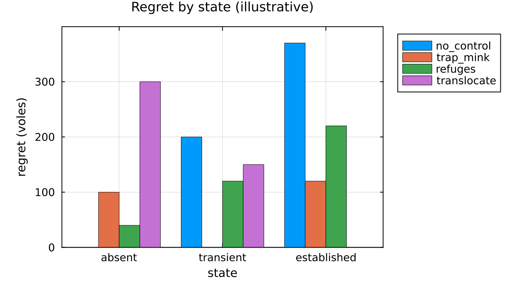
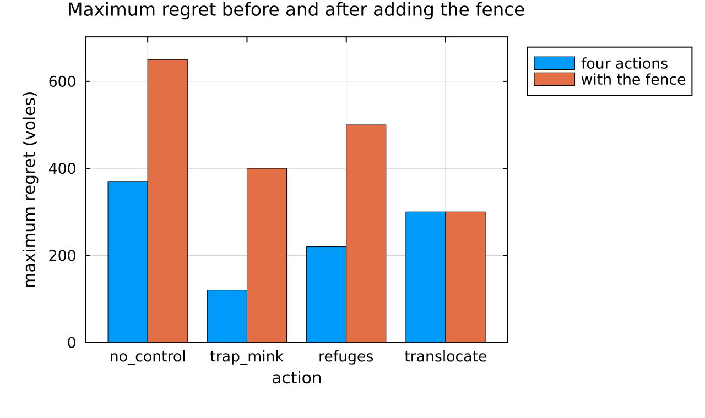

# Regret
Simon Frost

- [Motivation](#motivation)
- [The problem](#the-problem)
- [The regret table](#the-regret-table)
- [Maximum and expected regret](#maximum-and-expected-regret)
- [Expected regret and the value of perfect
  information](#expected-regret-and-the-value-of-perfect-information)
- [Relative regret](#relative-regret)
- [The menu-dependence of minimax
  regret](#the-menu-dependence-of-minimax-regret)
- [What to take away](#what-to-take-away)
- [Next](#next)

## Motivation

Regret measures an action against the best that could have been done had
the state been known. It turns a payoff table into a table of
shortfalls. Two summaries of that table are in common use: the expected
regret, which turns out to be the value of perfect information in
another guise, and the maximum regret, which the minimax-regret rule
minimises. This vignette computes both, shows the identity with the
expected value of perfect information (EVPI), and shows the main caveat
of minimax regret: the choice can change when an action that is never
chosen is added to the menu.

## The problem

The problem is the one of the previous vignette: a colony of water voles
on a river that American mink may reach. Outcomes are the number of
water voles alive in five years. **All numbers are illustrative.**

``` julia
using DecisionAnalysis
include(joinpath("..", "_common.jl"))

actions = [:no_control, :trap_mink, :refuges, :translocate]
states = [:absent, :transient, :established]
payoff = PayoffTable(actions, states,
                     [800 400 50; 700 600 300; 760 480 200; 500 450 420])
problem = DecisionProblem(payoff, [7 // 10, 1 // 5, 1 // 10]; baseline=:no_control)
payoff_markdown(payoff)
```

| action        | `absent` | `transient` | `established` |
|:--------------|---------:|------------:|--------------:|
| `no_control`  |      800 |         400 |            50 |
| `trap_mink`   |      700 |         600 |           300 |
| `refuges`     |      760 |         480 |           200 |
| `translocate` |      500 |         450 |           420 |

## The regret table

The regret of action `a` in state `θ` is the best payoff in that state
minus the payoff of `a`: `R[a, θ] = max over a′ of Q[a′, θ] − Q[a, θ]`.
Every entry is zero or positive and every column has a zero, at the
action that is best for that state.

``` julia
R = regret_table(problem)
labelled_table("regret in voles", feasible_actions(problem), states, R)
```

| regret in voles | `absent` | `transient` | `established` |
|:----------------|---------:|------------:|--------------:|
| `no_control`    |        0 |         200 |           370 |
| `trap_mink`     |      100 |           0 |           120 |
| `refuges`       |       40 |         120 |           220 |
| `translocate`   |      300 |         150 |             0 |

Reading the first row: with no mink, no control is the best action and
has no regret. With transient mink it is 200 voles behind trapping, and
with established mink 370 voles behind translocation.

``` julia
png_figure(grouped_bars(states, feasible_actions(problem), permutedims(R);
                        xlabel="state", ylabel="regret (voles)",
                        title="Regret by state (illustrative)"))
```



## Maximum and expected regret

``` julia
md_table(["action", "maximum regret", "expected regret", "expected voles",
          "expected gain over no control"],
         [[a, m, e, u, g]
          for (a, m, e, u, g) in zip(feasible_actions(problem), max_regret(problem),
                                     expected_regret(problem),
                                     aggregate(Expectation(), problem),
                                     expected_gain_over_baseline(problem))])
```

| action | maximum regret | expected regret | expected voles | expected gain over no control |
|:---|---:|---:|---:|---:|
| `no_control` | 370 | 77 | 645 | 0 |
| `trap_mink` | 120 | 82 | 640 | -5 |
| `refuges` | 220 | 74 | 648 | 3 |
| `translocate` | 300 | 240 | 482 | -163 |

`MinimaxRegret()` picks the action with the smallest maximum regret, and
it differs from the action with the smallest expected regret.

``` julia
first_choice(decide(problem, MinimaxRegret())),
first_choice(decide(problem, DecisionRule(Expectation(); transform=RegretTransform())))
```

    (:trap_mink, :refuges)

## Expected regret and the value of perfect information

Add the expected voles and the expected regret in any row of the table
above. The sum is the same for every action:

``` julia
aggregate(Expectation(), problem) .+ expected_regret(problem)
```

    4-element Vector{Rational{Int64}}:
     722
     722
     722
     722

That constant is the expected number of voles for a manager who learns
the state before choosing, the probability-weighted sum of the column
maxima. So ranking actions by expected regret (smallest first) is the
same as ranking them by expected utility (largest first), and the
smallest expected regret is what is lost by having to choose without
knowing the state. That loss is the expected value of perfect
information.

``` julia
minimum(expected_regret(problem)), evpi(problem)
```

    (74//1, 74//1)

``` julia
minimum(expected_regret(problem)) == evpi(problem)
```

    true

The identity is exact here because the inputs are integers and
rationals. Learning whether mink will be absent, transient or
established before acting would be worth 74 voles in expectation. No
survey of mink, however good, can be worth more than that to this
decision. Later vignettes price real, imperfect information against this
ceiling.

Regret is unchanged when the same number is subtracted from every action
in a state. In particular, the table of gains over the baseline has the
same regret table and the same EVPI as the original.

``` julia
gains = gain_over_baseline(problem)
regret_table(gains) == R,
evpi(DecisionProblem(gains, problem.belief)) == evpi(problem)
```

    (true, true)

## Relative regret

`relative_regret_table` divides each column by its best payoff, which
reads regret as a share of what was achievable. Unlike regret it changes
if a constant is added to the payoffs.

``` julia
labelled_table("relative regret", feasible_actions(problem), states,
               relative_regret_table(problem); digits=3)
```

| relative regret | `absent` | `transient` | `established` |
|:----------------|---------:|------------:|--------------:|
| `no_control`    |        0 |       0.333 |         0.881 |
| `trap_mink`     |    0.125 |           0 |         0.286 |
| `refuges`       |     0.05 |         0.2 |         0.524 |
| `translocate`   |    0.375 |        0.25 |             0 |

``` julia
first_choice(decide(problem,
                    DecisionRule(WorstCase(); transform=RelativeRegretTransform())))
```

    :trap_mink

## The menu-dependence of minimax regret

Regret is measured against the best action available in each state, so
it depends on which actions are on the table. Suppose a fifth action is
proposed: a mink-proof fence around the core of the colony. It protects
well if mink establish and does poorly otherwise, because it cuts the
colony off from the rest of the river.

``` julia
bigger = PayoffTable(vcat(actions, :fence), states, vcat(payoff.Q, [300 300 700]))
problem5 = DecisionProblem(bigger, problem.belief; baseline=:no_control)
payoff_markdown(bigger)
```

| action        | `absent` | `transient` | `established` |
|:--------------|---------:|------------:|--------------:|
| `no_control`  |      800 |         400 |            50 |
| `trap_mink`   |      700 |         600 |           300 |
| `refuges`     |      760 |         480 |           200 |
| `translocate` |      500 |         450 |           420 |
| `fence`       |      300 |         300 |           700 |

``` julia
before = decide(problem, MinimaxRegret())
after = decide(problem5, MinimaxRegret())
md_table(["action", "maximum regret, four actions", "maximum regret, with the fence"],
         [[a, i <= 4 ? before.scores[i] : "", after.scores[i]]
          for (i, a) in enumerate(feasible_actions(problem5))])
```

| action        | maximum regret, four actions | maximum regret, with the fence |
|:--------------|-----------------------------:|-------------------------------:|
| `no_control`  |                          370 |                            650 |
| `trap_mink`   |                          120 |                            400 |
| `refuges`     |                          220 |                            500 |
| `translocate` |                          300 |                            300 |
| `fence`       |                              |                            500 |

``` julia
first_choice(before), first_choice(after)
```

    (:trap_mink, :translocate)

The fence is not chosen. Its own maximum regret is 500. But it raises
the best payoff under established mink from 420 to 700, which adds 280
to the regret of every other action in that state, and the
recommendation moves from trapping to translocation. Choosing between
trapping and translocation has come to depend on an option that neither
rule recommends. This is a failure of the independence of irrelevant
alternatives, and it is a property of the rule, not of this table.

Expected utility does not behave like this. An action’s expected payoff
does not depend on the other rows, so adding the fence leaves the choice
where it was.

``` julia
first_choice(decide(problem, MaxExpectedUtility())),
first_choice(decide(problem5, MaxExpectedUtility()))
```

    (:refuges, :refuges)

``` julia
png_figure(grouped_bars(feasible_actions(problem),
                        ["four actions", "with the fence"],
                        hcat(before.scores, after.scores[1:4]);
                        xlabel="action", ylabel="maximum regret (voles)",
                        title="Maximum regret before and after adding the fence"))
```



## What to take away

- `regret_table` gives the shortfall of each action from the best action
  for each state. `max_regret` and `expected_regret` summarise it by
  action.
- Expected utility plus expected regret is the same for every action.
  Minimising expected regret is therefore maximising expected utility.
- The smallest expected regret equals `evpi(problem)`: here 74 voles,
  the most that any information about the state can be worth.
- Regret, and so EVPI, is the same whether payoffs are raw counts or
  gains over the no-intervention baseline.
- Minimax regret depends on the menu. Adding an action that is never
  chosen changed the recommendation from trapping to translocation.
  State the set of actions when reporting a minimax-regret choice.

## Next

[Experiments and the value of sample
information](../04_experiments_and_evsi/04_experiments_and_evsi.md)
replaces perfect information by a real diagnostic test and asks what its
result is worth.
