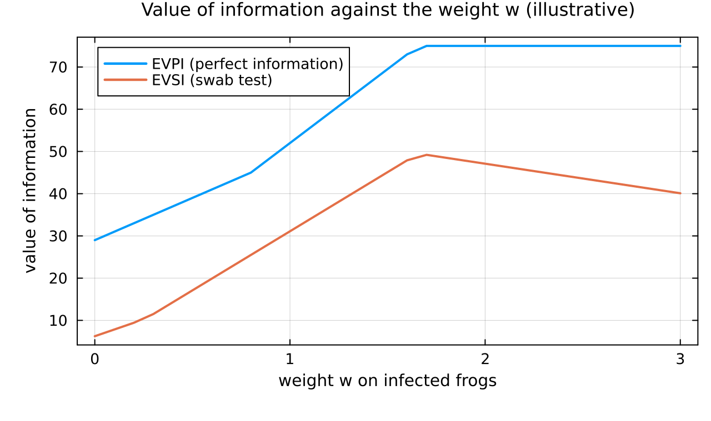

# Experiments and the value of sample information
Simon Frost

- [Motivation](#motivation)
- [The problem](#the-problem)
- [An experiment is a likelihood](#an-experiment-is-a-likelihood)
- [Bayes’ rule](#bayes-rule)
- [Acting on the result](#acting-on-the-result)
- [The value of sample information](#the-value-of-sample-information)
- [How the value depends on the
  weight](#how-the-value-depends-on-the-weight)
- [Information that is worth
  nothing](#information-that-is-worth-nothing)
- [Net benefit, only where the cost is
  additive](#net-benefit-only-where-the-cost-is-additive)
- [What to take away](#what-to-take-away)
- [Next](#next)

## Motivation

Perfect information is a ceiling. What a manager can actually buy is a
survey or a diagnostic test: something whose result depends on the state
but does not reveal it. This vignette describes such a source of
information as a likelihood, updates the belief on its result with
Bayes’ rule, and computes the expected value of sample information
(EVSI): how many more individuals the manager can expect by seeing the
result before choosing. It also shows that information can be worth
exactly nothing, and when a cost of sampling may be subtracted.

## The problem

A pond holds a population of frogs. The chytrid fungus *Batrachochytrium
dendrobatidis* (Bd) may be present. The manager can do nothing, treat
the frogs with antifungal baths, or drain and disinfect the pond while
the frogs are held in tanks. The state is the status of Bd in the pond:
absent, present at low prevalence, or present at high prevalence.

For an infectious disease the outcome has two parts, both counted in
individuals two years from now:

- the number of **uninfected** frogs alive (more is better);
- the number of **infected** frogs alive (fewer is better).

They are combined as

> utility = uninfected − w × infected,

where the weight `w` says how much an infected frog counts against the
population.

**Do infected but living frogs count towards the population?** In this
series they do not. Only uninfected frogs are counted as population.
With `w = 0` infected frogs are ignored altogether: they add nothing and
subtract nothing. With `w = 1` each infected frog cancels one uninfected
frog, on the argument that it is a source of infection for others. A
total head count of living frogs, infected or not, would correspond to
`w = −1` and is not used. Results are shown for `w = 0` and `w = 1`, and
as a sweep over `w`.

**All numbers are illustrative**, not data and not estimates for any
real pond or test.

``` julia
using DecisionAnalysis
include(joinpath("..", "_common.jl"))
using Plots

actions = [:no_intervention, :antifungal_baths, :disinfect_pond]
states = [:absent, :low_prevalence, :high_prevalence]
uninfected = PayoffTable(actions, states,
                         [500 300 100     # no intervention
                          470 380 250     # baths: some handling losses, fewer infections
                          350 340 320])   # disinfection: heavy losses, Bd nearly removed
infected = PayoffTable(actions, states,
                       [0 150 250
                        0  60 120
                        0  10  20])
uninfected
```

**PayoffTable{Int64}: 3 actions × 3 states**

| action             | `absent` | `low_prevalence` | `high_prevalence` |
|:-------------------|---------:|-----------------:|------------------:|
| `no_intervention`  |      500 |              300 |               100 |
| `antifungal_baths` |      470 |              380 |               250 |
| `disinfect_pond`   |      350 |              340 |               320 |

``` julia
infected
```

**PayoffTable{Int64}: 3 actions × 3 states**

| action             | `absent` | `low_prevalence` | `high_prevalence` |
|:-------------------|---------:|-----------------:|------------------:|
| `no_intervention`  |        0 |              150 |               250 |
| `antifungal_baths` |        0 |               60 |               120 |
| `disinfect_pond`   |        0 |               10 |                20 |

The belief is that Bd is absent with probability 1/2, at low prevalence
with 3/10 and at high prevalence with 1/5 (illustrative). A small
function builds the problem for a given `w`, with no intervention as the
baseline.

``` julia
prior = FiniteBelief(states, [1 // 2, 3 // 10, 1 // 5])

function bd_problem(w)
    return DecisionProblem(infection_payoff(; uninfected, infected, weight=w), prior;
                           baseline=:no_intervention)
end

md_table(["action", "expected utility, w = 0", "gain over no intervention, w = 0",
          "expected utility, w = 1", "gain over no intervention, w = 1"],
         [[a, u0, g0, u1, g1]
          for (a, u0, g0, u1, g1) in zip(actions,
                                         aggregate(Expectation(), bd_problem(0)),
                                         expected_gain_over_baseline(bd_problem(0)),
                                         aggregate(Expectation(), bd_problem(1)),
                                         expected_gain_over_baseline(bd_problem(1)))])
```

| action | expected utility, w = 0 | gain over no intervention, w = 0 | expected utility, w = 1 | gain over no intervention, w = 1 |
|:---|---:|---:|---:|---:|
| `no_intervention` | 360 | 0 | 265 | 0 |
| `antifungal_baths` | 399 | 39 | 357 | 92 |
| `disinfect_pond` | 341 | -19 | 334 | 69 |

Without further information the baths are the best action at both
weights. At `w = 0` disinfection is worse than doing nothing, because
its handling losses are not offset by anything that is counted. At
`w = 1` it is better than doing nothing, because the infected frogs it
prevents now count.

## An experiment is a likelihood

The manager can swab a sample of frogs and test the swabs for Bd by
qPCR. The result is a signal, negative or positive. What makes it
informative is that its probability depends on the state. An
`Experiment` holds that dependence as a matrix
`L[z, θ] = P(signal z | state θ)`, with rows for signals and columns for
states, so every column sums to one.

``` julia
swab = Experiment([19//20 2//5  1//20      # P(negative | state)
                    1//20 3//5 19//20];    # P(positive | state)
                  signals=[:negative, :positive], states=states)
labelled_table("P(signal given state)", signal_labels(swab), states, swab.likelihood;
               digits=2)
```

| P(signal given state) | `absent` | `low_prevalence` | `high_prevalence` |
|:----------------------|---------:|-----------------:|------------------:|
| `negative`            |     0.95 |              0.4 |              0.05 |
| `positive`            |     0.05 |              0.6 |              0.95 |

The test rarely gives a false positive (1 in 20 when Bd is absent),
nearly always detects a high prevalence, and misses a low prevalence two
times in five because few of the sampled frogs are infected.

## Bayes’ rule

`bayes_invert` combines the prior and the likelihood. It returns the
probability of each signal and the belief about the state after each
signal.

``` julia
inversion = bayes_invert(prior, swab)
md_table(vcat("signal", "probability of signal", ["P($(s) given signal)" for s in states]),
         [vcat(z, m, probabilities(post))
          for (z, m, post) in zip(inversion.signals, inversion.marginal,
                                  inversion.posteriors)]; digits=3)
```

| signal | probability of signal | P(absent given signal) | P(low_prevalence given signal) | P(high_prevalence given signal) |
|:---|---:|---:|---:|---:|
| `negative` | 0.605 | 0.785 | 0.198 | 0.017 |
| `positive` | 0.395 | 0.063 | 0.456 | 0.481 |

A negative result raises the probability that Bd is absent from 0.5 to
about 0.79. A positive result nearly rules absence out. The table of
joint probabilities `p(θ) × L[z, θ]` is in `inversion.joint`.

A signal that has probability zero has no posterior, and `bayes_invert`
returns `nothing` for it. It never invents one.

## Acting on the result

The manager’s best action after each signal is the expected-utility
choice under the posterior belief.

``` julia
function choice_after(w, posterior)
    after = DecisionProblem(bd_problem(w).payoff, posterior; baseline=:no_intervention)
    return first_choice(decide(after, MaxExpectedUtility()))
end

md_table(["signal", "best action, w = 0", "best action, w = 1"],
         [[z, choice_after(0, post), choice_after(1, post)]
          for (z, post) in zip(inversion.signals, inversion.posteriors)])
```

| signal     | best action, w = 0 | best action, w = 1 |
|:-----------|-------------------:|-------------------:|
| `negative` |  `no_intervention` | `antifungal_baths` |
| `positive` |   `disinfect_pond` |   `disinfect_pond` |

At `w = 0` a negative swab means doing nothing and a positive swab means
disinfecting: the test moves the manager away from the baths in both
directions. At `w = 1` the baths remain the choice after a negative
swab.

## The value of sample information

`value_with_information` is the expected utility of the plan “look at
the signal, then take the best action for it”. `evsi` is that value
minus the value of acting now, and `evpi` is the ceiling.

``` julia
md_table(["w", "act now", "act after the swab", "EVSI", "EVPI", "EVSI as a share of EVPI"],
         [[w, act_now_value(bd_problem(w)), value_with_information(bd_problem(w), swab),
           evsi(bd_problem(w), swab), evpi(bd_problem(w)),
           evsi(bd_problem(w), swab) / evpi(bd_problem(w))] for w in (0, 1)])
```

| w   | act now | act after the swab | EVSI | EVPI | EVSI as a share of EVPI |
|:----|--------:|-------------------:|-----:|-----:|------------------------:|
| 0   |     399 |             405.25 | 6.25 |   29 |                    0.22 |
| 1   |     357 |              388.1 | 31.1 |   52 |                     0.6 |

The unit of EVSI is the unit of the payoff. At `w = 0` the swab is worth
6.25 uninfected frogs in expectation. At `w = 1` it is worth 31.1 units
of uninfected-minus-infected frogs. EVSI is never negative under a
single prior and never exceeds EVPI.

The package computes the value in joint form, the sum over signals of
the best action’s joint expected payoff, without dividing by the
probability of a signal. The posterior route gives the same number:

``` julia
function value_by_posteriors(w)
    return sum(m * act_now_value(DecisionProblem(bd_problem(w).payoff, post))
               for (m, post) in zip(inversion.marginal, inversion.posteriors))
end

value_by_posteriors(1) == value_with_information(bd_problem(1), swab)
```

    true

## How the value depends on the weight

``` julia
ws = 0:(1 // 10):3
plt = plot(Float64.(ws),
           [Float64[evpi(bd_problem(w)) for w in ws] Float64[evsi(bd_problem(w), swab)
                                                              for w in ws]];
           label=["EVPI (perfect information)" "EVSI (swab test)"],
           xlabel="weight w on infected frogs", ylabel="value of information",
           title="Value of information against the weight w (illustrative)",
           legend=:topleft)
png_figure(plt)
```



The value of the test changes with what is being valued. The kinks are
the weights at which the best action for some signal changes.

## Information that is worth nothing

Information has value only through the actions it changes. Two cases
give exactly zero.

The first is a test whose result does not depend on the state.

``` julia
uninformative = Experiment([1//2 1//2 1//2; 1//2 1//2 1//2]; states=states)
evsi(bd_problem(0), uninformative), evsi(bd_problem(1), uninformative)
```

    (0//1, 0//1)

The second is more instructive: a test that is informative, but not
informative enough to move the decision. A rapid field kit separates the
states less sharply than the swab.

``` julia
field_kit = Experiment([17//20 1//2 1//4; 3//20 1//2 3//4];
                       signals=[:negative, :positive], states=states)
kit = bayes_invert(prior, field_kit)
md_table(["signal", "P(absent given signal)", "best action, w = 0", "best action, w = 1"],
         [[z, probabilities(post)[1], choice_after(0, post), choice_after(1, post)]
          for (z, post) in zip(kit.signals, kit.posteriors)]; digits=3)
```

| signal     | P(absent given signal) | best action, w = 0 | best action, w = 1 |
|:-----------|-----------------------:|-------------------:|-------------------:|
| `negative` |                   0.68 | `antifungal_baths` | `antifungal_baths` |
| `positive` |                    0.2 | `antifungal_baths` |   `disinfect_pond` |

``` julia
evsi(bd_problem(0), field_kit), evsi(bd_problem(1), field_kit)
```

    (0//1, 18//1)

At `w = 0` the kit changes the belief but both results lead to the
baths, which is what the manager would do anyway, so the kit is worth
nothing. At `w = 1` a positive result leads to disinfection and the same
kit has a positive value. Whether information is worth collecting
depends on the decision it serves.

`information_can_change_decision` asks that question directly. It is
true exactly when no single action is best after every result that can
occur, and that is exactly when the EVSI is positive. It does not
compute the EVSI.

``` julia
md_table(["test", "can change the decision, w = 0", "can change the decision, w = 1"],
         [[name, information_can_change_decision(bd_problem(0), e),
           information_can_change_decision(bd_problem(1), e)]
          for (name, e) in ["swab" => swab, "field kit" => field_kit,
                            "uninformative" => uninformative]])
```

| test | can change the decision, w = 0 | can change the decision, w = 1 |
|:---|---:|---:|
| swab | yes | yes |
| field kit | \- | yes |
| uninformative | \- | \- |

## Net benefit, only where the cost is additive

`enbs` subtracts the cost of an experiment from its EVSI. That
subtraction is only meaningful when the cost is in the same unit as the
payoff and reduces every payoff by the same amount whatever the action
and the state. There is no money in this series, so a cost has to be a
cost in individuals.

Swabbing is not lethal, and its cost in frogs is taken as zero. A
histological examination is lethal. Suppose it has the same likelihood
as the swab and needs 12 frogs, and suppose each of those frogs would
otherwise have been counted as one uninfected frog at the end, under
every action and in every state. Under that assumption, which is a
simplification, the cost is additive.

``` julia
histology = Experiment(swab.likelihood; signals=signal_labels(swab), states=states,
                       cost=12)
md_table(["w", "EVSI", "cost in frogs", "expected net benefit"],
         [[w, evsi(bd_problem(w), histology), histology.cost,
           enbs(bd_problem(w), histology)] for w in (0, 1)])
```

| w   | EVSI | cost in frogs | expected net benefit |
|:----|-----:|--------------:|---------------------:|
| 0   | 6.25 |            12 |                -5.75 |
| 1   | 31.1 |            12 |                 19.1 |

At `w = 0` the lethal test costs more frogs than its information saves,
and the net benefit is negative: do not run it. At `w = 1` it is worth
running. If the sampled frogs would have had different fates under
different actions or states, the cost would not be additive. The
sampling would then have to enter the payoff table itself, as separate
actions “sample, then act”, and `enbs` would not apply.

## What to take away

- An `Experiment` is a likelihood matrix `L[z, θ]`, rows for signals and
  columns for states, each column summing to one.
- `bayes_invert` gives the probability of each signal and the posterior
  belief after it.
- `evsi(problem, experiment)` is the expected gain from seeing the
  signal before choosing, in the unit of the payoff. It lies between
  zero and `evpi(problem)`.
- Information is worth nothing when no result would change the action,
  however much it changes the belief. `information_can_change_decision`
  checks this, and is equivalent to a positive EVSI.
- `infection_payoff(; uninfected, infected, weight)` builds the utility
  uninfected − weight × infected from the two tables of counts.
- For a disease, the value of a test depends on the weight `w` given to
  infected animals. Report it at `w = 0` and `w = 1` at least.
- `enbs` subtracts a cost only when that cost is additive in the payoff.
  Here costs are individuals removed by sampling, never money.

## Next

A test is one way of learning part of the truth. Another is to learn one
component of the state exactly. [Partial
information](../05_partial_information/05_partial_information.md) asks
which uncertainty is worth resolving.
