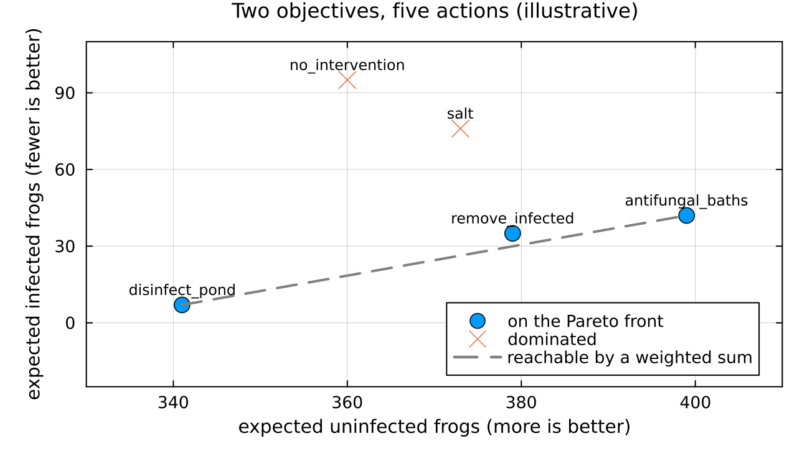
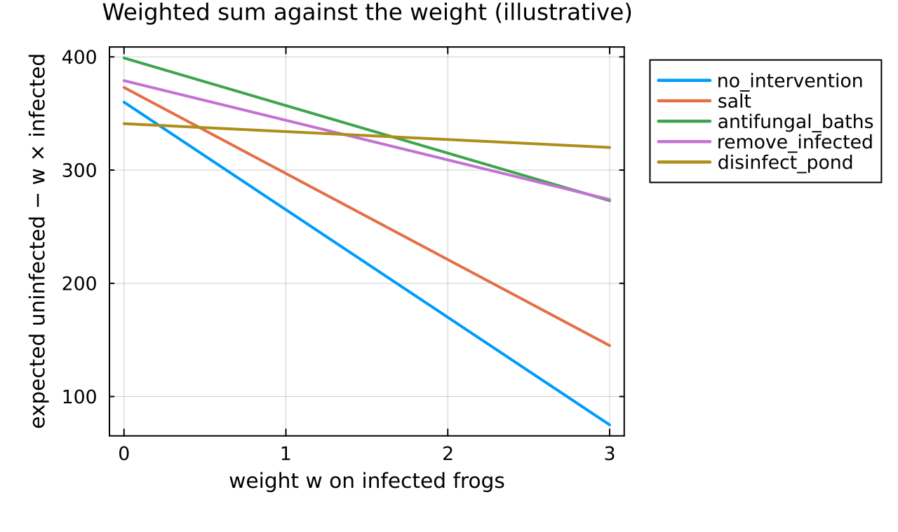

# Several objectives
Simon Frost

- [Motivation](#motivation)
- [The problem](#the-problem)
- [One table per objective](#one-table-per-objective)
- [The Pareto front](#the-pareto-front)
- [The weighted sum and the front](#the-weighted-sum-and-the-front)
- [What the weighted sum cannot
  find](#what-the-weighted-sum-cannot-find)
- [Other aggregators](#other-aggregators)
- [What to take away](#what-to-take-away)
- [Next](#next)

## Motivation

The earlier vignettes on amphibian disease combined two counts,
uninfected and infected frogs, into one number with a weight `w`.
Choosing `w` is a value judgement, and the analyst may not be the person
to make it. The alternative is to keep the objectives apart and report
the *Pareto front*: the actions that are not beaten on every objective
at once by some other action. Anything off the front can be discarded
whatever the weight. What is on the front is the real menu.

This vignette computes the front for the two disease counts, relates it
to the weighted sum, and shows a case the weighted sum cannot find.

## The problem

A pond holds frogs, and Bd may be absent, present at low prevalence, or
present at high prevalence. Five actions are considered: no
intervention, salt added to the pond, antifungal baths, testing every
frog and removing the infected ones, and draining and disinfecting the
pond. Two outcomes are counted two years from now:

- uninfected frogs alive (more is better);
- infected frogs alive (fewer is better).

Infected but living frogs are not counted as population in this series.
They are a separate count, to be kept low.

**All numbers are illustrative**, not data and not estimates for any
real treatment.

``` julia
using DecisionAnalysis
include(joinpath("..", "_common.jl"))
using Plots

actions = [:no_intervention, :salt, :antifungal_baths, :remove_infected, :disinfect_pond]
states = [:absent, :low_prevalence, :high_prevalence]
uninfected = PayoffTable(actions, states,
                         [500 300 100
                          490 320 160
                          470 380 250
                          480 330 200
                          350 340 320])
infected = PayoffTable(actions, states,
                       [0 150 250
                        0 120 200
                        0  60 120
                        0  50 100
                        0  10  20])
prior = FiniteBelief(states, [1 // 2, 3 // 10, 1 // 5])
uninfected
```

**PayoffTable{Int64}: 5 actions × 3 states**

| action             | `absent` | `low_prevalence` | `high_prevalence` |
|:-------------------|---------:|-----------------:|------------------:|
| `no_intervention`  |      500 |              300 |               100 |
| `salt`             |      490 |              320 |               160 |
| `antifungal_baths` |      470 |              380 |               250 |
| `remove_infected`  |      480 |              330 |               200 |
| `disinfect_pond`   |      350 |              340 |               320 |

``` julia
infected
```

**PayoffTable{Int64}: 5 actions × 3 states**

| action             | `absent` | `low_prevalence` | `high_prevalence` |
|:-------------------|---------:|-----------------:|------------------:|
| `no_intervention`  |        0 |              150 |               250 |
| `salt`             |        0 |              120 |               200 |
| `antifungal_baths` |        0 |               60 |               120 |
| `remove_infected`  |        0 |               50 |               100 |
| `disinfect_pond`   |        0 |               10 |                20 |

## One table per objective

Every objective is a payoff table on the same actions and states,
written so that higher is better. The infected count is to be kept low,
so its table is the count with a minus sign: tables with the same labels
can be negated, added, subtracted and scaled. The objectives are a named
collection of tables, and they share one belief.

``` julia
objectives = (; more_uninfected=uninfected, fewer_infected=-infected)
```

    (more_uninfected = PayoffTable{Int64}(5 actions × 3 states), fewer_infected = PayoffTable{Int64}(5 actions × 3 states))

Taken one at a time, each is an ordinary decision problem. No
intervention is the baseline of both.

``` julia
more_uninfected = DecisionProblem(objectives.more_uninfected, prior;
                                  baseline=:no_intervention)
fewer_infected = DecisionProblem(objectives.fewer_infected, prior;
                                 baseline=:no_intervention)

md_table(["action", "expected uninfected", "gain over no intervention",
          "expected infected", "change from no intervention"],
         [[a, u, gu, -i, -gi]
          for (a, u, gu, i, gi) in zip(actions,
                                       aggregate(Expectation(), more_uninfected),
                                       expected_gain_over_baseline(more_uninfected),
                                       aggregate(Expectation(), fewer_infected),
                                       expected_gain_over_baseline(fewer_infected))])
```

| action | expected uninfected | gain over no intervention | expected infected | change from no intervention |
|:---|---:|---:|---:|---:|
| `no_intervention` | 360 | 0 | 95 | 0 |
| `salt` | 373 | 13 | 76 | -19 |
| `antifungal_baths` | 399 | 39 | 42 | -53 |
| `remove_infected` | 379 | 19 | 35 | -60 |
| `disinfect_pond` | 341 | -19 | 7 | -88 |

Taken alone, the first objective chooses the baths and the second
disinfection.

``` julia
first_choice(decide(more_uninfected, MaxExpectedUtility())),
first_choice(decide(fewer_infected, MaxExpectedUtility()))
```

    (:antifungal_baths, :disinfect_pond)

## The Pareto front

`decide(objectives, prior, ParetoFront())` scores every action on every
objective (by expectation unless another aggregator is given) and keeps
the actions that are not dominated. An action is dominated when another
is at least as good on every objective and strictly better on one. The
result displays the scores, one column per objective, and marks the
front. The second column is minus the expected number infected, so that
higher is better in both.

``` julia
front = decide(objectives, prior, ParetoFront(); baseline=:no_intervention)
```

**DecisionResult: ParetoFront over 2 objectives, each summarised by
Expectation**

| action             | more_uninfected | fewer_infected | on the front |
|:-------------------|----------------:|---------------:|-------------:|
| `no_intervention`  |             360 |            -95 |           \- |
| `salt`             |             373 |            -76 |           \- |
| `antifungal_baths` |             399 |            -42 |          yes |
| `remove_infected`  |             379 |            -35 |          yes |
| `disinfect_pond`   |             341 |             -7 |          yes |

``` julia
front.chosen
```

    3-element Vector{Symbol}:
     :antifungal_baths
     :remove_infected
     :disinfect_pond

No intervention and salt are off the front. The baths give more
uninfected frogs *and* fewer infected frogs than either, so no weight on
the two counts could justify them. That includes business as usual: here
doing nothing is dominated.

``` julia
x = Float64.(front.scores[:, 1])
y = Float64.(-front.scores[:, 2])
on = [a in front.chosen for a in front.actions]
plt = scatter(x[on], y[on]; label="on the Pareto front", markersize=7,
              xlabel="expected uninfected frogs (more is better)",
              ylabel="expected infected frogs (fewer is better)",
              title="Two objectives, five actions (illustrative)",
              legend=:bottomright, xlims=(330, 410), ylims=(-25, 110))
scatter!(plt, x[.!on], y[.!on]; label="dominated", markersize=7, markershape=:xcross)
ends = [findfirst(==(:disinfect_pond), actions), findfirst(==(:antifungal_baths), actions)]
plot!(plt, x[ends], y[ends]; label="reachable by a weighted sum", linestyle=:dash,
      color=:gray)
annotate!(plt, [(x[i] , y[i] + 6, text(String(a), 8)) for (i, a) in enumerate(actions)])
png_figure(plt)
```



The best corner of this figure is the bottom right: many uninfected, few
infected. The dashed line joins the two actions that a weighted sum can
select, as shown below.

## The weighted sum and the front

The weighted problem of the earlier vignettes is utility = uninfected −
`w` × infected. For any `w ≥ 0` its best action is on the front. The
sweep shows which.

``` julia
function weighted(w)
    return DecisionProblem(infection_payoff(; uninfected, infected, weight=w), prior;
                           baseline=:no_intervention)
end

md_table(["w", "best action", "expected utility", "gain over no intervention"],
         [begin
              p = weighted(w)
              [exact(w), first_choice(decide(p, MaxExpectedUtility())), act_now_value(p),
               maximum(expected_gain_over_baseline(p))]
          end
          for w in (0, 1 // 2, 1, 3 // 2, 2, 3)])
```

| w   |        best action | expected utility | gain over no intervention |
|:----|-------------------:|-----------------:|--------------------------:|
| 0   | `antifungal_baths` |              399 |                        39 |
| 1/2 | `antifungal_baths` |              378 |                      65.5 |
| 1   | `antifungal_baths` |              357 |                        92 |
| 3/2 | `antifungal_baths` |              336 |                     118.5 |
| 2   |   `disinfect_pond` |              327 |                       157 |
| 3   |   `disinfect_pond` |              320 |                       245 |

`infection_payoff` is a weighted sum of two tables. `combine_payoffs` is
the general form, for any number of tables with the same labels, each
with its weight:

``` julia
combine_payoffs(uninfected => 1, infected => -1 // 2).Q ==
infection_payoff(; uninfected, infected, weight=1 // 2).Q
```

    true

``` julia
ws = 0:(1 // 20):3
lines = [Float64(aggregate(Expectation(), weighted(w))[i])
         for w in ws, i in eachindex(actions)]
plt = plot(Float64.(ws), lines; label=permutedims(String.(actions)),
           xlabel="weight w on infected frogs",
           ylabel="expected uninfected − w × infected",
           title="Weighted sum against the weight (illustrative)")
png_figure(plt)
```



At `w = 0` and `w = 1` the baths are best. Disinfection takes over once
an infected frog counts for more than about 1.66 uninfected ones:

``` julia
switch = findfirst(w -> first_choice(decide(weighted(w), MaxExpectedUtility())) ==
                        :disinfect_pond, ws)
exact(ws[switch])
```

    "17/10"

The sweep steps in twentieths, so this is the first grid value at which
disinfection wins.

## What the weighted sum cannot find

Removing infected frogs is on the front and is never the best action for
any weight. Its line in the figure above is never the highest.

``` julia
unique(first_choice(decide(weighted(w), MaxExpectedUtility())) for w in 0:(1 // 100):10)
```

    2-element Vector{Symbol}:
     :antifungal_baths
     :disinfect_pond

It is a compromise that lies on the wrong side of the dashed line
joining the baths and disinfection in the scatter plot, and a weighted
sum only ever picks out the points on the outer hull of the front. A
manager who wanted, say, at least 370 uninfected frogs and at most 40
infected ones in expectation would choose it, and no value of `w` would
have offered it. Sweeping a weight is therefore not a substitute for
computing the front.

``` julia
[a for (i, a) in enumerate(front.actions)
 if front.scores[i, 1] >= 370 && -front.scores[i, 2] <= 40]
```

    1-element Vector{Symbol}:
     :remove_infected

## Other aggregators

`ParetoFront(aggregator)` scores the objectives with something other
than the expectation. With `WorstCase()` an action is judged on its
worst state for each objective, with no probabilities.

``` julia
worst = decide(objectives, prior, ParetoFront(WorstCase()))
```

**DecisionResult: ParetoFront over 2 objectives, each summarised by
WorstCase**

| action             | more_uninfected | fewer_infected | on the front |
|:-------------------|----------------:|---------------:|-------------:|
| `no_intervention`  |             100 |           -250 |           \- |
| `salt`             |             160 |           -200 |           \- |
| `antifungal_baths` |             250 |           -120 |           \- |
| `remove_infected`  |             200 |           -100 |           \- |
| `disinfect_pond`   |             320 |            -20 |          yes |

Judged on worst cases, disinfection is best on both objectives at once
and the front is a single action. The front depends on how each
objective is summarised over the states, and that choice should be
stated with it.

The same call takes any number of objectives, for example one table per
species when a management action helps one species and harms another.
The tables must share their actions and states. Objectives that do not
share a belief can still be compared: pass a vector of
`DecisionProblem`s, one per objective, to
`decide(problems, ParetoFront())`.

## What to take away

- Write each objective as its own payoff table, with higher better, and
  pass the named collection and the belief to
  `decide(objectives, belief, ParetoFront())`.
- `infection_payoff(; uninfected, infected, weight)` is the weighted sum
  of the two counts, and tables with the same labels add, subtract and
  scale.
- Dominated actions can be dropped without choosing a weight. Here no
  intervention and salt are dominated by the baths.
- The best action of uninfected − `w` × infected is on the front for
  every `w ≥ 0`: baths for small `w`, disinfection for large `w`.
- The converse fails. Removing infected frogs is on the front and is not
  optimal for any `w`. A weight sweep finds only part of the front.
- Infected but living animals are a separate count to be minimised, not
  part of the population.

## Next

[The decision report](../09_decision_report/09_decision_report.md) puts
everything from the first eight vignettes into one object for one
problem.
