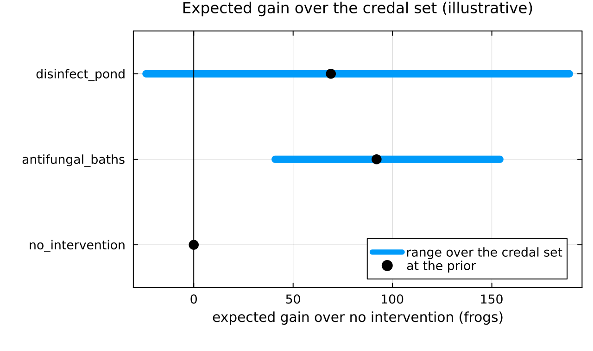

# The decision report
Simon Frost

- [Motivation](#motivation)
- [The problem](#the-problem)
- [The report](#the-report)
- [The report as data](#the-report-as-data)
- [A Tables.jl table](#a-tablesjl-table)
- [The report as text](#the-report-as-text)
- [What the report leaves out when it cannot be
  computed](#what-the-report-leaves-out-when-it-cannot-be-computed)
- [The weight on infected frogs](#the-weight-on-infected-frogs)
- [A feasibility filter in a report](#a-feasibility-filter-in-a-report)
- [What to take away](#what-to-take-away)
- [Next](#next)

## Motivation

The earlier vignettes computed one thing at a time. A decision-maker
needs them together: what each rule recommends, how each action compares
with doing nothing, how much could be regretted, what information would
be worth, and under which assumptions all of it holds. `DecisionReport`
assembles that for one problem. Its purpose is to make a contested
decision look contested, and an easy one look easy.

## The problem

The frog pond once more. Bd may be absent, at low prevalence or at high
prevalence, and the manager can do nothing, give antifungal baths, or
drain and disinfect the pond. Utility is uninfected frogs minus `w`
times infected frogs, two years from now. Infected but living frogs are
not counted as population: at `w = 0` they are ignored, and at `w = 1`
each cancels one uninfected frog. The report is built at `w = 1` and
compared with `w = 0` at the end.

**All numbers are illustrative**, not data.

``` julia
using DecisionAnalysis
using Tables
include(joinpath("..", "_common.jl"))

actions = [:no_intervention, :antifungal_baths, :disinfect_pond]
states = [:absent, :low_prevalence, :high_prevalence]
uninfected = PayoffTable(actions, states, [500 300 100; 470 380 250; 350 340 320])
infected = PayoffTable(actions, states, [0 150 250; 0 60 120; 0 10 20])
prior = FiniteBelief(states, [1 // 2, 3 // 10, 1 // 5])

function bd_problem(w)
    return DecisionProblem(infection_payoff(; uninfected, infected, weight=w), prior;
                           baseline=:no_intervention)
end

problem = bd_problem(1)
problem.payoff
```

**PayoffTable{Int64}: 3 actions × 3 states**

| action             | `absent` | `low_prevalence` | `high_prevalence` |
|:-------------------|---------:|-----------------:|------------------:|
| `no_intervention`  |      500 |              150 |              -150 |
| `antifungal_baths` |      470 |              320 |               130 |
| `disinfect_pond`   |      350 |              330 |               300 |

The further ingredients are all optional. A credal set says how far the
prior might be wrong: here the stated prior and two alternatives, one
more hopeful and one less. The experiments are the swab test and a
visual check for sick frogs, which barely separates the states, given by
name. A partition of the states names something that could be learned
exactly: here, whether Bd is present at all. The objectives are the two
counts kept apart, as in the vignette on several objectives. The Hurwicz
index is fixed at 1/2.

``` julia
credal = CredalSet(states, [[1 // 2, 3 // 10, 1 // 5],
                            [7 // 10, 1 // 5, 1 // 10],
                            [3 // 10, 3 // 10, 2 // 5]])
swab = Experiment([19//20 2//5 1//20; 1//20 3//5 19//20];
                  signals=[:negative, :positive], states=states)
visual_check = Experiment([11//20 1//2 9//20; 9//20 1//2 11//20];
                          signals=[:no_signs, :signs], states=states)
```

    Experiment{Rational{Int64}}(2 signals × 3 states, cost 0)

## The report

``` julia
report = DecisionReport(problem; credal=credal, experiments=(; swab, visual_check),
                        partitions=(; presence=[:absent, :present, :present]),
                        objectives=(; uninfected, fewer_infected=-infected),
                        hurwicz=1 // 2,
                        assumptions=["All payoffs are illustrative.",
                                     "Utility is uninfected minus infected frogs " *
                                     "(w = 1); infected but living frogs are not " *
                                     "counted as population."])
```

**DecisionReport: 3 actions × 3 states, FiniteBelief**  
**Baseline (no intervention): no_intervention**

**Scores by rule (\* marks the chosen actions)**

| action | MaxExpectedUtility | Maximin | Maximax | Laplace | Hurwicz | MinimaxRegret | GammaMaximin |
|:---|---:|---:|---:|---:|---:|---:|---:|
| `no_intervention` | 265 | -150 | 500 \* | 166.667 | 175 | 450 | 135 |
| `antifungal_baths` | 357 \* | 130 | 470 | 306.667 | 300 | 170 | 289 |
| `disinfect_pond` | 334 | 300 \* | 350 | 326.667 \* | 325 \* | 150 \* | 324 \* |

**First choice by rule**

| rule                 | first choice       | baseline             |
|:---------------------|:-------------------|:---------------------|
| `MaxExpectedUtility` | `antifungal_baths` | \[not the baseline\] |
| `Maximin`            | `disinfect_pond`   | \[not the baseline\] |
| `Maximax`            | `no_intervention`  | \[the baseline\]     |
| `Laplace`            | `disinfect_pond`   | \[not the baseline\] |
| `Hurwicz`            | `disinfect_pond`   | \[not the baseline\] |
| `MinimaxRegret`      | `disinfect_pond`   | \[not the baseline\] |
| `GammaMaximin`       | `disinfect_pond`   | \[not the baseline\] |

Minimax regret depends on the menu of actions: adding or removing an
action, even one that is never chosen, can change its choice.

**Expected gain over the baseline (no_intervention)**

| action             | expected gain |
|:-------------------|--------------:|
| `no_intervention`  |             0 |
| `antifungal_baths` |            92 |
| `disinfect_pond`   |            69 |

**Regret profile**

| action             | max regret | expected regret |
|:-------------------|-----------:|----------------:|
| `no_intervention`  |        450 |             144 |
| `antifungal_baths` |        170 |              52 |
| `disinfect_pond`   |        150 |              75 |

**Robust sets over the credal set**

| rule                | actions kept                                        |
|:--------------------|:----------------------------------------------------|
| `EAdmissible`       | `antifungal_baths, disinfect_pond`                  |
| `Maximal`           | `antifungal_baths, disinfect_pond`                  |
| `IntervalDominance` | `no_intervention, antifungal_baths, disinfect_pond` |

**Value of information**

| quantity             |      value | note                                       |
|:---------------------|-----------:|:-------------------------------------------|
| EVPI                 |         52 |                                            |
| EVSI of swab         |       31.1 | can change the decision                    |
| EVSI of visual_check |          0 | this experiment cannot change the decision |
| EVPPI of presence    |         52 |                                            |
| EVPI, Γ-maximin      |         45 |                                            |
| EVPI envelope        | \[40, 66\] |                                            |

**Several objectives: Pareto front, each objective summarised by
Expectation**

| action             | uninfected | fewer_infected | on the front |
|:-------------------|-----------:|---------------:|-------------:|
| `no_intervention`  |        360 |            -95 |           \- |
| `antifungal_baths` |        399 |            -42 |          yes |
| `disinfect_pond`   |        341 |             -7 |          yes |

Not dominated: antifungal_baths, disinfect_pond.

**Assumptions**

1.  Payoffs are conditional expected utilities of each action in each
    state; higher is better.
2.  State-wise rules (maximin, maximax, Laplace, Hurwicz, minimax
    regret) ignore probabilities and range over every state of the
    table, including any of probability zero.
3.  Regret is measured against the best feasible action in each state,
    so it changes when the set of actions changes. Minimax regret
    therefore depends on the menu of actions: adding or removing an
    action, even one that is never chosen, can change its choice.
4.  Tied actions are all reported; the first choice is the tied action
    that comes first in the payoff table.
5.  Expected utility, expected regret and EVPI are under the single
    stated prior; EVPI is the value of learning the state exactly and at
    no cost.
6.  EVSI is gross of the cost of the experiment and assumes the stated
    likelihood. The net value is EVSI minus the cost, which is
    meaningful only when payoffs and costs are in the same additive
    units. An experiment can change the decision exactly when its EVSI
    is positive.
7.  EVPPI is the value of learning which cell of a partition of the
    states holds, and nothing more, at no cost.
8.  The credal set is the convex hull of 3 stated priors;
    E-admissibility is decided over the whole hull.
9.  The rule-specific robust EVPI is under Γ-maximin; the envelope is
    the range of the single-prior EVPI over the credal set.
10. The Pareto front keeps the actions that no other action matches on
    every objective and beats on one; each objective is summarised over
    the states by Expectation.
11. The baseline (no intervention) is no_intervention; gains are payoffs
    minus the payoff of the baseline in the same state.
12. All payoffs are illustrative.
13. Utility is uninfected minus infected frogs (w = 1); infected but
    living frogs are not counted as population.

Reading it from the top:

- **Scores by rule.** One column per rule, with a star on every chosen
  action. The minimax-regret column is a loss, so its star is on the
  smallest number.
- **First choice by rule.** The single choice of each rule, and whether
  it is the baseline. Here maximax, which looks only at the best cell of
  each row, recommends doing nothing, and no other rule does. The line
  below the table is a standing warning: the minimax-regret choice
  depends on which actions are on the menu.
- **Expected gain over the baseline.** What each action adds to no
  intervention, in expectation under the stated prior.
- **Regret profile.** Maximum and expected regret by action.
- **Robust sets.** The actions that the credal set cannot rule out.
- **Value of information.** EVPI under the stated prior; the EVSI of
  each named experiment, with a note saying whether it can change the
  decision; the EVPPI of each named partition; the EVPI of a Γ-maximin
  decision-maker, and the range of EVPI over the credal set. The visual
  check is informative, yet the same action is best after either of its
  results, so the report says that this experiment cannot change the
  decision: its EVSI is zero.
- **Several objectives.** The expected score of each action on each
  objective, and the actions on the Pareto front.
- **Assumptions.** The conditions under which the numbers hold,
  including the two supplied above.

On this problem the rules split three ways. Expected utility under the
stated prior favours the baths. Maximin, Laplace, Hurwicz at 1/2,
minimax regret and Γ-maximin over the three priors favour disinfection.
Maximax favours doing nothing. The baths and disinfection are both
E-admissible, and doing nothing is not. The report does not settle the
choice between them. It shows that the choice turns on how much weight
the bad states get, and that information is worth having: EVPI is about
a seventh of the expected utility of acting now.

## The report as data

The fields hold the same content as objects.

``` julia
md_table(["rule", "first choice", "is the baseline"],
         [[string(r.rule), first_choice(r), first_choice(r) == problem.baseline]
          for r in report.results])
```

| rule               |       first choice | is the baseline |
|:-------------------|-------------------:|----------------:|
| MaxExpectedUtility | `antifungal_baths` |              \- |
| Maximin            |   `disinfect_pond` |              \- |
| Maximax            |  `no_intervention` |             yes |
| Laplace            |   `disinfect_pond` |              \- |
| Hurwicz            |   `disinfect_pond` |              \- |
| MinimaxRegret      |   `disinfect_pond` |              \- |
| GammaMaximin       |   `disinfect_pond` |              \- |

``` julia
md_table(["robust rule", "actions kept"],
         [[string(nameof(typeof(r.rule))), r.chosen] for r in report.robust])
```

| robust rule       |                                            actions kept |
|:------------------|--------------------------------------------------------:|
| EAdmissible       |                    `antifungal_baths`, `disinfect_pond` |
| Maximal           |                    `antifungal_baths`, `disinfect_pond` |
| IntervalDominance | `no_intervention`, `antifungal_baths`, `disinfect_pond` |

``` julia
report.evpi, report.experiments, report.partitions
```

    (52//1, NamedTuple[(name = :swab, evsi = 311//10, cost = 0, net = 311//10, can_change_decision = true), (name = :visual_check, evsi = 0//1, cost = 0, net = 0//1, can_change_decision = false)], NamedTuple[(name = :presence, evppi = 52//1)])

``` julia
report.robust_evpi, report.pareto.chosen
```

    (RobustVOI(evpi under GammaMaximin: 45//1; envelope [40//1, 66//1], upper end at the prior Rational{BigInt}[11//25, 53//200, 59//200]), [:antifungal_baths, :disinfect_pond])

``` julia
bullet(report.assumptions)
```

- Payoffs are conditional expected utilities of each action in each
  state; higher is better.
- State-wise rules (maximin, maximax, Laplace, Hurwicz, minimax regret)
  ignore probabilities and range over every state of the table,
  including any of probability zero.
- Regret is measured against the best feasible action in each state, so
  it changes when the set of actions changes. Minimax regret therefore
  depends on the menu of actions: adding or removing an action, even one
  that is never chosen, can change its choice.
- Tied actions are all reported; the first choice is the tied action
  that comes first in the payoff table.
- Expected utility, expected regret and EVPI are under the single stated
  prior; EVPI is the value of learning the state exactly and at no cost.
- EVSI is gross of the cost of the experiment and assumes the stated
  likelihood. The net value is EVSI minus the cost, which is meaningful
  only when payoffs and costs are in the same additive units. An
  experiment can change the decision exactly when its EVSI is positive.
- EVPPI is the value of learning which cell of a partition of the states
  holds, and nothing more, at no cost.
- The credal set is the convex hull of 3 stated priors; E-admissibility
  is decided over the whole hull.
- The rule-specific robust EVPI is under Γ-maximin; the envelope is the
  range of the single-prior EVPI over the credal set.
- The Pareto front keeps the actions that no other action matches on
  every objective and beats on one; each objective is summarised over
  the states by Expectation.
- The baseline (no intervention) is no_intervention; gains are payoffs
  minus the payoff of the baseline in the same state.
- All payoffs are illustrative.
- Utility is uninfected minus infected frogs (w = 1); infected but
  living frogs are not counted as population.

## A Tables.jl table

A report is a Tables.jl row table with one row per feasible action, so
it can be passed to anything that accepts a table: a `DataFrame`, a CSV
writer, a plotting package.

``` julia
rows = Tables.rows(report)
Tables.istable(report), length(rows), propertynames(first(rows))
```

    (true, 3, (:action, :MaxExpectedUtility, :MaxExpectedUtility_chosen, :Maximin, :Maximin_chosen, :Maximax, :Maximax_chosen, :Laplace, :Laplace_chosen, :Hurwicz, :Hurwicz_chosen, :MinimaxRegret, :MinimaxRegret_chosen, :GammaMaximin, :GammaMaximin_chosen, :max_regret, :expected_regret, :expected_gain_over_baseline, :EAdmissible, :Maximal, :IntervalDominance, :ParetoFront))

``` julia
columns = Tables.columntable(report)
md_table(["column", columns.action...],
         [vcat("`$name`", collect(getproperty(columns, name)))
          for name in keys(columns) if name != :action])
```

| column | `no_intervention` | `antifungal_baths` | `disinfect_pond` |
|:---|---:|---:|---:|
| `MaxExpectedUtility` | 265 | 357 | 334 |
| `MaxExpectedUtility_chosen` | \- | yes | \- |
| `Maximin` | -150 | 130 | 300 |
| `Maximin_chosen` | \- | \- | yes |
| `Maximax` | 500 | 470 | 350 |
| `Maximax_chosen` | yes | \- | \- |
| `Laplace` | 166.67 | 306.67 | 326.67 |
| `Laplace_chosen` | \- | \- | yes |
| `Hurwicz` | 175 | 300 | 325 |
| `Hurwicz_chosen` | \- | \- | yes |
| `MinimaxRegret` | 450 | 170 | 150 |
| `MinimaxRegret_chosen` | \- | \- | yes |
| `GammaMaximin` | 135 | 289 | 324 |
| `GammaMaximin_chosen` | \- | \- | yes |
| `max_regret` | 450 | 170 | 150 |
| `expected_regret` | 144 | 52 | 75 |
| `expected_gain_over_baseline` | 0 | 92 | 69 |
| `EAdmissible` | \- | yes | yes |
| `Maximal` | \- | yes | yes |
| `IntervalDominance` | yes | yes | yes |
| `ParetoFront` | \- | yes | yes |

The table is shown here with one line per column because it is wide.
Each scalar rule contributes its score and a `_chosen` flag, followed by
the regret profile, the expected gain over the baseline, membership of
each robust set and of the Pareto front.

## The report as text

In a notebook or a Quarto document a report renders as the tables above.
At the REPL, or printed, it is plain text that fits 80 columns, with the
rules wrapped into blocks of a few columns. This is the text form of a
smaller report.

``` julia
show(stdout, MIME"text/plain"(), DecisionReport(problem; experiments=(; swab)))
```

    DecisionReport: 3 actions × 3 states, FiniteBelief
    Baseline (no intervention): no_intervention

    Scores by rule (* marks the chosen actions)
      action            MaxExpectedUtility  Maximin  Maximax    Laplace
      ----------------  ------------------  -------  -------  ---------
      no_intervention                265     -150      500 *  166.667
      antifungal_baths               357 *    130      470    306.667
      disinfect_pond                 334      300 *    350    326.667 *

      action            MinimaxRegret
      ----------------  -------------
      no_intervention           450
      antifungal_baths          170
      disinfect_pond            150 *

    First choice by rule
      rule                first choice      baseline
      ------------------  ----------------  ------------------
      MaxExpectedUtility  antifungal_baths  [not the baseline]
      Maximin             disinfect_pond    [not the baseline]
      Maximax             no_intervention   [the baseline]
      Laplace             disinfect_pond    [not the baseline]
      MinimaxRegret       disinfect_pond    [not the baseline]
      Minimax regret depends on the menu of actions: adding or removing an action,
      even one that is never chosen, can change its choice.

    Expected gain over the baseline (no_intervention)
      action            expected gain
      ----------------  -------------
      no_intervention               0
      antifungal_baths             92
      disinfect_pond               69

    Regret profile
      action            max regret  expected regret
      ----------------  ----------  ---------------
      no_intervention          450              144
      antifungal_baths         170               52
      disinfect_pond           150               75

    Value of information
      quantity      value  note
      ------------  -----  -----------------------
      EVPI             52
      EVSI of swab   31.1  can change the decision

    Assumptions
      1. Payoffs are conditional expected utilities of each action in each state;
         higher is better.
      2. State-wise rules (maximin, maximax, Laplace, Hurwicz, minimax regret)
         ignore probabilities and range over every state of the table, including any
         of probability zero.
      3. Regret is measured against the best feasible action in each state, so it
         changes when the set of actions changes. Minimax regret therefore depends
         on the menu of actions: adding or removing an action, even one that is
         never chosen, can change its choice.
      4. Tied actions are all reported; the first choice is the tied action that
         comes first in the payoff table.
      5. Expected utility, expected regret and EVPI are under the single stated
         prior; EVPI is the value of learning the state exactly and at no cost.
      6. EVSI is gross of the cost of the experiment and assumes the stated
         likelihood. The net value is EVSI minus the cost, which is meaningful only
         when payoffs and costs are in the same additive units. An experiment can
         change the decision exactly when its EVSI is positive.
      7. The baseline (no intervention) is no_intervention; gains are payoffs minus
         the payoff of the baseline in the same state.

## What the report leaves out when it cannot be computed

The content depends on the belief. With a scenario set there are no
probabilities, so the report has the state-wise rules and the maximum
regret, and no expected utility and no value of information. The gain
over the baseline is shown as a range: the smallest and the largest gain
of each action over the scenarios.

``` julia
scenario_report = DecisionReport(DecisionProblem(problem.payoff, ScenarioSet(states);
                                                 baseline=:no_intervention))
```

**DecisionReport: 3 actions × 3 states, ScenarioSet**  
**Baseline (no intervention): no_intervention**

**Scores by rule (\* marks the chosen actions)**

| action             | Maximin | Maximax |    Laplace | MinimaxRegret |
|:-------------------|--------:|--------:|-----------:|--------------:|
| `no_intervention`  |    -150 |  500 \* |    166.667 |           450 |
| `antifungal_baths` |     130 |     470 |    306.667 |           170 |
| `disinfect_pond`   |  300 \* |     350 | 326.667 \* |        150 \* |

**First choice by rule**

| rule            | first choice      | baseline             |
|:----------------|:------------------|:---------------------|
| `Maximin`       | `disinfect_pond`  | \[not the baseline\] |
| `Maximax`       | `no_intervention` | \[the baseline\]     |
| `Laplace`       | `disinfect_pond`  | \[not the baseline\] |
| `MinimaxRegret` | `disinfect_pond`  | \[not the baseline\] |

Minimax regret depends on the menu of actions: adding or removing an
action, even one that is never chosen, can change its choice.

**Range of the gain over the baseline (no_intervention), over the
scenarios**

| action             | lowest gain | highest gain |
|:-------------------|------------:|-------------:|
| `no_intervention`  |           0 |            0 |
| `antifungal_baths` |         -30 |          280 |
| `disinfect_pond`   |        -150 |          450 |

**Regret profile**

| action             | max regret |
|:-------------------|-----------:|
| `no_intervention`  |        450 |
| `antifungal_baths` |        170 |
| `disinfect_pond`   |        150 |

**Value of information**

not defined without probabilities

**Assumptions**

1.  Payoffs are conditional expected utilities of each action in each
    state; higher is better.
2.  State-wise rules (maximin, maximax, Laplace, Hurwicz, minimax
    regret) ignore probabilities and range over the states of the
    scenario set.
3.  Regret is measured against the best feasible action in each state,
    so it changes when the set of actions changes. Minimax regret
    therefore depends on the menu of actions: adding or removing an
    action, even one that is never chosen, can change its choice.
4.  Tied actions are all reported; the first choice is the tied action
    that comes first in the payoff table.
5.  The baseline (no intervention) is no_intervention; gains are payoffs
    minus the payoff of the baseline in the same state, and no expected
    gain is shown because the belief has no single prior: the range of
    the gain over the scenarios is shown in its place.

With a credal set as the belief of the problem itself, the rules that
need one prior are left out and the robust rules are kept. The expected
gain over the baseline is again a range, this time of the expected gain
over the priors in the set.

``` julia
credal_report = DecisionReport(DecisionProblem(problem.payoff, credal;
                                               baseline=:no_intervention))
[string(r.rule) for r in credal_report.results],
credal_report.evpi === nothing, credal_report.expected_gain === nothing
```

    (["Maximin", "Maximax", "Laplace", "MinimaxRegret", "GammaMaximin"], true, true)

``` julia
md_table(["action", "lowest expected gain", "highest expected gain"],
         [[a, l, u] for (a, l, u) in zip(actions, credal_report.gain_range.lower,
                                         credal_report.gain_range.upper)])
```

| action             | lowest expected gain | highest expected gain |
|:-------------------|---------------------:|----------------------:|
| `no_intervention`  |                    0 |                     0 |
| `antifungal_baths` |                   41 |                   154 |
| `disinfect_pond`   |                  -24 |                   189 |

The figure shows the same ranges. The dot is the expected gain at the
single prior of the first report, which is one of the priors in the set.
Antifungal baths gain over no intervention at every prior in the set.
Disinfecting the pond has the wider range: it can gain more, and at one
end of the set it loses.

``` julia
lower = Float64.(credal_report.gain_range.lower)
upper = Float64.(credal_report.gain_range.upper)
plt = Plots.plot(; yticks=(1:3, String.(actions)), ylims=(0.5, 3.5), legend=:bottomright,
                 xlabel="expected gain over no intervention (frogs)",
                 title="Expected gain over the credal set (illustrative)")
for i in 1:3
    Plots.plot!(plt, [lower[i], upper[i]], [i, i]; color=1, linewidth=8,
                label=(i == 1 ? "range over the credal set" : ""))
end
Plots.scatter!(plt, Float64.(report.expected_gain), 1:3; color=:black, markersize=6,
               label="at the prior")
Plots.vline!(plt, [0]; color=:black, linewidth=1, label="")
png_figure(plt)
```



## The weight on infected frogs

The same report at `w = 0`, where only uninfected frogs count.

``` julia
report0 = DecisionReport(bd_problem(0); credal=credal, experiments=(; swab, visual_check),
                         hurwicz=1 // 2)
md_table(["rule", "first choice, w = 0", "first choice, w = 1"],
         [[string(r0.rule), first_choice(r0), first_choice(r1)]
          for (r0, r1) in zip(report0.results, report.results)])
```

| rule               | first choice, w = 0 | first choice, w = 1 |
|:-------------------|--------------------:|--------------------:|
| MaxExpectedUtility |  `antifungal_baths` |  `antifungal_baths` |
| Maximin            |    `disinfect_pond` |    `disinfect_pond` |
| Maximax            |   `no_intervention` |   `no_intervention` |
| Laplace            |  `antifungal_baths` |    `disinfect_pond` |
| Hurwicz            |  `antifungal_baths` |    `disinfect_pond` |
| MinimaxRegret      |  `antifungal_baths` |    `disinfect_pond` |
| GammaMaximin       |  `antifungal_baths` |    `disinfect_pond` |

``` julia
md_table(["quantity", "w = 0", "w = 1"],
         vcat([["expected gain over no intervention: `$a`", report0.expected_gain[i],
                report.expected_gain[i]] for (i, a) in enumerate(actions)],
              [["EVPI", report0.evpi, report.evpi],
               ["EVSI of the swab", report0.evsi, report.evsi],
               ["E-admissible actions", report0.robust[1].chosen,
                report.robust[1].chosen]]))
```

| quantity | w = 0 | w = 1 |
|:---|---:|---:|
| expected gain over no intervention: `no_intervention` | 0 | 0 |
| expected gain over no intervention: `antifungal_baths` | 39 | 92 |
| expected gain over no intervention: `disinfect_pond` | -19 | 69 |
| EVPI | 29 | 52 |
| EVSI of the swab | 6.25 | 31.1 |
| E-admissible actions | `antifungal_baths` | `antifungal_baths`, `disinfect_pond` |

At `w = 0` disinfection has a negative expected gain: it is worse than
doing nothing when the infected frogs it prevents are not counted. At
`w = 1` it gains 69. A report is a statement about one utility, and the
weight belongs among its assumptions.

## A feasibility filter in a report

Infeasible actions are left out of every part of a report, and the
assumptions say so. If the pond cannot be drained this year:

``` julia
restricted = DecisionProblem(problem.payoff, prior; baseline=:no_intervention,
                             feasible=[:no_intervention, :antifungal_baths])
r = DecisionReport(restricted)
r.evpi, last(r.assumptions, 3)
```

    (15//1, ["Infeasible actions are excluded throughout: disinfect_pond.", "Expected utility, expected regret and EVPI are under the single stated prior; EVPI is the value of learning the state exactly and at no cost.", "The baseline (no intervention) is no_intervention; gains are payoffs minus the payoff of the baseline in the same state."])

Removing an action lowers EVPI here, because there is less to choose
between once the state is known.

## What to take away

- `DecisionReport(problem; credal, experiments, partitions, objectives, hurwicz, assumptions)`
  puts every applicable rule side by side with the regret profile, the
  gain of each action over the baseline, the robust sets, the value of
  each named experiment and partition, and the Pareto front of the named
  objectives.
- It says of each experiment whether it can change the decision, and
  warns that the minimax-regret choice depends on the menu of actions.
- It renders as tables in a document and prints as aligned text within
  80 columns.
- It states its assumptions, and takes more through the `assumptions`
  keyword. Put the utility there, including the weight on infected
  animals and the fact that the numbers are illustrative.
- It says for every rule whether the recommendation is the
  no-intervention baseline.
- It is a Tables.jl table with one row per feasible action.
- Parts that are not defined for the belief are left out, not guessed.

## Next

[Exact arithmetic and
certificates](../10_exact_arithmetic_and_certificates/10_exact_arithmetic_and_certificates.md)
shows that these numbers are exact, and how to have them checked by a
program that shares no code with this package.
