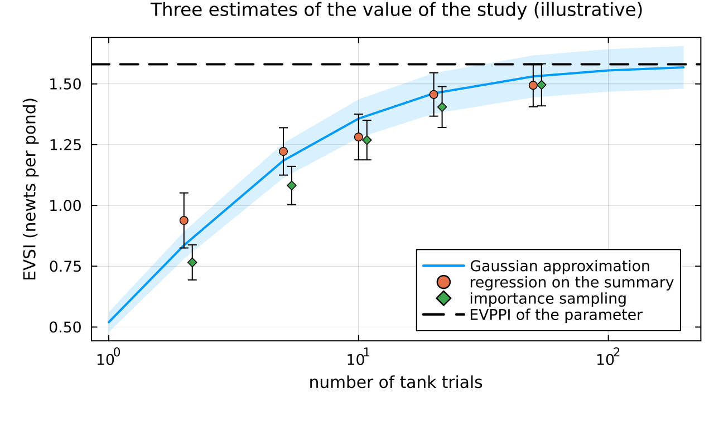

# EVSI from a sample: what a study is worth
Simon Frost

- [Motivation](#motivation)
- [The problem](#the-problem)
- [Regression on a summary
  statistic](#regression-on-a-summary-statistic)
- [Importance sampling](#importance-sampling)
- [The Gaussian approximation](#the-gaussian-approximation)
- [The three side by side](#the-three-side-by-side)
- [The net benefit of sampling, in
  newts](#the-net-benefit-of-sampling-in-newts)
- [A check against closed forms](#a-check-against-closed-forms)
- [What to take away](#what-to-take-away)
- [Next](#next)

## Motivation

The expected value of sample information (EVSI) is what the data of a
proposed study are worth before they are seen. [Experiments and the
value of sample
information](../04_experiments_and_evsi/04_experiments_and_evsi.md)
computed it exactly for a finite experiment, a likelihood matrix over a
few signals and states. With draws of continuous parameters and data
that can take any value, the EVSI has to be estimated.
`DecisionAnalysis.jl` has three estimators, chosen by how the study is
described:

| study description | method | needs |
|:---|:---|:---|
| `SummaryStatistics(table)` | regression of the payoffs on summaries of simulated data (Strong et al. 2015) | one simulated data set per draw, reduced to a few numbers |
| `ImportanceSampling(loglik)` | reweighting of the draws by the likelihood of simulated data (Menzies 2016) | a log-likelihood |
| `GaussianApproximation(focal; n0, n)` | shrinkage of the fitted conditional means (Jalal and Alarid-Escudero 2018) | the prior effective sample size |

All three return a `VOIEstimate`, with the standard error beside the
value.

**All numbers are illustrative.**

## The problem

The pond of newts of the two previous vignettes, with no intervention as
the baseline. [The EVPPI
vignette](../12_evppi_methods/12_evppi_methods.md) found that the
transmission rate is the parameter worth learning. Here is a study that
would inform it.

**The study.** Before the season, `n` tank trials are run. Each trial
houses a few newts with an infected one and yields one noisy measurement
of the log transmission rate, normally distributed around the true value
with standard deviation 1. The study’s data reduce to the mean of the
`n` measurements.

``` julia
using DecisionAnalysis
using Random: Xoshiro, randn
include(joinpath("..", "_common.jl"))
include(joinpath("..", "_toy_pond.jl"))

draws = toy_draws(Xoshiro(13), 600)
draws = merge(draws, (; log_contact=log.(draws.contact)))
belief = SampleBelief(draws)
table = outcomes(ToyPond(), TOY_ACTIONS, belief; replicates=10, seed=2026)
problem = DecisionProblem(table, IndividualsUtility(:alive); baseline=:none)
ceiling = evppi(problem, :log_contact)
voi_table(["EVPPI of the transmission rate (the ceiling for this study)" => ceiling])
```

| estimate | value | standard error | act-now bias | cell-noise bias |
|:---|---:|---:|---:|---:|
| EVPPI of the transmission rate (the ceiling for this study) | 1.581 | 0.089 | 0 | \- |

The model takes its parameters by name and ignores the extra
`log_contact` column, which is there for the study. No study of the
transmission rate can be worth more than learning it exactly.

## Regression on a summary statistic

For every draw, simulate the study once under that draw’s parameters and
keep its summary, here the mean of `n` measurements. Then ask what
learning the summary is worth. That is an EVPPI with the summary in
place of the parameter, so the same regression machinery applies.

``` julia
sigma = 1.0
rng = Xoshiro(2)
summary_of(n) = draws.log_contact .+ sigma / sqrt(n) .* randn(rng, length(belief))
by_regression = [n => evsi(problem, SummaryStatistics((; mean_measurement=summary_of(n))))
                 for n in (2, 5, 10, 20, 50)]
voi_table(["n = $n trials" => e for (n, e) in by_regression])
```

| estimate      | value | standard error | act-now bias | cell-noise bias |
|:--------------|------:|---------------:|-------------:|----------------:|
| n = 2 trials  | 0.938 |          0.113 |            0 |              \- |
| n = 5 trials  | 1.222 |          0.097 |            0 |              \- |
| n = 10 trials | 1.281 |          0.094 |            0 |              \- |
| n = 20 trials | 1.456 |          0.089 |            0 |              \- |
| n = 50 trials | 1.494 |          0.088 |            0 |              \- |

The summary must carry what the data say about the parameter, and there
must be few of them: the built-in regression suits up to about four.

## Importance sampling

When the data do not reduce to a few numbers, a log-likelihood is
enough. For each simulated data set the draws are reweighted by their
likelihood, which gives the posterior expected payoff of every action
with no refitting.

`importance_loglikelihoods` builds the matrix from two functions of the
model: one that simulates a data set from a draw, and one that gives the
log-likelihood of a data set under a draw.

``` julia
function importance_evsi(n)
    study = importance_loglikelihoods((rng, θ) -> θ.log_contact + sigma / sqrt(n) * randn(rng),
                                      (y, θ) -> -n * (y - θ.log_contact)^2 / (2 * sigma^2),
                                      belief; seed=3)
    return evsi(problem, study)
end
by_importance = [n => importance_evsi(n) for n in (2, 5, 10, 20, 50)]
md_table(["trials", "EVSI", "standard error", "from the data sets", "from the draws",
          "median effective sample size", "smallest"],
         [[n, Float64(e.value), e.standard_error, e.details.datasets_standard_error,
           e.details.draws_standard_error, e.details.median_ess, e.details.minimum_ess]
          for (n, e) in by_importance]; digits=3)
```

| trials | EVSI | standard error | from the data sets | from the draws | median effective sample size | smallest |
|:---|---:|---:|---:|---:|---:|---:|
| 2 | 0.766 | 0.072 | 0.048 | 0.054 | 455.462 | 26.687 |
| 5 | 1.082 | 0.079 | 0.057 | 0.054 | 351.902 | 9.557 |
| 10 | 1.269 | 0.081 | 0.061 | 0.054 | 272.467 | 4.816 |
| 20 | 1.405 | 0.084 | 0.062 | 0.057 | 203.228 | 1.735 |
| 50 | 1.496 | 0.087 | 0.063 | 0.06 | 135.554 | 1.032 |

The effective sample sizes are part of the estimate and are printed with
it:

``` julia
last(by_importance[3])
```

    VOIEstimate(evsi by ImportanceSampling: 1.26897 ± 0.0814613 (standard error); act-now bias 0.0; posterior effective sample size: median 272.467, smallest 4.81618 of 600 draws)

The effective sample size is the diagnostic to watch. The more
informative the data, the fewer draws carry the posterior weight. When
it falls to a handful, the “posterior mean” is the payoff at one or two
draws, noise and all, and the estimate drifts upwards towards the plain
EVPI. Here the median is comfortable throughout, while the smallest, for
data sets far in the tail, falls to one or two draws for the larger
studies.

The estimate has two sources of Monte Carlo error, and its standard
error combines them. One is the finite number of simulated data sets.
The other is the finite number of draws: each posterior mean is a
weighted average over the draws, and its error is carried through to the
estimate by the delta method. The two parts are in the table. Here there
is one data set per draw and the two parts are of similar size, so
leaving either out would understate the error by about a quarter. The
combined standard error is comparable with those of the other two
methods. It is a first-order calculation, so when the effective sample
size is small it understates the error and says nothing about the upward
drift.

## The Gaussian approximation

The third method needs no simulated data at all. The conditional means
given the focal parameter are fitted once, as for EVPPI, and shrunk
towards their mean by √(n / (n₀ + n)), which approximates how far a
study of size `n` can move them. `n₀` is the **prior effective sample
size**: the number of observations the prior is worth. For a normal
prior with variance τ² and observations with variance σ², n₀ = σ²/τ².

The prior on the log transmission rate is normal with standard deviation
0.7 (see `toy_draws`), so n₀ = 1 / 0.49.

``` julia
n0 = sigma^2 / 0.7^2
sizes = [1, 2, 5, 10, 20, 50, 100, 200]
curve = evsi(problem, GaussianApproximation(:log_contact; n0, n=sizes))
md_table(["trials", "EVSI", "standard error"],
         [[n, Float64(e.value), e.standard_error] for (n, e) in zip(sizes, curve)]; digits=3)
```

| trials |  EVSI | standard error |
|:-------|------:|---------------:|
| 1      |  0.52 |          0.041 |
| 2      | 0.836 |          0.056 |
| 5      | 1.184 |          0.071 |
| 10     | 1.357 |          0.079 |
| 20     | 1.461 |          0.083 |
| 50     | 1.531 |          0.086 |
| 100    | 1.555 |          0.087 |
| 200    | 1.568 |          0.088 |

One fit gives the whole curve. It rises from zero to the EVPPI of the
parameter.

## The three side by side

``` julia
plt = Plots.plot(; xlabel="number of tank trials", ylabel="EVSI (newts per pond)", xscale=:log10,
                 title="Three estimates of the value of the study (illustrative)",
                 legend=:bottomright)
Plots.plot!(plt, sizes, [Float64(e.value) for e in curve]; label="Gaussian approximation",
            ribbon=[e.standard_error for e in curve], fillalpha=0.15)
Plots.scatter!(plt, first.(by_regression), [Float64(e.value) for (_, e) in by_regression];
               yerror=[e.standard_error for (_, e) in by_regression],
               label="regression on the summary")
Plots.scatter!(plt, first.(by_importance) .* 1.08, [Float64(e.value) for (_, e) in by_importance];
               yerror=[e.standard_error for (_, e) in by_importance], label="importance sampling",
               markershape=:diamond)
Plots.hline!(plt, [Float64(ceiling.value)]; label="EVPPI of the parameter", linestyle=:dash,
             color=:black)
png_figure(plt)
```



The three agree to within about two standard errors. They are different
estimators, so they need not respect EVSI ≤ EVPPI to the last digit; the
definition does, and they do up to Monte Carlo error.

Which to use (after Kunst et al. 2020):

- a few sufficient summaries: **regression**;
- a likelihood but no small summary: **importance sampling**, watching
  the effective sample size;
- a curve over the sample size from one fit, for a study that measures a
  parameter more or less directly: the **Gaussian approximation**.

## The net benefit of sampling, in newts

A study is worth doing when its value exceeds its cost. There are no
monetary costs in this package. Here the cost is in the same currency as
the payoff: each tank trial uses three newts taken from the wild, which
are not returned.

`enbs` is defined **only for additive payoffs**: the cost must be in the
payoff’s units and must lower every payoff by the same amount whatever
is done and whatever is true. That holds here if the result serves
several ponds and the animals for the trials come from elsewhere in the
population. Suppose the result guides the decision at 25 ponds.

``` julia
ponds = 25
newts_per_trial = 3
net = [enbs(e; cost=newts_per_trial * n, population=ponds) for (n, e) in zip(sizes, curve)]
md_table(["trials", "EVSI × ponds", "cost (newts)", "net benefit (newts)", "standard error"],
         [[n, ponds * Float64(e.value), newts_per_trial * n, b.value, b.standard_error]
          for (n, e, b) in zip(sizes, curve, net)])
```

| trials | EVSI × ponds | cost (newts) | net benefit (newts) | standard error |
|:-------|-------------:|-------------:|--------------------:|---------------:|
| 1      |        12.99 |            3 |                9.99 |           1.03 |
| 2      |         20.9 |            6 |                14.9 |           1.41 |
| 5      |        29.61 |           15 |               14.61 |           1.79 |
| 10     |        33.93 |           30 |                3.93 |           1.97 |
| 20     |        36.53 |           60 |              -23.47 |           2.09 |
| 50     |        38.27 |          150 |             -111.73 |           2.16 |
| 100    |        38.88 |          300 |             -261.12 |           2.19 |
| 200    |         39.2 |          600 |              -560.8 |            2.2 |

``` julia
best = argmax([b.value for b in net])
(trials=sizes[best], net_benefit=net[best].value, standard_error=net[best].standard_error)
```

    (trials = 2, net_benefit = 14.902861355693503, standard_error = 1.405480939763762)

A small study pays for itself and a large one does not: the EVSI curve
flattens while the cost keeps rising. With a single pond no study is
worth its newts.

`optimal_design` makes the same comparison in one call, over a list of
candidate studies or, as here, the sample sizes of one study, with the
cost a function of the size:

``` julia
design = optimal_design(problem, GaussianApproximation(:log_contact; n0, n=sizes);
                        costs=n -> newts_per_trial * n, population=ponds)
(best=design.best, criterion=design.criterion)
```

    (best = Symbol("n = 2"), criterion = :net_benefit)

The best size is picked from estimates, so its net benefit is on average
a little flattering, and sizes whose net benefits differ by less than
their standard errors are not distinguished.

``` julia
[round(enbs(e; cost=newts_per_trial * n, population=1).value; digits=2)
 for (n, e) in zip(sizes, curve)]
```

    8-element Vector{Float64}:
       -2.48
       -5.16
      -13.82
      -28.64
      -58.54
     -148.47
     -298.44
     -598.43

## A check against closed forms

In the normal model used as a check in the previous vignette (payoffs 0
and p₁ − p₂, p₁ ~ N(1, 1), p₂ ~ N(0, 2²)), a study of `m` observations
of p₁ with standard deviation 1 has a closed-form EVSI: the preposterior
mean of p₁ is normal with variance m / (m + 1), which gives 0.0723251
for m = 10 and 0.0821176 for m = 100. The prior effective sample size is
1.

``` julia
rng = Xoshiro(20261123)
n = 40_000
p1, p2 = 1 .+ randn(rng, n), 2 .* randn(rng, n)
normal = DecisionProblem(PayoffTable(permutedims(hcat(zeros(n), p1 .- p2));
                                     actions=[:reference, :new]),
                         SampleBelief((; p1, p2)); baseline=:reference)
small = DecisionProblem(PayoffTable(normal.payoff.Q[:, 1:3000]; actions=[:reference, :new]),
                        SampleBelief((; p1=p1[1:3000], p2=p2[1:3000])); baseline=:reference)
rows = Pair{String,VOIEstimate}[]
for m in (10, 100)
    xbar = p1 .+ randn(rng, n) ./ sqrt(m)
    push!(rows, "m = $m, regression on the sample mean" => evsi(normal, SummaryStatistics((; xbar))))
    push!(rows, "m = $m, Gaussian approximation" =>
                evsi(normal, GaussianApproximation(:p1; n0=1, n=m)))
    study = importance_loglikelihoods((rng, θ) -> θ.p1 + randn(rng) / sqrt(m),
                                      (x, θ) -> -m * (x - θ.p1)^2 / 2, small.belief;
                                      datasets=800, seed=9)
    push!(rows, "m = $m, importance sampling (3,000 draws)" => evsi(small, study))
end
voi_table(rows; digits=4, truth=[0.0723251, 0.0723251, 0.0723251, 0.0821176, 0.0821176, 0.0821176])
```

| estimate | value | standard error | act-now bias | cell-noise bias | reference |
|:---|---:|---:|---:|---:|---:|
| m = 10, regression on the sample mean | 0.0801 | 0.0042 | 0 | \- | 0.0723 |
| m = 10, Gaussian approximation | 0.0778 | 0.0039 | 0 | \- | 0.0723 |
| m = 10, importance sampling (3,000 draws) | 0.0759 | 0.0137 | 0 | \- | 0.0723 |
| m = 100, regression on the sample mean | 0.088 | 0.0043 | 0 | \- | 0.0821 |
| m = 100, Gaussian approximation | 0.0879 | 0.0042 | 0 | \- | 0.0821 |
| m = 100, importance sampling (3,000 draws) | 0.0903 | 0.0169 | 0 | \- | 0.0821 |

## What to take away

- `evsi(problem, study)` estimates the value of a study from a sample.
  The study object fixes the method: `SummaryStatistics`,
  `ImportanceSampling` or `GaussianApproximation`.
- Regression on summaries is EVPPI with the summary in place of the
  parameter.
- Importance sampling needs only a log-likelihood. Its effective sample
  size is reported with the estimate: when it is small the estimate
  drifts towards the EVPI. Its standard error covers both the simulated
  data sets and the draws.
- `optimal_design` compares candidate studies or sample sizes by EVSI,
  or by net benefit in animals where payoffs are additive.
- The Gaussian approximation gives a curve over sample size from one fit
  and the prior effective sample size.
- No study of a parameter is worth more than its EVPPI.
- `enbs(estimate; cost, population)` is for additive payoffs only, with
  the cost in animals.

## Next

[Bd epizootic
response](../14_bd_epizootic_response/14_bd_epizootic_response.md) puts
all of this to work on a published model of chytridiomycosis in a frog
population.
