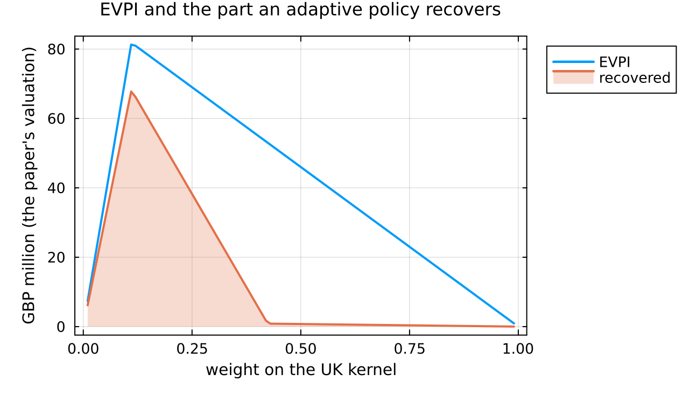

# Adaptive culling for foot-and-mouth disease (Shea et al. 2014)
Simon Frost

- [About this case study](#about-this-case-study)
- [The paper](#the-paper)
- [A misprint in Table 2](#a-misprint-in-table-2)
- [The published numbers](#the-published-numbers)
- [The two-stage adaptive policy](#the-two-stage-adaptive-policy)
- [What the package adds](#what-the-package-adds)
  - [Regret](#regret)
  - [A set of weights in place of
    one](#a-set-of-weights-in-place-of-one)
  - [How wrong may the monitoring be?](#how-wrong-may-the-monitoring-be)
- [What to take away](#what-to-take-away)
- [Next](#next)

## About this case study

This case study replicates a published analysis, as every case study
here does. Together they reproduce value-of-information analyses from
the ecological and epidemiological literature. They differ from the
tutorials in three ways.

- **The numbers are the papers’, not illustrations.** Every input is a
  table printed in the paper or its supplement, and every result is
  shown beside the published one. Where the two differ, the difference
  is explained or stated as unexplained.
- **The unit is the paper’s.** Here it is money, the authors’ valuation
  of livestock lost. It is not a valuation made by this package.
- **The same comparisons are in the test suite**, with the provenance of
  each number, in `test/fixtures/replications/` and
  `test/test_replications.jl`.

Each ends with something the package adds that the paper did not report.

## The paper

Shea, Tildesley, Runge, Fonnesbeck and Ferrari (2014), “Adaptive
management and the value of information: learning via intervention in
epidemiology”, *PLOS Biology* 12(10):e1001970,
[doi:10.1371/journal.pbio.1001970](https://doi.org/10.1371/journal.pbio.1001970),
published under CC0. The inputs are Table 2 of the article and Tables S1
and S2 of its supporting information.

**Decision.** Which culling policy to adopt for a foot-and-mouth disease
outbreak in a UK-like landscape of 188,496 farms.

**Actions.** Four nested policies: cull infected premises only (`IP`);
also dangerous contacts (`DC`); also contiguous premises (`CP`); or
infected premises, dangerous contacts and a 3 km ring (`RC`). The paper
has no action without culling. `IP` is the least intervention and is the
`baseline` here.

**States.** Three dispersal kernels of the Keeling et al. model: thin
(`K1`), the one estimated from the 2001 UK epidemic (`K2`), and fat
(`K3`).

**Belief.** Case 1 puts weights (1/4, 1/2, 1/4) on the kernels; case 2
weights them equally.

**Outcome.** The cost of livestock lost to disease and culling, in
millions of pounds at 2001 market prices, from the authors’ simulations:
**the paper’s published valuation**. Lower is better, so the payoff is
minus the cost. The paper does not print the numbers of animals behind
the costs.

``` julia
using DecisionAnalysis
include(joinpath("..", "_common.jl"))
using Plots

actions = [:IP, :DC, :CP, :RC]
kernels = [:K1_thin, :K2_UK, :K3_fat]
# Table 2 of the paper, as printed: rows = policies, columns = kernels, GBP million.
cost_printed = [  84.5 5129.3 284.1      # IP
                  55.1 1901.3 221.1      # DC
                  81.7 1162.2 221.1      # CP   <- the last entry is a misprint, see below
                 259.8 2537.7 381.7] .|> x -> rationalize(BigInt, x; tol=1e-9)   # RC
cases = ["case 1 (1/4, 1/2, 1/4)" => [1 // 4, 1 // 2, 1 // 4],
         "case 2 (equal weights)" => [1 // 3, 1 // 3, 1 // 3]]
labelled_table("cost, GBP million", actions, kernels, cost_printed; digits=1)
```

| cost, GBP million | `K1_thin` | `K2_UK` | `K3_fat` |
|:------------------|----------:|--------:|---------:|
| `IP`              |      84.5 |  5129.3 |    284.1 |
| `DC`              |      55.1 |  1901.3 |    221.1 |
| `CP`              |      81.7 |  1162.2 |    221.1 |
| `RC`              |     259.8 |  2537.7 |    381.7 |

## A misprint in Table 2

The weighted averages that Table 2 prints for `CP` are 696.0 (case 1)
and 540.7 (case 2). The printed row does not give them:

``` julia
md_table(["", "printed average for CP", "from the printed row"],
         [[name, shown, (cost_printed * w)[3]]
          for ((name, w), shown) in zip(cases, (696.0, 540.7))]; digits=1)
```

|                        | printed average for CP | from the printed row |
|:-----------------------|-----------------------:|---------------------:|
| case 1 (1/4, 1/2, 1/4) |                    696 |                656.8 |
| case 2 (equal weights) |                  540.7 |                488.3 |

The other three policies and the “Best” column do reproduce. The entry
for `CP` under `K3` repeats the `DC` entry of the same row (221.1); the
two printed averages require 378.1, and Table S1 of the supplement gives
378 for the fixed `CP` strategy under `K3`. With 378.0 everything in the
table is reproduced, so that is what is used.

``` julia
cost = copy(cost_printed)
cost[3, 3] = 378
problems = [name => DecisionProblem(PayoffTable(actions, kernels, -cost),
                                    FiniteBelief(kernels, w); baseline=:IP)
            for (name, w) in cases]
nothing
```

## The published numbers

``` julia
published = [(696.0, 650.1, 45.9, 6.6), (540.7, 479.5, 61.2, 11.3)]
rows = []
for ((name, p), pub) in zip(problems, published)
    v0 = -act_now_value(p)
    ours = (v0, v0 - evpi(p), evpi(p), 100 * evpi(p) / v0)
    for (what, o, q) in zip(("expected cost of the best fixed policy",
                             "expected cost with the kernel known", "EVPI",
                             "EVPI, % of the best fixed cost"), ours, pub)
        push!(rows, [name, what, q, o])
    end
end
md_table(["case", "quantity (GBP million)", "paper", "this package"], rows; digits=1)
```

| case | quantity (GBP million) | paper | this package |
|:---|---:|---:|---:|
| case 1 (1/4, 1/2, 1/4) | expected cost of the best fixed policy | 696 | 696 |
| case 1 (1/4, 1/2, 1/4) | expected cost with the kernel known | 650.1 | 650.2 |
| case 1 (1/4, 1/2, 1/4) | EVPI | 45.9 | 45.9 |
| case 1 (1/4, 1/2, 1/4) | EVPI, % of the best fixed cost | 6.6 | 6.6 |
| case 2 (equal weights) | expected cost of the best fixed policy | 540.7 | 540.6 |
| case 2 (equal weights) | expected cost with the kernel known | 479.5 | 479.5 |
| case 2 (equal weights) | EVPI | 61.2 | 61.2 |
| case 2 (equal weights) | EVPI, % of the best fixed cost | 11.3 | 11.3 |

`CP` is the best fixed policy in both cases, although `DC` is best under
two of the three kernels.

``` julia
p2 = last(problems[2])
md_table(["policy", "expected cost", "expected saving over IP only", "chosen"],
         [[a, -e, g, a in decide(p2, MaxExpectedUtility()).chosen]
          for (a, e, g) in zip(actions, aggregate(Expectation(), p2),
                               expected_gain_over_baseline(p2))]; digits=1)
```

| policy | expected cost | expected saving over IP only | chosen |
|:-------|--------------:|-----------------------------:|-------:|
| `IP`   |        1832.6 |                            0 |     \- |
| `DC`   |         725.8 |                       1106.8 |     \- |
| `CP`   |         540.6 |                         1292 |    yes |
| `RC`   |        1059.7 |                        772.9 |     \- |

The 540.6 against the paper’s 540.7 is rounding in the entry that the
table does not print correctly.

## The two-stage adaptive policy

The paper then allows the policy to change once, a month into the
outbreak, and assumes that by then monitoring has identified the kernel.
With four policies in each stage there are sixteen courses of action,
whose costs are Table S1 (whole numbers of millions).

``` julia
# Table S1: rows = kernels; columns = (stage 1, stage 2) with stage 1 slowest.
S1 = [  84   74   87  149   59   55   99  239   81   81   82  205  130  129  165  260
      5129 2238 1676 3395 4991 1901 1285 2779 4662 1823 1162 2074 4917 1875 1284 2538
       284  283  306  326  223  221  379  287  379  376  378  438  310  310  446  382]
courses = [Symbol(a, "_then_", b) for a in actions for b in actions]
first_stage = [a for a in actions for b in actions]
staged = [name => DecisionProblem(PayoffTable(courses, kernels, -permutedims(S1) .// 1),
                                  FiniteBelief(kernels, w); baseline=:IP_then_IP)
          for (name, w) in cases]
nothing
```

`two_stage_value` takes the problem over complete courses of action and
the first stage of each. It returns the value of choosing the first
stage on the prior and the second once the state is known.

``` julia
adaptive = [two_stage_value(p, first_stage) for (_, p) in staged]
# Table S2 of the paper: expected cost by first-stage policy.
tableS2 = [(927.1, 711.8, 695.3, 752.0), (677.5, 520.5, 539.6, 574.6)]
md_table(["case", "first stage", "paper (Table S2)", "this package", "chosen"],
         [[name, a, q, -v, a in r.chosen]
          for ((name, _), r, pub) in zip(staged, adaptive, tableS2)
          for (a, q, v) in zip(r.first_stages, pub, r.values)]; digits=1)
```

| case                   | first stage | paper (Table S2) | this package | chosen |
|:-----------------------|------------:|-----------------:|-------------:|-------:|
| case 1 (1/4, 1/2, 1/4) |        `IP` |            927.1 |        927.2 |     \- |
| case 1 (1/4, 1/2, 1/4) |        `DC` |            711.8 |        711.5 |     \- |
| case 1 (1/4, 1/2, 1/4) |        `CP` |            695.3 |        695.2 |    yes |
| case 1 (1/4, 1/2, 1/4) |        `RC` |              752 |        751.8 |     \- |
| case 2 (equal weights) |        `IP` |            677.5 |        677.7 |     \- |
| case 2 (equal weights) |        `DC` |            520.5 |        520.3 |    yes |
| case 2 (equal weights) |        `CP` |            539.6 |        539.7 |     \- |
| case 2 (equal weights) |        `RC` |            574.6 |        574.3 |     \- |

The differences of up to 0.5 are the rounding of Table S1 to whole
millions. Under equal weights the best first stage is `DC`, not the `CP`
of the best fixed policy: a milder cull is right when it can be
corrected.

``` julia
md_table(["case", "quantity", "paper", "this package"],
         [["case 1", "gain of the adaptive policy, GBP million", 0.78, adaptive[1].gain],
          ["case 1", "share of EVPI recovered, %", 1.7,
           100 * adaptive[1].gain / evpi(last(staged[1]))],
          ["case 2", "gain of the adaptive policy, GBP million", 20.1, adaptive[2].gain],
          ["case 2", "share of EVPI recovered, %", 32.85,
           100 * adaptive[2].gain / evpi(last(staged[2]))]]; digits=2)
```

| case   |                                 quantity | paper | this package |
|:-------|-----------------------------------------:|------:|-------------:|
| case 1 | gain of the adaptive policy, GBP million |  0.78 |         0.75 |
| case 1 |               share of EVPI recovered, % |   1.7 |         1.63 |
| case 2 | gain of the adaptive policy, GBP million |  20.1 |        20.33 |
| case 2 |               share of EVPI recovered, % | 32.85 |        33.15 |

`gain` is the adaptive value less the best fixed course, and it is at
most the EVPI: learning a month into the outbreak cannot beat learning
before it. Our figures are computed from the whole-number Table S1 and
the paper’s from unrounded costs, which is the whole of the difference:
from the one-decimal Table S2 the gains are 0.78 and 20.07 million
pounds.

The paper’s Figure 3D plots the EVPI and the part recovered against the
weight on the UK kernel, the rest split evenly, and reports more than
80% recovered below a weight of 0.13 and less than 2% above 0.41.

``` julia
weights = (1:99) .// 100
curve = map(weights) do u
    p = DecisionProblem(PayoffTable(courses, kernels, -permutedims(S1) .// 1),
                        FiniteBelief(kernels, [(1 - u) / 2, u, (1 - u) / 2]))
    r = two_stage_value(p, first_stage)
    return (evpi=evpi(p), gain=r.gain, first=only(r.chosen))
end
plt = plot(Float64.(weights), [Float64(c.evpi) for c in curve]; label="EVPI",
           xlabel="weight on the UK kernel", ylabel="GBP million (the paper's valuation)",
           title="EVPI and the part an adaptive policy recovers")
plot!(plt, Float64.(weights), [Float64(c.gain) for c in curve]; label="recovered",
      fillrange=0, fillalpha=0.25)
png_figure(plt)
```



``` julia
share = [c.gain / c.evpi for c in curve]
(above_80_percent_up_to=Float64(weights[findlast(>(4 // 5), share)]),
 below_2_percent_from=Float64(weights[findfirst(<(1 // 50), share)]),
 first_stage_changes_to_CP_at=Float64(weights[findfirst(c -> c.first == :CP, curve)]))
```

    (above_80_percent_up_to = 0.13, below_2_percent_from = 0.43, first_stage_changes_to_CP_at = 0.43)

The first threshold agrees with the paper. The second is 0.43 from the
whole-number Table S1 against the paper’s 0.41, which was computed from
unrounded costs.

## What the package adds

### Regret

The EVPI is the expected regret of the chosen policy. The regret table
shows where it comes from: `CP` costs 26.6 million more than `DC` under
the thin kernel and 156.9 million more under the fat one, and saves
739.1 million under the UK kernel.

``` julia
regret_table(p2)
```

**RegretTable{Rational{BigInt}}: regret, 4 actions × 3 states**

| action | `K1_thin` | `K2_UK` | `K3_fat` |
|:-------|----------:|--------:|---------:|
| `IP`   |      29.4 |  3967.1 |       63 |
| `DC`   |         0 |   739.1 |        0 |
| `CP`   |      26.6 |       0 |    156.9 |
| `RC`   |     204.7 |  1375.5 |    160.6 |

``` julia
md_table(["rule", "choice"],
         [["expected cost (equal weights)", decide(p2, MaxExpectedUtility()).chosen],
          ["minimax regret", decide(p2, MinimaxRegret()).chosen],
          ["maximin (least bad worst case)", decide(p2, Maximin()).chosen]])
```

| rule                           | choice |
|:-------------------------------|-------:|
| expected cost (equal weights)  |   `CP` |
| minimax regret                 |   `CP` |
| maximin (least bad worst case) |   `CP` |

All three rules choose `CP`. The recommendation of the paper does not
depend on being an expected-value decision maker.

### A set of weights in place of one

The paper analyses two weightings. A credal set holds every mixture of
stated ones; here, the two cases of the paper and a belief that the
outbreak is unlike 2001 (weight 1/10 on the UK kernel).

``` julia
credal = CredalSet(kernels, [[1 // 4, 1 // 2, 1 // 4], [1 // 3, 1 // 3, 1 // 3],
                             [9 // 20, 1 // 10, 9 // 20]])
robust = DecisionProblem(PayoffTable(actions, kernels, -cost), credal; baseline=:IP)
v = robust_evpi(robust)
md_table(["quantity", "GBP million"],
         [["lowest EVPI over the set", v.lower], ["highest EVPI over the set", v.upper],
          ["value of perfect information to a Γ-maximin decision maker", v.value]];
         digits=1)
```

| quantity                                                   | GBP million |
|:-----------------------------------------------------------|------------:|
| lowest EVPI over the set                                   |        45.9 |
| highest EVPI over the set                                  |        81.6 |
| value of perfect information to a Γ-maximin decision maker |        45.9 |

``` julia
md_table(["rule over the set of weights", "policies kept"],
         [["Γ-maximin", decide(robust, GammaMaximin()).chosen],
          ["E-admissible (best for some weights in the set)",
           decide(robust, EAdmissible()).chosen],
          ["maximal (not beaten for every weight)", decide(robust, Maximal()).chosen]])
```

| rule over the set of weights                    | policies kept |
|:------------------------------------------------|--------------:|
| Γ-maximin                                       |          `CP` |
| E-admissible (best for some weights in the set) |    `DC`, `CP` |
| maximal (not beaten for every weight)           |    `DC`, `CP` |

Once weights with little mass on the UK kernel are admitted, `DC` can no
longer be ruled out, and the EVPI nearly doubles from one end of the set
to the other.

### How wrong may the monitoring be?

The paper assumes that a month of monitoring identifies the kernel
exactly. The value of the adaptive policy when monitoring only partly
separates the kernels is the same call with a coarser partition. If
monitoring can tell the UK kernel from the other two but not the thin
from the fat:

``` julia
coarse = [:not_UK, :UK, :not_UK]
md_table(["case", "gain with the kernel identified", "gain when thin and fat are not told apart"],
         [[name, two_stage_value(p, first_stage).gain,
           two_stage_value(p, first_stage; partition=coarse).gain]
          for (name, p) in staged]; digits=2)
```

| case | gain with the kernel identified | gain when thin and fat are not told apart |
|:---|---:|---:|
| case 1 (1/4, 1/2, 1/4) | 0.75 | 0.75 |
| case 2 (equal weights) | 20.33 | 20.33 |

Nothing is lost: the second-stage policy is the same under the thin and
the fat kernel, so telling them apart is worth nothing. What the
surveillance has to establish within the month is only whether the
outbreak spreads like 2001.

## What to take away

- Table 2 of the paper misprints one entry (`CP` under `K3`: 221.1 for
  378). With it corrected, the best fixed costs, the EVPI (45.9 and 61.2
  million pounds) and its share of the cost (6.6% and 11.3%) are
  reproduced.
- `two_stage_value` reproduces the adaptive analysis: expected costs by
  first stage to the rounding of Table S1, the switch of the best first
  stage from `CP` to `DC` under equal weights, and about 20 million
  pounds, a third of the EVPI, recovered (paper: 20.1 and 32.85%; 20.3
  and 33.2% from the rounded Table S1).
- The measles case study of the same paper is not replicated: it has no
  printed table and needs the authors’ age-structured model.
- Added here: the choice is the same under minimax regret and maximin;
  over a set of weights `DC` cannot be excluded; and the adaptive gain
  needs monitoring only to separate the UK kernel from the others.

## Next

[Learning by doing for whooping
cranes](../17_ecology_runge_cranes/17_ecology_runge_cranes.md) replaces
the assumption that the state becomes known with an observation that has
measurement error.
