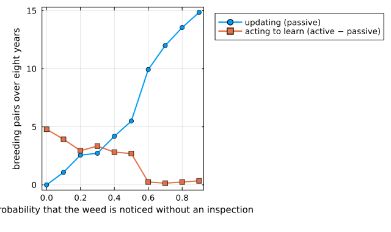
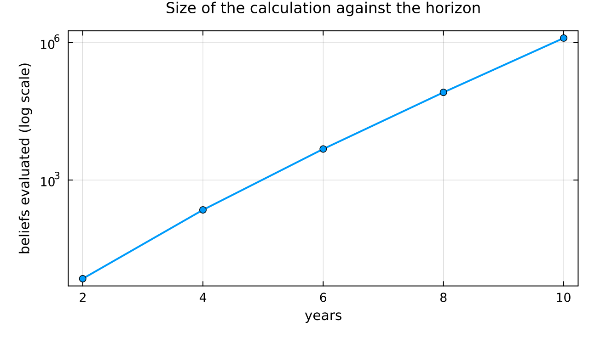

# Managing a state that changes
Simon Frost

- [The question](#the-question)
- [Eight years](#eight-years)
  - [The fixed plan is a schedule](#the-fixed-plan-is-a-schedule)
  - [Why the passive manager plans
    ahead](#why-the-passive-manager-plans-ahead)
  - [What the active manager adds](#what-the-active-manager-adds)
- [When inspection is worth it](#when-inspection-is-worth-it)
- [Which state the signal is about](#which-state-the-signal-is-about)
- [The size of the calculation](#the-size-of-the-calculation)
- [More than two states](#more-than-two-states)
- [What to take from this](#what-to-take-from-this)

## The question

A reserve may or may not hold an invasive weed. The weed cannot be seen
reliably without looking for it, it can arrive in any year, and once
there it stays until it is treated. Each year the manager can leave the
reserve alone, inspect it, or treat it. How much is it worth to watch
the reserve rather than treat it on a schedule, and is an inspection
worth what it costs?

In the [previous
vignette](../19_adaptive_management/19_adaptive_management.md) the
unknown was fixed: one of two explanations was true throughout. Here the
unknown **moves from year to year**, and the actions move it.
`adaptive_management` takes the movement as `transitions` and values the
same four ways of managing, two of which change their meaning:

- **no learning** is now the best *plan fixed in advance*: it allows for
  how the state is expected to move, so it can be a schedule, but it
  ignores what is seen;
- **passive adaptive management** remakes that plan every year from the
  current belief and takes its first action, but never acts in order to
  learn;
- **active adaptive management** is the best policy;
- **perfect information** is the state seen before every action, every
  year.

**The reserve and every number below are invented** to show the
calculation.

**Actions.** Each year: leave alone (`none`, the `baseline`), `inspect`,
or `treat`.

**States.** The reserve is `clear` or `infested` in a given year.

**Outcome.** Breeding pairs of a ground-nesting bird in the year: 50 in
a clear reserve and 20 in an infested one. An inspection disturbs the
birds and costs 2 pairs that year; a treatment costs 10. No money is
involved.

**Movement.** A clear reserve is invaded with probability 0.08 a year,
whatever is done. An infestation persists unless treated; a treatment
clears it with probability 0.85.

**Information.** The weed that is there in a year is noticed with
probability 0.2 if the reserve is left alone, and 0.9 by an inspection
or a treatment crew. It is never reported from a clear reserve.

``` julia
using DecisionAnalysis
include(joinpath("..", "_common.jl"))
using Plots

const ACTIONS = [:none, :inspect, :treat]
const STATES = [:clear, :infested]
const PAIRS = [50 20; 48 18; 40 10]              # rows are actions, columns are states
const INVASION, CLEARED = 0.08, 0.85

table = PayoffTable(ACTIONS, STATES, PAIRS)

# T[next, present]: each column sums to one.
untreated = [1-INVASION 0; INVASION 1]
treated = [1-INVASION CLEARED*(1 - INVASION); INVASION 1-CLEARED*(1 - INVASION)]
moves = (; none=untreated, inspect=untreated, treat=treated)

# The weed is seen with probability `d` if it is there.
noticed(d) = Experiment([1 1-d; 0 d]; signals=[:not_seen, :seen], states=STATES)
watching(casual) = (; none=noticed(casual), inspect=noticed(0.9), treat=noticed(0.9))
seen = watching(0.2)

reserve(prior) = DecisionProblem(table, [1 - prior, prior]; baseline=:none)
problem = reserve(0.1)
nothing
```

The transition matrices have the present state in the columns and the
next state in the rows, so each column sums to one, as the likelihood of
an `Experiment` does:

``` julia
md_table(["next state", "from clear, untreated", "from infested, untreated",
          "from clear, treated", "from infested, treated"],
         [Any[s, untreated[i, 1], untreated[i, 2], treated[i, 1], treated[i, 2]]
          for (i, s) in enumerate(STATES)]; digits=3)
```

| next state | from clear, untreated | from infested, untreated | from clear, treated | from infested, treated |
|:---|---:|---:|---:|---:|
| `clear` | 0.92 | 0 | 0.92 | 0.782 |
| `infested` | 0.08 | 1 | 0.08 | 0.218 |

A treatment that clears the weed leaves the reserve open to invasion in
the same year, which is why the treated column for an infested reserve
is 0.85 × 0.92.

## Eight years

The manager starts with a probability of 0.1 that the reserve is
infested.

``` julia
eight = adaptive_management(problem, seen; horizon=8, transitions=moves, depth=2)
md_table(["way of managing", "breeding pairs over eight years",
          "gain over leaving alone"],
         [["leave alone (baseline)", eight.baseline, 0.0],
          ["no learning (fixed plan)", eight.no_learning,
           eight.no_learning - eight.baseline],
          ["passive adaptive management", eight.passive, eight.passive - eight.baseline],
          ["active adaptive management", eight.active, eight.active - eight.baseline],
          ["perfect information", eight.perfect, eight.perfect - eight.baseline]];
         digits=1)
```

| way of managing | breeding pairs over eight years | gain over leaving alone |
|:---|---:|---:|
| leave alone (baseline) | 324.3 | 0 |
| no learning (fixed plan) | 340 | 15.7 |
| passive adaptive management | 342.6 | 18.3 |
| active adaptive management | 345.5 | 21.3 |
| perfect information | 370.9 | 46.6 |

The order of the four values, no learning ≤ passive ≤ active ≤ perfect
information, holds whatever the numbers, and is proved in the Lean
development (`Finite/AdaptiveDynamic.lean`).

### The fixed plan is a schedule

``` julia
md_table(["year", "action of the fixed plan"],
         [Any[t, a] for (t, a) in enumerate(eight.plan)])
```

| year | action of the fixed plan |
|:-----|-------------------------:|
| 1    |                   `none` |
| 2    |                   `none` |
| 3    |                  `treat` |
| 4    |                   `none` |
| 5    |                  `treat` |
| 6    |                   `none` |
| 7    |                   `none` |
| 8    |                   `none` |

Even a manager who never looks treats the reserve from time to time,
because the probability of infestation creeps up between treatments.
Most of the gain over leaving the reserve alone comes from this, before
anything is learned.

### Why the passive manager plans ahead

In any single year treating is the worse action whichever state holds:
it costs 10 pairs, and its benefit comes in later years. So a manager
who took the best action for the current year alone would never treat,
and would do exactly as badly as the baseline:

``` julia
one_year = [adaptive_management(reserve(q), seen; horizon=1, transitions=moves,
                                depth=0).act_now_action for q in 0:0.1:1]
```

    11-element Vector{Symbol}:
     :none
     :none
     :none
     :none
     :none
     :none
     :none
     :none
     :none
     :none
     :none

That is worse than the fixed plan, although such a manager updates on
what is seen and the fixed plan does not. For this reason the passive
manager of `adaptive_management` is not short-sighted: each year it
takes the first action of the plan that would be best if nothing more
were going to be learned, and remakes the plan after each observation.
Defined this way it is never worse than the fixed plan.

### What the active manager adds

``` julia
eight.act_now_action, eight.first_action
```

    (:none, :inspect)

The passive manager never inspects. An inspection changes nothing in the
reserve and costs 2 pairs, so no plan that ignores what will be learned
can include one. The active manager inspects at once, and what it does
next depends on the result:

``` julia
md_table(["seen in year 1", "probability", "belief that the reserve is infested, year 2",
          "action in year 2"],
         [Any[z, node.probability, node.belief[2], node.action]
          for (z, node) in eight.policy.branches]; digits=3)
```

| seen in year 1 | probability | belief that the reserve is infested, year 2 | action in year 2 |
|:---|---:|---:|---:|
| `not_seen` | 0.91 | 0.09 | `none` |
| `seen` | 0.09 | 1 | `treat` |

``` julia
md_table(["quantity (breeding pairs over eight years)", "value"],
         [["value of learning (active against the fixed plan)", eight.value_of_learning],
          ["   of which, from updating alone (passive against the fixed plan)",
           eight.passive - eight.no_learning],
          ["   of which, from acting in order to learn (active against passive)",
           eight.value_of_probing],
          ["value of seeing the state every year", eight.evpi]]; digits=1)
```

| quantity (breeding pairs over eight years)                       | value |
|:-----------------------------------------------------------------|------:|
| value of learning (active against the fixed plan)                |   5.5 |
| of which, from updating alone (passive against the fixed plan)   |   2.6 |
| of which, from acting in order to learn (active against passive) |   2.9 |
| value of seeing the state every year                             |  30.9 |

The value of acting in order to learn is here the value of being able to
inspect: it is what inspections are worth after their cost of 2 pairs
each has been paid.

## When inspection is worth it

Inspections matter because the weed is rarely noticed otherwise. If it
were noticed more often without looking, there would be less for an
inspection to add.

``` julia
casual = 0:0.1:0.9
sweep = [adaptive_management(problem, watching(d); horizon=8, transitions=moves,
                             depth=0) for d in casual]
plot(casual, [r.passive - r.no_learning for r in sweep]; label="updating (passive)",
     xlabel="probability that the weed is noticed without an inspection",
     ylabel="breeding pairs over eight years", marker=:circle)
plot!(casual, [r.value_of_probing for r in sweep];
      label="acting to learn (active − passive)", marker=:square)
```



``` julia
md_table(["probability noticed without inspection", "fixed plan", "passive", "active",
          "first action, active"],
         [Any[d, r.no_learning, r.passive, r.active, r.first_action]
          for (d, r) in zip(casual, sweep)]; digits=1)
```

| probability noticed without inspection | fixed plan | passive | active | first action, active |
|:---|---:|---:|---:|---:|
| 0 | 340 | 340 | 344.8 | `inspect` |
| 0.1 | 340 | 341.1 | 345.1 | `inspect` |
| 0.2 | 340 | 342.6 | 345.5 | `inspect` |
| 0.3 | 340 | 342.8 | 346.1 | `inspect` |
| 0.4 | 340 | 344.2 | 347 | `none` |
| 0.5 | 340 | 345.5 | 348.2 | `none` |
| 0.6 | 340 | 350 | 350.2 | `none` |
| 0.7 | 340 | 352 | 352.2 | `none` |
| 0.8 | 340 | 353.6 | 353.8 | `none` |
| 0.9 | 340 | 354.9 | 355.2 | `none` |

The fixed plan does not depend on what is seen, so its value is the same
in every row. As the weed becomes easier to notice without looking, the
passive manager gains, the gap between active and passive narrows
(broadly, not at every step), and from 0.4 the active manager no longer
opens with an inspection.

## Which state the signal is about

Above, the crew reports the weed that was in the reserve during the
year, and the state then moves: `signal_of=:current`, the default. With
`signal_of=:next` the signal is about the state after the move, as if
the reserve were looked at when the year’s work is done. That is the
usual convention of partially observed Markov decision processes.

``` julia
after = adaptive_management(problem, seen; horizon=8, transitions=moves, depth=0,
                            signal_of=:next)
md_table(["signal about", "no learning", "passive", "active", "perfect information"],
         [["the state during the year", eight.no_learning, eight.passive, eight.active,
           eight.perfect],
          ["the state after the move", after.no_learning, after.passive, after.active,
           after.perfect]]; digits=1)
```

| signal about              | no learning | passive | active | perfect information |
|:--------------------------|------------:|--------:|-------:|--------------------:|
| the state during the year |         340 |   342.6 |  345.5 |               370.9 |
| the state after the move  |         340 |   347.3 |  356.8 |               370.9 |

A report on the state after the move is fresher, and here learning is
worth more with it. The fixed plan and perfect information do not depend
on the experiments at all.

## The size of the calculation

``` julia
horizons = 2:2:10
counts = [adaptive_management(problem, seen; horizon=h, transitions=moves,
                              depth=0).beliefs_evaluated for h in horizons]
md_table(["years", "beliefs evaluated"], [[h, c] for (h, c) in zip(horizons, counts)])
```

| years | beliefs evaluated |
|:------|------------------:|
| 2     |                 7 |
| 4     |               223 |
| 6     |              4767 |
| 8     |             82309 |
| 10    |           1263869 |

``` julia
png_figure(plot(horizons, counts; yscale=:log10, marker=:circle, legend=false,
                xlabel="years", ylabel="beliefs evaluated (log scale)",
                title="Size of the calculation against the horizon"))
```



With a moving state the beliefs reached by different histories rarely
coincide, so their number grows with every year. This reserve, with two
signals and three actions, is practical to about twelve years in this
way. With two states there is a second exact method, `method=:vectors`,
which keeps the value function as a small set of lines and is not
limited like this:

``` julia
sixty = adaptive_management(problem, seen; horizon=60, transitions=moves, depth=0,
                            method=:vectors, passive=false)
md_table(["quantity, 60 years", "value"],
         [["breeding pairs, fixed plan", sixty.no_learning],
          ["breeding pairs, active adaptive management", sixty.active],
          ["breeding pairs, state seen every year", sixty.perfect],
          ["lines in the value function", size(sixty.value_function[60].vectors, 1)],
          ["treatments in the fixed plan", count(==(:treat), sixty.plan)]]; digits=1)
```

| quantity, 60 years                         |  value |
|:-------------------------------------------|-------:|
| breeding pairs, fixed plan                 |   2481 |
| breeding pairs, active adaptive management |   2534 |
| breeding pairs, state seen every year      | 2777.9 |
| lines in the value function                |     13 |
| treatments in the fixed plan               |     19 |

The [next
vignette](../28_ecology_chades_tiger/28_ecology_chades_tiger.md) uses it
to reproduce a published 30-year analysis.

## More than two states

`method=:vectors` needs two states. With more, `method=:points` gives
two numbers that the value of the best policy lies between: a lower
bound, which is the value of a policy that can be carried out, and an
upper bound. Both come from backing the value function up only at the
beliefs of a grid, and a finer grid brings them together.

Suppose the infestation can be `light` or `heavy`. **These numbers are
invented too.** A light infestation costs 12 pairs a year and a heavy
one 30; a light one becomes heavy with probability 0.3 a year; a
treatment clears a light infestation with probability 0.9 and usually
only reduces a heavy one; and a light infestation is much harder to
notice than a heavy one.

``` julia
const STAGES = [:clear, :light, :heavy]
stages = PayoffTable(ACTIONS, STAGES, [50 38 20; 48 36 18; 40 28 10])
spread = [0.92 0.0 0.0; 0.08 0.7 0.0; 0.0 0.3 1.0]               # untreated
cleared = [0.92 0.9*0.92 0.25; 0.08 1-0.9*0.92 0.6; 0.0 0.0 0.15]  # treated
stage_moves = (; none=spread, inspect=spread, treat=cleared)
found(light, heavy) = Experiment([1 1-light 1-heavy; 0 light heavy];
                                 signals=[:not_seen, :seen], states=STAGES)
stage_seen = (; none=found(0.1, 0.4), inspect=found(0.7, 0.95), treat=found(0.7, 0.95))
three = DecisionProblem(stages, [0.9, 0.08, 0.02]; baseline=:none)

# Eight years can still be done exactly, as a check.
checked = adaptive_management(three, stage_seen; horizon=8, transitions=stage_moves,
                            depth=0, passive=false)
md_table(["eight years", "lower bound", "upper bound", "points of the grid"],
         vcat([Any["exact (" * string(checked.beliefs_evaluated) * " beliefs)", checked.active,
                   checked.active, "-"]],
              [begin
                   r = adaptive_management(three, stage_seen; horizon=8,
                                           transitions=stage_moves, depth=0,
                                           method=:points, grid=g)
                   Any["grid of " * string(g), r.active, r.active_upper,
                       binomial(g + 2, 2)]
               end
               for g in (5, 10, 20)]); digits=2)
```

| eight years            | lower bound | upper bound | points of the grid |
|:-----------------------|------------:|------------:|-------------------:|
| exact (335923 beliefs) |      361.18 |      361.18 |                 \- |
| grid of 5              |      361.18 |      366.39 |                 21 |
| grid of 10             |      361.18 |      365.75 |                 66 |
| grid of 20             |      361.18 |      364.35 |                231 |

``` julia
md_table(["thirty years", "leave alone (baseline)", "lower bound", "upper bound", "gap",
          "state seen every year", "first action"],
         [begin
              r = adaptive_management(three, stage_seen; horizon=30,
                                      transitions=stage_moves, depth=0, method=:points,
                                      grid=g)
              Any["grid of " * string(g), r.baseline, r.active, r.active_upper,
                  r.active_upper - r.active, r.perfect, r.first_action]
          end
          for g in (5, 10, 20, 40)]; digits=1)
```

| thirty years | leave alone (baseline) | lower bound | upper bound | gap | state seen every year | first action |
|:---|---:|---:|---:|---:|---:|---:|
| grid of 5 | 962.6 | 1325.8 | 1354.4 | 28.5 | 1441.7 | `none` |
| grid of 10 | 962.6 | 1326.1 | 1350.8 | 24.7 | 1441.7 | `none` |
| grid of 20 | 962.6 | 1326.2 | 1343.8 | 17.6 | 1441.7 | `none` |
| grid of 40 | 962.6 | 1326.2 | 1336.8 | 10.6 | 1441.7 | `none` |

The lower bound is the one to act on: it is what the policy returned is
worth at least. The upper bound says how much a better policy could
still add. Here the lower bound hardly moves with the grid and is
already exact at eight years, while the upper bound closes slowly. The
baseline and the value of seeing the state every year are exact with
this method. The fixed plan and the passive manager are not computed
here, because the actions move the state differently.

## What to take from this

- When the state moves, “no learning” is a schedule, and a good schedule
  can capture most of the gain over doing nothing. `adaptive_management`
  reports the schedule as `plan`.
- A passive manager must plan ahead. One who takes the best action for
  the current year can do worse than the schedule, and with these
  numbers does no better than doing nothing.
- An action that only gathers information, such as an inspection, is
  never taken by the passive manager. Its worth, net of what it costs,
  is the difference between the active and the passive values.
- `perfect` is the state seen every year, which is more than knowing it
  at the start.
- Every value is a total of breeding pairs, and the baseline of leaving
  the reserve alone is reported beside them.
