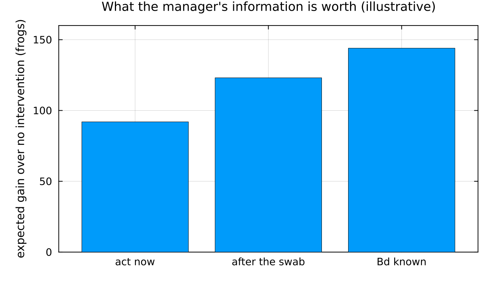

# From influence diagrams and Bayesian networks to a decision table
Simon Frost

- [Motivation](#motivation)
- [A published example: the umbrella](#a-published-example-the-umbrella)
- [What the table adds](#what-the-table-adds)
- [A diagram of our own: the pond](#a-diagram-of-our-own-the-pond)
- [Which variables make the state](#which-variables-make-the-state)
- [From Bayesian networks](#from-bayesian-networks)
  - [Several networks for one system](#several-networks-for-one-system)
- [What to take away](#what-to-take-away)

## Motivation

The earlier tutorials start from a payoff table. Many decision problems
are first drawn as an **influence diagram**: chance variables, one
decision, what the decision sees when it is taken, and a utility. The
diagram and the table are two descriptions of the same problem, and
`normal_form` turns the first into the second:

- the **actions** are the options of the decision;
- the **state** is the chance variable the payoff depends on, with its
  probabilities as the belief;
- the **payoff** `Q[a, θ]` is the expected utility of action `a` in
  state `θ`;
- what the decision observes becomes an **experiment**,
  `L[z, θ] = P(z | θ)`.

Once the problem is a table, everything in this package applies to it:
the other decision rules, regret, the value of each possible result,
sets of priors.

The diagrams are built and solved by
[InfluenceDiagrams.jl](https://github.com/ecorecipes/InfluenceDiagrams.jl),
which is not a dependency of this package. `normal_form` is available
once it is loaded. It handles diagrams with **one decision**, by
enumerating the joint distribution, so it is for small diagrams, and its
numbers are floating point.

## A published example: the umbrella

InfluenceDiagrams.jl ships the umbrella problem with the numbers of
Shachter (1986). The weather is sunny with probability 0.7 and rainy
otherwise, a forecast is seen before deciding whether to take an
umbrella, and the utilities are the source’s own (no unit is attached to
them). Leaving the umbrella is the `baseline`: it is what happens if
nothing is done.

``` julia
using DecisionAnalysis
using InfluenceDiagrams: InfluenceDiagrams
const ID = InfluenceDiagrams
include(joinpath("..", "_common.jl"))

umbrella = ID.umbrella_model()
form = normal_form(umbrella; states=:Weather, baseline=:leave)
form.problem.payoff
```

**PayoffTable{Float64}: 2 actions × 2 states**

| action  | `sunny` | `rainy` |
|:--------|--------:|--------:|
| `take`  |    20.0 |    70.0 |
| `leave` |   100.0 |     0.0 |

``` julia
(decision=form.decision, state=form.states, observed=form.observed,
 belief=round.(probabilities(form.problem.belief); digits=3))
```

    (decision = :Umbrella, state = [:Weather], observed = [:Forecast], belief = [0.7, 0.3])

The forecast is the experiment. Each column is a state, each row a
forecast:

``` julia
labelled_table("forecast", signal_labels(form.experiment), state_labels(form.problem),
               form.experiment.likelihood)
```

| forecast | `sunny` | `rainy` |
|:---------|--------:|--------:|
| `sunny`  |     0.7 |    0.15 |
| `cloudy` |     0.2 |    0.25 |
| `rainy`  |     0.1 |     0.6 |

The two packages share no code, so their answers check each other. The
diagram’s own solver gives the best expected utility with and without
the forecast, and its structural values of information; the table gives
the same numbers as `evsi` and `evpi`.

``` julia
blind = ID.without_information(umbrella, :Umbrella, :Forecast)
md_table(["quantity", "from the diagram", "from the table"],
         [["expected utility with no forecast", ID.optimize(blind).expected_utility,
           act_now_value(form.problem)],
          ["expected utility with the forecast", ID.optimize(umbrella).expected_utility,
           value_with_information(form.problem, form.experiment)],
          ["value of the forecast", ID.expected_value_of_information(blind, :Forecast, :Umbrella),
           evsi(form.problem, form.experiment)],
          ["value of knowing the weather",
           ID.expected_value_of_perfect_information(blind, :Umbrella; variables=[:Weather]),
           evpi(form.problem)]]; digits=4)
```

| quantity                           | from the diagram | from the table |
|:-----------------------------------|-----------------:|---------------:|
| expected utility with no forecast  |               70 |             70 |
| expected utility with the forecast |               77 |             77 |
| value of the forecast              |                7 |              7 |
| value of knowing the weather       |               21 |             21 |

These are the published values: 70 without the forecast, 77 with it, and
91 with the weather known, so the forecast is worth 7 and perfect
information 21.

The best policy is also the same. The diagram’s solver returns an action
for each forecast; `voi_profile` returns the best action after each
result, with what that result is worth.

``` julia
policy = ID.policy_table(ID.policies(ID.optimize(umbrella).strategy)[:Umbrella])
profile = voi_profile(form.problem, form.experiment)
md_table(["forecast", "probability", "diagram's policy", "best action from the table",
          "value of this forecast"],
         [[o.signal, o.probability, a, o.best, o.value]
          for (o, a) in zip(profile.outcomes, policy)]; digits=3)
```

| forecast | probability | diagram’s policy | best action from the table | value of this forecast |
|:---|---:|---:|---:|---:|
| `sunny` | 0.535 | `leave` | `leave` | 0 |
| `cloudy` | 0.215 | `leave` | `leave` | 0 |
| `rainy` | 0.25 | `take` | `take` | 28 |

Only a forecast of rain changes what is done, and the whole value of the
forecast comes from it.

## What the table adds

The diagram’s solver maximises expected utility. With the table, the
same problem can be read under other rules and from the side of regret.

``` julia
md_table(["rule", "chosen"],
         [[name, decide(form.problem, rule).chosen]
          for (name, rule) in ["expected utility" => MaxExpectedUtility(),
                               "maximin" => Maximin(), "minimax regret" => MinimaxRegret()]])
```

| rule             |  chosen |
|:-----------------|--------:|
| expected utility | `leave` |
| maximin          |  `take` |
| minimax regret   | `leave` |

``` julia
regret_table(form.problem)
```

**RegretTable{Float64}: regret, 2 actions × 2 states**

| action  | `sunny` | `rainy` |
|:--------|--------:|--------:|
| `take`  |    80.0 |     0.0 |
| `leave` |     0.0 |    70.0 |

The weather’s probability can be put in doubt too. Suppose the chance of
rain is only known to lie between 0.2 and 0.5 (**illustrative**). The
table goes with a credal set, and the value of perfect information
becomes a range.

``` julia
doubtful = DecisionProblem(form.problem.payoff,
                           CredalSet(state_labels(form.problem), [[0.8, 0.2], [0.5, 0.5]]);
                           baseline=:leave)
robust_evpi(doubtful)
```

    RobustVOI(evpi under GammaMaximin: 35.0; envelope [14.0, 35.0], upper end at the prior [0.5, 0.5])

## A diagram of our own: the pond

The pond of [Experiments and
EVSI](../04_experiments_and_evsi/04_experiments_and_evsi.md) as a
diagram: Bd is absent, at low prevalence or at high prevalence; a swab
is negative or positive; the manager sees the swab and then does
nothing, treats the frogs or disinfects the pond; the utility is
uninfected minus infected frogs. **All numbers are illustrative**, and
they are the ones of that tutorial.

``` julia
states = [:absent, :low_prevalence, :high_prevalence]
actions = [:no_intervention, :antifungal_baths, :disinfect_pond]
diagram = ID.influence_diagram(:Bd => states, :Swab => [:negative, :positive],
                               :Response => actions;
                               mechanisms=[:Swab => :Bd], decisions=[:Response => :Swab],
                               utilities=[:Frogs => (:Bd, :Response)])
uninfected = [500 300 100; 470 380 250; 350 340 320]     # action by state
infected = [0 150 250; 0 60 120; 0 10 20]
pond = ID.InfluenceDiagramModel(diagram)
pond = ID.bind_cpt(pond, [:Bd => [0.5, 0.3, 0.2],
                          :Swab => [0.95 0.05; 0.4 0.6; 0.05 0.95]])     # state by result
pond = ID.bind_utility(pond, :Frogs => Float64.(permutedims(uninfected .- infected)))
pond_form = normal_form(pond; states=:Bd, baseline=:no_intervention)
pond_form.problem.payoff
```

**PayoffTable{Float64}: 3 actions × 3 states**

| action             | `absent` | `low_prevalence` | `high_prevalence` |
|:-------------------|---------:|-----------------:|------------------:|
| `no_intervention`  |    500.0 |            150.0 |            -150.0 |
| `antifungal_baths` |    470.0 |            320.0 |             130.0 |
| `disinfect_pond`   |    350.0 |            330.0 |             300.0 |

The table is the one the earlier tutorial wrote down directly, and the
values agree with it and with the diagram’s solver:

``` julia
md_table(["quantity", "value"],
         [["payoff table equals uninfected − infected", pond_form.problem.payoff.Q == uninfected .- infected],
          ["best action with no swab", decide(pond_form.problem, MaxExpectedUtility()).chosen],
          ["its gain over no intervention (frogs)", maximum(expected_gain_over_baseline(pond_form.problem))],
          ["EVSI of the swab, from the table", evsi(pond_form.problem, pond_form.experiment)],
          ["the same, from the diagram",
           ID.expected_value_of_information(ID.without_information(pond, :Response, :Swab),
                                            :Swab, :Response)],
          ["EVPI", evpi(pond_form.problem)]]; digits=4)
```

| quantity                                  |              value |
|:------------------------------------------|-------------------:|
| payoff table equals uninfected − infected |                yes |
| best action with no swab                  | `antifungal_baths` |
| its gain over no intervention (frogs)     |                 92 |
| EVSI of the swab, from the table          |               31.1 |
| the same, from the diagram                |               31.1 |
| EVPI                                      |                 52 |

``` julia
values = [act_now_value(pond_form.problem),
          value_with_information(pond_form.problem, pond_form.experiment),
          act_now_value(pond_form.problem) + evpi(pond_form.problem)]
baseline_value = values[1] - maximum(expected_gain_over_baseline(pond_form.problem))
plt = Plots.bar(["act now", "after the swab", "Bd known"], values .- baseline_value;
                legend=false, linewidth=0.5, ylims=(0, 160),
                ylabel="expected gain over no intervention (frogs)",
                title="What the manager's information is worth (illustrative)")
png_figure(plt)
```



## Which variables make the state

`states` names the chance variables that form the state. It must hold
everything the utility depends on. By default it is every chance
variable that could be observed before the decision, which here includes
the swab: the swab is then part of the state, nothing is left to
observe, and learning the swab alone is a partial value.

``` julia
full = normal_form(pond; baseline=:no_intervention)
swab_of_each_state = repeat([:negative, :positive]; inner=length(states))
(states=full.states, experiment=full.experiment, joint_states=state_labels(full.problem))
```

    (states = [:Bd, :Swab], experiment = nothing, joint_states = [:absent_negative, :low_prevalence_negative, :high_prevalence_negative, :absent_positive, :low_prevalence_positive, :high_prevalence_positive])

``` julia
(evpi_of_the_joint_state=evpi(full.problem),
 evppi_of_the_swab=evppi(full.problem, swab_of_each_state),
 evsi_of_the_swab=evsi(pond_form.problem, pond_form.experiment))
```

    (evpi_of_the_joint_state = 52.0, evppi_of_the_swab = 31.100000000000023, evsi_of_the_swab = 31.099999999999966)

The value of the swab is the same either way: an EVSI when the swab is
an experiment on the state, an EVPPI when it is one coordinate of a
larger state.

## From Bayesian networks

Once its decision is made, an influence diagram is an ordinary Bayesian
network. So a decision problem is also a **set of networks, one for each
action**, and that is how networks are usually built in ecology: one
network with a management node, or one network per management scenario.
`normal_form` takes them directly, with no diagram in between. A network
has no utility, so the payoff is named: a count read from its nodes.

``` julia
using BayesianNetworks: BayesianNetworks
const BN = BayesianNetworks

network = BN.bayesnet(:Bd => states, :Swab => [:negative, :positive],
                      :Visual => [:no_signs, :signs], :Response => actions;
                      mechanisms=[:Swab => (:Bd,), :Visual => (:Bd,)])
network = BN.bind_cpt(BN.BayesModel(network),
                      [:Bd => [0.5, 0.3, 0.2], :Swab => [0.95 0.05; 0.4 0.6; 0.05 0.95],
                       :Visual => [0.55 0.45; 0.5 0.5; 0.45 0.55],
                       :Response => [1 / 3, 1 / 3, 1 / 3]])
frogs = Float64.(permutedims(uninfected .- infected))          # Bd by response
from_network = normal_form(network; decision=:Response, states=:Bd,
                           observed=(:Swab, :Visual),
                           outcome=(:Bd, :Response) => frogs, baseline=:no_intervention)
from_network.problem.payoff.Q ≈ pond_form.problem.payoff.Q
```

    true

The management node’s own probabilities play no part: each action’s
network is the intervention that sets the node to that action. The pond
now has a second test, a visual check for signs of disease, with the
likelihood of [Comparing
experiments](../06_comparing_experiments/06_comparing_experiments.md).

**Which node is worth monitoring?** Every observed variable comes back
as an experiment of its own, so the question is one table.

``` julia
md_table(["observe", "EVSI (frogs)", "share of EVPI"],
         vcat([[String(x), evsi(from_network.problem, e),
                evsi(from_network.problem, e) / evpi(from_network.problem)]
               for (x, e) in pairs(from_network.experiments)],
              [["both", evsi(from_network.problem, from_network.experiment),
                evsi(from_network.problem, from_network.experiment) /
                evpi(from_network.problem)]]); digits=3)
```

| observe | EVSI (frogs) | share of EVPI |
|:--------|-------------:|--------------:|
| Swab    |         31.1 |         0.598 |
| Visual  |            0 |             0 |
| both    |         31.1 |         0.598 |

A state, and anything observed before the decision, must not depend on
the action. The bridge checks that across the networks and refuses
otherwise. In the reference habitat network that BayesianNetworks.jl
ships, soil moisture is downstream of irrigation, so it cannot be
observed before deciding how much to irrigate:

``` julia
habitat = BN.reference_habitat_model()
occupied = :Occupancy => (absent=0, present=100)        # occupied sites of 100
try
    normal_form(habitat; decision=:Irrigation, states=:Climate, observed=:SoilMoisture,
                outcome=occupied)
catch err
    print(sprint(showerror, err))
end
```

    ArgumentError: the distribution of [:Climate, :SoilMoisture] under high differs from that under low: a state, or something observed before the decision, cannot depend on the action

### Several networks for one system

The networks can also stand for **hypotheses**: rival structures, or the
networks of several experts. The states are then the hypotheses, and the
payoff is each action’s expected outcome under each. Here the published
network is set beside one in which habitat quality matters much less to
occupancy, and irrigating is charged three occupied sites lost
downstream (both **illustrative**). Less irrigation is the baseline.

``` julia
doubtful = BN.bind_cpt(habitat, :Occupancy => [0.6 0.4; 0.5 0.5])
by_action(model) = (; low=BN.do_intervention(model, :Irrigation => :low),
                    high=BN.do_intervention(model, :Irrigation => :high))
count = [occupied, :Irrigation => (low=0, high=-3)]
rivals = normal_form((; published=by_action(habitat), doubtful=by_action(doubtful));
                     outcome=count, baseline=:low)
rivals.problem.payoff
```

**PayoffTable{Float64}: 2 actions × 2 states**

| action | `published` | `doubtful` |
|:-------|------------:|-----------:|
| `low`  |     45.7933 |    44.6897 |
| `high` |     47.3703 |    42.5219 |

The two networks disagree: more irrigation is better under the published
one and worse under the other. With no probabilities on the hypotheses
the belief is a scenario set, and the rules that need none apply. With
weights there is an expectation, and a value of finding out which
network is right.

``` julia
weighted = normal_form((; published=by_action(habitat), doubtful=by_action(doubtful));
                       outcome=count, prior=[3 // 4, 1 // 4], baseline=:low)
md_table(["quantity", "value"],
         [["maximin, no weights", decide(rivals.problem, Maximin()).chosen],
          ["minimax regret, no weights", decide(rivals.problem, MinimaxRegret()).chosen],
          ["best expected, weights 3/4 and 1/4",
           decide(weighted.problem, MaxExpectedUtility()).chosen],
          ["its gain over low irrigation (sites of 100)",
           maximum(expected_gain_over_baseline(weighted.problem))],
          ["value of knowing which network is right (sites of 100)",
           evpi(weighted.problem)]]; digits=3)
```

| quantity                                               |  value |
|:-------------------------------------------------------|-------:|
| maximin, no weights                                    |  `low` |
| minimax regret, no weights                             |  `low` |
| best expected, weights 3/4 and 1/4                     | `high` |
| its gain over low irrigation (sites of 100)            |  0.641 |
| value of knowing which network is right (sites of 100) |  0.542 |

## What to take away

- `normal_form(model; states, baseline)` turns a single-decision
  influence diagram into a `DecisionProblem` and the decision’s
  information into an `Experiment`. It needs InfluenceDiagrams.jl
  loaded.
- The diagram’s structural values of information are `evsi` and `evpi`
  on the table, and the two packages, which share no code, agree on the
  published umbrella problem.
- The table opens the diagram to what the diagram’s solver does not do:
  other decision rules, regret, the value of each result, sets of
  priors.
- The state must carry everything the utility depends on. A variable can
  be an experiment on the state or part of it; its value is the same.
- A set of Bayesian networks, one for each action, is a decision problem
  too: `normal_form(network; decision, states, outcome, observed)` reads
  it off one network with a management node, and gives an experiment for
  every observed variable. Networks for rival hypotheses give a table
  whose states are the hypotheses.
- One decision only, small diagrams only, and floating-point numbers.
  Sequential problems are for `adaptive_management` ([Learning while
  managing](../19_adaptive_management/19_adaptive_management.md)).
